# 02a: Walkthrough of the v2 review loop, start to finish

Research item for review-ui-v3. It answers Eric's request in `01-questions.md` ("A Claude Code loop already
exists, as files"): run the existing v2 tool locally, review a few values, leave annotations, export the
feedback, play Claude Code with it, publish a new ruleset, and review again. Screenshots are in
[`walkthrough/`](walkthrough/). The friction points at the end feed the v3 design.

Run on 2026-10-26, against a **local copy** of the data. Nothing in Azure was read by the app or written.

## The setup

| What | Where / how |
|---|---|
| App | a copy of `review-ui-v2/` in a scratch folder. `uv venv --python 3.13 .venv && uv pip install -e ".[dev]"` took **3.3 s**. `npm install && npm run build` took **3.5 s** |
| Data | `review-ui-index/` and `ccsf-curricunet-com-catalog/2026-10-01T16-02-34Z/` copied from the read-only mirror in `~/review-ui-v3-data/xtra-cli-output/` into a local root (521 pages, 2 earlier extractions, Jared's reviews) |
| Env | `REVIEW_UI_ROOT=<scratch>/root`, `REVIEW_UI_GOLDEN_ROOT=<scratch>/root/zz-golden-local`, `REVIEW_UI_CACHE=0`, no Azure credentials in the environment |
| Browser | headless Chromium through Playwright (Python), viewport 1600×1000 |

What was already in the root: Jared's real CCSF review `2026-10-19T17-58-24Z` on extraction
`2026-10-19T17-18-22Z` (ruleset v2), with 655 accepted values, 8 rejected labels, 23 "missed" Prerequisites, and 7
flagged program pages.

---

## Round 1: review

### Step 1: Start the server

```sh
review-ui-v2 serve --run ccsf --new-review --port 8011
```

`/healthz` answered after **2.3 s**. `--new-review` does not start from zero. It **carried over Jared's 655
accepted values and his 7 page flags** into a new review `2026-10-26T20-11-21Z`. It did **not** carry over his 8
rejections, his 23 "missed" items, or any notes, so those disappear from the review in the UI.

### Step 2: Pick the catalog

`--run` skips the landing page, so I clicked **⇄ Change ruleset** to see it. There is one card per crawl run with
a ruleset: the crawl, ruleset v2 (17 rules), the extraction, and the progress (655 of 965 accepted, 7 pages
flagged). **Continue review** opens it.

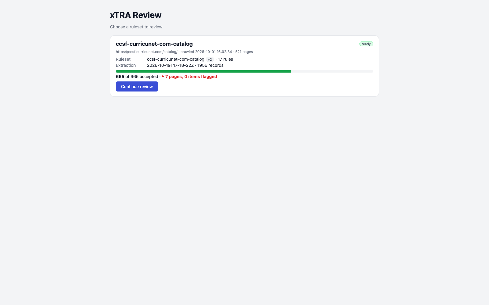

First load is fast locally. The first card renders in about **0.15 s** after navigation, and network-idle comes
at about **0.8 s**. The `/state` call returns **494 KB** of JSON. It took **1.2 s** the first time after a new
extraction, because the server creates the review then.

### Step 3: The review screen, and one pending value

The review opens on the first page that still has undecided values: *SMBU - Small Business*, 7 of 30. On the
left is the sampled page list (green = done, red edge = flagged). In the middle are the extracted values, grouped
by record. On the right is the page itself, with the matched element outlined. Almost every card already says
"accepted · Jared · carried over".

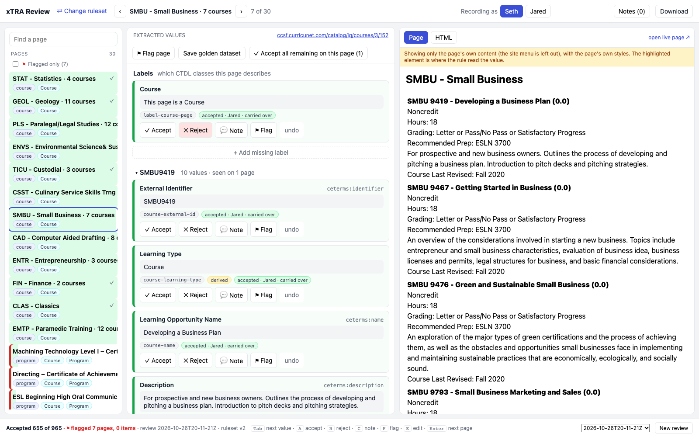

I pressed `Tab` until the one pending card, **Coded Notation = SMBU 9467**, was focused. The page pane outlines
the title row it came from.

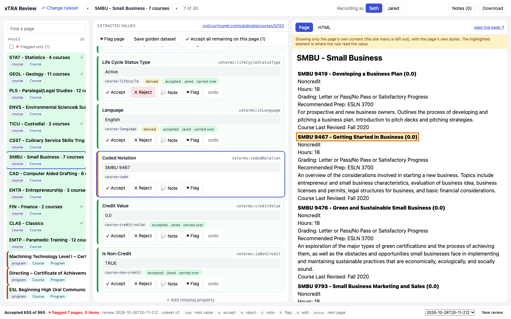

`A` accepts it:

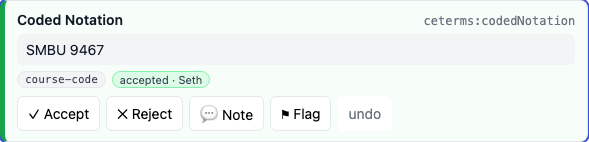

### Step 4: Find a real bug

I clicked *ESL Beginning High Oral Communication Skills – Certificate of Competency* in the page list. It is a
program page, so each requirement row becomes a stub course record. Two things stand out:

* The record header shows a yellow conflict: **"Credit Value differs between pages: 0.0 (1) 87.5 (1)"**.
* The page pane shows that the right-hand column is headed **HOURS**, not units.

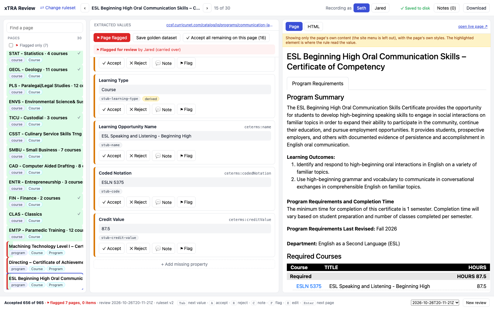

So `stub-credit-value` is reading contact hours (87.5) as a credit value on noncredit programs.

### Step 5: Tab through values and accept the good ones

On record ESLN5184, I pressed `A` then `Tab` for External Identifier, Learning Type, Name, and Coded Notation.
`A` alone does not move focus: my first attempt pressed `A` four times and accepted the same card four times.

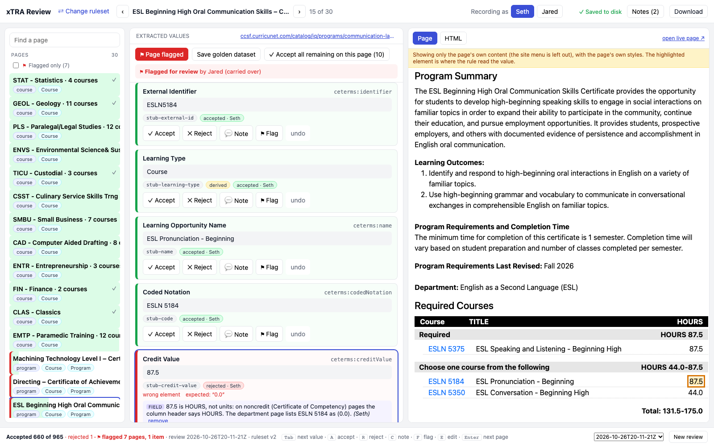

### Step 6: Reject with a reason, an expected value, and a note

With the **Credit Value = 87.5** card focused, I pressed `R`. I chose the reason chip *wrong element*, entered the
expected value `0.0` (the department page lists ESLN 5184 as `(0.0)`), and wrote a note on why.

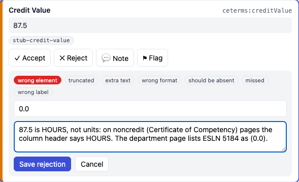

**Save rejection** turns the card red and shows the reason, the expected value, and the note:

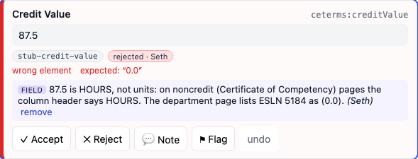

### Step 7: Add a rule note

On the same card I pressed `C` and chose **"The rule that found it (all pages)"**, then wrote what is wrong with
`stub-credit-value` in general.

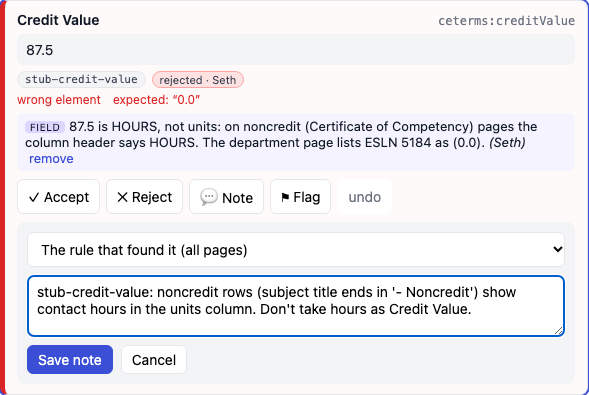

### Step 8: Flag something for an expert

On ESLN5350 **Learning Opportunity Name = "ESL Conversation - Beginning High"** I pressed `F` and asked whether
"Beginning High" is part of the official name. A flag is separate from accept/reject, and the value stays pending.

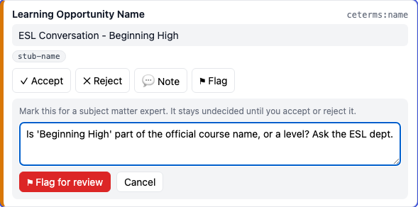
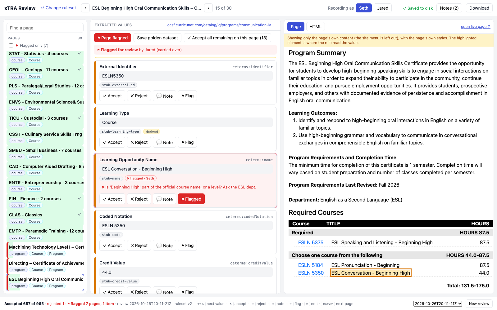

### Step 9: Look at the notes

**Notes (2)** in the top bar opens a drawer titled "Notes for Claude": general notes, then every flag, then the
scoped notes. Flags are listed by page *stem* (`ccsf-curricunet-com-catalog-iq-programs-tools-trades-2104-2847-cd1703d7b9`),
not by title, and Jared's carried-over page flags all say "(no note)".

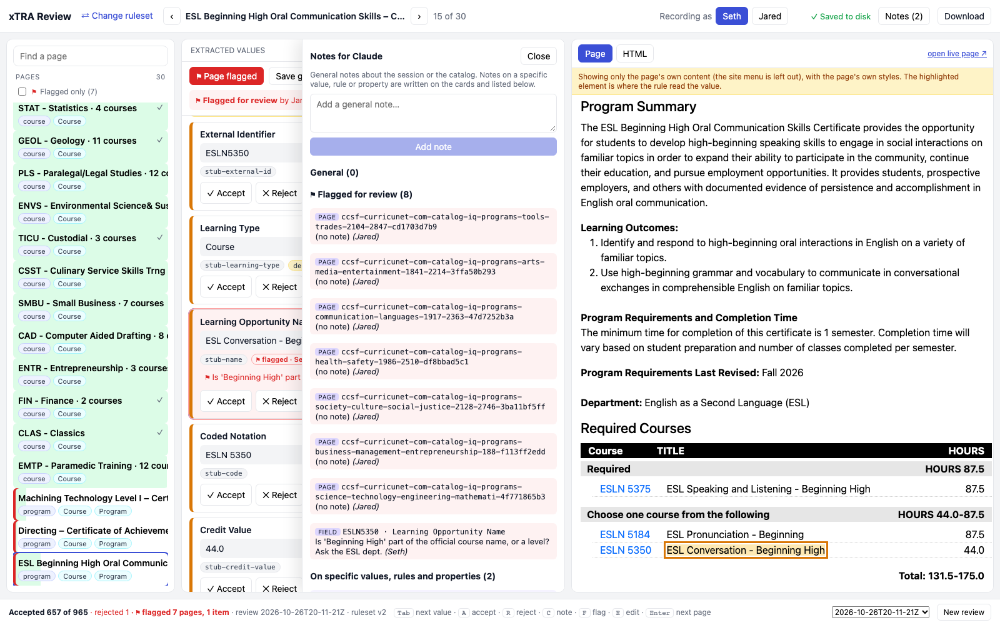

### Step 10: Export the feedback

The export is the last item of the **Download** menu, after four golden/labels downloads and the experts' flag
list: **Feedback for Claude (.md)**. The drawer titled "Notes for Claude" does not link to it.

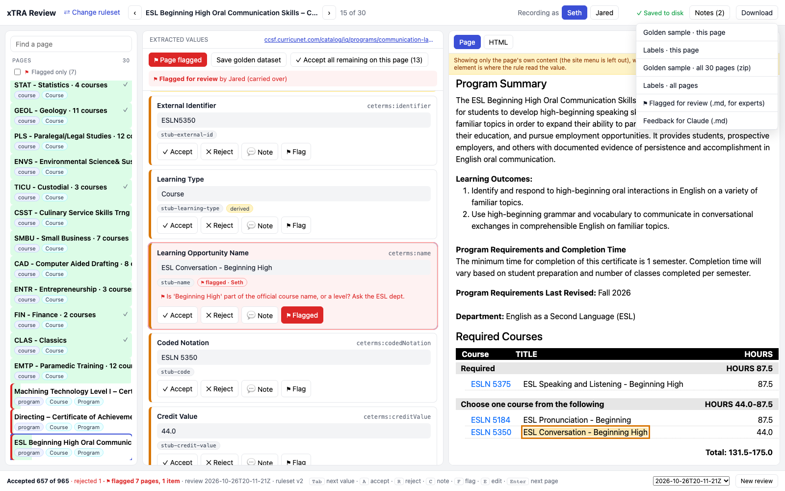

The CLI does the same thing and also writes the file next to the review:

```sh
$ review-ui-v2 export-feedback --run ccsf          # 0.23 s
wrote <root>/ccsf-curricunet-com-catalog/2026-10-01T16-02-34Z/review-ui/2026-10-26T20-11-21Z/feedback.md
```

The file is short (2.9 KB). The full copy is [`walkthrough/feedback-round1.md`](walkthrough/feedback-round1.md).
The part that matters:

```markdown
## Problems, grouped by rule

### `stub-credit-value`: Credit Value

current: `{'repeat': '.course-entry', 'selector': '.block-entry-units-display', 'regex': '^\\s*(\\d+(?:\\.\\d+)?)\\s*$', 'group': 1}`

- rule note (Seth): stub-credit-value: noncredit rows (subject title ends in '- Noncredit') show contact hours in the units column. Don't take hours as Credit Value.

- **Credit Value** on https://ccsf.curricunet.com/catalog/iq/programs/communication-languages/1917/2363 (record ESLN5184) [rejected: wrong_element]
  - extracted: `87.5`
  - expected: `0.0`
  - note (Seth): 87.5 is HOURS, not units: on noncredit (Certificate of Competency) pages the column header says HOURS. ...
  - html: `<span class="units-display block-entry-units-display">87.5</span>`
```

It also lists the flagged pages and items in their own section, marked "not rule bugs". The UI download and
the CLI file differed in one line: the UI copy said 657 accepted and the CLI copy said 660. I had accepted 3 more
values in between, so each export is a snapshot taken when you click.

---

## Round 1: Claude Code's turn (following `ITERATE.md`)

I played Claude Code here, using `feedback.md` and `ITERATE.md` as the only inputs, plus the CLI against the same
local root.

### Step 11: Pull the published ruleset

```sh
$ review-ui-v2 rules pull ccsf-curricunet-com-catalog --out draft.json     # 0.15 s
$ review-ui-v2 check-rules --rules draft.json                             # 0.17 s
17 field rules, 3 label rules, 0 example failures
```

### Step 12: Find the evidence in the HTML

`feedback.md` gives the page URL and the matched `<span>`, but not the context that tells a noncredit row apart.
I had to find the page file myself. The stem has a hash, so it is a glob on `pages/*1917-2363*.html`. Then I read
the markup around the row:

```html
<div class="... header-units">HOURS</div>
...
<span class="course-entry-subject" title="ESL - Noncredit">ESLN</span> <span class="course-entry-course-number">5375</span>
...
<span class="units-display block-entry-units-display">87.5</span>
```

Then I checked whether the pattern holds across all 334 program pages that have requirement rows. This was a
one-off BeautifulSoup script; the CLI has no command for it.

| header says | rows with `title$="Noncredit"` | pages |
|---|---|---|
| units | none | 312 |
| HOURS | all | 19 |
| HOURS | some | 2 |
| HOURS | none | 1 |

### Step 13: Edit the draft

The rule format has `repeat_filter`, which keeps a repeated row only if a selector inside it matches. I used it
twice:

* `stub-credit-value` now skips rows whose subject is noncredit:
  `"repeat_filter": {"selector": ".course-entry-subject:not([title$='Noncredit'])", "regex": "\\S"}`
* A new constant rule, `stub-credit-value-noncredit`, gives those rows `0.0`, which matches their department page.
* `version` goes from 2 to 3.

The full diff is in [`walkthrough/ruleset-v2-to-v3.diff`](walkthrough/ruleset-v2-to-v3.diff). I made it by copying
the file before editing, because nothing else keeps v2.

```sh
$ review-ui-v2 check-rules --rules draft.json
18 field rules, 3 label rules, 0 example failures
```

That check passes but proves little. Examples only test a regex on a string, so neither the `repeat_filter` nor
the constant rule was exercised.

### Step 14: Extract with the draft and check for regressions

```sh
$ time review-ui-v2 extract --run ccsf --rules draft.json
...
  "records": 1956,
  "records_with_conflicts": 72,          # was 129 with v2
  "regression": {
    "accepted_checked": 660,
    "regressions": [],
    "fixed": 1,
    "still_wrong": 24
  }
fill (present/total per canonical_label):
  "label-course-on-program-page": { ..., "Credit Value": "6028/6071", ... }   # same as v2
... 2.58 s total
```

Against a local root, a full extract of 521 pages takes **2.6 s**, using about 5 cores. (The README says Azure is
slower because each record is written as its own blob. I did not measure Azure here.)

Reading the output:

* **0 regressions** across 660 accepted values.
* **fixed: 1** is my rejected Credit Value, which now equals the expected `0.0`.
* **still_wrong: 24** gives no names. They come from Jared's older session (mostly "missed" Prerequisites, which
  the ruleset deliberately does not extract yet). The regression baseline is "latest decision per key across
  *all* sessions of the run", including decisions that the current review does not show.
* The fill rates look the same as v2's, because the constant fills what the filter removed. The only sign of how
  much changed is `records_with_conflicts` falling from 129 to 72. I compared the two extraction folders with
  another one-off script: **117 Credit Values changed across the catalog** (hours to `0.0`), and **only 1 of them
  is in the review sample**.

### Step 15: Publish the new ruleset (to the local root)

```sh
$ review-ui-v2 rules publish draft.json      # 0.22 s
published ccsf-curricunet-com-catalog v3 to <root>/review-ui-index/rulesets/ccsf-curricunet-com-catalog/rules.json
```

This overwrites `rules.json` in place. v2 now exists only as the snapshot inside the old extraction folder.

The extraction from Step 14 used exactly this file, so I did not extract again. Following the README order
(publish first, then extract) would cost another 2.6 s locally.

**Claude's report back (ITERATE step 7), as it would read:**

> * ESLN5184 Credit Value (rejected, expected 0.0): `stub-credit-value` now skips noncredit rows
>   (`repeat_filter` on `.course-entry-subject:not([title$='Noncredit'])`). The new constant rule
>   `stub-credit-value-noncredit` gives them `0.0`. 117 stub values change from hours to 0.0, and conflicts fall
>   from 129 to 72. Fill rates are unchanged.
> * Caveat: 3 program pages show HOURS with mixed or no "Noncredit" subjects. Those rows keep their number. Worth
>   a look.
> * Flag on ESLN5350's name: left alone (waiting on an expert).
> * Regression check: 0 of 660 accepted values changed. Fixed 1. The 24 still wrong are the old Prerequisite items.

---

## Round 2: review again

### Step 16: Restart the server

```sh
review-ui-v2 serve --port 8011          # no --run, no --new-review; ready in 0.7 s
```

The landing card now shows **ruleset v3, 18 rules**, the new extraction `2026-10-26T20-16-10Z`, and **660 of 965
accepted, 7 pages and 1 item flagged**.


Opening it started review `2026-10-26T20-16-38Z`. Restarting picks the newest extraction, and because no review
exists for it yet, it starts one that carries over every accepted value whose text did not change, plus open
flags.

### Step 17: The fixed value

On the ESL page, the ESLN5184 record no longer has a conflict banner. Its four accepted values say "accepted · Seth
· carried over". **Credit Value is now `0.0`**, from `stub-credit-value-noncredit`, marked *derived*, and
**pending**:

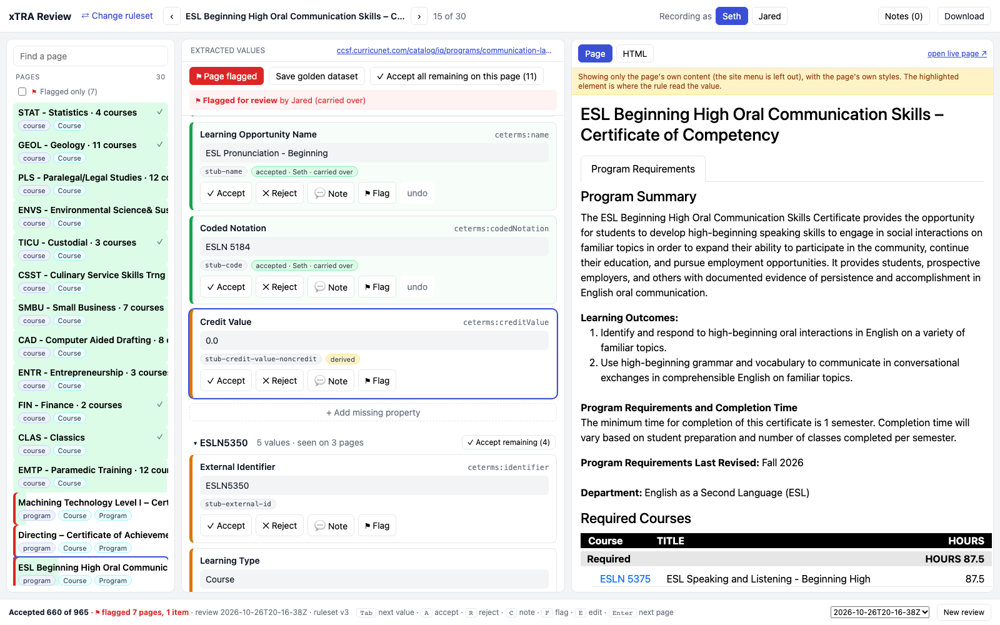

Nothing on the card says it was rejected in the last round or that it used to be 87.5. Because it is a constant,
nothing is outlined in the page pane either. `A` accepts it:

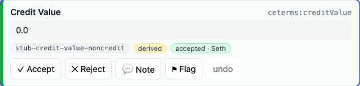

The expert flag carried over with its note:

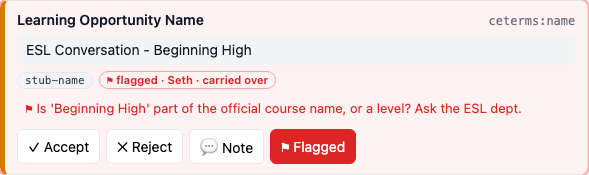

**Notes (0)**: the value note and the rule note from round 1 did **not** carry over. A new
`export-feedback` (0.35 s) says "661 accepted, 0 rejected" and has no trace of round 1. That is the start of the
next lap.

Both servers I started were stopped at the end. The repo is unchanged apart from this file and `walkthrough/`.

---

## Timings (local root, M-series laptop)

| Step | Time |
|---|---|
| Python install / web build | 3.3 s / 3.5 s |
| `serve` to `/healthz` | 2.3 s (with `--new-review`), 0.7 s (restart) |
| First load: HTML to first card / network idle | ~0.15 s / ~0.8 s |
| `/state` for a new review (494 KB JSON) | 1.2 s |
| `rules pull`, `check-rules`, `rules publish`, `export-feedback` | 0.15 to 0.35 s each |
| `extract` over the whole run (521 pages, 1,956 records) | **2.6 s** |
| Me, as Claude: reading feedback, finding the HTML, checking the pattern across the catalog, editing | most of the lap; the tool's own steps took seconds |

Locally, nothing is slow. Wall-clock time goes into the work between the commands (finding the evidence and
judging the change), and the tool gives little help there.

---

## Friction points for v3

Most important first.

1. **The export is hard to find, and it is one more file to move.** "Feedback for Claude (.md)" is the 6th item of a
   generic Download menu. The drawer actually called "Notes for Claude" does not link to it. There is no "copy
   prompt" button. Someone then has to put the file in front of Claude together with `ITERATE.md` and the right
   `REVIEW_UI_ROOT`. This is why Eric didn't find the loop.
2. **feedback.md leaves out the context Claude needs.**
   * The HTML is only the matched element (`<span ...>87.5</span>`). The `HOURS` header and the `title="ESL - Noncredit"`
     attribute that explain the bug were not included.
   * There is no local file path or stem for the page, and no run key or root, so Claude has to work out
     `pages/*1917-2363*.html` itself.
   * There is no list of other pages where the rule fires, and none of the values already accepted for the same rule.
   * There is no command to say "show me every value this rule produces". I wrote two throwaway scripts: one to test
     the pattern across 334 pages, and one to compare extractions.
3. **There is no ruleset history and no diff.** `rules publish` overwrites `rules.json`. v2 survives only by
   accident, inside an old extraction folder. Neither the UI nor the CLI can show "what changed between v2 and v3"
   for the rules or for the extracted values.
4. **The size of a change is hidden.** My fix changed **117 values across the catalog**. Only 1 of them is in the
   30-page sample. The extract output's fill rates did not move. Only `records_with_conflicts` (129 to 72) hinted at
   it. In the UI, changed values look like any other pending value. There is no "changed since v2 (was 87.5)" marker.
5. **Regression results are counts only, and the UI never shows them.** `still_wrong: 24` names no items. The
   baseline includes decisions from older sessions that the current review does not show (Jared's rejections and
   "missed" items do not carry over, but they still count). `types.ts` has a `regression` field that no component
   renders.
6. **Annotations do not survive a round.** Value notes and rule notes are dropped by the new review. Rejections are
   dropped too, though that one makes sense. Only accepts and flags carry. After v3, the only record of *why*
   `stub-credit-value-noncredit` exists is its `description`. Round 2's feedback.md has no trace of round 1.
   Annotations are tied to a review session, not to the rule.
7. **I wrote the same thing twice.** I put a value note on the record and a rule note on the rule, saying nearly the
   same thing. A record-level annotation that names the rule (what Eric described) would cover both.
8. **`check-rules` gives false comfort.** It runs only `example_input` → `example_output` through the regex. It does
   not exercise `repeat_filter`, `repeat`, selectors, or constant rules, so my new rule passed with no real test.
9. **The "expected value" field steers the fix.** "fixed" counts only an exact match. I had to choose between `0.0`
   and absent (empty). Absent would have shown as `still_wrong`, which pushed me toward a constant-0.0 rule. v3 should
   let the reviewer say "should be absent" as a first-class choice. A *should be absent* reason chip exists, but it
   is separate from the expected value.
10. **Derived and constant values have no evidence.** `0.0` from a constant rule highlights nothing on the page, so a
    reviewer cannot check it against the source.
11. **Small UI papercuts.**
    * `A` does not advance to the next value; you need `A`, `Tab` each time.
    * Opening a page leaves the values column scrolled partway down, not at the first record.
    * The flags list in the drawer shows hash stems, not page titles.
    * Carried-over page flags have no note, so nobody knows why they were flagged.
    * The UI download and the CLI file of feedback.md can differ, because each is a snapshot taken when you click.
12. **`--new-review` is surprising.** It sounds like "start clean" but carries over another reviewer's 655 accepts
    and 7 flags. To get a real clean slate you need a fresh root.
13. **The review is record-centric, so checking a rule means hunting.** To judge `stub-credit-value` I had to open
    program pages one by one. The sample has 8 program pages and only one of them is noncredit. A rule-centric view
    ("all 6,071 values from `stub-credit-value`, grouped by value or by page type") would have shown the hours
    values at once. This is the core of Eric's v3 ask.
