# S — Spec: CTDL Golden Dataset Studio

Phase 3 of QRSPI. This is the specification for **CTDL Golden Dataset Studio** ("the Studio"; called Golden Dataset Studio until the build), the rule-centric
successor to review-ui-v2. It's based on [`01-questions.md`](01-questions.md) (Eric's answers),
[`02-research.md`](02-research.md) (facts and Eric's review of them), and a working prototype whose screenshots and
example data appear below.

- Written: 2026-10-26
- Status: **built** (see [`../../PROGRESS.md`](../../PROGRESS.md)). Updated after the build with Eric's tweaks: the
  name, the page pane's view tools, the Rules ⇄ Records links, the Prompt tab's rule list and rendered preview, and
  dark mode (§7). The screenshots are now of the built Studio.
- Visual companion: https://claude.ai/artifact/Nco7wuYZyHK9kMDyyzfor8. It combines the playable review flow, the
  dependency budget, the files, the screens and the order of work.

---

## 0. Why rules, not records

**The problem.** Today Jared reviews a sample of about 20–30 records, page by page, and each verdict improves one
record. So the golden dataset we get is about as big as the sample. For example, his AVC review in v2 covered 14 of
AVC's ~1,075 courses. That's a low yield for the limited time of our only domain expert.

**What a golden dataset is.** A golden dataset is **scoped to one institution's catalog** and has two properties:

1. **Complete:** every record (course) in that institution's catalog is in it.
2. **Correct:** every in-scope field of every record in it is right.

**Golden Dataset Studio is our answer.** It spends Jared's attention on **rules**, not records. Each verdict he gives
is evidence about a rule, and a fixed rule fixes every record it applies to, across the whole catalog. On AVC, five of
his verdicts led to one rule change that corrected 278 descriptions.

We refine the rules **together with Jared** in a very fast feedback loop:
1. he annotates;
2. Claude Code proposes a new rule version;
3. it is rerun over the whole catalog in seconds;
4. he compares the two versions, and approves the rule or annotates again.

When every rule is approved, the full extraction is the golden dataset.

**Why the name leaves out "xtra".** The name deliberately doesn't mention xtra. The rules made in the Studio have
nothing to do with how the final xtra pipeline will work. They're a means to an end: a way to build golden datasets
for a few specific institutions. They aren't expected to generalize to other institutions, and we may throw them all
away. xtra-cli, by contrast, is meant to work for every institution.

**Why it's a new major version, not v2 with changes.** review-ui-v2 is **record-centric**: you review a page's
records and accept or reject values. In v2, iterating on rules was not straightforward:
- the export for Claude was hidden;
- publishing overwrote the ruleset, so there was no history and no diff;
- a fix's effect outside the sample was invisible.

The Studio is **rule-centric**. Iterating on a rule with Claude Code and inspecting the results across the whole
catalog is the central design concept.

## 1. What the Studio is for

A domain expert (Jared) and a developer (Eric) build a **golden dataset** of CTDL Courses for **one catalog**. They
do it by improving **rules**, not by editing data:

1. a ruleset is run over every saved page of the catalog;
2. Jared reviews the results one rule at a time, starting with the rows most likely to be wrong;
3. he marks rows **correct / wrong / missing / question** and points at the right text on the page;
4. the Studio turns those annotations into a prompt;
5. Claude Code, on Eric's laptop, writes a new rule version and checks it against the annotations;
6. Claude publishes it, and the Studio reruns it and shows what changed;
7. when every rule is **approved**, the extraction becomes the golden dataset.

**Extracted values are immutable and disposable. Rules are what changes.**

### 1.1 In scope

- The five catalogs: **AVC** (eLumen), **CCSF** (CurricUNET), **Marshall**, **UALR**, **WVU**. More can be added from
  the picker, from crawls xtra-cli has already made (§7.1, Add a catalog).
- **Course** only, and only the **minimum required fields** for the Course resource type: the seven properties the
  CTDL template marks as required, plus Coded Notation, because it identifies each course (§4.4):
  - Learning Opportunity Name (`ceterms:name`)
  - Description (`ceterms:description`)
  - External Identifier (`ceterms:identifier`)
  - Subject Webpage (`ceterms:subjectWebpage`)
  - Learning Type (no CTDL term)
  - Life Cycle Status Type (`ceterms:lifeCycleStatusType`)
  - Language (`ceterms:inLanguage`)
  - Coded Notation (`ceterms:codedNotation`), which isn't required but is the course's key
- Running locally against **a local folder** or **an Azure prefix**, with the same code and the same layout (I3).
- Importing Jared's existing v2 verdicts.

### 1.2 Out of scope

Much of this work is throwaway: it exists to build golden datasets and to test whether rule-centric review works.
So anything that only matters for a production system is left out. Each item says what we do instead.

- **Changes to xtra-cli, including its crawler.**
  - Instead, we write our own tools: the Golden Dataset Studio UI and the `golden-datasets` CLI.
  - xtra-cli is meant for production and for every institution. The Studio's rules are not.
- **Login and auth.**
  - Instead, a "Reviewing as [name ▾]" dropdown gives each annotation an author.
  - It's throwaway work, so it isn't worth securing. It runs behind ngrok basic auth, as v2 does.
- **Deploying to Azure.**
  - We may do this eventually. To find out whether the UI is any good, we serve it from a laptop.
- **Requisites, credit units, and resource types other than Course.**
  - We test the idea on the minimum required Course fields only (listed in §1.1).
- **Running Claude from the UI.**
  - We don't build a runtime for Claude. The UI makes generating the prompt easy, and a developer runs it in Claude
    Code on their laptop.
- **Changing v2.**
  - If the Studio works out, v2 will probably be deleted.
  - v2's speed fixes were a separate work stream, done in their own Superset workspace (branch
    `review-ui-v2-speed-fixes`).

### 1.3 Boundaries

Two words are used precisely across the boundary:
- **import** means reading something the Studio doesn't own, without changing it;
- **publish** means writing.

The parts, and what crosses between them:

- **xtra-cli (not ours).** Its crawl writes `<catalog>/<crawl>/pages/*.html`, `*.meta.json` and `crawl.json`. The
  Studio imports these (read-only).
- **The Studio (ours)** is the `golden-datasets` CLI and the Studio UI. The CLI runs on a laptop. The UI is served from
  a laptop, over ngrok. Both read and publish (write) to one storage root: a local folder or
  `azure://…/xtra-cli-output[/prefix]`.
- **The golden sets container (shared).** The Studio publishes (writes) domain-only output to `xtra-golden-sets`,
  one property at a time, in the per-page format the golden sets saved so far use (§5.6).
- **Claude Code (laptop)** uses the `golden-datasets` CLI only, never the UI or the storage directly.
- **People** (Jared, Eric) use the UI. Either of them can copy a prompt from it.

```
┌──────────────── xtra-cli (not ours) ─────────────────────────────────┐
│ crawl → <catalog>/<crawl>/pages/*.html + *.meta.json + crawl.json     │
└───────────────────────────────────────────────────────────────────────┘
                 │ import (read-only)
┌────────────────▼────────── CTDL Golden Dataset Studio ──────────────────┐
│ golden-datasets CLI (laptop)        Studio UI (laptop, over ngrok)     │
│        └──────── both import from and publish (write) to ──────┘       │
│ storage root = local folder  OR  azure://…/xtra-cli-output[/prefix]    │
└──────────────────────────────┬────────────────────────────────────────┘
                               │ publish (write) domain-only output
                 ┌─────────────▼─────────────┐
                 │ xtra-golden-sets           │  existing format + location
                 └────────────────────────────┘
Claude Code (laptop) ── uses the golden-datasets CLI only
```

---

## 2. Vocabulary

These are the only nouns the UI, CLI, files and this spec use. Each one is defined once here.

| Term | Meaning | Example | Lives in |
|---|---|---|---|
| **Catalog** | One institution's online course catalog | `ccsf-curricunet-com-catalog` | folder name |
| **Crawl** | One snapshot of a catalog's saved pages, made by xtra-cli | `2026-10-01T16-02-34Z` | `<catalog>/<crawl>/` |
| **Page** | One saved HTML page in a crawl | stem `3f9a…` = "Administration of Justice" department page | `pages/<stem>.html` |
| **Asset** | A CSS, font, image or JS file a page references, archived once by content hash | `a1b2….css` | `assets/` |
| **Rule** | A named, declarative instruction. Three kinds: **page rule**, **record locator**, **field rule**. A rule may also be a domain expert's heuristic rather than something read off the page: "every course in this catalog is in English" is a field rule with a constant value | `course-code` | `rules/<rule_id>/` |
| **Page rule** | Decides whether a page contains courses (today's label rules) | "URL has `/Department/` and the page has `.course-summary-wrapper`" | |
| **Record locator** | Decides where each course starts and ends on a page (today's `repeat`) | "each `div.course-summary-wrapper` is one course" | |
| **Field rule** | Decides where one property is inside one course | "Coded Notation = text before ` - ` in the title row" | |
| **Rule version** | An immutable snapshot of a rule: definition + **what / how / why** prose + examples. *What* says what the rule finds on the page, in page terms, and never defines the field. *How* says how it finds it. *Why* says why this version is better than the last | `course-code` v3 | `rules/<rule_id>/v0003.json` |
| **Ruleset version** | An immutable list of rule versions + catalog settings. Every publish makes one | CCSF ruleset v7 | `rulesets/v0007.json` |
| **Extraction** | The output of running one ruleset version over one crawl. Immutable | CCSF crawl × ruleset v7 | `extractions/rs-0007/` |
| **Occurrence** | One course block found on one page by a record locator | `3f9a…@html>body>…>div.course-summary-wrapper:nth-of-type(4)` | `occurrences.parquet` |
| **Course** | Every occurrence that shares a normalized course code. **The unit users see** | `ADMJ51` | derived |
| **Match** | One rule's result on one occurrence (or page): a value, or "empty", or "no match" | `course-code` on occurrence … = `ADMJ 51` | `matches.parquet` |
| **Signal** | A deterministic reason to look at a match: empty, shape outlier, changed since accepted, … | `shape-outlier` | `signals.parquet` |
| **Annotation** | A person's verdict on a match, occurrence, page or rule, appended to a log, never edited | Jared: `wrong`, expected "ADMJ 51", note | `annotations.jsonl` |
| **Discussion** | Comments on a **whole rule** (e.g. questioning whether it's needed) or on the **ruleset** (suggesting a new rule or another approach), each with a topic. Shown in the Rules tab's sidebar and sent to Claude in the prompt | Eric on `course-description`: "Do we need a separate Advisory rule?" (questions this rule) | `annotations.jsonl` (`comment`, target `rule` / `ruleset`) |
| **Verdict** | `correct` · `wrong` · `missing` (record locators and page rules only) · `question` (a comment marked "question for the institution"). A plain comment is a separate `comment` event with no verdict | | annotation field |
| **Rule status** | `in review` · `needs work` · `approved`, for one rule version | ✓ approved | derived from annotations |
| **Comparison** | Two ruleset versions (or two versions of one rule) on the same crawl | v6 → v7 | derived |
| **Prompt** | Deterministic text built from annotations, for Claude Code | | generated, copied |
| **Golden publication** | The domain-only dataset, plus a lineage table that traces each value back to its rule | `pub-2026-11-03-ccsf-v9` | §5.6 |

Words the Studio deliberately does **not** use: "review session" (annotations aren't grouped into sessions),
"accept/reject" (replaced by verdicts), "label" (replaced by "page rule"), "record" (ambiguous: use course or
occurrence).

---

## 3. Workflow

### 3.1 The loop

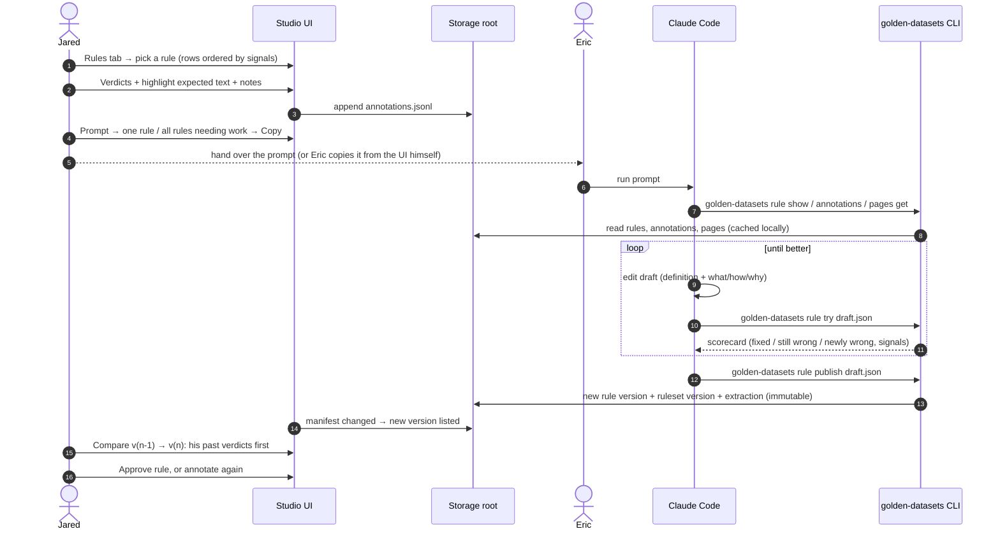

Jared doesn't have to be the one who copies the prompt. Eric can open the UI and copy it himself whenever he wants
to iterate on a rule.

In two steps, the way the catalog picker shows it (§7.1): **annotate records** matched by a rule → **generate / apply
better rules** (Claude Code, then Compare), and repeat until every rule for the catalog is
deemed 100% correct (approved).

### 3.2 First-time setup for a catalog

1. `golden-datasets init --catalog ccsf` reads the crawl and writes `pages.parquet`.
2. `golden-datasets assets fetch` archives the CSS, fonts and images.
3. `golden-datasets import-v2` converts v2's `rules.json` into rule versions (v1, with the locator pulled out, D2) and makes
   ruleset v1. It also converts v2 decisions into annotations.
4. `golden-datasets extract` produces extraction `rs-0001`.

---

## 4. Data model

The storage is **files only**:
- **Parquet** for anything with more than a few hundred rows;
- **JSON** for small definitions;
- **JSONL** for the append-only log.

There's no database file. DuckDB is used **only as an in-process query library** over those files, in the server, the
CLI, and for exploring by hand (Eric's review of R2). Relational integrity is a requirement. Every foreign key below is
checked by `golden-datasets check`, and by `extract` and `publish` before they write anything.

### 4.1 Entities and keys

| Table (file) | Primary key | Foreign keys | Written by | Mutable? |
|---|---|---|---|---|
| `manifest.json` | — | indexes every path below. Nothing is found by listing | every writer (ETag) | yes (small index) |
| `rules/<rule_id>/v<NNNN>.json` | `(catalog, rule_id, version)` | `depends_on[]` → rule ids in every ruleset that lists it | `rule publish` / `import-v2` | **no** |
| `rulesets/v<NNNN>.json` | `(catalog, version)` | `rules[] → (rule_id, version, content_hash)`; `parent_version` | `rule publish` | **no** |
| `pages.parquet` | `(crawl, page_stem)` | `html_path` → saved page file | `init` | no |
| `assets/page_assets.parquet` | `(crawl, page_stem, url)` | → pages, → assets | `assets fetch` | append-only |
| `assets/assets.parquet` | `(crawl, url)` | `sha256` → `assets/files/<sha256>` (also fonts referenced from CSS) | `assets fetch` | append-only |
| `extractions/<id>/extraction.json` | `extraction` (e.g. `rs-0002`; a re-extraction of the same ruleset gets `rs-0002-b`) | → ruleset version, `parent_extraction`; `files{}` with row counts + sha256 | `extract` | **no** |
| `…/page_labels.parquet` | `(extraction, page_stem, rule_id)` | → pages, → page-rule version in that ruleset | `extract` | **no** |
| `…/occurrences.parquet` | `(extraction, occurrence_key)` | → pages, → locator version, page rule matched that page | `extract` | **no** |
| `…/matches.parquet` | `(extraction, rule_id, occurrence_key, value_index)` | → occurrence, → field-rule version, rule's locator = occurrence's locator | `extract` | **no** |
| `…/signals.parquet` | `(extraction, target_kind, rule_id, occurrence_key, value_index, page_stem, css_path, char_start, signal)`, nullable parts (the location is set only for page-text signals such as `uncovered-code`) | → match / occurrence / page | `extract` | **no** |
| `annotations.jsonl` | `annotation_id` | → crawl, `(rule_id, rule_version_seen)`, occurrence/match of `extraction_seen`, page, `supersedes` | UI, `import-v2` | **append-only** |
| `golden/<pub>/lineage.parquet` | `(publication, golden_record_id, page_stem, property, value_index)` | → match (same value), → annotations | `golden publish` | **no** |

`extraction` isn't stored inside the rows; the folder implies it. That keeps rows that were copied from a parent
extraction **row-identical** to the parent's. `golden-datasets check` verifies this with `EXCEPT` in both directions.

### 4.2 Keys that cross versions

- **`occurrence_key`** = `<page_stem>@<locator css_path from the document root>`. Rerunning a *field* rule never changes
  it. A changed *record locator* can change it. Annotations then re-attach through `course_key`, and the UI marks
  them "re-attached" (D3). Comments re-attach the same way as verdicts, so a row keeps everything said about it in
  earlier ruleset versions. Document-root paths are long (AVC: 9 steps, ~200 characters), so:
  - occurrences store the full path;
  - matches store `css_path` **relative to their occurrence**;
  - the UI and the prompt show short labels and resolve paths only when needed.

  Checked in Chromium: 202 of 202 occurrence paths and 652 of 652 match paths resolve on 60 AVC pages.
- **`course_key`** = the normalized code (spaces removed, upper case). It's stored **only on occurrences**, and
  matches get it through a join. It's `null` when there's no code. It's what users see and search by. It isn't unique
  (Marshall and WVU have ~190 codes covering different entries, and WVU lists 88% of its courses on 2+ pages), so it's
  a grouping key, not a primary key.
- **Character offsets** are positions in the element's DOM `textContent`. That's what highlight capture produces in
  the browser. The prototype's v2-style offsets matched the browser for 606 of 652 values. Using `textContent`
  everywhere removes the mismatch, and the UI still falls back to a text search.
- **A comparison** joins two extractions' matches on `(rule_id, occurrence_key)`, falling back to `(rule_id,
  course_key)`. Rows that can't be matched either way are listed as "new" or "vanished" (D9).
- **`golden_record_id`** = `course_key`, when every full occurrence with that code has the same name. Otherwise it's
  `course_key~<n>`, one per distinct name, and the Publish screen lists these for Jared to confirm. AVC, CCSF and UALR
  have none. Marshall and WVU have ~190.

### 4.3 Rule versions and ruleset versions

- Publishing **always** creates a ruleset version (D11). Changing one rule reuses every other rule version unchanged.
  So "iterate on one rule" and "publish a batch" are the same operation.
- **`content_hash`** is computed over the rule's **own** `definition`. It is the rule's identity. It decides the
  version number and what an approval refers to. `golden-datasets` assigns `version`, never a person or Claude. Publishing an
  unchanged hash is a no-op. Hashing the dependencies too, as an earlier draft did, re-versioned rules nobody touched
  and lost their approvals.
- **`input_hash`**, per rule, per extraction (in `extraction.json`), is computed over the definition, its
  dependencies' definitions, and `content_root`. It decides **what to rerun**: rules whose `input_hash` is unchanged
  are copied from the parent extraction. A changed page rule or record locator therefore reruns everything beneath
  it. A changed field rule reruns only itself. The code rule doesn't need rerunning, because `course_key` lives on
  occurrences.
- **Settings-only changes**, such as `pane_css` or signal thresholds, make a new ruleset version with every rule
  unchanged. Rules are copied, and only the signals are recomputed.
- **The log's event types:**
  - `verdict` (correct / wrong / missing / question);
  - `comment` (a note with no verdict);
  - `approve`;
  - `reopen` (undoes an approve);
  - targets of kind `match`, `occurrence`, `page` (with `rule_id`, or `null` for a page-level question), `rule`
    (approvals, and comments on the whole rule) and `ruleset` (comments on the ruleset as a whole, no `rule_id`; it
    records `ruleset_version_seen`). Only comments target the ruleset;
  - a comment on a whole rule or on the ruleset may carry a `topic`: `new-rule` (suggests a new rule, such as a
    domain expert's heuristic), `approach` (suggests another approach), `question-rule` (questions whether a rule is
    needed) or `other`. These comments never attach to a row, and they don't change a rule's status;
  - machine authors (`golden-datasets import-v2`) are allowed.
- **Wrong vs missing:**
  - `wrong` + `expected` is for a field rule's row whose value is wrong. That includes an empty value when the page
    has one. A right value in **several pieces** on the page (two paragraphs with a heading between them) keeps its
    shape: `expected.text` is the pieces joined by line breaks in page order (what the rule should extract, and what
    "fixed" compares with), `css_path` / offsets / `quote` locate the first piece, and `expected.segments` lists
    every piece (`text`, `css_path`, `char_start`, `char_end`, `quote`). One piece has no `segments`.
  - `missing` is only for record locators and page rules: a course on a page that no occurrence covers, or a page
    holding courses that no page rule recognized.
  - `question` is stored for a comment with "question for the institution" ticked: something only the institution
    can answer, not Jared. A plain comment is a `comment` event.

  An edit is a new event that `supersedes` the old one.
- **Rule status** (derived):
  - `approved` when the latest `approve` / `reopen` for that rule version is `approve`;
  - otherwise `needs work` when there are open `wrong` / `missing` verdicts;
  - otherwise `in review`.

  A new version starts at `in review`. Its old verdicts carry forward through the comparison. Constant and URL rules
  are approved on import.

### 4.4 Fields in scope

| Property | CTDL term | Rule kind in all five catalogs | Starts as |
|---|---|---|---|
| Coded Notation | `ceterms:codedNotation` | field (page content). **The key** | in review |
| External Identifier | `ceterms:identifier` | field, same element as Coded Notation, `remove_spaces` | in review |
| Learning Opportunity Name | `ceterms:name` | field (page content) | in review |
| Description | `ceterms:description` | field (page content) | in review |
| Subject Webpage | `ceterms:subjectWebpage` | page URL | approved |
| Learning Type | — (no term) | constant `Course` | approved |
| Life Cycle Status Type | `ceterms:lifeCycleStatusType` | constant `Active` | approved |
| Language | `ceterms:inLanguage` | constant `English` | approved |

Learning Type has no CTDL term. So the golden output and the lineage are keyed by `property` (the template name), with
`ctdl_term` as a nullable column.

Plus, per catalog: 1–3 **page rules** and 1–2 **record locators**. AVC imported as 3 page rules (`course-page`,
`program-page`, `program-page-with-courses`), 2 locators (`locator-course-page`, `locator-program-requirement`) and 12
field rules (8 for full courses, 4 `stub-*` for courses listed on program pages). The examples in §4–§5 are that
imported ruleset. **Since 2026-10-27 the learning-program rules are gone** (§12.1): every catalog now runs 1 page rule
(`course-page`), 1 record locator (`locator-course-page`) and the 8 course field rules.

### 4.5 Storage layout

The same layout serves a local folder and an Azure prefix. xtra-cli's crawl is read in place (folders marked
**read-only**). Everything the Studio writes sits in a `golden-dataset-studio/` folder at three levels: storage root,
catalog, and crawl. This is the real AVC example built by the prototype:

```text
<root>/                                   local folder, or azure://…/xtra-cli-output/zz-scratch-review-ui-v3
├── golden-dataset-studio/
│   └── manifest.json                       5.8 KB   index of every path below
└── avc-elumenapp-com-catalog-2026-27-welcome/          ← catalog
    ├── golden-dataset-studio/                           ← catalog level: rules + human input
    │   ├── rules/
    │   │   ├── course-page/v0001.json                    page rule
    │   │   ├── program-page/v0001.json                   page rule
    │   │   ├── program-page-with-courses/v0001.json      page rule
    │   │   ├── locator-course-page/v0001.json            record locator
    │   │   ├── locator-program-requirement/v0001.json    record locator
    │   │   ├── course-code/v0001.json                    field rule (the key)
    │   │   ├── course-description/v0001.json v0002.json  field rule, 2 versions
    │   │   └── … 10 more field rules (course-*, stub-*)
    │   ├── rulesets/
    │   │   ├── v0001.json                      5.3 KB   imported from v2
    │   │   └── v0002.json                      4.8 KB   course-description → v2
    │   └── annotations.jsonl                 164 KB   153 events (Jared's v2 verdicts, imported)
    └── 2026-10-12T20-59-13Z/                             ← crawl (xtra-cli)
        ├── crawl.json                                    read-only
        ├── pages/  1,467 × (.html + .meta.json), 3.8 GB  read-only
        └── golden-dataset-studio/                        ← crawl level: everything derived
            ├── pages.parquet                 144 KB    1,467 rows
            ├── assets/
            │   ├── page_assets.parquet        25 KB    7,335 rows
            │   ├── assets.parquet              5 KB       18 rows
            │   └── files/<sha256>             644 KB      18 files (CSS, fonts, icons)
            ├── extractions/
            │   ├── rs-0001/                              ruleset v1
            │   │   ├── extraction.json         1.5 KB
            │   │   ├── page_labels.parquet      25 KB    4,401 rows
            │   │   ├── occurrences.parquet      66 KB    3,813 rows
            │   │   ├── matches.parquet         530 KB   19,500 rows
            │   │   └── signals.parquet          35 KB    1,366 rows
            │   └── rs-0002/                              ruleset v2 (2 rules rerun, 15 copied)
            │       └── … same five files (signals: 1,084 rows)
            └── golden/
                └── pub-2026-10-26-avc-rs-0002-example/
                    ├── publication.json
                    ├── <page_stem>/<page_stem>.json        one per page, existing golden-set shape
                    ├── <page_stem>/<page_stem>.html        the page as crawled   → both also written to xtra-golden-sets
                    └── lineage.parquet                     160 rows
```

**Size check:** a whole extraction of AVC is **~0.7 MB in five files**. In v2 it was 1,065 record files. Building
everything from scratch takes ~13 s on Eric's laptop:
- init: 1.4 s;
- assets: 3.9 s;
- extract rs-0001: 3.8 s for 1,467 pages and 17 rules;
- publish + extract rs-0002: 2.6 s (2 rules rerun on 1,062 pages).

**Boundaries in the layout:**
- **Inputs** are `crawl.json` and `pages/` (from xtra-cli), and v2's `rules.json` and review folders (imported once).
- **Human input** is `annotations.jsonl`. It's the only file people change, and they only ever append to it.
- **Claude's output** is the rule versions plus one ruleset version, and the extraction `golden-datasets` computes from them.
- **Final output** is the golden publication, written to `xtra-golden-sets` in the existing per-page format (§5.6),
  one or more properties at a time.

---

## 5. Files, with real example data

Every excerpt is real. It was generated from AVC by the prototype ([`prototype/make_example.py`](prototype/make_example.py)).
All files, with more rows, are in [`prototype/example-data.md`](prototype/example-data.md). The story running through
them:
1. Jared marked GEOG222's Description **wrong** because it starts with "Prerequisite: …".
2. Claude published `course-description` v2.
3. Extraction `rs-0002` fixed it.

### 5.1 A rule version (`rules/course-description/v0002.json`)

```json
{
  "catalog": "avc-elumenapp-com-catalog-2026-27-welcome",
  "rule_id": "course-description", "version": 2, "parent_version": 1, "kind": "field",
  "ctdl_property": "ceterms:description", "property_label": "Description",
  "definition": {
    "locator": "locator-course-page", "rule_type": "css", "selector": ".introtext", "transforms": ["strip"],
    "regex": "\\A\\s*(?:(?i:pre-?requisites?|co-?requisites?)\\s*:[^\\n]*?(?:\\.[ \\t]+(?=[A-Z(])|\\n|\\Z)\\s*)*(\\S[\\s\\S]*?)\\s*\\Z",
    "group": 1
  },
  "what": "The intro paragraph(s) under each course's title on a course page, minus any leading 'Prerequisite:' or 'Corequisite:' statement.",
  "how": "Text of the intro block (.introtext). Skip every leading 'Prerequisite:' or 'Corequisite:' statement … 'Advisory:' and 'Limitation on Enrollment:' lines are kept.",
  "why": "Jared marked 5 of the 14 descriptions he reviewed wrong (GEOG222, PHYS102, DFST202, AUTO230, ENGR955) because the 'Prerequisite: …' line was included. … A first draft also dropped 'Advisory:' and 'Limitation on Enrollment:' lines; `golden-datasets rule try` showed that changed 4 descriptions Jared had marked correct (ACCT199, AERO199, CFE114, NS922L), so those lines stay until he decides.",
  "examples": [{"input": "Prerequisite: Completion of DFST 201.\n\nAdvanced study of ASL grammar.",
                "output": "Advanced study of ASL grammar."}],
  "depends_on": ["locator-course-page"],
  "content_hash": "sha256:2a397c7c…",
  "published_by": "Claude Code (Eric's laptop) via golden-datasets rule publish", "published_at": "2026-10-26T12:00:00Z"
}
```

A **record locator**, pulled out of the four `stub-*` rules' identical `repeat` (`rules/locator-program-requirement/v0001.json`):

```json
{
  "rule_id": "locator-program-requirement", "version": 1, "kind": "locator",
  "definition": {"page_rules": ["program-page-with-courses"],
                 "repeat": "#accordion-program-builder-rules .new-rule",
                 "repeat_filter": {"selector": ".rule-name", "regex": "^\\s*[A-Za-z]+\\s*[A-Za-z]?\\d+[A-Za-z]*\\s+-\\s+"}},
  "what": "On a program page, every requirement line that names a course is one course stub.",
  "how": "Each .new-rule inside #accordion-program-builder-rules is a candidate. Keep it only when its .rule-name text starts with a course code followed by ' - ' …",
  "depends_on": ["program-page-with-courses"],
  "imported_from": {"v2_field_rules": ["stub-code", "stub-external-id", "stub-learning-type", "stub-name"], "v2_key": "properties.repeat"}
}
```

### 5.2 A ruleset version (`rulesets/v0002.json`, trimmed)

```json
{
  "catalog": "avc-elumenapp-com-catalog-2026-27-welcome", "version": 2, "parent_version": 1,
  "note": "course-description v2: drop leading requisite lines (Jared's 5 'wrong' descriptions).",
  "settings": {"content_root": "#mainContent", "pane_css": "…reveal accordions…",
               "signals": {"course_code_pattern": "…", "shape_dominance": 0.5}},
  "rules": [{"rule_id": "course-page", "version": 1, "content_hash": "sha256:…"},
            {"rule_id": "course-description", "version": 2, "content_hash": "sha256:2a397c7c…"},
            "… 15 more"],
  "changed_rules": ["course-description"]
}
```

### 5.3 An extraction (`extractions/rs-0002/extraction.json`, trimmed)

```json
{
  "extraction": "rs-0002", "crawl": "2026-10-12T20-59-13Z", "ruleset_version": 2, "parent_extraction": "rs-0001",
  "rerun_rules": ["course-description"], "rerun_pages": 1062, "copied_from": "rs-0001",
  "copied_rules": ["course-code", "course-name", "locator-course-page", "… 12 more"],
  "input_hashes": {"course-description": "sha256:…", "…": "…"},
  "files": {"matches.parquet": {"rows": 19500, "sha256": "4d35c190…"},
            "occurrences.parquet": {"rows": 3813, "sha256": "ab942984…"},
            "page_labels.parquet": {"rows": 4401, "sha256": "1f7e079b…"},
            "signals.parquet": {"rows": 1084, "sha256": "013f45e9…"}}
}
```

### 5.4 Parquet rows

`page_labels.parquet`: one row per page × page rule, matched or not:

| page_stem | rule_id | rule_version | matched | reason |
|---|---|---|---|---|
| …course-geog222-c85465e9c2 | course-page | 1 | true | matched |
| …program-computer-engineering… | course-page | 1 | false | url_mismatch |
| …program-computer-engineering… | program-page-with-courses | 1 | true | matched |

`occurrences.parquet`, abbreviated. The full GEOG222 key is
`…course-geog222-c85465e9c2@html > body:nth-of-type(1) > app-root:nth-of-type(1) > app-public:nth-of-type(1) > div:nth-of-type(2) > div:nth-of-type(2) > div:nth-of-type(2) > main:nth-of-type(1) > div:nth-of-type(4)`:

| occurrence_key | page_rule_id | locator_rule_id | locator_index | course_key |
|---|---|---|---|---|
| …geog222…@…main > div:nth-of-type(4) | course-page | locator-course-page | 0 | GEOG222 |
| …computer-engineering…@…div(2) > div(1) | program-page-with-courses | locator-program-requirement | 0 | MATH150 |
| …computer-engineering…@…div(3) > div(1) | program-page-with-courses | locator-program-requirement | 1 | MATH150H |

`matches.parquet` (rs-0002, GEOG222). `css_path` is relative to the occurrence:

| rule_id | rule_version | status | value | raw_text | css_path | char_start | char_end |
|---|---|---|---|---|---|---|---|
| course-code | 1 | found | GEOG 222 | GEOG 222: | header > h3 | 0 | 9 |
| course-name | 1 | found | Cartography for Geographic Information Science (GIS) | … | header > h2 | 0 | 52 |
| course-description | **2** | found | This course provides a general survey of basic… | … | div(1) > div(1) | **70** | 699 |
| course-lifecycle | 1 | found | Active | Active | ∅ | ∅ | ∅ |

`char_start` 70 is where v2 starts, after the prerequisite line. In rs-0001 it was 0.

`signals.parquet`:

| target_kind | rule_id | course | signal | severity | detail |
|---|---|---|---|---|---|
| match | course-description | ABDY113 | contains-label-text | high | value includes the label text 'Prerequisite:' |
| match | course-code | ARTHC1100 | shape-outlier | medium | shape 'A A9' is 16 of 1062 values; most common 'A 9' |
| match | course-name | AFAB110 | length-outlier | low | 80 chars; 1st–99th percentile is 9–68 |
| occurrence | locator-program-requirement | ARTHC1100 | duplicate-occurrence | medium | ARTHC1100 occurs 2× on this page |
| page | ∅ | (allcourses) | unclassified-page-with-codes | medium | no page rule matched, but the page names 21 course codes |

### 5.5 The annotation log (`annotations.jsonl`, 3 of 153 lines, trimmed)

```jsonl
{"annotation_id":"an-75aeec940bac","type":"verdict","at":"2026-10-21T20:19:46Z","author":"Jared","crawl":"2026-10-12T20-59-13Z","target":{"kind":"match","rule_id":"course-description","rule_version_seen":1,"extraction_seen":"rs-0001","occurrence_key":"…geog222…@…div:nth-of-type(4)","course_key":"GEOG222","value_index":0,"value_seen":"Prerequisite: Completion of, or concurrent enrollment in, GEOG 205.\n\nThis course provides …"},"verdict":"wrong","expected":{"text":"This course provides a general survey …","css_path":"…div:nth-of-type(4) > div:nth-of-type(1) > div:nth-of-type(1)","char_start":70,"char_end":699,"quote":{"prefix":"ent enrollment in, GEOG 205.\n\n","exact":"This course provides …","suffix":"\n"}},"note":"Prerequisite should be a separate property.","supersedes":null,"imported_from":{"source":"review-ui-v2","session":"2026-10-19T17-27-55Z","decisions":[{"status":"rejected","author":"Jared"},{"status":"missing","author":"Seth"}]}}
{"annotation_id":"an-48e252fac7e7","type":"verdict","at":"2026-10-22T13:07:46Z","author":"Jared","target":{"kind":"page","rule_id":null,"page_stem":"…program-computer-engineering-as-fall-2026-5a1e6e1354"},"verdict":"question","note":"I have updated the page labels. But properties listed here are all for courses. Should I reject all these properties? Skip this page altogether?"}
{"annotation_id":"ap-05e602437e48","type":"approve","at":"2026-10-26T12:00:00Z","author":"golden-datasets import-v2","target":{"kind":"rule","rule_id":"course-language","rule_version_seen":1},"note":"Constant / page-URL rule: approved on import."}
```

**v2 import tally for AVC** (Jared's session: 213 decisions, 21 notes, 8 flags):
- **153 annotations:** 107 correct, 5 wrong-with-expected (each reject + missing pair joined), 21 + 7 page-rule
  verdicts, 8 questions for the institution, 5 approve.
- **Skipped as out of scope:** 52 field decisions, 16 labels and 17 notes.

### 5.6 The golden output and its lineage

The golden output keeps the **existing per-page shape of the golden sets saved so far** (in `xtra-golden-sets-verified`),
so their readers keep working (Eric's decision, §12.1); it is written to the `xtra-golden-sets` container.
**Published one property at a time:** a publication writes the chosen properties' values from the current extraction
into each page's file and keeps what earlier publications wrote there for every other property (records pair by
`golden_record_id`, in page order), so the golden set fills up property by property. Its `lineage.parquet` covers only the
properties it published; `publication.json` lists them (`properties`, `property_gate` with each one's rule, version
and approval) and the status of the page rule and record locator that decide which courses exist
(`identity_rules`). `golden-datasets check` compares the files with the lineage of the publication that last
published each property. There's one folder per page, `<page_stem>/<page_stem>.json`, next to `<page_stem>.html`
(the page as crawled). Each record gains `golden_record_id` (renamed from `golden_id` on 2026-10-27; older files and
lineage say `golden_id`, and the Studio reads both), and each field gains `property` and `location`. It's
domain-only: **no rule IDs**.

**Who approved each value** is in every format, so it's clear which values a person confirmed and which only a rule
vouches for:
- **each field:** `approval` is `"human"` when a person confirmed that value (marked it correct and it hasn't
  changed since, or marked it wrong and selected the right text, which the value now is), else `"rule"` (it was
  published because its rule is approved); `approved_by` and `approved_at` name that person and when, or who
  approved the rule and when;
- **each record:** `approval` is `"human"` when every value is, `"rule"` when none is, else `"mixed"`;
- **the lineage:** the same `approval`, `approved_by` and `approved_at` columns per value;
- **`publication.json`:** `approvals`, the count of human- and rule-approved values, in all and per property;
- **the Publish tab:** "1,062 values (14 approved by a person, 1,048 by the rule)".

GEOG222's file, trimmed (Jared reviewed every field of GEOG222, so the record is `human`):

```json
[
  {
    "golden_record_id": "GEOG222",
    "approval": "human",
    "fields": [
      {"ctdl_property": "ceterms:codedNotation", "property": "Coded Notation", "value": "GEOG 222",
       "source_url": "https://avc.elumenapp.com/catalog/2026-27/course/geog222",
       "location": {"css_path": "html > body … > div:nth-of-type(4) > header:nth-of-type(1) > h3:nth-of-type(1)", "char_start": 0, "char_end": 9},
       "approval": "human", "approved_by": "Jared", "approved_at": "2026-10-21T20:19:46Z"},
      {"ctdl_property": "ceterms:description", "property": "Description",
       "value": "This course provides a general survey of basic methods used for the presentation of geographic information science (GIS) data and analysis. …",
       "source_url": "https://avc.elumenapp.com/catalog/2026-27/course/geog222",
       "location": {"css_path": "html > body … > div:nth-of-type(4) > div:nth-of-type(1) > div:nth-of-type(1)", "char_start": 70, "char_end": 699}},
      {"ctdl_property": "ceterms:subjectWebpage", "property": "Subject Webpage",
       "value": "https://avc.elumenapp.com/catalog/2026-27/course/geog222",
       "source_url": "https://avc.elumenapp.com/catalog/2026-27/course/geog222", "location": null},
      {"ctdl_property": null, "property": "Learning Type", "value": "Course",
       "source_url": "https://avc.elumenapp.com/catalog/2026-27/course/geog222", "location": null},
      "… 4 more fields"
    ]
  }
]
```

`lineage.parquet` stays in the Studio. It's the association table Eric asked for, so every golden value can be traced
back to its rule:

| golden_record_id | page_stem | property | value_index | extraction | rule_id | rule_version | occurrence_key | annotation_ids | approval | approved_by |
|---|---|---|---|---|---|---|---|---|---|---|
| GEOG222 | …geog222-c85465e9c2 | Coded Notation | 0 | rs-0002 | course-code | 1 | …geog222…@… | [an-6191f7ba8324] | human | Jared |
| GEOG222 | …geog222-c85465e9c2 | Description | 0 | rs-0002 | course-description | 2 | …geog222…@… | [an-75aeec940bac] | human | Jared |
| ABDY112 | …abdy112-… | Language | 0 | rs-0003 | course-language | 1 | …abdy112…@… | [] | rule | Eric |

### 5.7 Relational integrity: `golden-datasets check`

The prototype's checker runs **52 checks in about 0.25 s** on the AVC example. All of them pass. Against a copy with three
planted faults, it catches all three, failing 5 checks. An excerpt:

```text
table            kind check                                                                   rows  bad  result
ruleset_version  FK   rules[] → rule_version (rule_id, version, content_hash)                    2    0  ok
occurrences      FK   (locator_rule_id, version) → locator in the extraction's ruleset        7626    0  ok
matches          PK   (extraction, rule_id, occurrence_key, value_index) unique              39000    0  ok
matches          FK   occurrence_key → occurrences (same extraction)                         39000    0  ok
matches          CHK  rs-0002: unchanged rules' rows identical to rs-0001                    18438    0  ok
annotations      FK   occurrence_key → occurrences of extraction_seen, course_key agrees       153    0  ok
lineage          FK   (extraction, rule_id, occurrence_key, value_index) → matches, same value 160    0  ok
golden files     CHK  domain-only: no rule ids / occurrence keys / annotation ids               20    0  ok
52 checks, 0 failed
```

### 5.8 DuckDB as the query library

Each question the UI asks is one SQL statement over the files. There's no database. The real query behind the
comparison, which returns 14 rows in 7 ms:

```sql
WITH ann AS (
  SELECT target.occurrence_key AS occurrence_key, verdict, expected.text AS expected
  FROM read_json('<catalog>/golden-dataset-studio/annotations.jsonl')
  WHERE type = 'verdict' AND target.rule_id = 'course-description')
SELECT a.verdict, o.course_key, left(v1.value, 38) AS v1, left(v2.value, 38) AS v2,
       CASE WHEN v1.value = v2.value THEN 'unchanged'
            WHEN v2.value = a.expected THEN 'fixed'
            WHEN a.verdict = 'correct' THEN 'newly wrong' ELSE 'still wrong' END AS outcome
FROM ann a
JOIN '<crawl>/golden-dataset-studio/extractions/rs-0001/matches.parquet' v1 USING (occurrence_key)
JOIN '<crawl>/golden-dataset-studio/extractions/rs-0002/matches.parquet' v2 USING (occurrence_key)
JOIN '<crawl>/golden-dataset-studio/extractions/rs-0002/occurrences.parquet' o USING (occurrence_key)
WHERE v1.rule_id = 'course-description' AND v2.rule_id = 'course-description';
```

| verdict | course_key | v1 | v2 | outcome |
|---|---|---|---|---|
| wrong | GEOG222 | Prerequisite: Completion of, or concur | This course provides a general survey | fixed |
| wrong | PHYS102 | Prerequisite: Completion of PHYS 101. | This course is the second part of a tw | fixed |
| correct | ACCT199 | LIMITATION ON ENROLLMENT: To participa | LIMITATION ON ENROLLMENT: To participa | unchanged |
| … | | | | 5 fixed · 9 unchanged · 0 newly wrong |

---


## 6. CLI: `golden-datasets`

One Python package (`golden-dataset-studio/` in the repo, separate from v2) provides both the CLI and the server.
Every command takes `--root` (or `GOLDEN_DATASETS_ROOT`):
- a folder (`~/golden-datasets-data/xtra-cli-output`);
- or an Azure prefix (`azure://https://ceteststorage.blob.core.windows.net/xtra-cli-output/zz-scratch-review-ui-v3`).

Pages and immutable Parquet files are cached on disk (`~/.cache/golden-datasets`), so the second read of anything costs nothing.

**Install anywhere, from the branch.** Claude Code may run on any machine, so the prompt (§7.5) installs the CLI
straight from the branch the Studio runs on:

```sh
uv tool install --reinstall 'git+https://github.com/CredentialEngine/ctdl-xtra.git@golden-dataset-studio#subdirectory=golden-dataset-studio'
# or, without installing: uvx --from '<same>' golden-datasets …
```

The installed package holds the CLI and the API; the web UI's build (`web/dist`) isn't in it, so `serve` needs a
checkout with the web app built.

**`golden-datasets.env`.** Claude Code's shell commands don't share `export`s, so unset variables
(`GOLDEN_DATASETS_ROOT`, `GOLDEN_DATASETS_CATALOG`, …) are read from `golden-datasets.env` (KEY=VALUE lines) in the
current folder or the nearest parent. The environment always wins.

**Azure credentials.** `AZURE_STORAGE_CONNECTION_STRING` if it is set; otherwise the CLI asks the signed-in Azure CLI
(`az storage account show-connection-string`), so `az login` is the whole setup and nothing secret is exported or
saved.

| Group | Command | What it does | Writes |
|---|---|---|---|
| Setup | `golden-datasets init --catalog C [--crawl ID]` | Index a crawl's pages into `pages.parquet`, register it in the manifest | pages.parquet, manifest |
| | `golden-datasets assets fetch --catalog C` | Download each page's CSS, fonts, images and JS once, stored by hash (D7). Never runs JS | assets/ |
| | `golden-datasets crawls list [WORDS] [--crawls-root URI]` | One line per catalog xtra-cli has crawled: its latest crawl's date, pages and status, and whether it's in the Studio. Lists folders (setup only) | — |
| | `golden-datasets crawls add FOLDER [--crawl ID] [--by NAME]` | What **Add a catalog** does (§7.1): copy the crawl's `crawl.json` and pages into the root, `init`, `assets fetch`, and name the catalog in the manifest. Safe to rerun | pages/, pages.parquet, assets/, manifest |
| | `golden-datasets import-v2 --catalog C` | v2 `rules.json` → rule versions v1 (locator pulled out) + ruleset v1. v2 decisions → annotations | rules/, rulesets/, annotations.jsonl |
| Run | `golden-datasets extract --catalog C [--ruleset N]` | Run a ruleset version over the crawl. Refuses if that extraction exists | extractions/rs-N/ |
| | `golden-datasets check [--catalog C]` | Validate every primary/foreign key and every hash | — |
| | `golden-datasets sql "…"` | DuckDB over named views (`pages`, `occurrences`, `matches`, `signals`, `annotations`, `rules`) resolved through the manifest | — |
| For Claude | `golden-datasets rule list` / `golden-datasets rule show R [--version N]` | Rule definitions, what/how/why, status, fill, signal counts | — |
| | `golden-datasets rule annotations R [--open]` | Each annotation with the value seen, expected text + location, note, page path | — |
| | `golden-datasets pages get STEM… [--to DIR]` | Make page files (and their assets) available locally and print their paths | local cache |
| | `golden-datasets pages sample --rule R [--signal S] [-n 20]` | Page paths where the rule fires, filtered by signal | — |
| | `golden-datasets rule draft R… > draft.json` | Current versions of one or more rules as an editable draft; `--all`: every rule; `--for C`: every rule and the settings as a template for catalog C's first ruleset | — |
| | `golden-datasets rule try draft.json` | Run the draft over the **whole crawl** on the laptop and print the scorecard. Writes nothing | — |
| | `golden-datasets rule publish draft.json [--force]` | New rule versions + ruleset version + extraction, uploaded together. Refuses when anything that was `correct` changes, unless `--force` | rules/, rulesets/, extractions/ |
| Prompt | `golden-datasets prompt --catalog C [--rule R \| --needs-work \| --first-rules] [--target local\|azure]` | The same text the UI's **Copy prompt** button gives (`--first-rules`: the **Generate rules** prompt of a catalog with no rules, §7.1); `azure` points Claude at the Azure root (`--azure-root`) | — |
| Golden | `golden-datasets golden publish --catalog C --to ROOT [--property NAME …]` | Publishes the named properties (default: every property whose field rule is approved); each needs its field rule approved, the others keep what earlier publications wrote. Domain-only files to the golden root in its existing format (plus `location` and `golden_record_id`), lineage to the Studio | golden/ |
| Local work | `golden-datasets sync --from ROOT --to DIR [--catalog C]` | Copy Studio files and pages between roots (both directions) | target root |
| | `golden-datasets serve [--port 8000] [--azure-root URI] [--crawls-root URI]` | The web UI; `--azure-root` is where the prompt's Azure version points (the root itself when it is Azure); `--crawls-root` is where Add a catalog looks for crawls | annotations.jsonl (via UI) |

**A draft** is one JSON file holding one or more rules. Each has its `definition` plus `what`, `how` and `why`. Claude
edits the draft; `golden-datasets` assigns versions and hashes. This makes "one rule" and "batch" the same thing (A5.1).

**The scorecard** from `rule try` (and on publish) is the same summary the Compare screen shows:

```
course-description  v1 → draft
  annotated rows      12   fixed 5 · still wrong 0 · newly wrong 0 · unchanged 7
  values changed     214 of 1062 (20%)   new 0 · vanished 0
  signals            empty 0→0 · contains-label-text 214→0 · length-outlier 9→6
  verdict            BETTER (fixed > 0, newly wrong = 0)
```

## 7. The UI

The screenshots are of the **built Studio** on AVC, served from the shared Azure root at ruleset v2 (taken with
`bench/shots_review.py`, 2026-10-26). Layout, wording and behaviour are part of the
spec. Pixel details aren't.

**Top bar on every screen:** the Studio's name (no tag beside it), catalog, crawl date, ruleset version, the five
tabs, "Reviewing as [name ▾]", and a **Show the tour** button at the top right (§7.8).

**Bottom bar on every screen:** the keyboard hints of the current tab and, at the right end, a **Light / Dark**
button. The choice is remembered in the browser; with none yet, the Studio follows the system setting. The saved page
in the page pane keeps the catalog's own colours: it is a picture of the source.

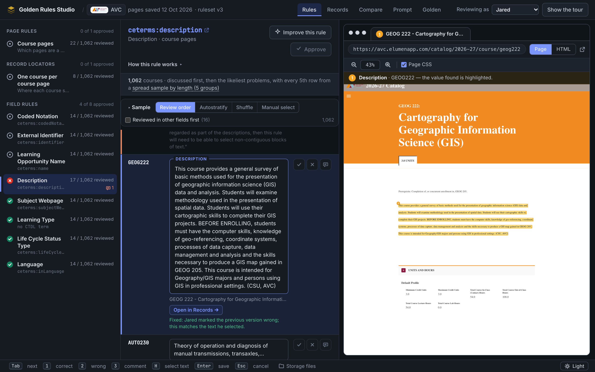

| Tab | Job | Default? |
|---|---|---|
| **Rules** | Review one rule's results across the whole catalog | **yes** |
| **Records** | Review one course with all its fields (v2's view, kept) | |
| **Compare** | Is ruleset/rule version B better than A? | |
| **Prompt** | Turn annotations into a prompt for Claude Code | |
| **Golden datasets** | Each golden dataset version, read-only (approving a column's rule publishes it; [Evals spec](evals/03-spec.md) §6.6) | |
| **Evals** | How closely xtra's extract outputs match the golden dataset ([Evals spec](evals/03-spec.md) §6.3) | |

### 7.1 Catalog picker

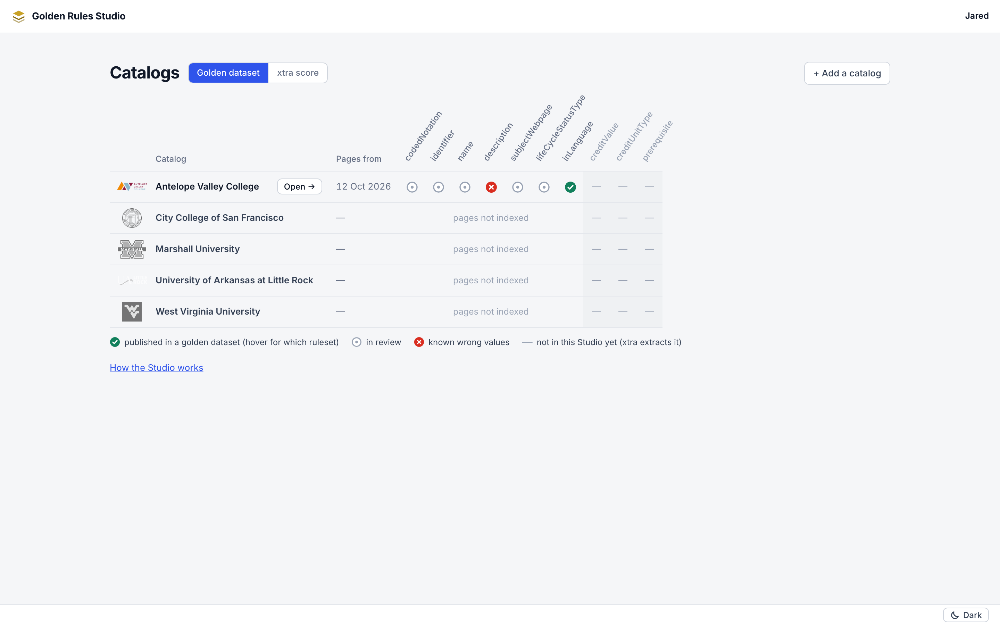

**Since the Evals work** the cards are a table (Golden dataset | xtra score): [Evals spec](evals/03-spec.md) §6.1,
§6.2 and §9. The cards as first built:

One card per catalog, laid out the same way on every card:
- the institution's logo;
- its name top-left and "pages from <crawl date>" top-right (the page count on hover): the Studio works on one
  crawl per catalog;
- a thin progress bar of approved rules ("5 of 17 rules approved"), the same width and position on every card.

A catalog whose rules haven't been run yet shows an empty bar and "rules not run yet". **Open →** goes to its Rules
tab. Status comes from the manifest (no listing).

**How the Studio works.** When the picker opens, a modal shows the loop as a ring of two boxes, **1 Annotate
records** (Rules tab) on the left and **2 Generate / apply better rules** (Claude Code, Compare tab) on the right, with
"↻ Repeat until every rule is 100% correct for that catalog" between them. A dot leaves each box with a short press, runs
along the arrow, and lands on the next box with a swell, then pauses (no motion when the system asks for reduced
motion). The arrows start and end on the boxes' edges. **Got it**, Esc or a click outside closes it; **Don't show this
again** is remembered in the browser, and a "How the Studio works" link under the cards opens it again. At phone
width it is a numbered list.

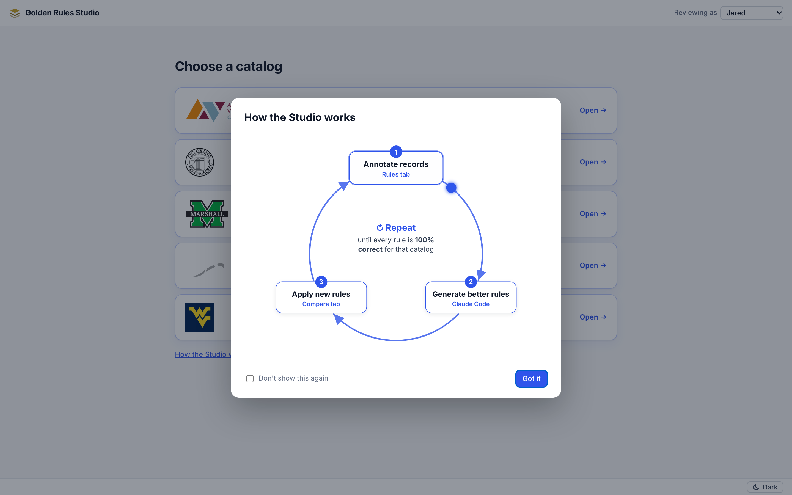

**Who's reviewing:** a "Reviewing as [Jared ▾]" dropdown at the top right. It's a list of names remembered in the
browser and recorded as each event's `author`. There's no login and no profiles (out of scope), just like v2's
Seth/Jared switch.

**Add a catalog.** A **+ Add a catalog** button sits right of the heading. It opens a modal that lists the catalogs
xtra-cli has already crawled. The Studio never starts a crawl: an **ⓘ** beside the title says "Only catalogs the xTRA
engine has already crawled can be found here. For a new catalog, ask engineering to crawl it." (on hover or click).

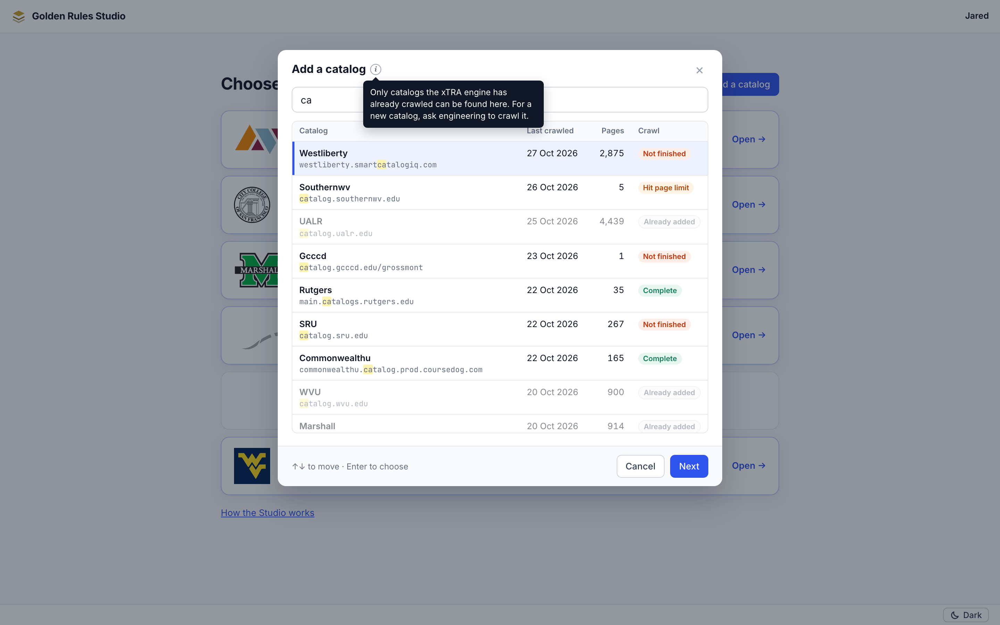

- **Where it looks:** the crawls root, `--crawls-root` / `GOLDEN_DATASETS_CRAWLS_ROOT`, else the container above an
  Azure root's prefix (the Studio serves `xtra-cli-output/zz-scratch-review-ui-v3`, the crawls are in
  `xtra-cli-output/`), else the root itself. The server lists it when it starts and when the modal opens (about 15 s
  for 60 catalogs on Azure the first time, reading names from pages; then about 3 s) and keeps the list for 5 minutes; the picker itself still does no listing.
- **One row per catalog folder, newest crawl first,** showing its latest crawl. Every column comes from that crawl
  itself; nothing comes from anywhere else and nobody types anything:

  | Column | From the crawl |
  |---|---|
  | **Catalog**: the institution's name, and the URL under it | The name its saved pages give (8 pages, read once per crawl): the name that at least half their `<title>`s repeat, as a whole title or a part between separators (`\|`, `<`, `–`, ` - `), naming a university, college, institute, school or district, with "Catalog", "Bulletin" and years removed; or the site name the pages declare (`og:site_name`) when it says more than that (it contains it) or when the titles name nothing. training.uark.edu → "University of Arkansas Professional and Workforce Development", catalog.uark.edu → "University of Arkansas". When the pages give no name (eLumen and CurricUNET titles don't), the host of `crawl.json`'s `seed_url`: its first label that isn't generic (`www`, `catalog`, …), e.g. `cabrillo`.elumenapp.com → Cabrillo (in capitals at 4 letters or fewer). The original five keep their names |
  | **Last crawled** | `finished_at` (else `updated_at`) |
  | **Pages** | `pages_saved` |
  | **Crawl** | `status`: Complete, Hit page limit (`limit_reached`), Not finished (`incomplete`) |

- The search box has focus and filters as you type on the name, folder and URL (every word must match; matches are
  highlighted). ↑/↓ move, Enter picks. A catalog already in the Studio is greyed out as **Already added**; a crawl
  that saved no pages as **No pages**.

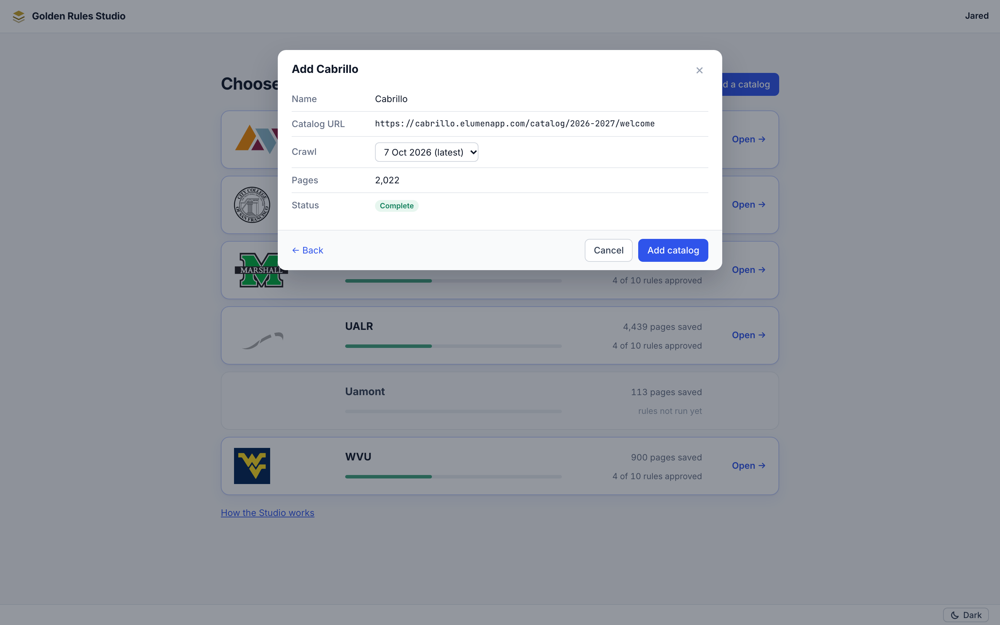

- **Confirm:** Name, Catalog URL, Crawl (a dropdown, the latest preselected, older crawls below it), Pages, Status.
  None of it can be edited. A crawl that isn't complete can be added, with "This crawl isn't complete, so the golden
  dataset won't be either." **Add catalog** starts the work and closes the modal.
- **What adding does** (`crawls add`, in the background): copy the crawl's `crawl.json` and `pages/` into the root
  (blob to blob on Azure; nothing when the crawls root is the root; files already there are skipped, so it can be
  rerun), `init`, `assets fetch`, then write the catalog's `name`, `seed_url`, `crawls_root`, `added_by` and
  `added_at` into its manifest entry. Anyone can add one; `added_by` is the profile's name.

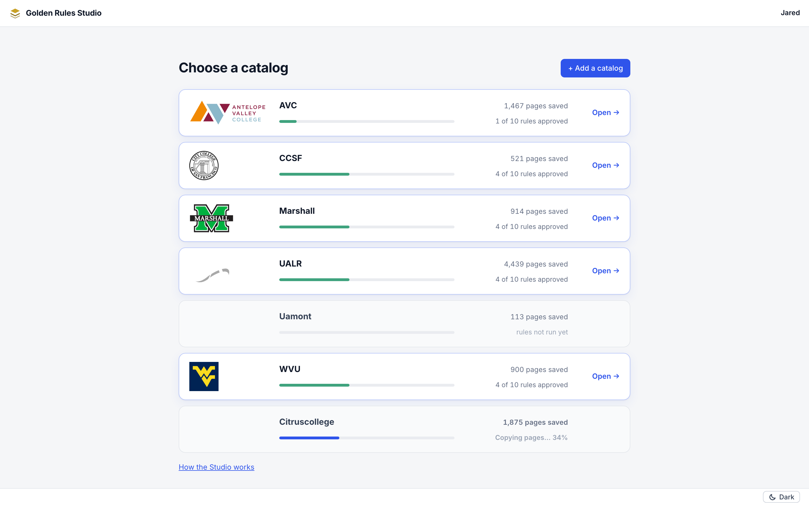

- **On the picker,** the new catalog's card shows its progress while it's added (Copying pages… N%, Indexing pages…,
  Saving page styles…), polled every 2 s, then becomes an ordinary card with "rules not run yet". If adding fails the
  card says "Couldn't add it" (the reason on hover) with **Dismiss**; adding it again resumes. Cards are sorted by
  the name they show. An added catalog's URL and `--catalog` name is its folder name.
- **Generate rules.** An added catalog has no rules, so its card says "rules not run yet" and has a **Generate rules**
  button instead of **Open →**. It opens a modal with the prompt for Claude Code (**Copy prompt**, **Download .md**;
  the same text as `golden-datasets prompt --first-rules`): write the catalog's first ruleset and publish it as v1.
  The prompt gives the setup, the catalog, its crawl, the most common URL shapes of its saved pages, the catalogs that
  already have rules as templates (one is **suggested** when the pages' markup or URLs name its platform: eLumen →
  AVC, CurricUNET → CCSF, CourseLeaf → Marshall, Acalog → UALR), the rule formats and settings, the limits, and five
  steps: look at the pages (`sql`, `pages get`), copy the template (`rule draft --catalog T --all --for C`), adapt it,
  `rule try` (for a first ruleset it prints what each rule finds: rows, rows with a value, signals), `rule publish`.
  Once v1 and its extraction exist, the card opens like any other.

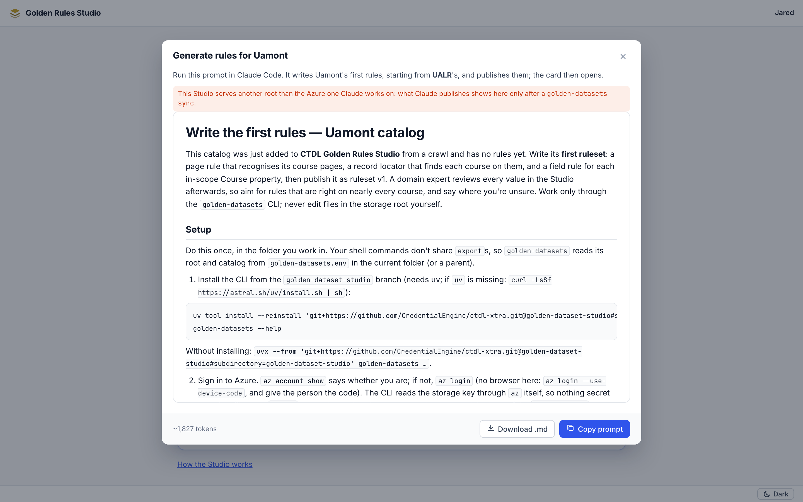

- **Not covered yet:** a newer crawl of a catalog already in the Studio (its row just says Already added; §12.3).

### 7.2 Rules tab (default)

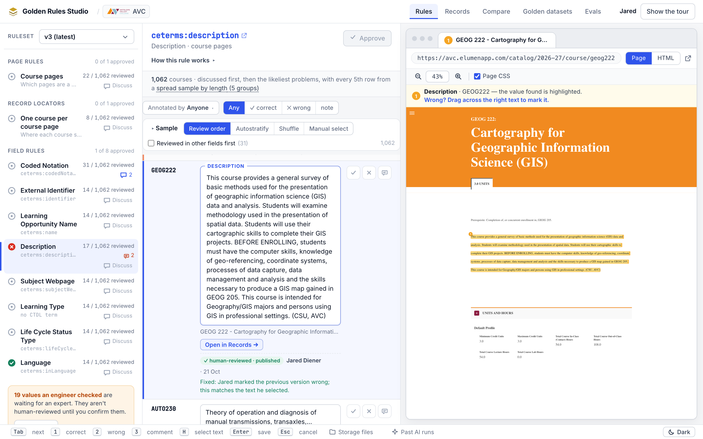

The Rules tab is designed for Jared.

**Left column: rules by kind.**
- Groups: **Page rules**, **Record locators**, **Field rules**.
- Each rule shows one status icon: green check = approved, red cross = needs work, neutral circle = in review.
- Status appears only here, not repeated in the header.
- Each rule shows how many of its rows have been reviewed, as whole numbers: "14 / 1,062 reviewed". How many courses
  the rule found a value for (its fill rate) is inside "How this rule works".
- **Discuss the ruleset** (top of the column, collapsed to one line with its count): a thread about the rules as a
  whole. A comment has a topic: **Suggests a new rule** (the default; a domain expert's heuristic counts, e.g. "every
  course in this catalog is in English: set `ceterms:inLanguage` to English for all of them"), **Suggests an
  approach**, or **Comment**.
- **Discuss** on each rule (its count once it has comments): opens that rule's own thread under it in the list, with
  a **Question whether this rule is needed** checkbox. A rule questioned this way keeps its status; the question goes
  to Claude, who answers it in its report rather than removing the rule (that's what happened with the learning-
  program rules, §12.1).
- Both threads show author, date, topic and, for a rule, the version it was said about. `⌘ Enter` posts.

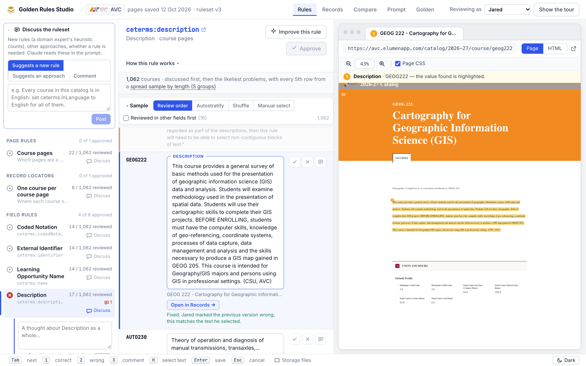

**Middle column: the selected rule.**
- **Title:** the CTDL term (`ceterms:description`), linked to its definition, with the plain property name under it.
- **Buttons:**
  - **Approve** is greyed out while any course is marked wrong or missing for this rule, with a tooltip saying why.
    A rule is rejected if even one course is rejected.
  - **Improve this rule** opens the Prompt tab with this rule selected.
- **"How this rule works ▸"** (collapsed by default) holds everything about the definition, in plain words: what it
  finds, how, why this version is better, the selector or regex, the version, the hash and what it depends on.
- **The current version only.** The Rules tab never shows two versions side by side; differences between versions
  live in the Compare tab.

**Rows:** one per course, sorted (by default, "Review order") with the likeliest problems first. The ordering comes from signals (§8), but
signals are never shown as tags: Jared doesn't see or enter them. Annotation happens on the row, with three
controls:
- **✓ correct**
- **✗ wrong.** The row expands inline: "Select the right text on the page →". It shows the captured selection and
  an optional note. This covers an empty value too: if the rule found nothing but the page has a Description, that's
  ✗ plus the right text. **Selecting text on the row's page does the same without ✗** (see "Highlight to annotate"
  below).
- **comment** (a speech-bubble icon). It opens a short note with a **question for the institution** checkbox. Jared
  is the domain expert; this is for things only the institution can answer.

Each row shows its verdict and who gave it. **The value sits in its own box**, so it stands apart from the caption,
history and buttons; an empty value's box is dashed ("nothing found"). Unselected rows show its first two lines.
**The selected row shows the whole value**, its paragraphs kept (the way the Records tab shows a field), in a
stronger box labelled with the field (DESCRIPTION, CODED NOTATION …, or FOUND on a page rule or locator), and an
**Open in Records →** button under it opens the course on the Records tab with this field and page selected. **Rows that already have a verdict fade back** (lower opacity, muted
colour), so the eye goes to the rows still waiting; hovering or focusing one brings it back. Keyboard: `Tab` moves to
the next row, `1` / `2` record correct / wrong, `3` comments, `H` starts the text selection (`A` / `W` / `C` still
work). These appear as a single hint line; the Records tab uses the same keys.

**"Missing" only exists for the rules that find things.** A field-rule row is a course the record locator already
found, so nothing on that row can be "missing": an empty value is simply wrong. Something is missing when a whole
course or page wasn't found:
- **Record locator** view: its rows are the courses it found on each page. "Add a course this rule missed" lets
  Jared select a course block on the page that has no row. That's recorded as `missing`.
- **Page rule** view: its rows are pages. "Add a page this rule missed" records a page that holds courses but wasn't
  recognized.

**How Jared notices that something is missing.** He can't see what a rule didn't find in a list of what it did find,
so the page pane shows it:
- In a record locator's view, every course block the rule found is outlined and numbered.
- Any text on the page that looks like a course code but sits outside every outlined block is marked in a different
  style. That's the `uncovered-code` signal (§8), for example "CFE 201 fulfils CORE 8 Requirements" on an AVC program
  page.
- A one-line legend says "outlined = found by this rule · marked = looks like a course but wasn't found".
- Pages with marked text come first in the list.
- For page rules, the `unclassified-page-with-codes` signal does the same job: pages not recognized as course pages
  but full of course codes come first.

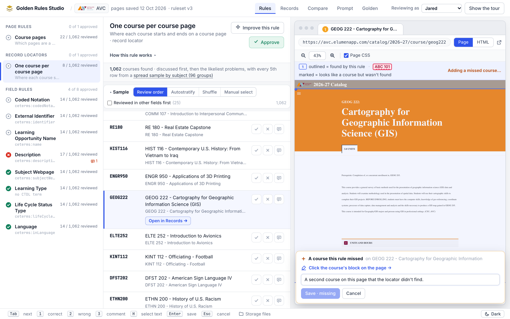

**Right column: the page pane.**
- The whole saved page, in a browser-like frame: a tab per page in view, the URL, a Page | HTML switch, and "open
  live".
- A second row of view tools under the URL:
  - **zoom out / zoom level / zoom in.** Zoom works like browser zoom: the page is laid out narrower and scaled up,
    so it reflows instead of scrolling sideways. The level shows the real on-screen size; clicking it goes back to
    fitting the pane.
  - **Page CSS** (on by default). Off, the page's own stylesheets and inline styles are disabled and a plain,
    readable style is used, to see the content and its structure. The Studio's highlights stay.

  Neither changes the page's DOM, so css paths, highlights and text selection keep working. Both are remembered in
  the browser.
- The value for the selected row is highlighted and scrolled into view (§9).
- **Open record →** on the selected row opens the course in the Records tab, with this field and this page's entry
  selected (a course listed on several pages keeps the entry Jared came from).

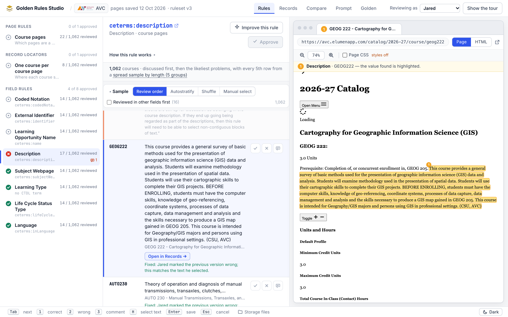

**Highlight to annotate (D5).** Jared selects the right text on the page. The row shows only that text, an optional
note, and Save / Cancel. The `css_path` and offsets are stored, never shown.
- **No ✗ needed.** On a field rule, the page banner says "Wrong? Drag across the right text to mark it." Dragging
  across text on the selected row's own page opens the ✗ draft with that text (✗ turns on). Selecting the value
  the rule already found does nothing, so copying it doesn't mark the row wrong. Selections count only on the row's
  own page (tab 1), where the expected text is located; on another tab the banner points back to tab 1.
- **Several pieces.** Each drag adds a piece of the answer; a drag over a piece replaces it. Pieces stay in page
  order, whatever order they were selected in, and are saved as one `expected` with `segments` (§4.1). The banner
  counts them ("Your answer is outlined (2 pieces)").
- **× to undo.** Every piece has a × at its end on the page and another beside its quote in the row; either removes
  that piece. Whitespace a drag picks up at either end (the line break after a paragraph) is left out.
- A saved wrong verdict with several pieces outlines every piece on the page.

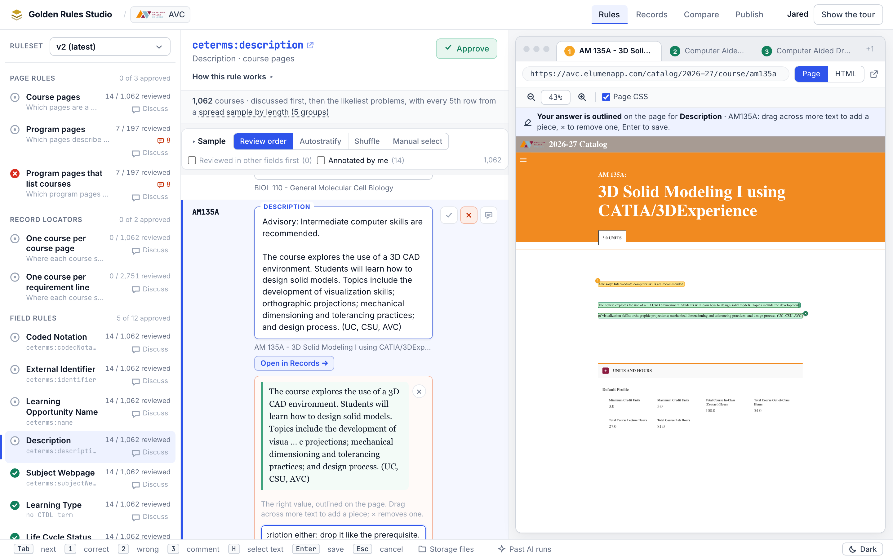

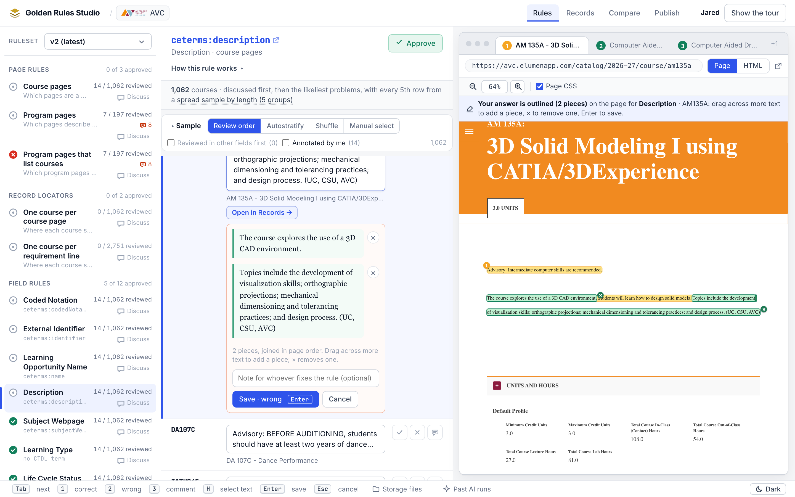

**Question for the institution.** A comment with "question for the institution" ticked carries Jared's question. It's left out of the
prompt's list of rule bugs:

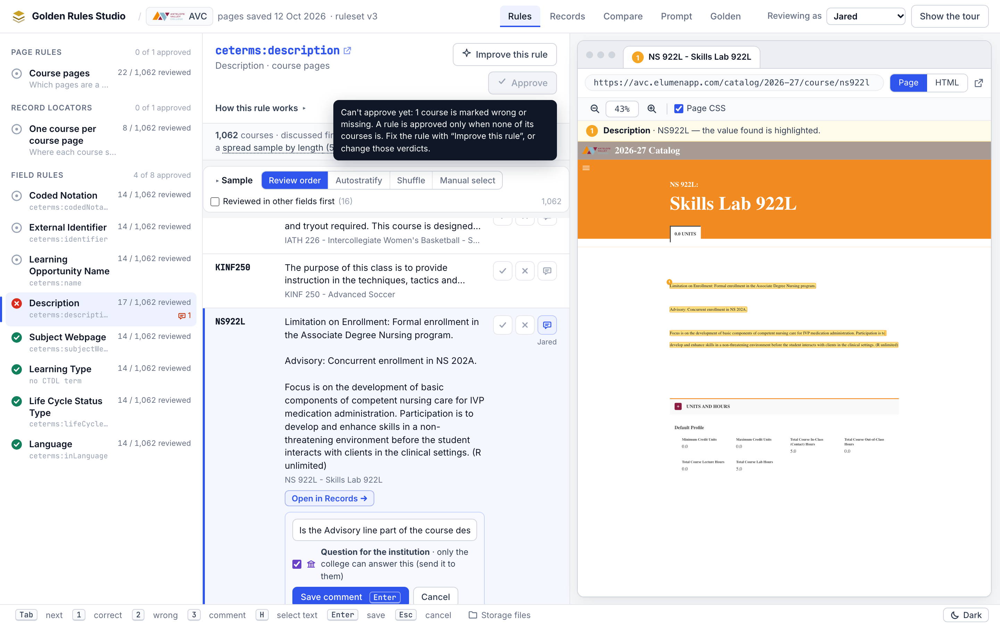

Rows Jared had marked wrong that a new version made right show **fixed** (screen 03 shows them on
`course-description`).

**The Sample drawer** sits above the rows and decides which rows come first. It cuts the rows along several
**strata** at once: the value's length (an equal-width histogram), paragraphs, leading label ("Prerequisite:",
"Advisory:", a label of 1–4 words), distinct value or shape (codes, URLs), course subject, URL pattern, courses on
the page, signals, review state, **Annotated by** (who marked or commented on the row, in any ruleset version; one
bucket per person, plus "nobody") and **Annotated in** (the ruleset versions those annotations were made in, plus
"not annotated"). Modes:
- **Review order** (the default): discussed rows first, then rows with signals, with every 5th row from a spread
  sample.
- **Autostratify:** cross the strata that split the rows most evenly (up to 3, 2–8 buckets each; never review state,
  signals, rule, Annotated by or Annotated in), or the ones picked in the drawer. Go through **3 rows of each combination**, the rarest
  combinations first (the ones least like the bulk of the rows), then round again until every row is listed.
  Empty combinations never show.
- **Shuffle:** a seeded random order, with **Reshuffle**.
- **Manual select:** every stratum as a histogram, **one bar per bucket: how many rows fall in it**. Click bars to
  filter (bars of one stratum are ORed, strata ANDed); a stratum's own filter is left out of its counts, so its
  other buckets stay pickable. Strata where every row is in one bucket are listed on one line, set aside.

The drawer **closes by itself as soon as the reader moves to another row** (click, `Tab`, arrows, or the next row
after a verdict), so it stays out of the way while reviewing; filters and mode stay as set. Filters stay on in every
mode and show as removable chips. **A row shows its strata tags only when a filter or
Autostratify is on** (its bucket in each crossed or filtered stratum), so it is clear why it is listed; otherwise
rows carry no strata labels.

**Reviewed in other fields first** (a checkbox with its count): rows nobody has reviewed for this rule yet, whose
course someone marked or commented on in another rule (or whose page, for page-rule verdicts), come first, tagged
"Reviewed in: Description, …". A record's fields get finished together.

**Annotated by** (above the rows, replacing the drawer's "Annotated by me" checkbox and its Annotated by stratum):
pick a person, Not annotated yet or Any engineer · waiting for an expert, and a verdict; experts get **Confirm** on
engineer-checked rows. [Evals spec](evals/03-spec.md) §6.7, with the screens in §9.

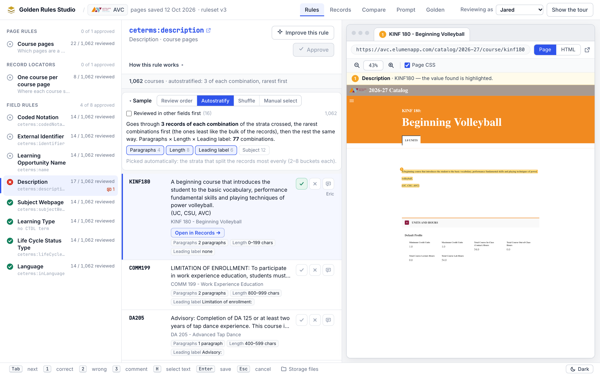

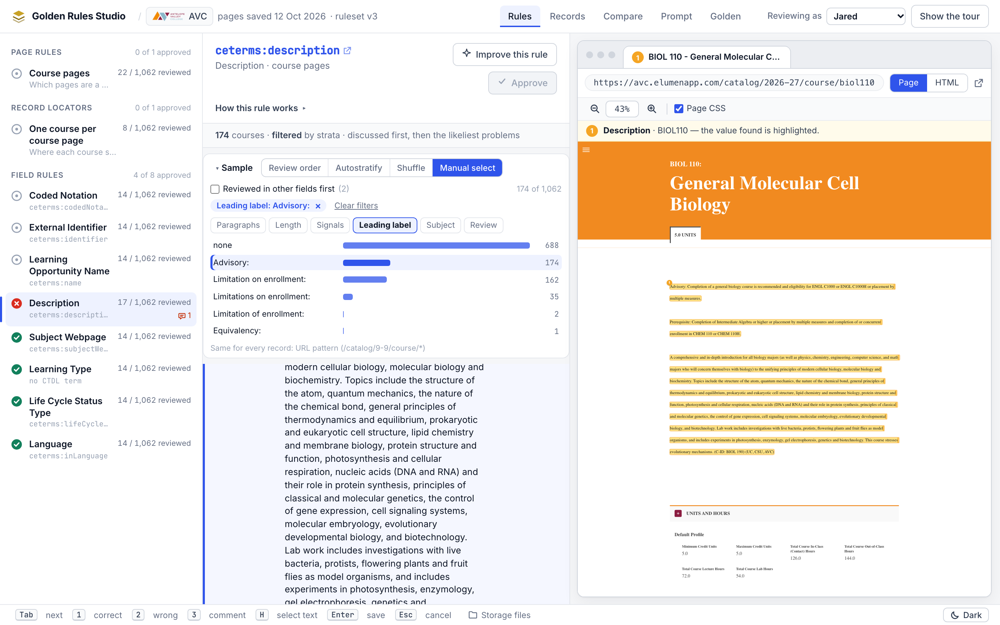

### 7.3 Records tab

One course with every in-scope field as a card, v2-style. The same page pane shows numbered highlights for each
field. Verdicts made here are the same `verdict` events, targeting (field rule, occurrence), so both tabs show them
(D6). Each value sits in its own box; the selected one shows in full, in a stronger box labelled VALUE, with an
**Open in Rules →** button under it that opens that field's rule in the Rules tab with this course selected and its
page shown:

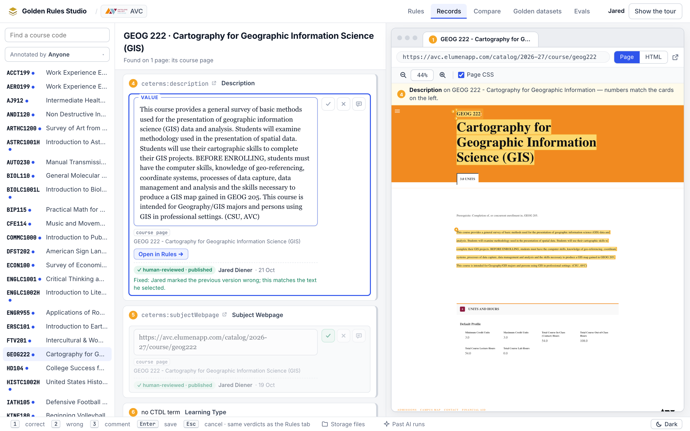

### 7.4 Compare

The top has two dropdowns, **From** and **To** ruleset versions (the latest two by default), and nothing else.

**Left column.** "All changed rules", then each rule that changed between the two versions, by its CTDL term, with a
count of changed records. Selecting one filters everything on the right.

**Right side, in order:**
1. **One summary line:** "278 records changed · 5 fixed · 0 still wrong · 0 newly wrong". Zeros are muted inline,
   not boxed.
2. **"Why this version ▸"**, collapsed to one line.
3. **Jared's earlier verdicts**, compact and side by side: old value → new value with a word diff, and the outcome
   (fixed / still wrong / newly wrong / unchanged). This is Eric's A4.1 ordering.
4. **Signals, before → after.** Each signal is clickable. It expands into the records that **lost** it (−) and the
   records that **gained** it (+), each showing old → new with a word diff.
5. **Other changed records:** every changed record without a verdict, a page at a time (**Previous / Next**, 50 per
   page by default; 25, 50, 100, 200 or 500, remembered in the browser). The same **Sample** drawer as the Rules tab
   (Autostratify, Shuffle (the default), Manual select), over these records; its strata add how the value changed
   (shorter, much shorter, emptied …) and the leading label in A. Records show their strata tags when a filter or
   Autostratify is on.

**"See on page →".** Every record in the comparison has this link. It opens the Rules tab with that record selected
and highlighted on the saved page. Compare has no page pane of its own.

The same numbers are what `golden-datasets rule try` prints.

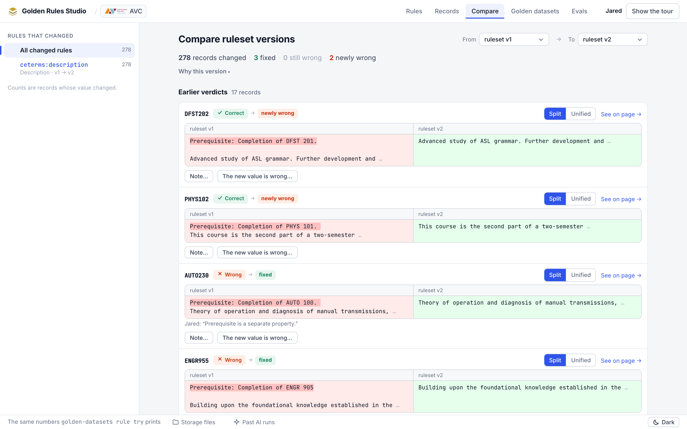

Full page: [`screens/08-compare-full.png`](screens/08-compare-full.png)

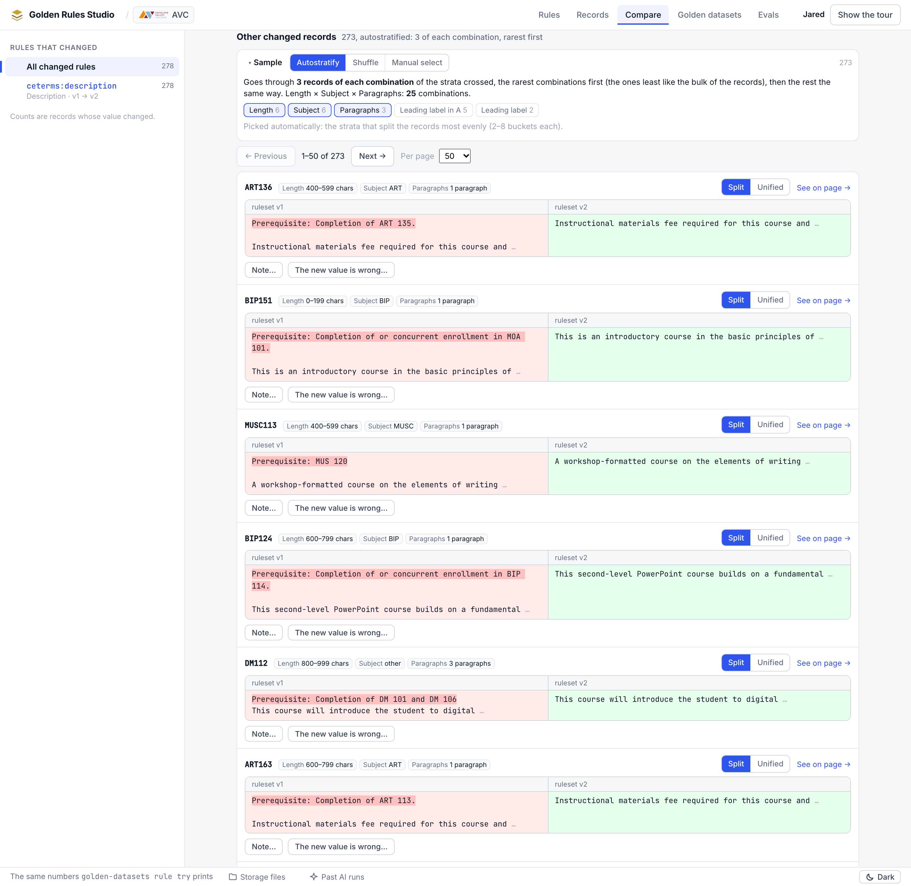

### 7.5 Prompt

Scope: **one rule** or **all rules needing work**, as two radio buttons. Under **One rule**, and only when it is
picked, an indented list grouped like the Rules tab (page rules, record locators, field rules) shows each rule with its
status icon, name, CTDL term and count of open verdicts; the selected rule is scrolled into view.

**Where Claude works: Local | Azure.** Local points Claude at the root the Studio was launched with (no hard-coded
path); Azure at the shared Azure root (`serve --azure-root`), after `az login`, from any machine. When the Studio
itself serves Azure, both give the Azure setup. The sidebar warns when the branch has commits GitHub doesn't, and when
the Studio serves another root than the one Claude would publish to. The text is deterministic: the same annotations always
give the same prompt. It contains:
- the task and its limits;
- **Setup:** install the CLI from this branch with uv (§6), sign in to Azure (Azure only), write `golden-datasets.env`
  with the root and catalog, and check it with `golden-datasets rule show`;
- the catalog, crawl, ruleset and storage root (a table);
- each in-scope rule's definition and what/how/why;
- every open annotation as a table (verdict, course, page stem, value seen, expected text + location, notes);
- the values marked correct, which must not change (a table), and the signals (a table);
- for all rules needing work, a table of those rules first;
- `golden-datasets` commands as a table (step, command, what it gives), noting that everything above comes from them;
- the publish rule ("only when nothing correct changes");
- each rule's **comments on the whole rule** (a table; when someone questions whether the rule is needed, Claude is
  told to answer in its report, not to remove or rewrite the rule for that), and the **comments on the ruleset**
  (suggested rules and approaches), with a note that a domain expert's heuristic becomes a field rule with
  `rule_type` `constant` (or `source_url`) when the pages can't contradict it.

There's **no raw HTML**. Pages are referenced by stem, fetched with `golden-datasets pages get`. The left side shows size
(characters, ≈ tokens) and the number of page references. Buttons: **Copy prompt** and **Download .md**.

The preview has a **Raw | Rendered** switch. **Raw** (the default) is the exact Markdown that is copied. **Rendered**
shows it formatted (headings, lists, tables, code); it never interprets the text as HTML, since the prompt quotes
catalog pages.

**What changes is highlighted.** In both views the rule's definition (the first JSON block of a rule section) has the
strongest highlight, and what comes from the rule and its annotations (each rule section, "The N rules", the questions)
is tinted. The template (setup, context, limits, how to work) is faded, and comes back on hover. The copied text is
unchanged.

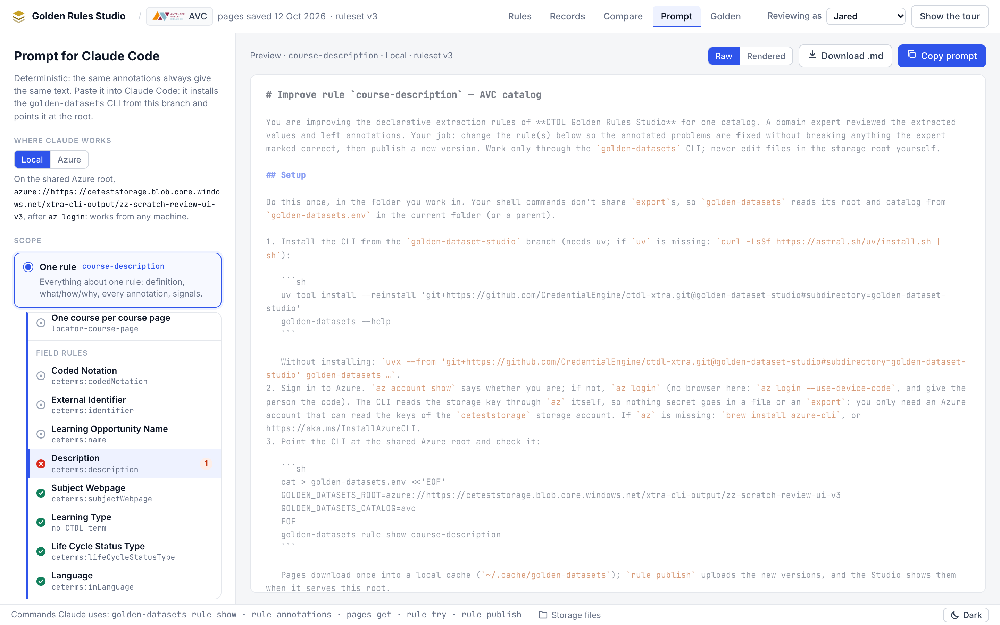

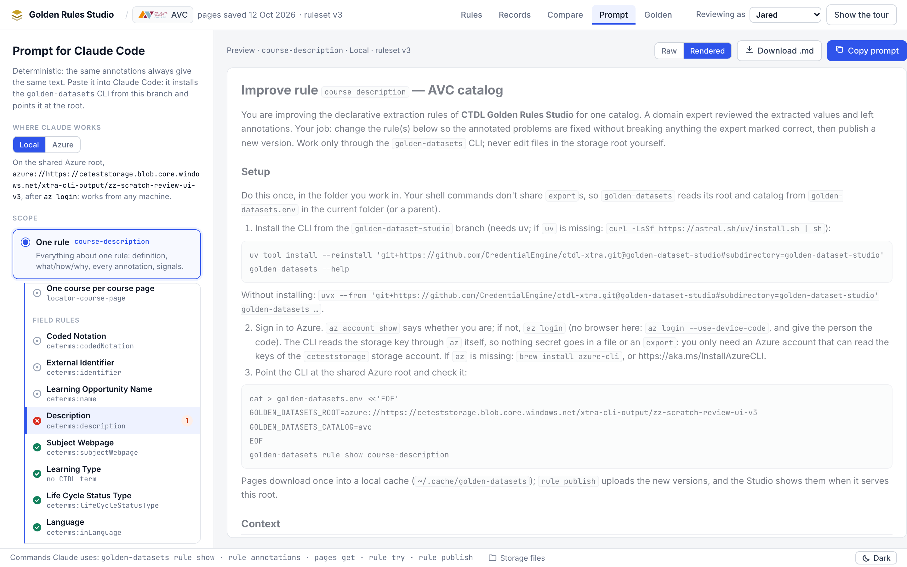

Full prompt: [`screens/09-prompt-full.png`](screens/09-prompt-full.png)

### 7.6 Publish

**Superseded:** approving a column's rule publishes it, and this tab is now the read-only **Golden datasets** tab
([Evals spec](evals/03-spec.md) §6.6, §9). The Publish tab as first built:

The tab is called **Publish** (old `#/c/<catalog>/golden` links still open it). It publishes the golden dataset **one
property at a time**: just because other fields' rules aren't approved yet doesn't hold back a field whose rule is.
- **Properties:** one line per property (Coded Notation … Language) with a checkbox, its CTDL term, its field rule's
  status (linked to the rule) and when it was last published ("published 2026-10-27 · v2", or "not published yet").
  A property can be ticked only when its rule is approved; the approved ones are ticked to start with.
- **Which courses exist** comes from the page rule and record locator: their status is shown on one line and recorded
  with each publication, but it doesn't hold a property back.
- **Publish Description** (or **Publish N properties**) writes the ticked properties from the current extraction to
  `xtra-golden-sets` and keeps every other property as earlier publications wrote it (§5.6).
- **What will be written** shows the target and the files; each opens as a sample of what this publication would
  write: a page's JSON merged with what the golden set already has, its HTML, the lineage rows of the ticked
  properties, and `publication.json`. It also lists `golden_record_id` collisions for Jared to confirm (§4.2), and earlier
  publications.

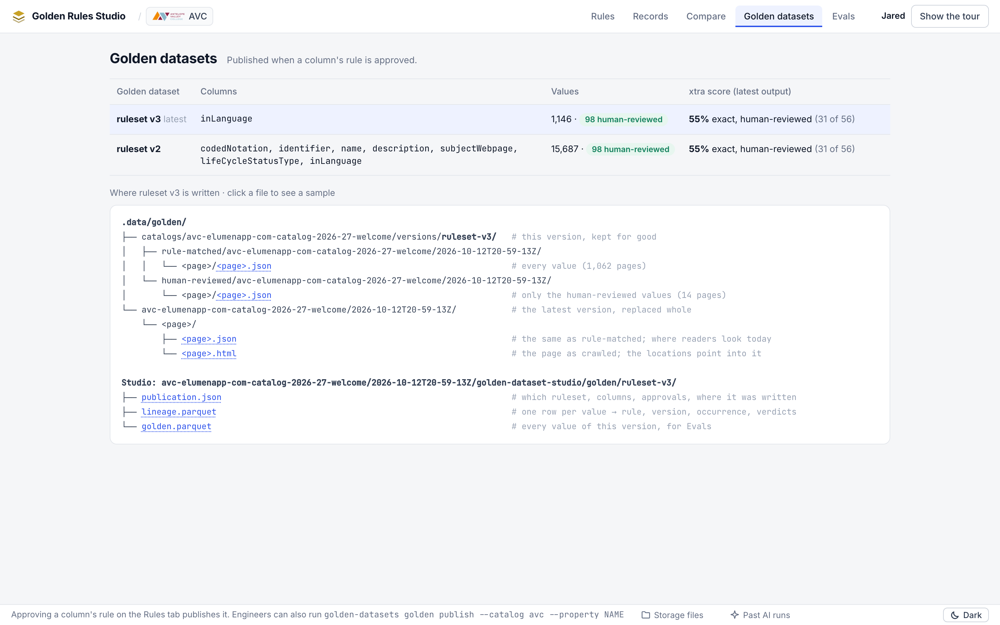

### 7.7 Page pane: HTML view

The **HTML** switch shows the saved markup around the matched element, with the same numbered highlight. It's for
cases where the rendered page hides something:

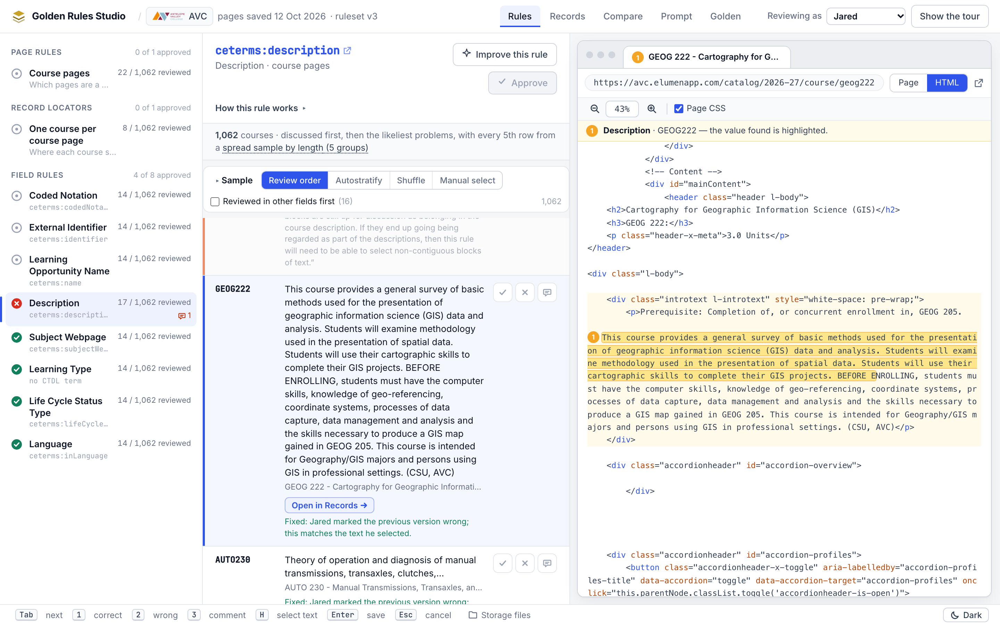

### 7.8 The tour

A **Show the tour** button sits at the top right of every screen, as in the v1 mockup. That mockup's version is
`~/repos/xtra-mockup/viewer/src/Tour.tsx`, also on branch `docs/mockup-human-inputs`; reuse its approach.
- **How it works.** Each step lights up one area of the real screen and puts a short card beside it. Where it helps,
  the step *does* the action on real data, as the reader would: selecting a row, highlighting the value on the page,
  opening "How this rule works". Leaving the step undoes it. `Esc` closes the tour.
- **When it opens.** Automatically the first time someone opens a catalog in this browser (remembered locally).
  After that, only from the button.
- **Steps**, in order:
  1. the rule list and its status icons (approved, needs work, in review), and "14 / 1,062 reviewed";
  2. **the three kinds of rules**, one after another: page rules pick the pages that hold courses, record locators
     find where each course starts and ends on them, field rules read one field of each course (with this catalog's
     own examples and counts). A wrong page rule or locator affects every field after it; "missing" exists only on
     page rules and locators;
  3. the rows: discussed first, then the likeliest problems, and the **Sample** drawer that changes the order;
  4. ✓ and ✗ on a row: ✗ is pressed for the reader, and both **the ✗ button and the value on the saved page** are
     lit (the highlight inside the page pane's iframe, mapped to the screen), with the card over the rule list so
     neither is covered. The card says to drag across the text the rule should have found;
  5. the comment bubble and "question for the institution";
  6. the page pane: highlight, Page | HTML, open live;
  7. in a record locator's view, outlined courses, marked text, and "Add a course this rule missed";
  8. **Improve this rule** and "How this rule works";
  9. **the Prompt** that Improve this rule opens, before Compare: the raw prompt scrolled to **the reader's feedback**
     (the "Open annotations" lines, lit), with Copy prompt;
  10. **Compare** after a new version: Jared's earlier verdicts first, and "See on page";
  11. **Approve**, and why it's greyed out while any course is wrong.

### 7.9 Storage files (debugging)

A **Storage files** link (with a folder icon) in the bottom bar, next to Light / Dark, opens a read-only view of what the Studio keeps for
the catalog on its storage root, to see how it works under the hood. It is out of the way on purpose: a debugging
tool, not part of the review.
- **Left:** the files as a **tree of the storage layout**, from the root folder down: the root's
  `golden-dataset-studio/manifest.json`; the catalog's folder with its rules (one folder per rule, one file per
  version), rulesets and annotation log; its crawl folder with `crawl.json`, `pages.parquet`, the asset tables,
  extractions (one folder per run) and golden publications. Not the saved pages or archived asset files. Folders
  have a folder icon, guide lines, a count of the files under them and, for some, a short note ("one folder per
  run of a ruleset"); a click collapses one, but the selected file's folders stay open. Each file shows its size,
  and on hover what it is.
- **Right:** the selected file (the annotation log first), with its full URI and a sentence on what it is. JSON is
  pretty-printed; the annotation log is one event per line, **newest first**, filterable (an author, a course code, a
  rule), 100 at a time; Parquet is a table, filterable on any column, 100 rows at a time.
- **Azure portal links** (when the root is on Azure): the header links to the storage account's Storage browser and
  each file to its blob page in the portal (both work for whoever is signed in to Azure). The account's resource id
  comes from `az storage account show`.

The listing lists the root (the Studio itself never does), so it is cached for 10 seconds.

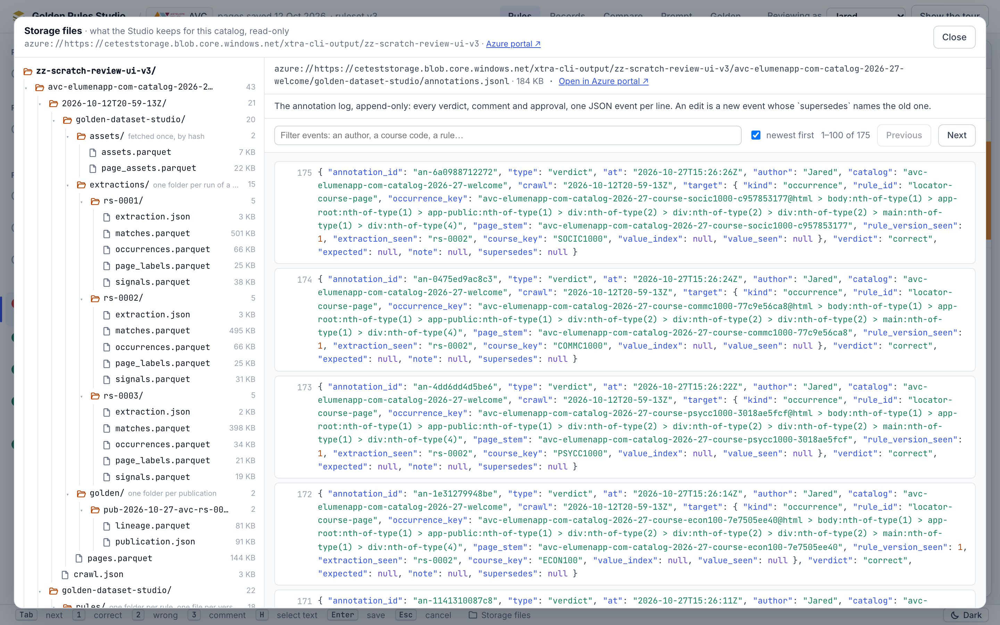

## 8. Uncertainty signals

A signal is a named, deterministic check (no LLM) that gives `(signal, severity, detail)` for a match, an occurrence
or a page. **Signals are computed, never entered by people, and never shown to Jared as tags.** They decide the order
of rows in the Rules tab, and their counts appear in Compare and in `golden-datasets rule try`, so a developer can see
whether a new version made things better.
- **Value and comparison signals** are computed at extract time into `signals.parquet`.
- **History signals** are computed when read, because they depend on annotations and on the version being compared.

The rule view orders rows by severity, then signal count, then a seeded random sample of rows with no signals, so a
reviewer always sees some "boring" rows. The comparison is the same view sorted by history signals (A4.1). Thresholds
(for example the catalog's course-code pattern) live in the ruleset `settings.signals`.

| Signal | Applies to | Severity | First release? |
|---|---|---|---|
| `empty` / `no-match` | field rule | high | ✓ |
| `shape-outlier`: value shape (`A`=letter, `9`=digit) is rare for this rule | field rule | medium | ✓ |
| `length-outlier`: outside the 1st–99th percentile | field rule | low | ✓ |
| `contains-label-text`: starts with "Description:", "Prerequisite", "Units" … | field rule | medium | ✓ |
| `duplicate-value`: two different courses share a Description or Name | field rule | low | ✓ |
| `duplicate-occurrence`: same `course_key` twice on one page | record locator | high | ✓ |
| `block-count-mismatch`: candidate blocks on the page ≠ occurrences found | record locator | high | ✓ |
| `uncovered-code`: course-code pattern on the page outside every occurrence ("possible missed course") | record locator | high | ✓ |
| `unclassified-page-with-codes`: a non-course page with many code patterns ("possible missed page") | page rule | medium | ✓ |
| `previously-wrong` / `previously-correct` / `changed-since-correct` | any | high | ✓ (history) |
| `new-in-version` / `vanished-in-version` | any | medium | ✓ (history) |
| `cross-field-mismatch`, `markup-leak`, `not-in-vocabulary` | field rule | low | later |

What the prototype learned on AVC (rs-0001 → rs-0002):
- **`contains-label-text` is the most useful signal.** It went from 547 to 273. It also surfaced 174 "Advisory:" and
  199 "Limitation on Enrollment:" lines that Jared hadn't seen.
- **`shape-outlier` needs a dominance test.** Applied naively to course names, it flagged 296 of them. It now runs only
  when the rule's most common shape covers ≥ 50% of values (`settings.signals.shape_dominance`), which is true for codes
  but not names.
- **`unclassified-page-with-codes` fires on 129 AVC pages,** most of them legitimate lists (`allcourses`, department
  indexes, AP/CLEP tables). It needs a per-catalog allow-list (`settings.signals.page_allow`) to be useful.
- **History signals are computed when read, never stored.** They depend on the mutable log and on which two versions
  are being compared.

## 9. Page rendering

All of this was measured in the research (`research/rendering.md`).

- **What's shown:** the **whole saved page**. Scripts and inline handlers are removed. Every stylesheet and `<style>`
  is kept *wherever it is* (AVC's theme is inside `<body>`).
- **How it's served:** in an iframe sandboxed with `allow-same-origin` only, from the Studio's own URL, with CSP
  `script-src 'none'`. It's laid out at desktop width and scaled to fit.
- **The frame:** it imitates the v1 mockup: a tab per page, a Page | HTML switch, and coloured highlights with
  numbered badges.
- **Where CSS, fonts and images come from:** the archive written by `golden-datasets assets fetch`, with URLs rewritten to
  `/assets/<sha256>`. If something isn't archived, the live URL is used. Storing licensed fonts is fine because they
  aren't redistributed (Eric).
- **Highlighting:** `element_css_path` is relative to the document root, so it resolves directly. The parent page adds
  a highlight class and scrolls to it.
- **Highlight-to-annotate:** the parent reads `iframe.contentWindow.getSelection()` (same origin, page scripts
  blocked) and stores `{text, css_path of the nearest element, char_start, char_end, prefix, suffix}` as the
  annotation's `expected`.
- **Fallback for JavaScript-dependent content.** It's not needed for the five catalogs, because the saved HTML is the
  rendered page. In order:
  1. a per-catalog `pane_css` that reveals hidden content;
  2. a link to the crawled page that holds the content;
  3. the live page in a new tab.

## 10. Performance budget

The research showed every v2 delay comes from serial storage round trips. The Studio's rules:
- **no container listing at run time** (the manifest says where everything is);
- **immutable files are read once and cached on disk**;
- **the annotation log is read incrementally** (remember the byte offset);
- **pages are fetched when shown, and the next few rows' pages are prefetched** (Eric's suggestion).

| Action | Budget (Azure scratch, cold server) | Budget (warm) |
|---|---|---|
| Open the catalog, rule list shown | ≤ 2 s | ≤ 300 ms |
| Switch rule (rows shown) | ≤ 500 ms | ≤ 150 ms |
| Next row (page pane updated) | ≤ 1 s | ≤ 100 ms (prefetched) |
| Record a verdict | ≤ 300 ms | ≤ 300 ms |
| Open Compare (two extractions) | ≤ 2 s | ≤ 300 ms |
| `golden-datasets rule try` on WVU (largest) | ≤ 30 s on a laptop | |
| `golden-datasets rule publish` upload | ≤ 15 s (a few Parquet files) | |

These budgets are acceptance criteria. Each work stream that touches the hot paths measures them with a script in
`golden-dataset-studio/bench/`.

## 11. Sequence of work

### 11.1 Work streams

| ID | Work stream | Depends on | Parallel with |
|---|---|---|---|
| **V2** | v2 speed fixes. Already running in its own Superset workspace (`review-ui-v2-speed-fixes`) | — | everything |
| **W0** | Storage layer: local / `azure://` root, disk cache, manifest with ETag, append-only log, `golden-datasets sync` | — | W1 |
| **W1** | Page pane: whole-page renderer, `golden-datasets assets fetch`, browser frame, highlight + selection capture | W0 (reads pages) | W2, W3 |
| **W2** | Data model + engine: rule/ruleset versions, `extract` → Parquet (root-relative paths, memoized `css_path`), rerun scope, `golden-datasets check`, `import-v2` | W0 | W1 |
| **W3** | Signals (value + comparison at extract, history when read) | W2 schema | W1 |
| **W4** | UI: catalog picker, Rules tab, annotation bar, Records tab | W2, W1, W3 | W5 |
| **W5** | Compare (UI + scorecard library shared with `rule try`) | W2, W3 | W4 |
| **W6** | Claude loop: `golden-datasets rule show/annotations/draft/try/publish`, `pages get/sample`, prompt generator (CLI + UI button) | W2, W5 (scorecard) | W4 |
| **W7** | Golden publication + lineage | W2 | late |

### 11.2 Order

```
week-ish:   1            2            3            4            5
V2   ████████████ (separate workspace)
W0   ██████
W1         ████████████████
W2         ████████████████
W3                     ██████
W4                          ████████████████
W5                          ██████████
W6                                ████████████
W7                                            ██████
           ▲ M1          ▲ M2        ▲ M3          ▲ M4
```

*Weeks only show order and overlap. Eric asked for no dates.*

- **M1, data in place:** `golden-datasets sync`, `init`, `import-v2`, `extract`, `check` work for AVC. `golden-datasets sql` answers "every value
  of rule X".
- **M2, thin slice:** the Rules tab shows one rule (`course-description`) on AVC with the full page pane. Annotations
  are recorded.
- **M3, the loop closes:** prompt → Claude → `rule try` → `publish` → Compare shows v1 → v2 for the real "prerequisite
  in Description" problem.
- **M4, all five catalogs, every in-scope rule, golden publication.**

What can be **parallel**: V2 with everything. W1 with W2 (they only share W0's storage interface). W4 with W5 and W6
once W2 and W3 have fixed the schema. What's **inherently sequential**: W0 → W2 → W3 → (W4, W5) → W6 → W7, because each
needs the previous one's files.

### 11.3 How to run the parallel streams

Each stream gets its own Superset workspace and branch (as V2 does), with a bounded prompt that points at this spec.
The schema in §4–5 is the contract between W1, W2 and W4–W6. Changing it means changing this spec first.

## 12. Decisions and open questions

### 12.1 Decided (Eric, 2026-10-26)

- **Package location:** a top-level `golden-dataset-studio/` folder in the repo, next to `review-ui-v2/`.
- **Who may approve a rule:** anyone using the UI. The Studio isn't exposed widely, so there's no role check. Every
  approve event records its author, and the UI shows who approved.
- **Golden output format:** keep the existing per-page shape of `xtra-golden-sets-verified`, so its current readers
  keep working, and add `location` to each field and `golden_record_id` to each record (§5.6).
- **Who approved each value, and `golden_record_id`** (Eric, 2026-10-27): every published value, record, lineage row
  and publication says whether a person approved the value or its rule did (§5.6); `golden_id` is renamed
  `golden_record_id`.
- **Golden output place, and publishing per property** (Eric, 2026-10-27): publications go to the `xtra-golden-sets`
  container, not `xtra-golden-sets-verified`; the Golden tab is now **Publish**, and it publishes one property (or a
  few) at a time, each once its field rule is approved, whatever the other fields' rules say (§7.6).
- **A v2 reject and its correction by different people** (GEOG222: Jared rejected the value, Seth typed the correct
  text): the `wrong` verdict's author is the person who rejected it (Jared), and `expected.author` is the person who
  typed the text (Seth).

- **One shared root: Azure** (Eric, 2026-10-26). The Studio serves
  `azure://https://ceteststorage.blob.core.windows.net/xtra-cli-output/zz-scratch-review-ui-v3`; only what is
  persisted there is kept. The laptop root had diverged from it and was dropped (Claude's laptop-only
  `course-description` v2, a few comments, and the Marshall and UALR Studio files). The benchmark's "bench: timing a
  write" comments were deleted from the Azure logs.

- **Learning programs are out of scope** (Eric, 2026-10-27). A program's requirement lines aren't courses, so every
  catalog dropped the 7 learning-program rules: the page rules `program-page` and `program-page-with-courses`, the
  record locator `locator-program-requirement`, and the field rules `stub-code`, `stub-external-id`,
  `stub-learning-type` and `stub-name`. Each catalog got a new ruleset version without them (AVC v3, the others v2)
  and its extraction; the older versions stay on the root, immutable. An extraction copied from its parent keeps no
  rows of a rule its ruleset dropped (labels, occurrences, matches, page signals), and `check` compares copied
  tables on the rules that remain.

- **Add a catalog** (Eric, 2026-10-27): from the picker, only from crawls xtra-cli has already made (the Studio never
  starts one; new catalogs are crawled by engineering). Everything shown comes from `crawl.json`, never typed in and
  never from the xTRA Sources sheet (the Studio has no Google access). We use the latest crawl; incomplete crawls can be
  added with a warning; anyone can add one (§7.1). Its first rules come from **Generate rules**: a prompt that has Claude
  Code adapt a template catalog's rules and publish ruleset v1 (`rule try` / `rule publish` accept a catalog with no
  ruleset; its settings start from import-v2's defaults, and each locator's course key is its Coded Notation rule).

### 12.2 Questions for Jared

Both come from his real AVC review in v2, which the prototype imported. Each is written so it can be forwarded to him
as is.

**Q1. "Course" on program pages.** *Moot since 2026-10-27: the program-page rules are gone (§12.1).* In v2, AVC program pages (for example *Computer Engineering AS*) showed a page
label **Course**. v2 meant "this page *lists* courses", because a program's requirements name courses such as MATH150
and CS150, and v2 extracts those as short course entries. On 7 program pages Jared rejected that "Course" label and
added Credential or Competency instead. On one of them he also left a flag: *"Properties listed here are all for
courses. Should I reject all these properties? Skip this page altogether?"*

> *Question for Jared:* When you rejected "Course" on those program pages, did you mean (a) "this page is a program,
> not a course", or (b) "the courses listed on this page shouldn't be extracted"?
>
> If (a), the rule is fine. v2's label wording was misleading, and the Studio fixes that by calling the rule "program
> page with courses". If (b), the Studio should stop extracting course entries from program pages.

**Until he answers:** the import counts the 7 rejections as **wrong** on the page rule `program-page-with-courses`.
So that rule shows *needs work*, possibly for a reason that isn't real.

**Q2. "Advisory:" and "Limitation on Enrollment:" lines in AVC descriptions.** Many AVC course descriptions start with
one or more short lines before the description itself:

| Kind of line | Example (real) | AVC courses |
|---|---|---|
| Prerequisite (or Corequisite) | "Prerequisite: Completion of, or concurrent enrollment in, GEOG 205." | 278 (the ones v2 changed) |
| Advisory | "Advisory: Intermediate computer skills are recommended." | 174 |
| Limitation on Enrollment | "LIMITATION ON ENROLLMENT: To participate in Cooperative Work Experience, students must…" | 199 |

Jared marked 5 descriptions wrong because they started with a **Prerequisite** line ("Prerequisite should be a
separate property"). So `course-description` v2 removes Prerequisite lines. But he marked 4 descriptions **correct**
that start with an Advisory or Limitation line (ACCT199, AERO199, CFE114, NS922L). So v2 keeps those lines, and 138
descriptions still contain a Prerequisite that comes after one of them.

> *Question for Jared:* Should Advisory and Limitation on Enrollment lines be part of a course's Description, or
> removed like Prerequisite lines?
>
> Either answer is a one-rule change: v3 of `course-description`.

### 12.3 Follow-ups

- **A newer crawl of a catalog already in the Studio:** switching crawls means re-extracting and carrying annotations
  across crawls.
- **UALR needs a recrawl.** Many UALR courses appeared only as short entries on program pages, because their course
  pages weren't crawled; with the program rules gone (§12.1) those courses aren't in the dataset at all. Recrawling is
  xtra-cli's job (outside the Studio).
- **Row comments in the prompt.** Comments on a whole rule and on the ruleset now reach the prompt. A comment on a
  row still reaches it only when the row has an open verdict; comments on their own,
  or on rows already fixed or marked correct, don't. Add a Comments table per rule section.
- **`sync` with diverged roots** overwrites an immutable file (a rule or ruleset version) whose size differs; it should
  refuse instead.
- **Marshall and UALR on Azure:** their pages and Studio files exist only in the dropped laptop root; sync them up
  (about 590 MB) to bring them back.
- **The web UI in the package**, so `uvx … golden-datasets serve` works for teammates without a checkout.
