# S — Spec: Evals

How the CTDL Golden Rules Studio shows how closely xtra's extract output matches the golden dataset. Written
2026-10-28 from [`principles.md`](principles.md) and Eric's answers of the same day (recorded in §1). It replaces the
POC's design ([`poc.md`](poc.md)). **Mockups (§6) come first: review them before anything is built.**

## 1. Decisions (Eric, 2026-10-28)

| # | Question | Decision |
|---|---|---|
| 1 | What is a golden dataset version? | **A publication.** There are many more ruleset versions than golden datasets. Each golden dataset comes from exactly one ruleset version. A rule found wrong after publishing is fixed and the column republished, which makes a new version. Each column has exactly one rule (some rules aren't for columns). |
| 2 | Can unpublished rulesets be scored? | **Yes, as clearly marked drafts, and tucked away:** never the first way to do something. |
| 3 | Can a published column be withdrawn? | **Not for now.** Columns only grow. |
| 4 | Where are the extract outputs? | **Wherever xtra-cli already writes them in Azure** (§3.1). The UI says where, behind the ⓘ. Ignore the v2 review UI's folders. |
| 5 | Old extractions score 0 (slot names) | **Checked: Nicolas's branch fixes it** (§3.2), and it's merged here (row 19), so no adapter is needed. |
| 6 | How do scores run? | **xtra's scorer, called as a Python library**, with a subprocess only if its logic ends up gated behind the CLI. A durable async job, shown in the UI at the right moments (§4). |
| 7 | Keep score results? | **Yes**, with provenance: what was scored, against what, by which xtra-cli version, and the equivalent command. |
| 8 | After a publish | **Score automatically** against the latest extract output for that catalog. |
| 9 | All catalogs | **The home page's catalog list becomes a compact table**, with expandable rows that show a short summary. One view shows golden dataset progress and one shows the xtra score (§6.1, §6.2). |
| 10 | Baselines | **Dropped.** There is one golden dataset. Revised by row 43: whether values were human-reviewed or rule-labelled is now the main switch. |
| 11 | The old verified container | **Out of scope.** It isn't imported and isn't mentioned. |
| 12 | Counts | **Values, counted per column.** This view is field-centric, not record-centric. No "N records · M fields" lines. |
| 13 | Field names | **The CTDL term without its `ceterms:` prefix** (`description`, `codedNotation`) in Evals, Publish and the catalogs table. Rules and Records stay as they are. |
| 14 | Running extractions from the UI | **Removed**, code and CLI included. Engineers run `xtra extract`, and the Studio only reads its output. |
| 15 | Where to build | In the Superset workspace **evals** (branch `golden-dataset-studio-evals`). |
| 16 | Publishing | **Never merge in place: every publication writes the full golden dataset** (all columns published so far), and each version is kept (§4.1). |
| 17 | Version names | **The golden dataset's ID is its ruleset's ID** ("ruleset v3"), because a golden dataset is defined by its ruleset. No separate version numbers. |
| 18 | xtra-cli in the Studio | **A dependency of the Studio**, from the same repo (`../xtra-cli`). |
| 19 | Nicolas's branch | **Merged into this branch now** (2026-10-28, `6513231`), since it will become the latest xtra-cli. |
| 20 | Home table columns | **The seven Course columns, plus the columns the extract output has that the Studio doesn't cover yet** (credits, prerequisites), shown as "—". |
| 21 | Icons | **The Rules tab's icons** (approved, needs work, in review), reused as they are. |
| 22 | Versioned folders | **Catalog outside, versions inside**, under `catalogs/` (§4.1). |
| 23 | Home table rows | **No expanding rows, no chevron.** The logo comes first, then the name (it wraps) with **Open →** beside it, or **Generate rules →** for a catalog without rules. No ruleset or version line under the name. Column headers are angled so the row stays compact. |
| 24 | The red ✕ | Means **known wrong values**: someone marked values this rule finds as wrong. |
| 25 | The green ✓ on the home table | Means **published**. Hovering it names the golden dataset (its ruleset), for example "Published in golden dataset ruleset v3". |
| 26 | Evals dropdowns | Show **(latest)** instead of a date. A date appears only when an older item is picked, in the browser's local time zone (read from the browser; no location prompt). |
| 27 | Score again | **Gone.** A golden dataset is scored against an extract output once, and the score is kept. **Score** appears only for a pair with no score yet. |
| 28 | ⓘ in Evals | **A modal** with where everything comes from, plus the equivalent command. |
| 29 | Publish | **Publishing includes scoring.** The Publish tab keeps showing where every file lands (behind an ⓘ is fine). |
| 31 | Generate rules | **The AI sparkle icon** instead of an arrow. |
| 32 | Columns not in the Studio | **Shown by the grey "—"**, not italics. The legend says "not in this Studio yet". |
| 33 | Outcome definitions | **A tooltip on any bar or legend colour** gives, in a small table, each outcome, its count and its rule, plus one line on how similarity is computed. The catalogs table says **Exact matches** instead of "match rate". |
| 34 | History | **The Evals tab shows xtra's extract outputs over time** as vertical stacked bars (match at the bottom, then partial, wrong, missing). Clicking a bar picks that extract output; it stays highlighted. An output that hasn't been scored shows a dashed bar with **Score**. That's the only Score button. |
| 35 | Keeping extract outputs | **The Studio keeps a copy of each extract output it sees** (§3.1), so a past output can still be scored against a newer golden dataset. |
| 36 | Diff layout | **GitHub-style, Split or Unified** (Split by default, row 40). |
| 37 | "The golden value is wrong" | **A formal `wrong` verdict on that row,** with the comparison attached (§4.2). The rule then shows ✕ known wrong values, on the Rules tab and the catalogs table, until a new rule version fixes it. No "saved on this row" text. |
| 38 | Where Publish writes | **The file tree, as the Publish tab has it today,** with each file a link to a sample. It covers the version folder, the latest location and the Studio's own files. |
| 39 | Evals title | **"[Golden dataset ▾] vs `xtra catalog extract` outputs over time"** is the title above the chart. Below the chart, the chosen pair shows as two distinct chips: the golden dataset styled like its dropdown, the extract output styled like the picked bar. No sentence. |
| 40 | Diff default | **Split**, in Evals and Compare. Unified is the other option. |
| 42 | Approving publishes | **Yes.** Approving a column's rule publishes that column into the golden dataset of its ruleset, then scores it (§4.1). There's no separate Publish step. The Publish tab becomes **Golden datasets**, a read-only record: each version, its columns, its values and where it's written. |
| 43 | Human-reviewed vs rule-labelled | **Every score says which it's against, and the default is human-reviewed**, because the team is skeptical of labelling by rules. A slim switch, "scored against **Human-reviewed** \| Rule-matched", sits on the catalogs table and the Evals tab. Each score is computed both ways and both are kept. |
| 41 | The "marked wrong" box | **Structured:** a header (✕ Marked wrong · who · when), then rows for right text, note and compared with, then a footer saying the rule now has known wrong values. |
| 44 | Human-reviewed values in unpublished columns | **Count, and are published as soon as they're checked** (Eric, 2026-10-28, answering §8). Human-reviewed values have their own life cycle, separate from rules and their approval (§4.3). |
| 45 | Who human reviews | **Only subject matter experts.** A check by someone with an engineer profile is recorded as **engineer-checked, waiting for an expert**: it isn't human-reviewed or published until an expert confirms it, and it's made visible so an expert can review it later (§4.3, §6.7). |
| 46 | Exploring annotations | **An "Annotated by" filter on the Rules and Records tabs** (searchable, people grouped by role), with a verdict switch on the Rules tab, so experts can browse what's already annotated and by whom (§6.7, §6.8). |
| 47 | Name | **"Human-reviewed"**, not "hand-checked", everywhere. |
| 48 | Re-scoring after reviews | **Automatic, 5 minutes after the last review**, made reliable with a due-time file the server checks (§4.3). No Score button for it. |
| 30 | The value diff | **Back, as in the POC:** a GitHub-style diff (red: in the golden dataset, not extracted; green: extracted, not in the golden dataset) and the saved page with both values highlighted. It can be annotated (§4.2). **The same diff serves Compare** (ruleset vs ruleset) and Evals (golden dataset vs extract output). |

**Design rule:** simplify and focus. Show one thing well instead of every piece of information.

## 2. Vocabulary

| Term | Meaning |
|---|---|
| **Extract output** | The records `xtra catalog extract` wrote for one crawl of one catalog. Engineers produce it; the Studio reads it. |
| **Golden dataset** | One publication: the full set of values the Studio published for one catalog, from one ruleset version. Its ID is the ruleset's: *ruleset v3*. |
| **Draft** | An unpublished ruleset version's extraction (`rs-NNNN`), scored as if it were a golden dataset. Clearly marked. |
| **Score** | One extract output compared with one golden dataset by `xtra score extraction match`, exact and partial. Kept. |
| **Column** | A CTDL property of the golden dataset, shown by its term without `ceterms:` (`description`). |
| **Value** | One column of one course. |
| **Human-reviewed value** | A value a subject matter expert confirmed: they marked it correct and it hasn't changed since, or they marked it wrong and selected the text it now is (`approval: human`). Published as soon as it's checked, whatever its rule's status (§4.3). |
| **Engineer-checked** | A value someone with an engineer profile marked. Recorded, shown, and waiting for an expert; until one confirms it, it counts as rule-matched, not human-reviewed (§4.3). |
| **Rule-matched** | Every value the rules matched in the golden dataset, human-reviewed or not. In the UI it's the other side of the switch from **Human-reviewed**. |
| **Outcome** | Per value: **missing** (nothing extracted), **wrong** (similarity < 0.8), **partial** (≥ 0.8), **match** (identical). |
| **Not scored** | A column whose values aren't read from the page (`location: null`: `inLanguage`, `lifeCycleStatusType`, `subjectWebpage`). xtra's scorer skips these as *implied* (xtra-cli #343). |

## 3. Facts the design rests on (checked 2026-10-28)

### 3.1 Where extract outputs are

- **The standard place** is `xtra-cli-output/<catalog folder>/<crawl>/records/*.json`, with `extract-report.json`
  beside it. It's the same layout as `crawl.json` and `pages/`.
- **72 crawls** in `xtra-cli-output`; **4 have extract output**: AVC (rewritten 28 Oct 11:49 MDT), Cabrillo (9 Oct),
  Arkansas Tech (8 Oct), Bergen (20 Oct). Of the Studio's five catalogs, **only AVC has one**.
- **One output per crawl, overwritten in place.** Earlier outputs are gone from the bucket.
- **`extract-report.json` doesn't say which xtra-cli version produced it.** It has `schema`, `run_id`,
  `discovery_run_id`, `only_golden_sample`, `pages_considered`, `records_written` and `skipped`. So the Studio can
  only identify an output by its report's last-modified time, its ETag and its counts. Asking engineers to record the
  CLI version in the report is a follow-up, not a blocker.
- **Re-runs don't clear the folder** (checked in `xtra/catalog/extract.py`). A re-run replaces files with the same
  name, but a record an earlier run wrote and the new run doesn't stays behind, and `xtra score` scores it. Today AVC's
  folder holds exactly the 1,065 records its report counts. The Studio compares the file count with the report's
  `records_written` and flags a mismatch. Follow-up for engineers: write each run to its own folder, or list its
  records in the report.
- **So the Studio keeps a copy of each extract output it sees.** When Evals or Publish finds the report's ETag changed,
  the Studio copies `records/` and the report into `<crawl>/golden-dataset-studio/extract-outputs/<date>/` (about
  2–5 MB for AVC), identified by the report's last-modified time. That's what lets the history chart (§6.3) score an
  older output against a newer golden dataset.
- **Consequence:** the Studio can't list past outputs from the bucket. Its "extract output" history is the outputs it
  has scored. Each score keeps both values of every row, so a past score stays viewable after the output is
  overwritten.

### 3.2 Will new extractions score?

- `xtra score` reads each record's `expected`, keyed by `ceterms:` terms. Main's extractor writes slot names
  (`course_description`), so its output scores as all missing.
- **Nicolas's branch** (`fix/xtra-cli-extraction-pages-fix`) maps slot names to `ceterms:` terms. It's now merged into
  this branch (`6513231`). Run on AVC's review sample, it wrote `ceterms:codedNotation`, `identifier`, `name`,
  `description`, `subjectWebpage`, `creditValue` and `creditUnitType` for all 11 records.
- AVC's output in the bucket (28 Oct) already has `ceterms:` keys.
- **So there's no adapter.** If an extract output has no `ceterms:` keys (Cabrillo, Arkansas Tech and Bergen still
  don't), its score says so: "this output uses slot names; re-extract with the current xtra-cli".

### 3.3 The scorer as a library

- `implementations.score_extraction_match.match_extraction_run(records_store, baseline_store, catalog, run_id, mode)`
  returns the report as a dict.
- It needs two store objects with `list_keys(prefix)`, `get_json(key)` and `describe_location()`.
- **So the Studio can call it in-process:**
  - records read in place from `xtra-cli-output` (read-only, nothing copied, no report written there);
  - the baseline served from the golden dataset version;
  - the report written into the Studio's own score folder.
- The scorer's `fields` and `outliers` give everything a row needs. With the library there's no need to rebuild rows
  from two report files: `match_entity` returns every field.

## 4. Scores

**Where they're kept:** `<crawl>/golden-dataset-studio/scores/sc-NNNN/`, immutable once done.

| File | Holds |
|---|---|
| `score.json` | status, the two results (human-reviewed values only, and all values), golden dataset version (or draft `rs-NNNN`), extract output identity (path, report ETag, last modified, `discovery_run_id`, records), scorer (xtra-cli commit), whether the output used slot names (so nothing could match), the equivalent `xtra score` commands, who, when |
| `values.parquet` | one row per scored value: column, course, page, outcome, similarity, golden value, extracted value, golden location, approved by (person / rule) |

- **Each score runs `xtra score` twice:** against the human-reviewed values only (the default view), and against every
  rule-matched value. Both results are kept. They're computed separately, not filtered from one run, so the counts are exactly
  the scorer's.
- **When a score runs:**
  - **automatically when a column is approved** (approving publishes it), against the catalog's latest extract output;
  - automatically when the Studio first sees a new extract output, against the latest golden dataset;
  - when someone presses **Score** on a dashed bar in the history chart: an older output against the chosen golden
    dataset, or a draft. A pair is scored once; there is no "Score again".
- **As a durable job:**
  - `POST /api/catalogs/{c}/scores` writes `score.json` with status `running` and runs the score in a worker
    thread; it's a few seconds for AVC;
  - the UI polls `GET …/scores/{id}`;
  - on server start, a `running` score left by a restart becomes `interrupted`, and **Score** reappears;
  - only one score runs per catalog at a time.
- **The scorer version:** xtra-cli is a dependency of the Studio, from the same repo (uv path dependency on
  `../xtra-cli`; resolution checked on 2026-10-28). The scorer is whatever xtra-cli the branch holds, Nicolas's work
  included, and every score records that commit.
### 4.1 Golden dataset versions

- **Every publication writes the full golden dataset, and every version is kept.** Today a publication merges its
  columns into the files in `xtra-golden-sets`, so v2 is gone from disk once v3 is published. That changes:
  - **Each version is written whole** to its own folder in the shared container, in the layout `xtra score` already
    reads:

    ```
    xtra-golden-sets/catalogs/<catalog>/versions/ruleset-v3/rule-matched/<catalog>/<crawl>/<stem>/<stem>.json
    xtra-golden-sets/catalogs/<catalog>/versions/ruleset-v3/human-reviewed/<catalog>/<crawl>/<stem>/<stem>.json
    ```

    **Two parallel trees per version** (Eric, 2026-10-28): `rule-matched/` holds every value (rule-matched and
    human-reviewed); `human-reviewed/` holds only the `approval: human` values, and only pages and records that have
    one. Same layout, so `xtra score` scores either by pointing `--baseline-uri` at it, and the Studio's two results
    are exactly those two commands.

    The catalog is the outer level and versions sit inside it (Eric, 2026-10-28). `xtra score` always reads
    `{baseline-uri}/{catalog}/{crawl}/{stem}/{stem}.json`, which is why the catalog appears again inside the version.
    So an engineer can score against any version with the standard command (`--baseline-uri
    …/xtra-golden-sets/catalogs/<catalog>/versions/ruleset-v3/human-reviewed`).
  - Values with no CTDL term (Learning Type) aren't written to either tree: `xtra score` rejects a `null`
    `ctdl_property`. The Studio still keeps them.
  - **Version trees hold `<stem>.json` only.** `<stem>.html` (the page as crawled, ~2.7 MB each) is written once, at
    the latest location; `xtra score` reads only the JSON, and an HTML copy per version cost 3.2 GB for AVC.
  - **`xtra-golden-sets/<catalog>/<crawl>/`** keeps holding the latest version's `rule-matched/` tree, replaced whole, never merged. Readers
    of the current location keep working.
  - **The Studio also keeps a Parquet copy,** `golden/<pub>/golden.parquet` (one row per value, about 1 MB for AVC), so
    Evals can load a version quickly.
- **Approving a column publishes it** into its ruleset's golden dataset. The first approval in a ruleset creates that
  golden dataset (with every column already approved in it). Later approvals in the same ruleset rewrite that version
  with the extra column. Its existing columns can't change, because their values come from the same immutable extraction.
  Columns only grow, and each score records the columns it covered.
- **A column found wrong after publishing stays published.** Its rule shows ✕ until a new rule version fixes it, and
  approving the fix publishes the column in the new ruleset's golden dataset.
- **The two existing AVC publications** are rebuilt once from their lineage and the immutable extractions, as ruleset
  v2 and ruleset v3.

### 4.2 Notes on a diff

**Constraint:** reuse the annotation log as it is, without losing which comparison someone was looking at.

- **The note lives on the Studio row** (the golden value's match): the existing annotation target, `{kind: "match",
  rule_id, occurrence_key, value_index, value_seen}`. A row in Evals is a golden value, and lineage maps it to its rule
  and occurrence. A row in Compare is the To side's match.
- **The comparison is kept in one new optional field** on the event, `compared_with`:

  ```json
  {"type": "comment", "target": {"kind": "match", "rule_id": "course-description", "...": "..."},
   "note": "xtra stops at the first paragraph on NS lab courses; the golden value is right.",
   "compared_with": {"kind": "extract", "score": "sc-0004", "value": "Limitation on Enrollment: …"}}
  ```

  In Compare it is `{"kind": "ruleset", "ruleset": 1, "value": "<the From value>"}`. Nothing else in the data model
  changes.
- **The diff panel has two actions:**
  - **Save note** writes a `comment` with `compared_with`;
  - **The golden value is wrong…** (in Compare, **The new value is wrong…**) opens the existing ✗ flow, where you select
    the right text on the page. It writes a formal `wrong` verdict on that row, also with `compared_with`. As with any
    open `wrong` verdict, the rule's status becomes **needs work**, so it shows ✕ known wrong values on the Rules tab
    and the catalogs table until a new rule version fixes it.
- **Where notes show up:**
  - on the row in the Rules and Records tabs, with a short line saying what it was compared with ("while comparing with
    xtra's extract output, 28 Oct");
  - in the Prompt for Claude, like any other note.

  A note about xtra's mistake (the golden value is right) stays a comment. It doesn't count against the rule.

### 4.3 Human-reviewed values have their own life cycle

**Decided 2026-10-28 (rows 44–48).** A human-reviewed value doesn't depend on its rule being right, so it doesn't wait
for the rule's approval.

- **Same files as today, plus a subset.** A human-reviewed value goes into the golden dataset's page files with
  `approval: human`, as it does now, in any column, published or not; it's also in the version's `human-reviewed/`
  tree (§4.1).
- **On each expert verdict** (`correct`, or `wrong` with the right text selected), the Studio rebuilds that one page's
  file from its state and overwrites it (milliseconds: small JSON files), in the latest location and in both trees of
  the latest version (§4.1). Undoing a verdict takes the value out the same way. If the catalog has no golden dataset yet,
  the first review creates the current ruleset's.
- **Two scores, one per side of the switch:** **Human-reviewed** scores the `human-reviewed/` tree; **Rule-matched**
  scores the `rule-matched/` tree. Each is one plain `xtra score` command. In Evals, with the switch on **Human-reviewed**, the golden side is a chip,
  **Human-reviewed values · as of <time>**, instead of the ruleset dropdown.
- **Re-scoring 5 minutes after the last review, reliably:**
  - each expert verdict writes `scores/pending.json` (`due_at` = now + 5 min, overwritten by the next verdict);
  - a loop in the server checks it every 30 s, and once on start, so a restart doesn't lose it;
  - when due, it starts one score job (§4) against the latest extract output, then deletes the file.
- **Engineer checks wait for an expert:**
  - new events record `author_role` (optional, like `compared_with`); older events use the author's role in
    `profiles.json` today. On AVC that makes Eric's 22 field verdicts engineer-checked, so the 75 drops;
  - an engineer-checked value stays `approval: rule` until an expert presses **Confirm** (an ordinary `correct` by the
    expert, which supersedes it);
  - an engineer's ✕ counts against the rule straight away (needs work, ✕);
  - it shows as an amber "engineer-checked" chip, and a note at the foot of the Rules tab's rule list for experts
    ("22 values an engineer checked are waiting for an expert") applies the filter (§6.7).

### 4.4 Where files go, and why

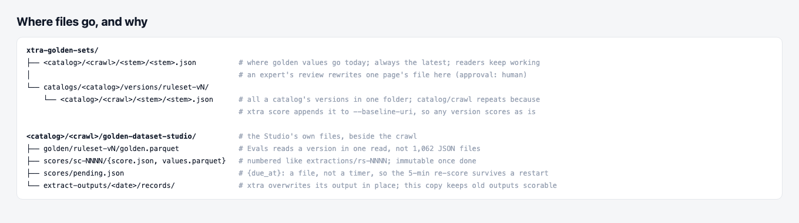

| Path | Why |
|---|---|
| `xtra-golden-sets/<catalog>/<crawl>/<stem>/<stem>.json` | Where golden values go today. Readers keep working. Always the latest. |
| `xtra-golden-sets/catalogs/<catalog>/versions/ruleset-vN/{rule-matched,human-reviewed}/<catalog>/<crawl>/…` | One folder per catalog holds all its versions; two parallel trees, the full set and the human-reviewed subset. `<catalog>/<crawl>` repeats because `xtra score` appends it to `--baseline-uri`, so either tree scores with the standard command. |
| `<crawl>/golden-dataset-studio/golden/ruleset-vN/golden.parquet` | Evals loads a version in one read instead of 1,062 JSON files. |
| `<crawl>/golden-dataset-studio/scores/sc-NNNN/` | Beside `extractions/`, numbered the same way, immutable once done. |
| `<crawl>/golden-dataset-studio/scores/pending.json` | A file, not a timer, so the 5-minute delay survives a restart. |
| `<crawl>/golden-dataset-studio/extract-outputs/<date>/` | xtra overwrites its output in place; this copy keeps old outputs scorable. |

## 5. What goes away

- The Publish button and its checkboxes (approving publishes; the tab becomes Golden datasets).
- Running extractions from the Studio: "+ New extraction", `golden-datasets xtra run`, `serve --allow-runs`, the
  extraction job runner, and the `xtra-runs/` copies.
- The left nav and the baselines (full catalog / human-reviewed / verified container).
- Every mention of `xtra-golden-sets-verified`.
- "Records" and "fields" counts in the Evals tab.

## 6. Mockups

Static mockups in [`mockups/mockups.html`](mockups/mockups.html). AVC's numbers come from the POC; the other catalogs'
are illustrative. **The xtra score views and the history are illustrative too:** they show AVC as if `identifier`,
`name` and `description` were published, and invent earlier extract outputs.

### 6.1 Home: Catalogs, golden dataset progress

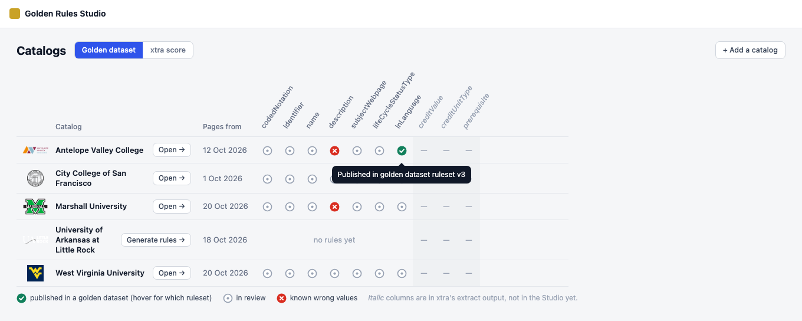

- **One compact row per catalog:**
  - the logo first;
  - the name (it wraps), with **Open →** beside it, or **✦ Generate rules** for a catalog without rules;
  - the date of its pages;
  - one icon per column.
- **Angled field names** (no `ceterms:` prefix). No card around the table.
- **The Rules tab's icons:** ✓ published (hover: "Published in golden dataset ruleset v3"), ○ in review, ✕ known wrong
  values. A grey "—" means not in this Studio yet (xtra extracts it).

### 6.2 Home: Catalogs, xtra score (every catalog)

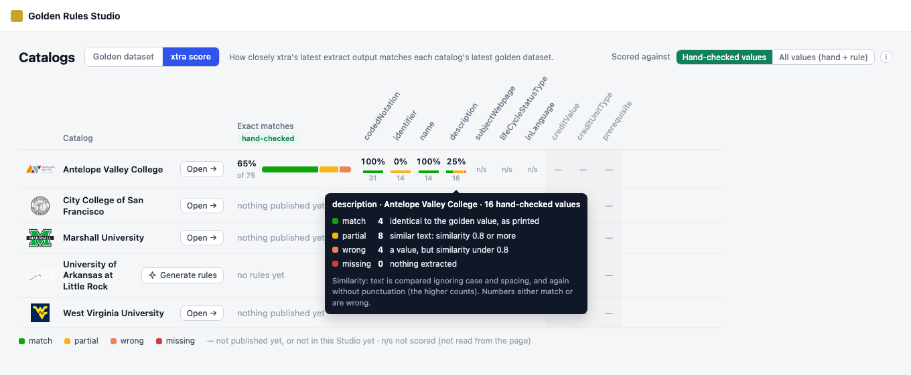

- **Under the header,** the table's title, "How closely xtra's latest extract output matches each catalog's latest
  golden dataset", and under it the slim switch, "scored against **Human-reviewed** | Rule-matched" (human-reviewed by
  default).
- **The exact matches column is labelled human-reviewed,** and each figure shows its count (65% of 75).
- **Exact matches** per catalog, and per column.
- **Hovering a bar or a legend colour** shows a small table: each outcome, its count and its rule. Underneath, one line
  explains similarity:
  - text is compared ignoring case and spacing, and again without punctuation, keeping the higher score;
  - numbers either match or are wrong.
- **"—"** means not published yet, or not in this Studio yet. **"n/s"** marks columns that aren't read from the page.

### 6.3 A catalog's Evals tab, with history

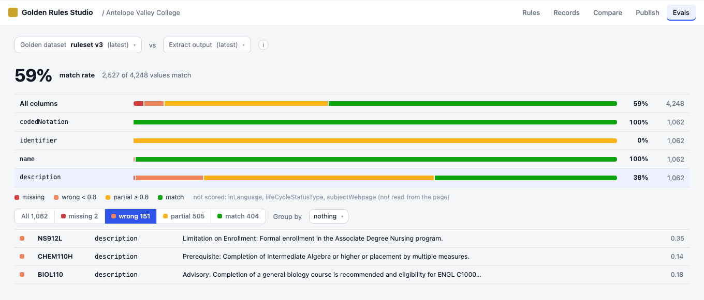

- **The same slim switch** sits at the right of the title: **Human-reviewed** by default. The headline reads "65% exact
  matches · human-reviewed · 49 of 75 values a person confirmed".
- **The title is the comparison:** "[Golden dataset ruleset v3 (latest) ▾] vs `xtra catalog extract` outputs over time",
  above the chart.
  - Each output is a vertical bar: match at the bottom, then partial, wrong and missing.
  - The match % is on top, and the date (local time) is below.
- **Clicking a bar picks that extract output.** It stays highlighted in grey, and everything below follows.
- **A dashed bar** is an output that hasn't been scored against this golden dataset yet. It holds the only **Score**
  button.
- **Below the chart, the chosen pair shows as two chips.** The golden dataset chip (blue, like its dropdown) and the
  extract output chip (grey with a mini bar, like the picked bar) show where each one is chosen.
- **Then:** exact matches, one bar per column, and (scrolled off here) the outcome filter, Group by and the rows.

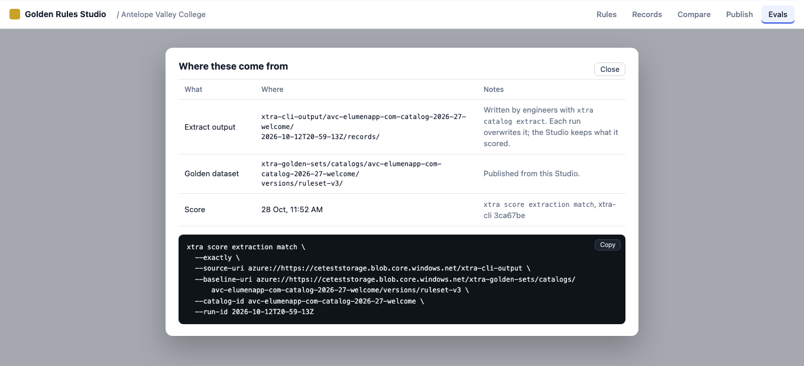

- **The ⓘ opens a modal:** a table of where the extract output and the golden dataset are and when the score ran, then
  the command with Copy.

### 6.4 A row: the diff, a note, and the page

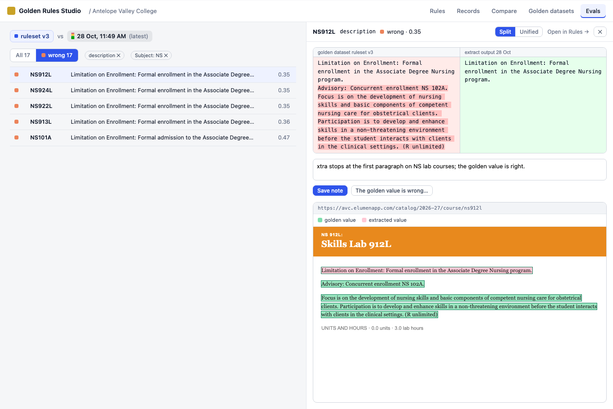

- **A GitHub-style diff, Split by default** (golden value left, extracted value right, differing words highlighted).
  **Unified** shows `−` and `+` lines.
- **A note box:** **Save note** and **The golden value is wrong…**.
- **The saved page** with the golden value (green) at its recorded location and the extracted value (pink) wherever
  its text is found.

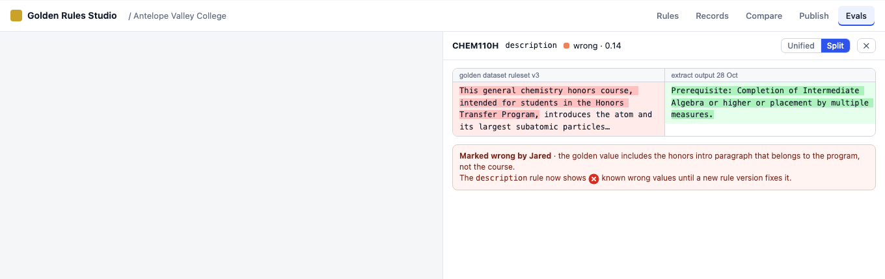

- **After "The golden value is wrong,"** a structured box shows the verdict:
  - a header (✕ Marked wrong · Jared · when);
  - rows for the right text, the note and what it was compared with;
  - a footer saying the rule now has known wrong values (§4.2).

### 6.5 The same diff in Compare

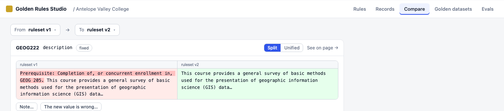

- **The same component,** Split by default, comparing ruleset v1 with ruleset v2, with **Note…** and **The new value is
  wrong…**.

### 6.6 Approving publishes

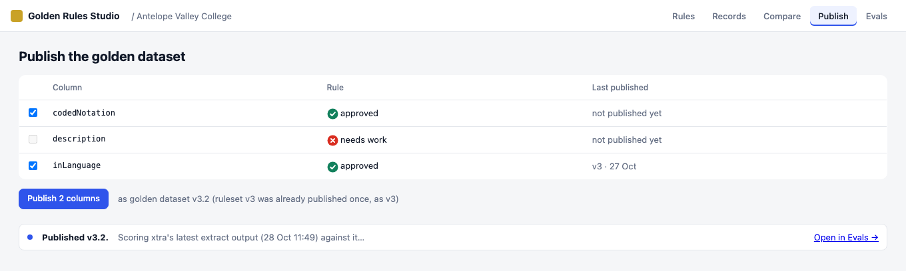

- **Approving a column's rule** asks once: it shows the golden dataset's columns now and after, and how many of the
  column's values a person checked and how many the rule labels. **Approve and publish** publishes the column and then
  scores it.

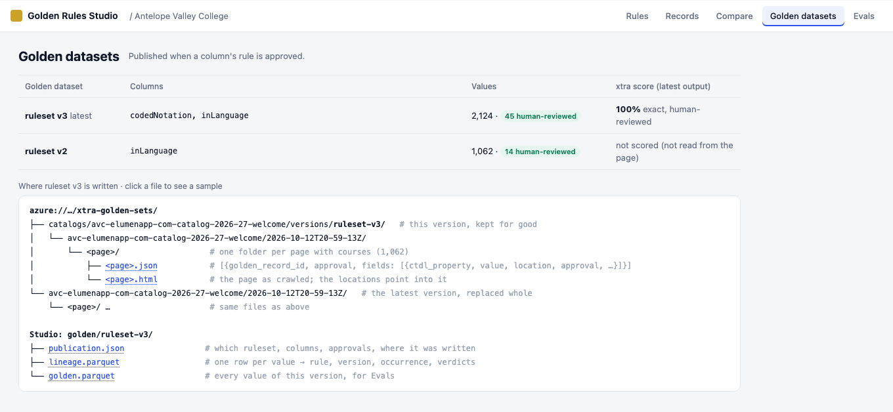

- **The Publish tab becomes Golden datasets,** a read-only record:
  - one row per version: its columns, its values (with how many are human-reviewed) and its latest xtra score;
  - below, the file tree of where the chosen version is written, each file a link to a sample.

### 6.7 Rules tab: engineer checks waiting for an expert

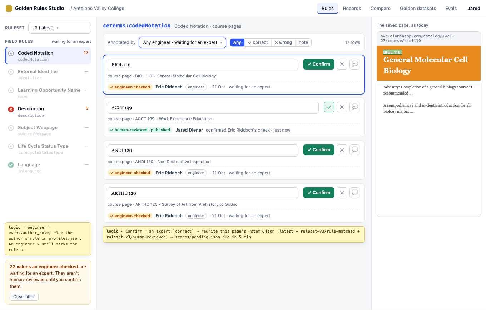

- **"Annotated by"** sits above the rows, a searchable dropdown (§6.8), with a verdict switch beside it: **Any** · ✓
  correct · ✕ wrong · note. Here it's set to **Any engineer · waiting for an expert**.
- **The rule list follows the filter:** each rule shows how many of its rows match, and rules with none are dimmed, so
  an expert can walk through every field.
- **Each engineer-checked row** has the amber chip, the engineer, the date and **Confirm**. Once confirmed it shows
  "✓ human-reviewed · published", who confirmed it and whose check it was.

### 6.8 Records tab: annotated by

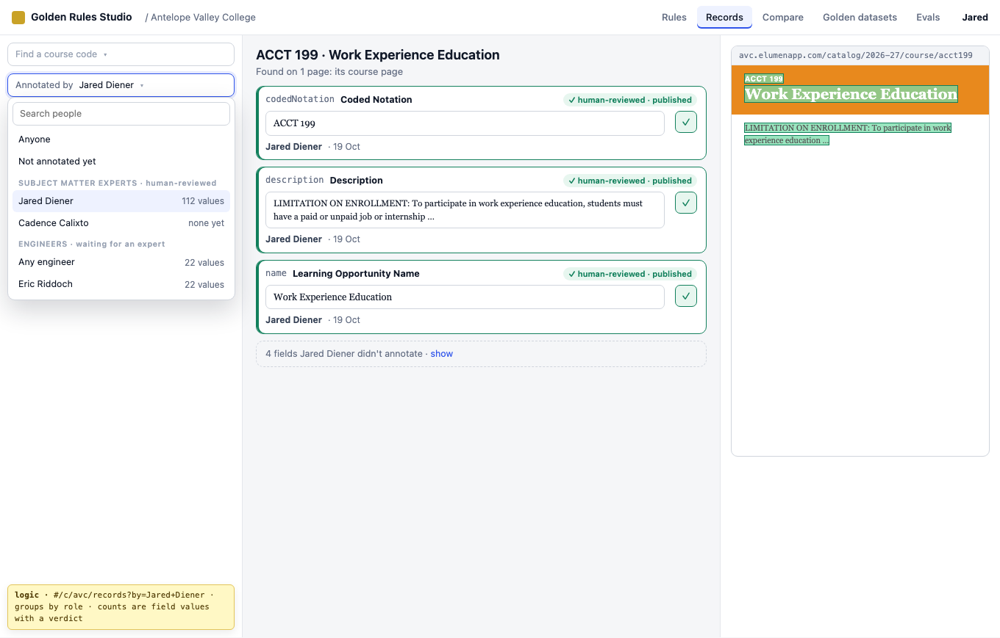

- **The same "Annotated by" dropdown** under "Find a course code": Anyone (the default), Not annotated yet, then
  subject matter experts (human-reviewed) and engineers (waiting for an expert), each with how many values they've
  annotated.
- **Picking a person lists only the courses they annotated.** On a course, their fields come first with their verdict
  and date; the other fields fold into one line ("4 fields Jared Diener didn't annotate · show").
- The choice is kept in the URL, so a filtered view can be shared.

## 7. Order of work

1. **Golden dataset versions** (§4.1) **and human-reviewed values** (§4.3):
   - an expert's verdict rewrites that page's file; `scores/pending.json`; `author_role`; engineer checks wait;
   - Publish writes the full dataset, versioned, plus the Parquet copy;
   - backfill v2 and v3;
   - draft versions from `rs-NNNN`.
2. **Scores:**
   - xtra-cli as a path dependency, called as a library;
   - a store adapter over the Studio's roots;
   - `scores/` with its durable job;
   - the CLI `golden-datasets score --ruleset N` (a draft with `--draft`).

   Remove the extraction-running code.
3. **"Annotated by"** on the Rules and Records tabs, with **Confirm** for engineer checks (§6.7, §6.8).
4. **The Evals tab** with its history chart (§6.3), and **the shared value diff with notes** (§6.4, §6.5, §4.2), used
   by Evals and Compare. Keeping a copy of each extract output (§3.1).
5. **The home table** (§6.1, §6.2).
6. **Approving publishes** (§6.6): the approve confirmation, publication and scoring on approval, and the Golden
   datasets tab with its file tree. Field names without `ceterms:`.
7. **Tests and checks:** `check` rules (score → golden version and extract identity; values → pages); tour, spec and
   screenshots.

## 8. Open questions

None open. Answered:

1. ~~**Do human-reviewed values in unpublished columns count?**~~ **Yes** (rows 44, 45; §4.3). A person confirmed them, so they don't depend on the rule
   being right. The mockups assume they do: AVC's human-reviewed score covers `identifier`, `name` and `description` (14,
   14 and 16 values) although only `inLanguage` is published. The alternative is to count only published columns,
   which would leave AVC's human-reviewed score with nothing to score today.
