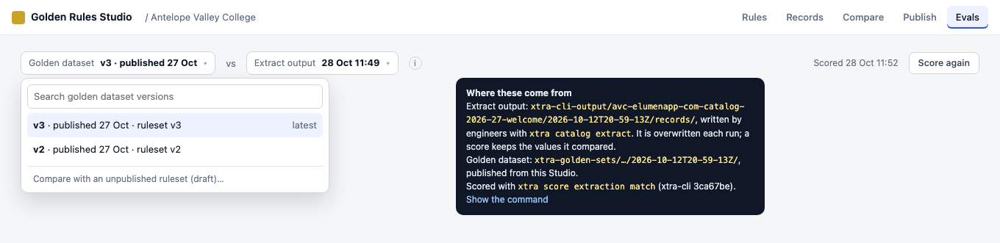

# S — Spec: Evals

How the CTDL Golden Rules Studio shows how closely xtra's extract output matches the golden dataset. Written
2026-10-28 from [`principles.md`](principles.md) and Eric's answers of the same day (recorded in §1). It replaces the
POC's design ([`poc.md`](poc.md)). **Mockups (§6) come first: review them before anything is built.**

## 1. Decisions (Eric, 2026-10-28)

| # | Question | Decision |
|---|---|---|
| 1 | What is a golden dataset version? | **A publication.** There are many more ruleset versions than golden datasets. Each golden dataset comes from exactly one ruleset version. A rule found wrong after publishing is fixed and the column republished, which makes a new version. Each column has exactly one rule (some rules aren't for columns). |
| 2 | Can unpublished rulesets be scored? | **Yes, as clearly marked drafts, and tucked away:** never the first way to do something. |
| 3 | Can a published column be withdrawn? | **Not for now.** Columns only grow. |
| 4 | Where are the extract outputs? | **Wherever xtra-cli already writes them in Azure** (§3.1). The UI says where, behind the ⓘ. Ignore the v2 review UI's folders. |
| 5 | Old extractions score 0 (slot names) | **Checked: Nicolas's branch fixes it** (§3.2), and it's merged here (row 19), so no adapter is needed. |
| 6 | How do scores run? | **xtra's scorer, called as a Python library**, with a subprocess only if its logic ends up gated behind the CLI. A durable async job, shown in the UI at the right moments (§4). |
| 7 | Keep score results? | **Yes**, with provenance: what was scored, against what, by which xtra-cli version, and the equivalent command. |
| 8 | After a publish | **Score automatically** against the latest extract output for that catalog. |
| 9 | All catalogs | **The home page's catalog list becomes a compact table**, with expandable rows that show a short summary. One view shows golden dataset progress and one shows the xtra score (§6.1, §6.2). |
| 10 | Baselines | **Dropped.** There is one golden dataset. "Approved by a person / by its rule" becomes a filter. |
| 11 | The old verified container | **Out of scope.** It isn't imported and isn't mentioned. |
| 12 | Counts | **Values, counted per column.** This view is field-centric, not record-centric. No "N records · M fields" lines. |
| 13 | Field names | **The CTDL term without its `ceterms:` prefix** (`description`, `codedNotation`) in Evals, Publish and the catalogs table. Rules and Records stay as they are. |
| 14 | Running extractions from the UI | **Removed**, code and CLI included. Engineers run `xtra extract`, and the Studio only reads its output. |
| 15 | Where to build | In the Superset workspace **evals** (branch `golden-dataset-studio-evals`). |
| 16 | Publishing | **Never merge in place: every publication writes the full golden dataset** (all columns published so far), and each version is kept (§4.1). |
| 17 | Version names | **The golden dataset's ID is its ruleset's ID** ("ruleset v3"), because a golden dataset is defined by its ruleset. No separate version numbers. |
| 18 | xtra-cli in the Studio | **A dependency of the Studio**, from the same repo (`../xtra-cli`). |
| 19 | Nicolas's branch | **Merged into this branch now** (2026-10-28, `6513231`), since it will become the latest xtra-cli. |
| 20 | Home table columns | **The seven Course columns, plus the columns the extract output has that the Studio doesn't cover yet** (credits, prerequisites), shown as "—". |
| 21 | Icons | **The Rules tab's icons** (approved, needs work, in review), reused as they are. |
| 22 | Versioned folders | **Catalog outside, versions inside**, under `catalogs/` (§4.1). |
| 23 | Home table rows | **No expanding rows, no chevron.** The logo comes first, then the name (it wraps) with **Open →** beside it, or **Generate rules →** for a catalog without rules. No ruleset or version line under the name. Column headers are angled so the row stays compact. |
| 24 | The red ✕ | Means **known wrong values**: someone marked values this rule finds as wrong. |
| 25 | The green ✓ on the home table | Means **published**. Hovering it names the golden dataset (its ruleset), for example "Published in golden dataset ruleset v3". |
| 26 | Evals dropdowns | Show **(latest)** instead of a date. A date appears only when an older item is picked, in the browser's local time zone (read from the browser; no location prompt). |
| 27 | Score again | **Gone.** A golden dataset is scored against an extract output once, and the score is kept. **Score** appears only for a pair with no score yet. |
| 28 | ⓘ in Evals | **A modal** with where everything comes from, plus the equivalent command. |
| 29 | Publish | **Publishing includes scoring.** The Publish tab keeps showing where every file lands (behind an ⓘ is fine). |
| 30 | The value diff | **Back, as in the POC:** a GitHub-style diff (red: in the golden dataset, not extracted; green: extracted, not in the golden dataset) and the saved page with both values highlighted. It can be annotated (§4.2). **The same diff serves Compare** (ruleset vs ruleset) and Evals (golden dataset vs extract output). |

**Design rule:** simplify and focus. Show one thing well instead of every piece of information.

## 2. Vocabulary

| Term | Meaning |
|---|---|
| **Extract output** | The records `xtra catalog extract` wrote for one crawl of one catalog. Engineers produce it; the Studio reads it. |
| **Golden dataset** | One publication: the full set of values the Studio published for one catalog, from one ruleset version. Its ID is the ruleset's: *ruleset v3*. |
| **Draft** | An unpublished ruleset version's extraction (`rs-NNNN`), scored as if it were a golden dataset. Clearly marked. |
| **Score** | One extract output compared with one golden dataset by `xtra score extraction match`, exact and partial. Kept. |
| **Column** | A CTDL property of the golden dataset, shown by its term without `ceterms:` (`description`). |
| **Value** | One column of one course. |
| **Outcome** | Per value: **missing** (nothing extracted), **wrong** (similarity < 0.8), **partial** (≥ 0.8), **match** (identical). |
| **Not scored** | A column whose values aren't read from the page (`location: null`: `inLanguage`, `lifeCycleStatusType`, `subjectWebpage`). xtra's scorer skips these as *implied* (xtra-cli #343). |

## 3. Facts the design rests on (checked 2026-10-28)

### 3.1 Where extract outputs are

- **The standard place** is `xtra-cli-output/<catalog folder>/<crawl>/records/*.json`, with `extract-report.json`
  beside it. It's the same layout as `crawl.json` and `pages/`.
- **72 crawls** in `xtra-cli-output`; **4 have extract output**: AVC (rewritten 28 Oct 11:49 MDT), Cabrillo (9 Oct),
  Arkansas Tech (8 Oct), Bergen (20 Oct). Of the Studio's five catalogs, **only AVC has one**.
- **One output per crawl, overwritten in place.** Earlier outputs are gone from the bucket.
- **`extract-report.json` doesn't say which xtra-cli version produced it.** It has `schema`, `run_id`,
  `discovery_run_id`, `only_golden_sample`, `pages_considered`, `records_written` and `skipped`. So the Studio can
  only identify an output by its report's last-modified time, its ETag and its counts. Asking engineers to record the
  CLI version in the report is a follow-up, not a blocker.
- **Re-runs don't clear the folder** (checked in `xtra/catalog/extract.py`). A re-run replaces files with the same
  name, but a record an earlier run wrote and the new run doesn't stays behind, and `xtra score` scores it. Today AVC's
  folder holds exactly the 1,065 records its report counts. The Studio compares the file count with the report's
  `records_written` and flags a mismatch. Follow-up for engineers: write each run to its own folder, or list its
  records in the report.
- **Consequence:** the Studio can't list past outputs from the bucket. Its "extract output" history is the outputs it
  has scored. Each score keeps both values of every row, so a past score stays viewable after the output is
  overwritten.

### 3.2 Will new extractions score?

- `xtra score` reads each record's `expected`, keyed by `ceterms:` terms. Main's extractor writes slot names
  (`course_description`), so its output scores as all missing.
- **Nicolas's branch** (`fix/xtra-cli-extraction-pages-fix`) maps slot names to `ceterms:` terms. It's now merged into
  this branch (`6513231`). Run on AVC's review sample, it wrote `ceterms:codedNotation`, `identifier`, `name`,
  `description`, `subjectWebpage`, `creditValue` and `creditUnitType` for all 11 records.
- AVC's output in the bucket (28 Oct) already has `ceterms:` keys.
- **So there's no adapter.** If an extract output has no `ceterms:` keys (Cabrillo, Arkansas Tech and Bergen still
  don't), its score says so: "this output uses slot names; re-extract with the current xtra-cli".

### 3.3 The scorer as a library

- `implementations.score_extraction_match.match_extraction_run(records_store, baseline_store, catalog, run_id, mode)`
  returns the report as a dict.
- It needs two store objects with `list_keys(prefix)`, `get_json(key)` and `describe_location()`.
- **So the Studio can call it in-process:**
  - records read in place from `xtra-cli-output` (read-only, nothing copied, no report written there);
  - the baseline served from the golden dataset version;
  - the report written into the Studio's own score folder.
- The scorer's `fields` and `outliers` give everything a row needs. With the library there's no need to rebuild rows
  from two report files: `match_entity` returns every field.

## 4. Scores

**Where they're kept:** `<crawl>/golden-dataset-studio/scores/sc-NNNN/`, immutable once done.

| File | Holds |
|---|---|
| `score.json` | status, golden dataset version (or draft `rs-NNNN`), extract output identity (path, report ETag, last modified, `discovery_run_id`, records), scorer (xtra-cli commit), whether the output used slot names (so nothing could match), the equivalent `xtra score` commands, who, when |
| `values.parquet` | one row per scored value: column, course, page, outcome, similarity, golden value, extracted value, golden location, approved by (person / rule) |

- **When a score runs:**
  - **automatically after every publish**, against the catalog's latest extract output (§6.4);
  - when someone presses **Score**, which appears only when the chosen pair has no score yet (an extract output that
    changed since, an older output, a draft). A pair is scored once; there is no "Score again".
- **As a durable job:**
  - `POST /api/catalogs/{c}/scores` writes `score.json` with status `running` and runs the score in a worker
    thread; it's a few seconds for AVC;
  - the UI polls `GET …/scores/{id}`;
  - on server start, a `running` score left by a restart becomes `interrupted`, and **Score** reappears;
  - only one score runs per catalog at a time.
- **The scorer version:** xtra-cli is a dependency of the Studio, from the same repo (uv path dependency on
  `../xtra-cli`; resolution checked on 2026-10-28). The scorer is whatever xtra-cli the branch holds, Nicolas's work
  included, and every score records that commit.
### 4.1 Golden dataset versions

- **Every publication writes the full golden dataset, and every version is kept.** Today a publication merges its
  columns into the files in `xtra-golden-sets`, so v2 is gone from disk once v3 is published. That changes:
  - **Each version is written whole** to its own folder in the shared container, in the layout `xtra score` already
    reads:

    ```
    xtra-golden-sets/catalogs/<catalog>/versions/ruleset-v3/<catalog>/<crawl>/<stem>/<stem>.json
    ```

    The catalog is the outer level and versions sit inside it (Eric, 2026-10-28). `xtra score` always reads
    `{baseline-uri}/{catalog}/{crawl}/{stem}/{stem}.json`, which is why the catalog appears again inside the version.
    So an engineer can score against any version with the standard command (`--baseline-uri
    …/xtra-golden-sets/catalogs/<catalog>/versions/ruleset-v3`).
  - **`xtra-golden-sets/<catalog>/<crawl>/`** keeps holding the latest version, replaced whole, never merged. Readers
    of the current location keep working.
  - **The Studio also keeps a Parquet copy,** `golden/<pub>/golden.parquet` (one row per value, about 1 MB for AVC), so
    Evals can load a version quickly.
- **Publishing again from the same ruleset** (after approving another column) rewrites that ruleset's version with the
  extra column. Its existing columns can't change, because their values come from the same immutable extraction.
  Columns only grow, and each score records the columns it covered.
- **The two existing AVC publications** are rebuilt once from their lineage and the immutable extractions, as ruleset
  v2 and ruleset v3.

### 4.2 Notes on a diff

**Constraint:** reuse the annotation log as it is, without losing which comparison someone was looking at.

- **The note lives on the Studio row** (the golden value's match): the existing annotation target, `{kind: "match",
  rule_id, occurrence_key, value_index, value_seen}`. A row in Evals is a golden value, and lineage maps it to its rule
  and occurrence. A row in Compare is the To side's match.
- **The comparison is kept in one new optional field** on the event, `compared_with`:

  ```json
  {"type": "comment", "target": {"kind": "match", "rule_id": "course-description", "...": "..."},
   "note": "xtra stops at the first paragraph on NS lab courses; the golden value is right.",
   "compared_with": {"kind": "extract", "score": "sc-0004", "value": "Limitation on Enrollment: …"}}
  ```

  In Compare it is `{"kind": "ruleset", "ruleset": 1, "value": "<the From value>"}`. Nothing else in the data model
  changes.
- **The diff panel has two actions:**
  - **Save note** writes a `comment` with `compared_with`;
  - **The golden value is wrong…** (in Compare, **The new value is wrong…**) opens the existing ✗ flow, where you select
    the right text on the page. It writes a `wrong` verdict, also with `compared_with`.
- **Where notes show up:**
  - on the row in the Rules and Records tabs, with a short line saying what it was compared with ("while comparing with
    xtra's extract output, 28 Oct");
  - in the Prompt for Claude, like any other note.

  A note about xtra's mistake (the golden value is right) stays a comment. It doesn't count against the rule.

## 5. What goes away

- Running extractions from the Studio: "+ New extraction", `golden-datasets xtra run`, `serve --allow-runs`, the
  extraction job runner, and the `xtra-runs/` copies.
- The left nav and the baselines (full catalog / hand-checked / verified container).
- Every mention of `xtra-golden-sets-verified`.
- "Records" and "fields" counts in the Evals tab.

## 6. Mockups

Static mockups in [`mockups/mockups.html`](mockups/mockups.html). AVC's numbers come from the POC; the other catalogs'
are illustrative. **The xtra score views are illustrative too:** they show AVC as if `identifier`, `name` and
`description` were published (today only `inLanguage` is, and it isn't scored).

### 6.1 Home: Catalogs, golden dataset progress


- **One compact row per catalog:**
  - the logo first;
  - the name (it wraps), with **Open →** beside it, or **Generate rules →** for a catalog without rules;
  - the date of its pages;
  - one icon per column.

  No expanding, no chevron.
- **Column headers are angled** field names (no `ceterms:` prefix), so the columns stay narrow.
- **No card around the table:** no white panel, border or rounded corners, just row lines. The same goes for the tables in Evals and Publish.
- **The Rules tab's icons:** ✓ published (hover: "Published in golden dataset ruleset v3"), ○ in review, ✕ known wrong
  values.
- **Italic columns** are in xtra's extract output but not in the Studio yet ("—").

### 6.2 Home: Catalogs, xtra score (every catalog)


- **The same rows,** switched to xtra score: match rate and outcome bar per catalog, match % per column.
- **"—"** means not published yet. **"n/s"** marks columns that aren't read from the page.
- **This is the all-catalog Evals view.** A catalog's Evals tab is the same thing filtered to that catalog.

### 6.3 A catalog's Evals tab


- **Header:** **Golden dataset** ruleset v3 *(latest)* vs **Extract output** *(latest)*, and an ⓘ.
- **Below the header:**
  - the match rate;
  - one bar per column;
  - the outcome filter and **Group by**;
  - the rows.



- **Picking something older shows its date**, in the browser's time zone.
- **A pair with no score yet** shows **Score**. Nothing else ever asks to score again.


- **The ⓘ opens a modal:** the extract output's path (and that each run overwrites it), the golden dataset's path, when
  and with which xtra-cli it was scored, and the command, with Copy in the code block's corner.

### 6.4 A row: the diff, a note, and the page


- **Selecting a row opens the diff:**
  - the golden value and the extracted value as a word diff (red: in the golden dataset, not extracted; green:
    extracted, not in the golden dataset);
  - a note box with **Save note** and **The golden value is wrong…**;
  - the saved page, with the golden value at its recorded location and the extracted value wherever its text is found.
- **Notes are stored as in §4.2.**

### 6.5 The same diff in Compare


- **The same component** compares ruleset v1 with ruleset v2, with **Note…** and **The new value is wrong…**.

### 6.6 Publish (scoring included)


- **Columns are listed by field name** (`codedNotation`). **Publish ruleset v4** writes the golden dataset and then scores xtra's
  latest extract output against it.
- **"Where it's written" ⓘ** lists every destination: the version folder, the current location (replaced whole) and
  the Studio's own files.
- **When it finishes,** one line gives the match rate, with **Open in Evals →**.

## 7. Order of work

1. **Golden dataset versions** (§4.1):
   - Publish writes the full dataset, versioned, plus the Parquet copy;
   - backfill v2 and v3;
   - draft versions from `rs-NNNN`.
2. **Scores:**
   - xtra-cli as a path dependency, called as a library;
   - a store adapter over the Studio's roots;
   - `scores/` with its durable job;
   - the CLI `golden-datasets score --ruleset N` (a draft with `--draft`).

   Remove the extraction-running code.
3. **The Evals tab** (§6.3) and **the shared value diff with notes** (§6.4, §6.5, §4.2), used by Evals and Compare.
4. **The home table** (§6.1, §6.2).
5. **Publish:** field names without `ceterms:`, scoring included, and where it's written (§6.6).
6. **Tests and checks:** `check` rules (score → golden version and extract identity; values → pages); tour, spec and
   screenshots.

## 8. Open questions

1. **Should approving a column's rule publish it?** You said publishing should mean the same as the green ✓. Today a rule
   can be approved and not published (AVC's `codedNotation`). There are two options:
   - **approving publishes** that column into the ruleset's golden dataset, which removes the "approved, not published"
     state;
   - the ✓ shows only once published, and an approved-but-unpublished column shows ○.

   The mockups use the second for now (AVC's `codedNotation` shows ○).
