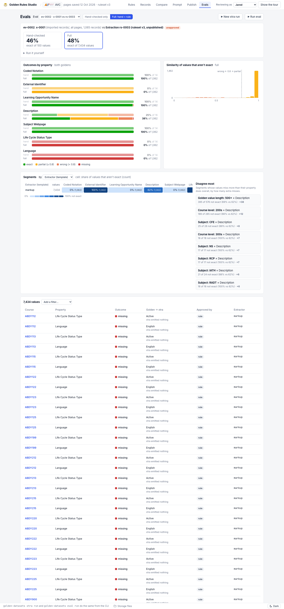
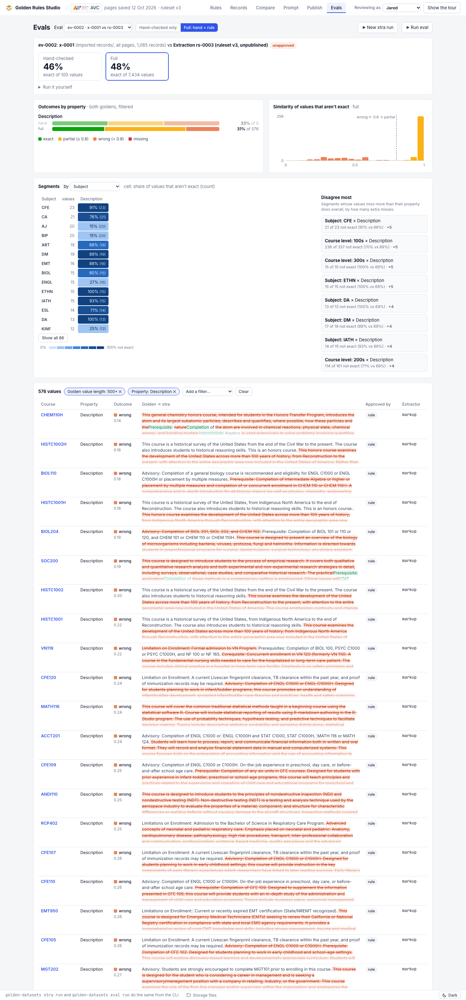
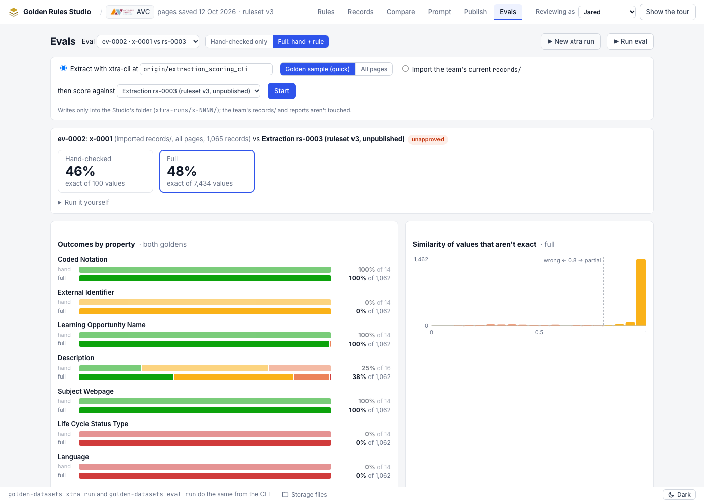

# Evals: proof of concept

Built on 2026-10-27, after Eric accepted every default in [`01-questions.md`](01-questions.md). Branch
`golden-dataset-studio-evals` (its own Superset workspace), off `golden-dataset-studio` at `fcacef5`.

The POC answers the research questions the design depended on, and shows the whole loop working on AVC: trigger an
xtra run from the tab, score it against the hand-checked and the full golden, see the charts, and drill into segments.
It is not the spec. The spec and plan come next and can change any of this.

## What was built

| Part | Where |
|---|---|
| Eval engine: xtra runs (extract at a pinned commit, or import `records/`), golden versions, hand / full baselines, scoring with xtra's own scorer, `fields.parquet` | `src/golden_datasets/evals.py` |
| CLI: `golden-datasets xtra run`, `golden-datasets eval run`, `golden-datasets eval show` | `cli.py` |
| Jobs (one per catalog, log, cancel) and the API | `server/jobs.py`, `server/routes_evals.py` |
| `serve --allow-runs`: starting runs from the UI is off by default | `cli.py`, `server/app.py` |
| Evals tab: eval picker, Hand-checked / Full toggle, run and eval panels, job strip with log, outcome bars (both goldens), similarity histogram, segment heatmap, "disagree most", filter bar, rows worst first with a word diff, history grid, "Run it yourself" | `web/src/evals/` |
| Tests for the baselines and the rebuilt rows | `tests/test_evals.py` |

Storage, all under the crawl's `golden-dataset-studio/` folder, registered in the manifest (`xtra_runs`, `evals`):

```
xtra-runs/x-0001/run.json, out/<catalog>/<crawl>/{records/, extract-report.json}
evals/ev-0001/eval.json, baseline/{hand,full}/…, reports/{hand,full}-{exact,partial}.json, fields.parquet
```

Overview (ev-0002, full golden): 

Drill-down (Description values longer than 500 characters, by subject): 

Starting a run from the tab: 

## Research answers

- **B1. The reports don't hold a row for every field.** `outliers` lists every field that isn't exact (not capped:
  AVC's 38 = 31 mismatch + 7 missing); exact matches appear only in the counts. So `fields.parquet` is the baseline's
  fields plus the outliers, and anything not in the outliers is exact. The rebuild checks its counts against the
  report's and fails the eval if they differ.
- **B2. Source ≠ target is safe.** `catalog extract` reads pages, metadata and discovery only from `--source-uri` and
  writes only to `--target-uri`. `score extraction match` writes its report into the store it read the records from,
  which here is the run's own `out/`. The eval copies each report out before the next call overwrites it.
- **B3. Extract time, AVC, local mirror:** golden sample 6.7 s (11 records, 19 multi-course pages skipped); all pages
  **508 s** (1,064 records). A whole eval (4 scorer calls) takes about 4 s.
- **B4. The scorer and the Studio's files.**
  - `{golden_record_id, approval, fields: […]}` records are accepted, and extra keys are ignored.
  - **A field with `ctdl_property: null` makes the whole page file malformed**, and the scorer skips that page. Once
    Learning Type is published, `xtra score` against `xtra-golden-sets` will skip every page. The POC drops those
    fields from its baselines. **Publish should be fixed too.**
  - An entity with no fields is also malformed. A hand-checked baseline drops trailing empty courses and leaves out a
    page where an empty course comes before a non-empty one; the scorer pairs by position.
- **B5. Installing xtra-cli at a commit:** `git archive <sha> xtra-cli`, then `uv venv` and `uv pip install -e
  ".[azure]"` (editable, as its Dockerfile does, so `lib/` resolves). `uv sync` / `uvx` fail: there's no lock file and
  the optional `crawl4ai` extra doesn't resolve on Python 3.9. Installed once per commit into
  `~/.cache/golden-datasets/xtra-cli/<sha>`, in a few seconds. Extract doesn't need Playwright browsers.
- **B8. Hand-checked values today (AVC, rs-0003):** 100 scored values across 14 courses (16 Description values); none
  for Language, which is approved by its rule.

## First results (AVC, crawl 2026-10-12T20-59-13Z)

| Eval | xtra run | Golden | Hand-checked | Full |
|---|---|---|---|---|
| ev-0001 | x-0001 (imported records/) | published (Language only) | no values | 0% of 1,062 |
| ev-0002 | x-0001 | rs-0003 (unapproved) | 46% of 100 | 48% of 7,434 |
| ev-0003 | x-0002 (extract, golden sample, `extraction_scoring_cli`) | rs-0003 | none in scope | 14% of 77 |
| ev-0004 | x-0001 | verified | 64.8% of 108 | 64.8% of 108 |

- **ev-0004 reproduces the team's own report exactly** (70 match, 31 mismatch, 7 missing).
- **xtra never emits `ceterms:inLanguage` or `ceterms:lifeCycleStatusType`**, so both are 100% missing. Every External
  Identifier is a mismatch, though a near one (partial).
- **Description is where the work is.** 38% exact overall. The drill-down points at long descriptions (500+
  characters: 69% not exact vs 62% overall) and at subjects such as CFE, ETHN and DA. The rows show why: xtra keeps
  the "Advisory:" and "Prerequisite:" text that the golden set's description rule leaves out.

- **Studio-run extractions can't be scored yet (blocker).** The extractor on `extraction_scoring_cli` writes `expected`
  with slot names (`course_description`, `course_name`), but its scorer reads ceterms keys (`ceterms:description`).
  So ev-0003 finds only Coded Notation and Subject Webpage, and everything else is `missing`. That branch's own plan
  says "a separate PR changes extraction so `expected` is written with ceterms keys". The team's current `records/`
  have ceterms keys, but that extractor isn't on any branch pushed to GitHub. Until it is, imported runs are the ones
  worth scoring; pass `--ref` once it lands.

## How to run it

```bash
cd golden-dataset-studio
cat > golden-datasets.env <<EOF
GOLDEN_DATASETS_ROOT=$PWD/.data/root
GOLDEN_DATASETS_CATALOG=avc
GOLDEN_DATASETS_XTRA_SOURCE=$HOME/review-ui-v3-data/xtra-cli-output   # crawl pages + discovery, read-only
EOF
golden-datasets sync --from azure://…/xtra-cli-output/zz-scratch-review-ui-v3 --to .data/root -c avc --pages skip
ln -s ~/review-ui-v3-data/xtra-cli-output/<catalog>/<crawl>/pages .data/root/<catalog>/<crawl>/pages
export AZURE_STORAGE_CONNECTION_STRING="$(az storage account show-connection-string -n ceteststorage --query connectionString -o tsv)"

golden-datasets xtra run --import                         # x-0001: the team's records/
golden-datasets xtra run --sample --then-eval rs-0003     # extract the golden sample at the default ref, then score
golden-datasets eval run --xtra-run x-0001 --golden verified
golden-datasets serve --allow-runs                        # Evals tab: start runs and evals from the UI
```

## Limits of the POC (for the spec)

- **`published` is the golden container as it is now.** It doesn't rebuild an earlier publication by folding lineage.
- **Segments are the POC's own twelve dimensions,** not `strata.py`'s. Course level and subject are read from the
  course code.
- **No page pane:** a row links to the Records tab for its course.
- **Jobs live in the server process.** A restart forgets them (runs and evals already written are kept).
- **No compare-two-evals view and no triage**, as the defaults said for a first version.
- **Not tried against the Azure root:** `--target-uri azure://…/<prefix>` for an extract into the shared Studio root.
- **`golden-datasets check` has no eval rules yet.** On this root it fails one existing check (lineage
  `annotation_ids` → annotations, 12 rows). It fails the same way on the shared Azure root, so it predates this
  branch.
