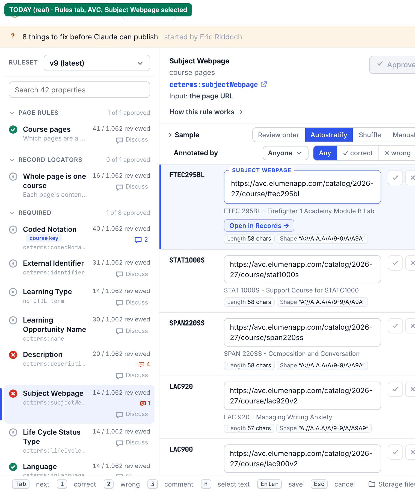
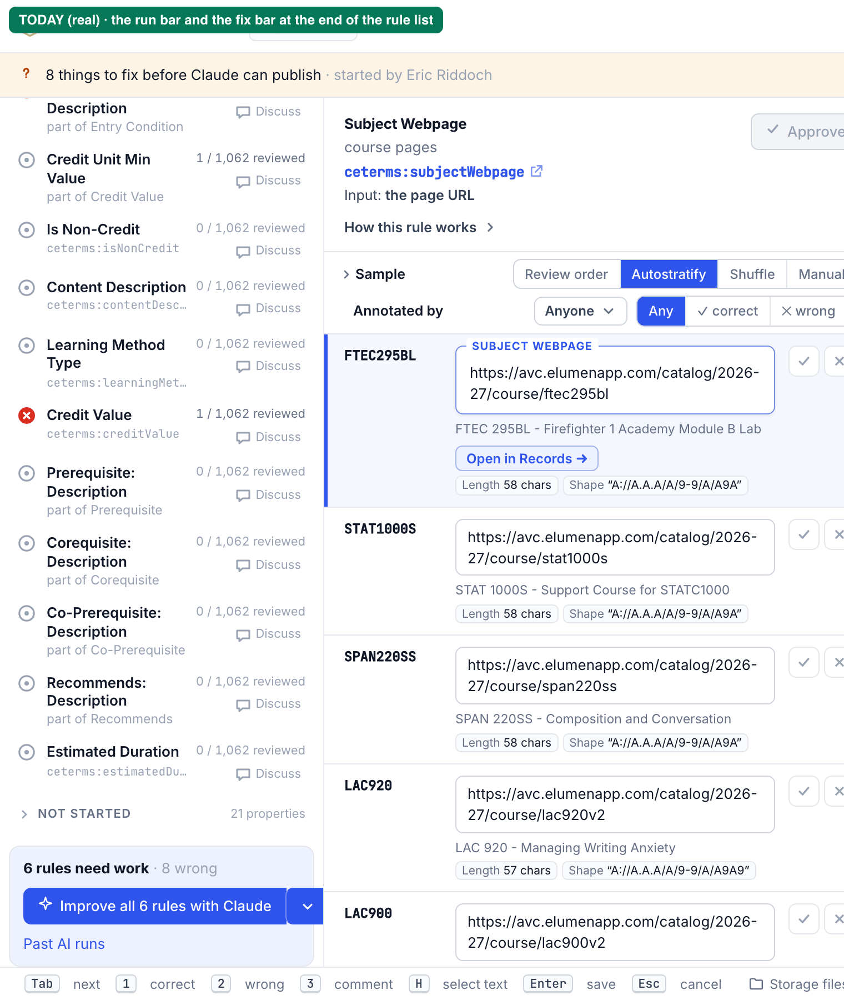

# R — Research: one rule per AI run, several runs at once, reports you can act on (2026-11-05)

Follows [`01-questions.md`](01-questions.md). Eric's request, verbatim: [`prompt.md`](prompt.md). No answers had come in
when this was written, so it works from each question's **default**. Code was read and nothing was changed. File
references are to `golden-dataset-studio/` on branch `studio-one-rule-runs`, which already has the report the CLI
writes (`report.py`). The spec is [`03-spec.md`](03-spec.md). Pictures are in [`screens/`](screens/); each one says
whether it shows the Studio **today (real)** or a **proposal (mockup)**.

**Pass 2 (after Eric's answers, [`answers-pass1.md`](answers-pass1.md)).** Eric chose:
- one run per **set** of rules, not one run per rule;
- rules that depend on each other change **as one transaction**;
- **2** runs at once, with proof that the queue works with K2;
- inferred expected values shown as structured data;
- no refusal of vague words; instead, references the report **dereferences**.

New research for those is in **§7**. **Pass 4** ([`answers-pass3.md`](answers-pass3.md): the rules picked are the goal, Claude may edit any rule surgically, and every check runs the whole golden suite) adds §7.8 and §7.9. §7.1 is a real HTTP transcript against a local K2 of the same version
([`k2-transcript.md`](k2-transcript.md)). Points of §0, §2 and §6 that pass 2 changes are marked *(pass 2: …)*.

## 0. Summary

1. **A one-rule run already half exists.** `build_prompt(ctx, rule=…)` builds a prompt for one rule
   (`prompt.py:307-315`, `scope_rules` at `prompt.py:108-112`), and the web code already knows a `rule` scope
   (`web/src/agent/api.ts:8`, `scopeWords` at `api.ts:88-93`). Only the API turns it away (`routes_agent.py:26-29`).
2. **The lock is per catalog** (`agent_runs.py:7`, `start` at `:243-273`), and the browser polls a single run per
   catalog (`web/src/agent/state.tsx:44-58`). To allow several runs, the lock moves to one file per rule, and the poll
   returns a list.
3. **K2 can run one fresh Claude per run.** Its `/v1/w/<workspace>/host-sessions` API starts a new agent session for
   each prompt. By default it allows 15 live sessions per workspace, and it answers `429` when the workspace is full.
   It is already switched on in the K2 server's settings (`K2_API: "1"`). The Studio needs a key that may use host
   sessions; today's key may only send chat messages. This is less setup than a fixed pool of agents, and it also
   fixes a problem we have today (point 4). *(Pass 2: checked end to end on a local K2 v0.46.5, §7.1. Two runs at
   once, not three. Two findings change the design: K2 doesn't enforce the deadline, and its default "guest policy"
   tells the agent to prefer read-only work.)*
4. **Today every run lands in one long Claude chat.** All 17 real runs on the K2 server went to the same Claude
   session. Each run starts on top of everything the earlier runs said: 41K tokens of context for the first run,
   211K by the eleventh, before an automatic compaction. A fresh session per run starts at about 40K.
5. **A missing expected value blocked 13 of the 17 real runs.** Claude answered the same way each time: "`rule try`
   only counts a row as fixed when the new value matches the expected value". The block comes from the **prompt**
   (`prompt.py:359`: publish only on BETTER). The CLI's `rule publish` refuses only when values marked correct change
   (`loop.py:581-585`).
6. **One run is small.** `rule try` on one rule: 5 s, 312 MB. A one-rule prompt is 7–16K characters. The 6-rule
   prompt is 27K characters. The memory limit of the K2 server is 4 GiB, and its processes use 0.9 GB today. Three
   runs at once fit, with little room to spare. *(Pass 2: Eric chose 2 at once on today's 4 GiB, and a cap that can be
   set to 3 later.)*
7. **Two runs publishing at once is already safe.** A ruleset version is written only if no file has that name yet
   (`rulesets.py:148-150`), and the manifest is updated with a retry on conflict (`manifest.py:55-69`). The second
   publish fails cleanly with "try again". A retry built into the CLI would save Claude a turn. *(Pass 2: publishes are
   serialized with a publish lock, §7.4.)*
8. **The CLI can check quotes.** It can read a course's saved page as text, every annotation's note and comment, and
   every course's current value. The Studio's Markdown has no quote block yet (`web/src/prompt/markdown.tsx:7-25`).

---

## 1. What a run is today (Studio side)

### 1.1 Starting a run

- `POST /api/catalogs/{c}/agent-runs` accepts only `needs_work` or `first_rules` (`server/routes_agent.py:26-29`).
  It refuses a run with nothing to fix (`_check_scope`, `:79-87`), then builds the prompt with every rule that needs
  work (`:105-108`: `build_prompt(ctx, None, True, …)`).
- The prompt builder already handles one rule. With `rule="course-subject-webpage"` and `needs_work=False`,
  `scope_rules` returns just that rule (`prompt.py:108-112`), and the title becomes "Improve rule `…`"
  (`prompt.py:323-324`). The draft file is named after the rule (`prompt.py:490`, `drafts/<rule>.json`).
- The web code was written with a one-rule scope in mind: `ScopeKind = "needs_work" | "rule" | "first_rules"` and
  `RunScope.rule_id` (`agent/api.ts:8-9`), and `scopeWords` says "improving <rule>" (`api.ts:90`).

### 1.2 The lock and the run record

- Files (`agent_runs.py:7-9`): `agent-runs/current.json` (the lock: the live run, or the last one that ended),
  `last.json`, and per run `run.json`, `prompt.md`, `log.jsonl`, `summary.md`, `report.json`, `last-try.json`.
- **Nothing is deleted**, because the agent's storage token can write but not delete (`agent_runs.py:11-13`). A run
  frees the lock by writing its ended state into `current.json`, and the next run replaces that file using its
  ETag (`start`, `:248-264`).
- States: `sending → running → finished | needs_you | failed | cancelled | timed_out | ended`, with `waiting` while
  the agent is busy (`agent_runs.py:16-18, 38-40`).
- `advance()` (`:298-321`) is called on every poll by every Studio. It sends a waiting run when its retry time comes
  (every 20 s, `RETRY_SECS` at `:41`) and ends a run that is past its deadline (90 min by default).
- **What changes for one lock per rule:** `current.json` becomes `agent-runs/rules/<rule id>.json`, with the same
  ETag rules. `live()` and `advance()` loop over the live rule files instead of reading one file. `history()`
  (`:220-227`) already lists run folders and needs no change. A `first_rules` run (a catalog with no rules yet) keeps
  a catalog-wide lock: it may start only when no rule run is live, and while it runs, no rule run may start.

### 1.3 K2 today

- `K2.send` posts the whole prompt as a chat message to one agent: `POST /v1/w/golden-rules/message`
  (`agent_runs.py:87-92`). `409` means the agent is busy, and the run waits (`:97-98, 279-286`).
- Cancelling is "best effort". The Studio sends a "stop" message, and that usually can't get through because the
  agent is busy (`agent_runs.py:377-386`).
- The run folder on the K2 server is `/var/lib/k2/work/<agent>/runs/<run id>` (`prompt.py:227-231`). Every run
  installs the CLI with `uv tool install --reinstall '<git spec>'` into the single shared tool folder
  (`prompt.py:296`). **With several runs at once, this is a race**: two runs reinstalling the same tool at the same
  moment can break each other's `golden-datasets`. The page cache is safe: it writes to a temporary file and renames
  it (`storage.py:394-399`).

### 1.4 The browser

- `AgentProvider` polls `GET …/agent-runs/current` every 3 s and keeps **one** `run`, one `last`, and their notes
  (`agent/state.tsx:7-14, 44-58`). The run bar shows that one run (`agent/RunBar.tsx:61-103`). A run button is
  disabled while any run is live (`agent/RunButton.tsx:38-40`).
- The fix bar at the end of the rule list has the only run button for rules: "Improve all N rules with Claude"
  (`agent/FixBar.tsx:31-37`). For Eric and Seth it is a split button with "Open the prompt" (`RunButton.tsx:37,
  64-74`).
- Sidebar rows: `web/src/rules/RuleList.tsx:99-127` (not `parts.tsx`; `parts.tsx` holds the course-row controls).
  Each row is a grid of status icon, name, and a `meta` column with "N / 1,062 reviewed", the comment count, and
  **Discuss**. The **Discuss** button is the precedent for a small per-row action.
- Past AI runs (`agent/RunsPanel.tsx`) lists every run of the catalog, newest first. Its "Show the prompt Claude was
  given" (`RunsPanel.tsx:104-107`) is **shown to everyone**, not only to Eric and Seth. Only the "Open the prompt"
  item in the run button's menu is limited to them (`RunButton.tsx:37`). Q5.2's default ("keep it to Eric and Seth")
  matches the run button only.
- The Markdown renderer has headings, paragraphs, code, lists and tables (`prompt/markdown.tsx:7-25`). It has **no
  blockquote**. Links open in a new tab with the external-link icon.


**Today (real):** the Rules tab on AVC with Subject Webpage selected. The bar at the top shows the 6-rule run's
ending.


**Today (real):** the end of the rule list: "Improve all 6 rules with Claude" (a split button for Eric) and Past AI
runs.

The 6-rule report, **today (real):** [`../report-links/screens/report-sim.png`](../report-links/screens/report-sim.png).

### 1.5 Publishing, and two publishes at once

- `rule publish` merges the draft into the **latest** ruleset when the command runs, not into the one the run
  started from (`plan_draft`, `loop.py:390-396`). It warns if the draft was made from an older version. A draft
  holds only the rules it names (`rule draft <ids>`), so a one-rule draft carries one rule.
- It reruns the merged ruleset over the crawl, refuses if a value marked correct changes (`loop.py:581-585`), then
  calls `rulesets.publish` (`loop.py:590`).
- `rulesets.publish` (`rulesets.py:124-165`) writes rule version files that don't exist yet (`:140-144`), then the
  ruleset file `rulesets/v<N>.json` **only if no file has that name** (`:147-150`). If another publish won, it
  raises "ruleset vN was published by someone else meanwhile; try again". The manifest update retries on ETag
  conflicts (`manifest.py:55-69`). The extraction id is checked the same way (`extract.py:253-259, 279`).
- **So two runs publishing different rules at the same time can't corrupt anything.** The second one fails, Claude
  runs `rule publish` again, and the command merges into the new latest version (which has the first run's rule)
  and checks again. Cost: about 5 s and one more Claude step. An orphan rule version file can be left behind, and it
  is reused next time, because `plan_versions` finds a version by its content hash (`rulesets.py:52-58`).
- **What the merge doesn't protect:** a run that changes a rule another rule reads. Example: Credit Unit Type reads
  Credit Value. A Credit Value run publishing while a Credit Unit Type run is drafting changes what the second run
  sees. The second run's publish still re-checks everything (the scorecard covers every rule whose values changed,
  `loop.py:455-460`), so nothing marked correct breaks silently. It may just fail its check and stop.

## 2. K2: several Claudes at once

All facts below come from the K2 server's deploy scripts (`apps/k2/`: `Dockerfile`, `manifest.yaml`, `deploy.sh`, `README.md`), K2 v0.46.5's own release notes and
help text (inside the daemon binary, `build/k2-daemon-linux-x86_64`), and read-only `kubectl get/exec ls/cat/ps` on
pod `k2/k2-0`. Nothing on the server was changed.

### 2.1 What the K2 server runs today

| Fact | Where |
|---|---|
| One pod: K2 daemon + Claude Code 2.1.308 + uv, Ubuntu 24.04 | `apps/k2/Dockerfile`, `versions.env` |
| The `/v1` API is on: `K2_API: "1"` ("POST /v1/w/<ws>/host-sessions starts an agent with a prompt") | `apps/k2/manifest.yaml:39-40` |
| Memory request 1 GiB, **limit 4 GiB**; no CPU limit; 4 cores visible | `manifest.yaml:122-124`; `nproc` = 4, `cpu.cfs_quota_us` = -1 |
| No `python3`, so most `k2` CLI commands fail in the pod (`k2 done`, `k2 respond`, `k2 workspace …`) | `Dockerfile` (apt installs only curl, git, libssl3, tini) |
| Workspaces are folders: `/var/lib/k2/work/golden-rules` (created by `deploy.sh`), plus `k2` | `deploy.sh:57`; `ls /var/lib/k2/work` |
| 17 run folders under `golden-rules/runs/` (Oct 28 → Nov 5) | `ls /var/lib/k2/work/golden-rules/runs` |
| Processes now: daemon 213 MB; the canonical `golden-rules` Claude 299 MB; two idle Claude tabs opened 6 days ago, 264 MB and 299 MB | `ps` |
| Memory now: 855 MB in processes, 2.5 GB file cache. The highest reading, 4.23 GB, counts cache; no out-of-memory event (`failcnt` 0) | cgroup `memory.stat`, `memory.max_usage_in_bytes`, `memory.failcnt` |

### 2.2 Every run today goes into one Claude chat

The canonical `golden-rules` agent is a single Claude session (`--resume 9b5ef769…` in `ps`), and each Studio run
is a new message in it. From that session's transcript (`~/.claude/projects/-var-lib-k2-work-golden-rules/
9b5ef769….jsonl`, 3.4 MB):

| Run (start) | Claude's turn | Context at start | Output tokens | How it ended |
|---|---|---|---|---|
| Oct 28 03:51 | 4.8 min, 23 commands | 41K tokens | 30K | not published: BIOL110 has no expected value |
| Oct 28 04:00 → Oct 28 17:44 (6 runs) | 0.7–1.0 min each, 3–6 commands | 94K → 138K | 3–8K | each: not published, "BIOL110's WRONG annotation still has no expected value" |
| Oct 29 03:18 | 4.1 min | 148K | 5K | cancelled |
| Oct 29 03:22 | 3.6 min, 12 commands | 159K | 35K | **published** Description v3 (ruleset v4) |
| Oct 29 16:28 | 0.7 min | 185K | 11K | not published: DA107A and DA107B contradict each other |
| Nov 4 16:34 | 55 min (stuck) | 212K | 3K | couldn't start: the storage token was rejected |
| *(auto-compaction, Nov 4 17:29)* | | | | |
| Nov 4 23:24 | 2.7 min | 68K | 14K | not published: the 6 ACCT199 annotations have no expected value |
| Nov 5 15:38, 16:43, 16:54 (Marshall) | 1.4–2.0 min | 93K → 120K | 5–8K | each: not published, "none of the open annotations has a saved expected value" |
| Nov 5 17:31, 20:49 (AVC) | 1.2–1.3 min | 137K → 154K | 5–8K | not published: no expected values; "nothing has changed since the last AVC run" |

What this shows:
- **Context grows by 8–15K tokens per run**, because each run is one more turn in the same chat. The 11th run
  started with 212K tokens of earlier runs in its context. A fresh session per run would start at about 40K
  (Claude Code's own instructions plus the prompt: the first run started at 41K with a 3K-token prompt).
- **Runs remember each other, and it shows.** "Nothing has changed since the last AVC run (`ada4`)" (Nov 5 17:31).
  That memory is useful, but it is also why later runs are short: Claude repeats its earlier conclusion. Fresh
  sessions lose it, so the prompt should carry the facts that matter: the rule's last run and its report (spec §5).
- **Most runs are short**: 1–5 min of Claude's time when nothing can be published. The simulated 6-rule AVC run
  (run `20261105T004857Z-53d9`, done by a Claude given only the prompt) took 7 min, from 00:48:57 to 00:55:56, with
  10 progress notes.

### 2.3 Option B: one K2 host session per run (recommended)

K2 v0.46.5 ships a "host sessions" API (release notes 0.40.30, 0.40.76, 0.40.87–0.40.95, inside the daemon):

- `POST /v1/w/<workspace>/host-sessions` with `{"prompt": "…", "timeout_secs": N}` (or `timeoutSecs`) **boots a new
  agent session in that workspace** with the prompt as its first message. It answers with `sessionId`. The default
  `timeout_secs` is **180 s**, so the Studio must pass the run's deadline (e.g. 5,400 s). It is the hard wall: "Working
  agents are not idle-reaped mid-job; grace after `k2 respond --final`; hard wall = `timeout_secs`."
- `GET …/host-sessions/<id>` gives `phase` (`working`, `grace`, `finished`). `POST …/host-sessions/<id>/kill` stops
  it. `GET /v1/w/<ws>/host-sessions` lists them. Sessions show up as live tabs in the K2 app, so Eric can watch one.
- **Concurrency limits:** per workspace 15 by default (settable 1–512, setting `host_session_cell_cap`), per key
  owner 64, per server 512. At the limit K2 waits up to 30 s, then answers **`429`** with a code such as
  `workspace-cell-cap`. An optional durable queue (`K2_HOST_SESSION_SPAWN_QUEUE=1`) is off by default.
- `clientRequestId` makes a spawn idempotent: the same id while the job is open returns the same job. The Studio can
  pass the run id, so a retried start never starts two Claudes. *(Pass 2: wrong for a live session. A retry with the same id got `429`, not the same
  session, §7.1 step 3.)*
- **Permissions:** "auto-approve flags are KEPT by default on API host-session spawns (`api_skip_permissions` ON)",
  the default since migration `0093_api_skip_permissions_default_on`. So a host session runs Claude with
  `--dangerously-skip-permissions`, like the canonical agent does today (`ps`). *(Pass 2: confirmed, §7.1.)*
- **Ending:** a session ends when the agent runs `k2 done` / `k2 respond --final` (then 10 s of grace), when it is
  killed, or at `timeout_secs` *(pass 2: not observed; the session outlived its 20 s deadline, §7.1)*. In our pod, `k2 done` fails because there's no `python3`. The Studio already knows when
  a run ends (`run done` writes to the storage root), so it can **kill the session** itself. That also makes
  **Cancel** real: today it's a chat message that usually can't get through (§1.3).
- K2 adds a short preamble telling the agent how to answer back (`k2 respond`). Without `python3` that command fails,
  so the prompt should say "report only with `golden-datasets run`; don't use `k2 respond`" (or `python3` gets added).
- The API key is scoped: `k2 api-key create --workspaces golden-rules --allow host-sessions,canonical-message`
  (help text in the daemon). The Studio's key today was made with `--allow canonical-message` only (k2-runs spec
  §9), so **a new key is needed**. `k2 api-key create` is run with `kubectl exec` (README "The API"). If it needs
  `python3` like other commands, `deploy.sh`'s pattern of calling the daemon's `/cli/…` routes with `curl` from
  inside the pod works (`deploy.sh:30-33`; the route is `/cli/api-keys/create`).

**What the Studio needs:** the same URL and a new key; a setting for how many runs may be live (default 3, Q2.1);
a new client method `spawn` (POST host-sessions, `429` = wait, like `409` today), plus `kill`. The per-workspace cap
on K2 can be set to the same number, so K2 enforces it even with two Studios running.

### 2.4 Option A: a fixed pool of agents (`golden-rules-1` … `-3`)

Each agent is its own workspace: a folder made by hand (`deploy.sh:57`), **registered by adding the folder in the K2
desktop app**, with "Agent" mode on and "Let agents on other servers message this agent" on (k2-runs spec §9). The
key must list each workspace. The Studio would pick a free one (`409` from one → try the next).

It is more setup per agent, it can't grow without more manual steps, and **each pool agent is again one long chat**
(§2.2), with context growing run after run and runs remembering each other. Cancelling is still only a message. It
has no advantage over host sessions, except that it doesn't need the new key permission.

**Answer to Q2.2: host sessions (option B).** No new K2 setup except a key and, optionally, a cap setting and
`python3`.

### 2.5 Cost of one run, and of three at once

| | One-rule run | 6-rule run (today) |
|---|---|---|
| Prompt (local/Azure version) | Subject Webpage 8,624 chars · In Catalog 7,221 · Description 16,156 | 26,637 chars (`golden-datasets prompt --needs-work`) |
| Prompt (K2 version: + run header and report section, about +4K chars) | ~11–20K chars (3–5K tokens) | ~31K chars (the real Nov 5 K2 prompt: 31,861) |
| Context at Claude's first step | ~40K tokens (fresh session) | 154K tokens today (shared chat) |
| `rule try` (In Catalog draft, measured on a Mac) | 5.3 s, 312 MB peak, 15 CPU-seconds | about the same per try; more rules don't rerun more pages |
| Claude Code process | ~260–300 MB while alive | same |
| Claude's time | 1–5 min when blocked; the one real publish took 3.6 min | 7 min (simulated) |

*(Pass 2: Eric chose 2 at once, on today's limit.)* **Three runs at once on the K2 server:** 3 × ~300 MB (Claude) + up to 3 × ~310 MB (`rule try` at the same moment)
≈ +1.8 GB on top of today's 0.9 GB in processes. That's about 2.7 GB of a 4 GiB limit. The file cache shrinks to
make room. It fits, but the two idle Claude tabs from 6 days ago (560 MB) should be closed, and raising the limit to
6 GiB costs nothing on a node with room. **Claude usage:** several runs at once spend the subscription's usage
limits faster but not more in total. A one-rule run reads ~40K tokens of context per step instead of ~150K, so six
one-rule runs cost about what one 6-rule run in today's long chat costs.

**The `uv tool install --reinstall` race** (§1.3) is the one real blocker for concurrency: each run must install the
CLI into its own folder (spec §6).

## 3. Expected values

- The scorer counts a row marked wrong as **fixed only when the new value equals the saved expected value**
  (`scorecard.py:59-66`). With no expected value, a change is "still wrong", and the rule's verdict is "UNKNOWN (no
  annotated row changed)" (`scorecard.py:179-180`). That label is also wrong in this case, because the row did change.
- Measured on the In Catalog draft (`rule_type: source_url`): ACCT199 gets
  `https://avc.elumenapp.com/catalog/2026-27/course/acct199`, **exactly the text of Jared's note**
  (annotation `an-441bd81433b2`, verdict wrong, `expected: null`), and `rule try` prints "fixed 0 · still wrong 1 ·
  verdict UNKNOWN".
- **The block is in the prompt**: "Publish only when nothing marked correct changes: `rule try` must say BETTER
  (fixed > 0, newly wrong = 0)" (`prompt.py:359-360`). `rule publish` refuses only when values marked correct
  change (`loop.py:581-585`). Claude obeys the prompt, so 13 of 17 real runs ended unpublished (§2.2).
- **What option A of Q3.1 needs:**
  1. Claude states each value it assumes, with the reason quoted (the note or the page), in `report.json`
     (`assumed`, spec §1).
  2. `rule try` / `rule publish` accept those assumptions (`--assume assumed.json`, or read from the run's
     folder). The scorer then counts a matching row as **"now right (assumed)"** instead of "still wrong".
  3. The prompt's publish rule becomes: publish when nothing marked correct changes and every open annotation is
     either right or right under an assumption you state.
  4. In the Studio, "That's right · save it" marks the course's **new** value correct. After a publish the assumed
     value is the current value, so this is an ordinary ✓ verdict through the existing route
     (`POST /api/catalogs/{c}/annotations`, `routes_review.py:649-720`). It needs no new kind of annotation.
     If the run didn't publish, the button saves a ✕ with the expected text instead.
- **Golden values stay human.** An assumed value is not saved as a golden value. The course's row keeps Jared's ✕,
  and after the publish it shows as "changed since the verdict" until someone confirms it. Only the ✓ makes it a
  golden value (a verdict rewrites the page's file in the latest golden dataset, `routes_review.py:653-654`).
- **Courses marked correct** (Q3.2): a ✓ already makes the current value the expected one (`scorecard.py:64-65`).

## 4. Quotes: what the CLI can check them against

| Source | How the CLI reads it | Id Claude gives |
|---|---|---|
| A course's saved page | `pages get` (`loop.py:637`) gives the HTML; `engine.parse` + `engine.text_of` (`engine.py:35, 80`) give its text as the Studio shows it | `{"page": "ACCT199"}` (the course's page, from the extraction) |
| A verdict's note, a comment on a course | `rule_annotations` returns `note` and every comment's `note` with its id (`loop.py:61-127`) | `{"note": "an-39127172c8e8"}` |
| A comment on a rule or on the ruleset | the discussion (`rv.discussion()`, `prompt.py:375`) | `{"note": "<id>"}` |
| A course's current value in a rule | the latest extraction's row (`snap.rows(rule)`) | `{"value": "GEOG222"}` (in the item's rule) |

A quote passes when its text, with whitespace collapsed and curly quotes and dashes made plain, appears in the source.
`…` may join pieces that appear in that order. The real Subject Webpage case: Jared's ✕ on ACCT199
(`an-f69f1da3e976`) has no note. His reason is a separate **comment** (`an-39127172c8e8`: "When the resource is in a
catalog, use the property ceterms:inCatalog instead of ceterms:subjectWebpage."). The 6-rule report linked "Jared's
note" to the ✕, which says nothing. Quoting the comment fixes that.

## 5. The real cases used in the mockups

- **Subject Webpage (AVC):** ACCT199 marked ✕ by Jared Diener on Nov 4, with the comment above. 13 courses
  are marked ✓ by Jared on Oct 19–22 with the same kind of value (their page address): KINF244, GEOG222, NS922L, PHYS102,
  DFST202, AUTO230, FTV201, PHIL106, CFE114, IATH105, AERO199, ENGR955, AJ912. The rule is `rule_type: source_url`
  on all 1,062 courses.
- **In Catalog (AVC):** `rule_type: none` (empty on all 1,062). ACCT199 ✕ by Jared, Nov 4, note
  `https://avc.elumenapp.com/catalog/2026-27/course/acct199`, no expected value. The `source_url` draft gives
  exactly that address.

## 6. Defaults that research shows are wrong or risky

| Question | Default | Finding |
|---|---|---|
| Q2.2 | "whichever K2 supports with the least setup" | **Host sessions.** They exist, are switched on, and also fix the growing shared chat. Needs a new key. |
| Q2.1 | 3 at once | Fits in 4 GiB (§2.5), but tight while idle Claude tabs stay open. Raise the pod's limit to 6 GiB, or close idle tabs. |
| Q5.2 | "keep the prompt to Eric and Seth" | Past AI runs already shows each run's prompt to everyone (`RunsPanel.tsx:104-107`). Either keep that, or hide it too. Decide which. |
| Q1.3 A | a one-rule run publishes only its rule | Prompt-only today. The CLI can enforce it: `rule publish` inside a run refuses a draft that changes other rules (spec §3). |
| Q2.4 | second publish re-reads and retries | Already safe; only the retry is manual (Claude reruns the command). Spec adds an automatic retry. |
| Q1.4 B | batch = N one-rule runs | Fine. A run that fixes Credit Value can still change what Credit Unit Type's run sees; the publish check catches it, so the cost is a failed run, not bad data. |
| Concurrency (not asked) | — | `uv tool install --reinstall` into one shared folder must become one install per run. |

---

## 7. Pass 2: research for Eric's answers

### 7.1 K2 host sessions, checked end to end on a local K2

I started a K2 daemon v0.46.5, the version the K2 server runs, on the laptop, isolated from everything else: its
own home folder `/tmp/k2t`, `127.0.0.1:7499` only, no k2.dev. On it:
- a workspace `golden-rules`;
- a **stand-in agent** in place of Claude: a script that logs how it was started and every line it is sent, then
  works for 240 s;
- the workspace's `host-session-cell-cap` set to **2**;
- a key limited to `golden-rules` and `host-sessions`.

Then I made the calls the Studio would make. Full transcript: [`k2-transcript.md`](k2-transcript.md). **Nothing was
created on the K2 server.** The daemon was stopped afterwards.

| # | Request | Response | What it means for the Studio |
|---|---|---|---|
| 1, 2 | `POST /v1/w/golden-rules/host-sessions` `{"prompt": "…", "timeoutSecs": 600, "clientRequestId": "run-A"}` (then run-B) | **200** in 0.1 s: `{"sessionId": "df01d0f9-…", "agentName": "api-…", "workspace": "golden-rules", "stream": {"grid": "/cli/sessions/grid?session=…&token=…"}, "sandbox": "none", …}` | Start works. Keep `sessionId`. |
| 3 | the same body as run-A again (a retried start) | **429** after **30.0 s**: `{"code": "workspace-cell-cap", "error": "concurrent host-session limit reached for this workspace"}` | `clientRequestId` does **not** make a start idempotent for a live session (only for jobs in K2's optional queue). The Studio must never resend a start it isn't sure failed (§7.1.1). |
| 4 | start run-C (the cap is 2) | **429** after 30.0 s, same body | **The "full" answer.** K2 holds the request 30 s first, so the Studio's K2 timeout (15 s today, `agent_runs.py:43`) must be over 30 s, or "full" looks like "K2 didn't answer". |
| 5 | `GET /v1/w/golden-rules/host-sessions` | 200 `{"sessions": [], "workspace": "golden-rules"}` while two were live | The list shows only durable (resumable) sessions, not these. The Studio can't use it to find its sessions; it must keep each `sessionId`. |
| 6 | `GET …/host-sessions/df01d0f9-…` | 200 `{"phase": "working", "live": true, "reaper": "working", "started": true, …}` | One session's state. |
| 7 | `POST …/host-sessions/df01d0f9-…/kill` `{}` | 200 `{"killed": true, "resumable": true, "sessionId": "…"}` in 0.1 s | Kill frees the slot at once (step 8). |
| 8 | start run-C again | **200**, new `sessionId` | The queue moves as soon as a slot is free. |
| 10 | wrong key | 401 `{"error": "invalid or missing API key"}` | → K2Unavailable ("K2 refused the Studio's key"), as today. |
| 11 | a workspace the key can't use | 404 `{"error": "no such workspace"}` | Same answer for unknown and forbidden (K2 doesn't reveal which). |
| 13–14 | start run-D with `"timeoutSecs": 20`, then GET every 10 s | 200 `phase: "working"` for **4 minutes** | **K2 did not end the session at its deadline.** The Studio must end a run past its deadline itself, with `kill`. |
| — | run-D's agent exits by itself (240 s) | K2 log: "released concurrent-cell quota slot"; GET → **404** `{"error": "no such workspace"}` | When Claude exits, the slot frees by itself. 404 on GET = the session is over. |
| 16–18 | kill run-E, kill it again, GET it | 200 `{"killed": true}`; 200 `{"killed": false, "reason": "not_live", "indexCleared": false}`; 200 `{"phase": "gone", "live": false}` | Kill is safe to repeat. "gone" = killed. |

What the agent was given (the stand-in agent's log):
- `argv: --dangerously-skip-permissions`: auto-approve is kept, as K2's notes say.
- Environment: `K2_SESSION_ID=<its sessionId>`, `K2_API_CELL=1`, `K2_HOOK_SOCK`, `K2_HOOK_TOKEN`. **The agent can
  read its own session id**, which §7.1.1 uses.
- Lines typed in, in order:
  1. `[K2 API] You were invoked through the K2 API. Report progress … by running: k2 respond …`;
  2. **`[K2 API guest policy] The external API client is NOT the workspace owner. Prefer read-only work; do not modify
     files, wiki notes, or secrets unless a tool explicitly allows it for this call.`**;
  3. the Studio's prompt.

  The second line works against a run that must write drafts and publish. It is a per-workspace setting:
  `k2 workspace api-guest-policy set golden-rules "<text>"` (or `POST /cli/workspace/set` with `api_guest_policy`).
  Tested: with a custom text, line 2 becomes that text. Line 1 always stays.

#### 7.1.1 How the Studio drives the queue (designed from the transcript)

- The Studio keeps its own count of live sessions across catalogs, in one shared file on the storage root (spec
  §6.2). It sends a start only when that count is under the cap (2). So K2's `429` is a safety net, and the Studio
  rarely waits 30 s for it.
- A start runs in the Studio's background loop, never inside a browser request. The browser gets `201` with state
  `waiting` at once.
- **Lost answer to a start** (the Studio dies, or the network drops after K2 started the session): the Studio can't
  find the session through K2 (step 5), and resending would start a second Claude (step 3). So the run's first
  progress note (`golden-datasets run note`) records `$K2_SESSION_ID`, which the agent has in its environment. A run
  stuck in `sending` for more than 2 minutes with no note is marked failed; it is not resent. A session that turns up
  later through its note is killed if its run already ended.
- **Deadline:** `timeoutSecs` = the run's deadline, so it's right if K2 starts enforcing it. Meanwhile the Studio
  kills the session when the run passes its deadline (step 13 shows K2 doesn't).

### 7.2 How the CLI finds a rule's downstream rules

- Every rule lists what it reads: `depends_on`, computed from its definition (`model.py:168-175`). A locator reads
  its page rules. A property rule reads its locator and, if `input` is `{"from": "rule"}`, that rule.
- **Downstream rules are already rerun.** A rule's input hash includes the hashes of everything it reads
  (`model.input_hashes`, `model.py:149-165`), so changing a rule reruns every rule below it (`extract.plan`,
  `extract.py:112-127`). The scorecard covers every rule whose values changed, not just the drafted ones
  (`scorecard.changed_rules`, `scorecard.py:222-234`, used in `evaluate`, `loop.py:455-460`). So **`rule try`
  already checks downstream golden values**: a downstream value marked correct that changes counts as "newly
  wrong" and blocks the publish.
- AVC's graph, from the latest ruleset:

  | Rule | Rules downstream |
  |---|---|
  | Course pages (page rule) | 43 (everything) |
  | Whole page is one course (locator) | 42 (every property rule) |
  | Credit Value | 1: Credit Unit Type reads it (`input: {"from": "rule", "rule": "course-credit-value"}`) |
  | Subject Webpage, In Catalog, Description, Entry Condition, … | 0 |

- **Subject Webpage and In Catalog don't read each other.** Both read the page's address (`rule_type:
  source_url`). What ties them is meaning: Jared's comment "use the property ceterms:inCatalog **instead of**
  ceterms:subjectWebpage" (comment `an-39127172c8e8` on ACCT199). No dependency graph can find that link; only a
  person or Claude can. The design needs both kinds of link: a **data link** the CLI finds, and a **meaning link**
  Claude declares (spec §3).

### 7.3 Publishing several rules as one transaction, and rolling back

- **Publishing is already all or nothing.** `rulesets.publish` first writes any new rule version files
  (`rulesets.py:140-144`; files no ruleset points to have no effect), then the single ruleset file `v<N>.json`
  (`rulesets.py:147-150`). That one write is the commit point: until it lands, readers still see v(N-1), the old
  rules. So a draft with Subject Webpage and In Catalog publishes both in one version, or neither.
- **Rolling back** has no command today. Older versions are kept, and Compare shows any two (`#/c/<c>/compare?a=&b=`).
  A rollback is a new version whose rules are the earlier versions of the rules that version changed: v11 = v10 with
  Subject Webpage and In Catalog back to their v9 versions. `plan_versions` reuses an existing rule version when the
  content hash matches (`rulesets.py:52-58`), so no rule file is duplicated.

### 7.4 Serializing publishes (2 runs at once)

Today two publishes can't corrupt anything (§1.5), but the loser fails with "try again". With 2 runs, that can happen
on every overlap. Proposed: a **publish lock** per catalog on the storage root, `golden-dataset-studio/publish.json`,
taken and released with ETags like the run lock. Nothing is deleted, because the agent's storage token can't delete
(`agent_runs.py:11-13`): releasing writes `{"holder": null}`. A lock older than 10 minutes counts as free.

`rule publish` takes the lock, then plans against the latest version, evaluates, checks, writes and releases it. So
version N+1 is always computed from version N. A second publish waits for the lock (it prints "waiting for run
20261105T… to finish publishing") instead of failing. The `if_none_match` write of the ruleset file stays as the
last guard.

### 7.5 What the CLI can resolve for a dereferenced report

Everything a report points at is data the CLI can read when the run ends:

| Reference | Resolved to | Source |
|---|---|---|
| a course | code, title ("ACCT 199 - Work Experience Education"), page address | the extraction's occurrences (`page_title`, `url`; `/api/catalogs/avc/courses/ACCT199` shows the same data) |
| a course's value in a rule | the value now; its verdict (who, when, ✓/✕, expected value) | the extraction's rows + `rule_annotations` (`loop.py:61-127`) |
| a comment or note | text, author, date, course, rule | `rule_annotations` (`note`, `comments`) and the discussion |
| a page passage | the sentence or block, with a line before and after for context | the saved page via `engine.parse` + `text_of` (`engine.py:35, 80`) |
| a set of courses ("13 courses marked correct") | per course: code, title, value, who marked it and when | as above |
| a value before / after | the value in ruleset v9 and in the published v10, or in the run's last try | the two extractions; `last-try.json` |

The real AVC data behind the mockups is all of this kind. The 13 courses marked correct on Subject Webpage, with
their titles and Jared's dates (Oct 19–22), and ACCT199's title all come from the local Studio's API.

### 7.6 The Save button ("That's right · save it")

**Feasible, with no new kind of annotation.**
- If the run published the inferred value, the course's current value **is** that value, so Save posts an ordinary
  ✓ verdict through the existing route (`POST /api/catalogs/{c}/annotations`, `routes_review.py:649-720`).
- If the run didn't publish, Save posts a ✕ with `expected.text` = the inferred value, superseding the open ✕. This is
  what the Studio stores when a reviewer selects the right text, minus the page position (the scorer uses only the
  text, `scorecard.py:59-66`).

The report the Studio shows must be rendered from structured data for the button to exist; Markdown can't carry it
(spec §2.3). In the Markdown copy (Slack), Save becomes a link that opens the course's row with the value ready to save.

### 7.7 Defaults research showed wrong or risky (pass 2)

| Item | Finding |
|---|---|
| K2 deadline | `timeoutSecs` was not enforced in 4 minutes (§7.1, step 13). The Studio must kill at the deadline. |
| K2 guest policy | Default text tells the agent to prefer read-only work. The `golden-rules` workspace needs its own text (K2 server change). |
| Studio's K2 timeout | 15 s today; K2 holds a "full" start for 30 s. Must be > 30 s (45 s). |
| Retried starts | Not idempotent for live sessions. Never resend a start; find the session from the run's first note. |
| Subject Webpage + In Catalog | Linked by meaning, not data. The CLI can't find the link; Claude must declare it. |
| Picker default ("rules with annotations or some progress") | AVC has no new annotations on rules without open ones, so the default ticks exactly the 6 rules that need work. |

### 7.8 Pass 4: what the whole golden suite costs

Measured on this laptop against AVC (ruleset v9, 1,467 saved pages, 44 rules), with `golden-datasets rule try`
(writes nothing). To rerun **every** rule, the draft changed the page rule `course-page` in a way that changes its
hash but not its output (`url_regex` gained a `(?#same)` comment). A rule's hash includes everything upstream of it
(`model.py:149-165`), so all 44 rules reran.

| Try | Rules rerun | Time | Peak memory | CPU |
|---|---|---|---|---|
| In Catalog only (pass 1, §2.5) | 1 | 5.3 s | 312 MB | 15 s |
| Credit Value + Credit Unit Type (§7.9) | 2 | 5.3 s | 345 MB | 15 s |
| **Whole suite**, pages already in the local cache | 44 on 1,467 pages | **5.95 s** (2.9 s of it rerunning) | **335 MB** | 21 s |
| Whole suite, first time on this laptop | 44 | 47 s | 340 MB | 24 s |

- **Every try can afford the whole suite.** Warm, it costs 0.6 s more than one rule. Most of a try's time goes to
  loading the extraction and the annotation log, not to the rules.
- The 47 s run was cold: it downloaded every saved page into the local cache (`~/.cache/golden-datasets`, written
  atomically, `storage.py:394-399`). On the K2 server the cache is shared by every run and kept between runs, so a
  catalog pays this once per crawl.
- The K2 server has 4 cores (laptop: more). The rerun step is parallel, so expect roughly 2–3× the rerun part there:
  about 10–12 s per whole-suite try. Not measured on the server.
- **A rule whose values didn't change can't regress**, so the scorecard only has to score rules whose values changed
  (`scorecard.changed_rules`, `scorecard.py:222-234`). The whole-suite guarantee comes from rerunning everything. What
  changes is how the result is reported: one line for the whole suite (spec §3.3).
- **AVC's golden values**, counted from the annotation log, are 244 on 15 rules: the latest ✓ verdicts plus ✕ verdicts
  with an expected value. Another 14 ✕ or missing verdicts have no expected value.

### 7.9 Pass 4: a real surgical edit on AVC

The goal is **Credit Value**. Jared marked ACCT199's "1.0 - 8.0 Units" wrong (annotation `an-718755f023ce`): "There
should be no values for this property. ceterms:creditValue takes the sub-class Value Profile." **Credit Unit Type**
reads Credit Value (`input: {"from": "rule", "rule": "course-credit-value"}`, regex `([A-Za-z]+)\s*$`), and Jared
marked ACCT199's "Units" correct (`an-ec1403349d8b`). Emptying Credit Value alone would empty Credit Unit Type on every
course.

The surgical edit, tried for real with `rule try`:
- Credit Value: `rule_type: none` (empty);
- Credit Unit Type: the same regex, read from the page element Credit Value reads (`css+regex`, `p.header-x-meta`)
  instead of from Credit Value.

```text
course-credit-value  v2 → draft (v1)
  annotated rows      1   fixed 0 · still wrong 1 · newly wrong 0 · unchanged 0
  values changed   1062 of 1062 (100%)
  still wrong: ACCT199
course-credit-value-credit-unit-type  v2 → draft (v3)
  annotated rows      1   fixed 0 · still wrong 0 · newly wrong 0 · unchanged 1
  values changed      0 of 1062 (0%)
elapsed 5.2 s
```

Credit Value is empty everywhere. Credit Unit Type is unchanged on all 1,062 courses, so Jared's ✓ holds. ACCT199
counts as "still wrong" only because his ✕ has no expected value; with an inferred empty value (§3) it counts as now
right. This is the case shown in spec mockup 2.

There's no real case on AVC today where a goal needs an upstream page rule or locator edited. The Credit Value case is
the edit of a rule outside the goal: a rule that reads the goal.

