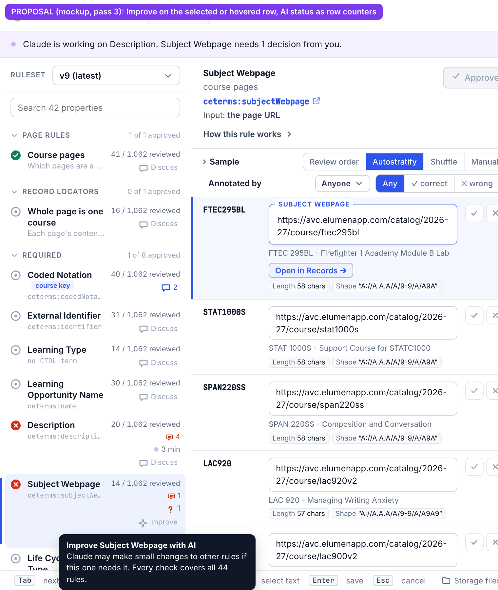
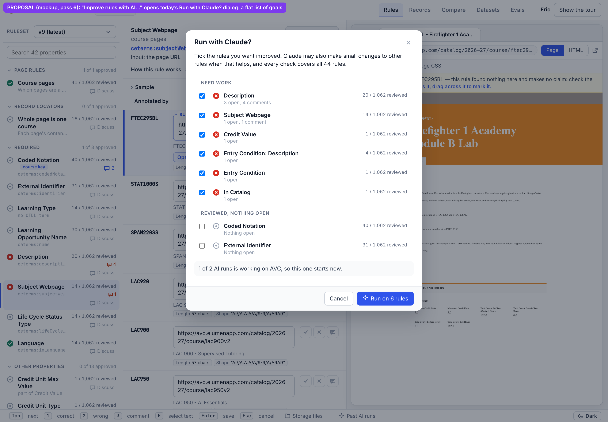
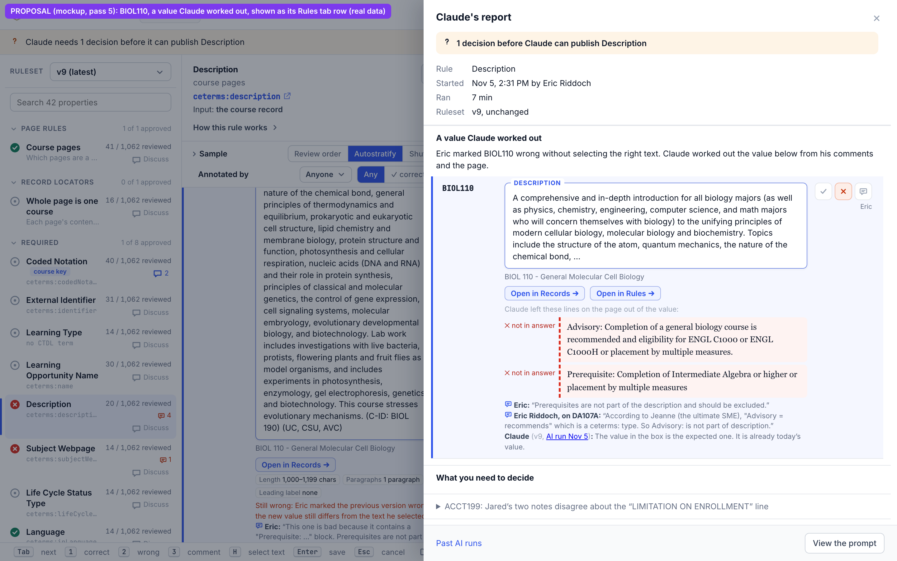
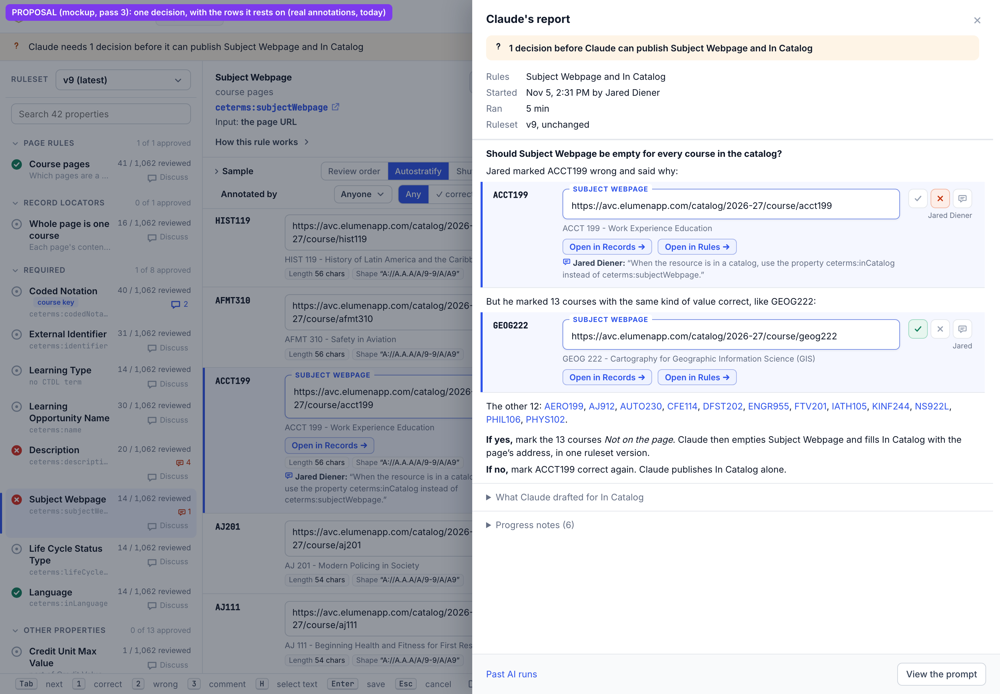
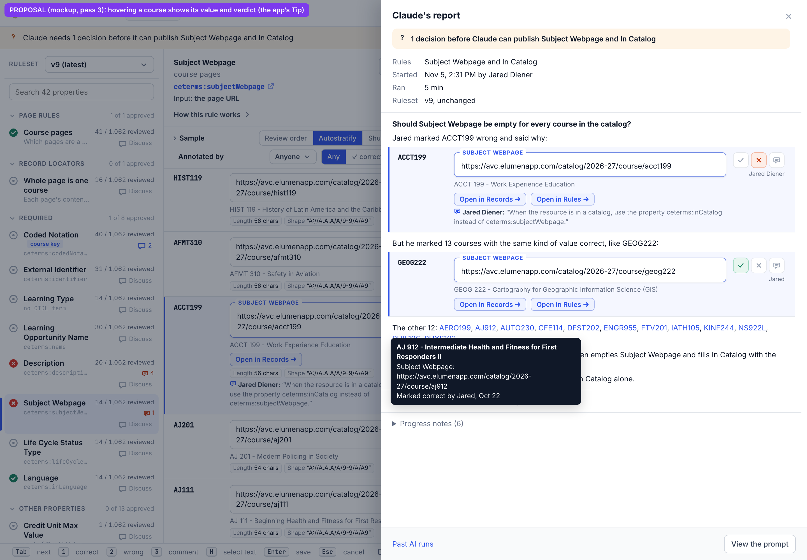
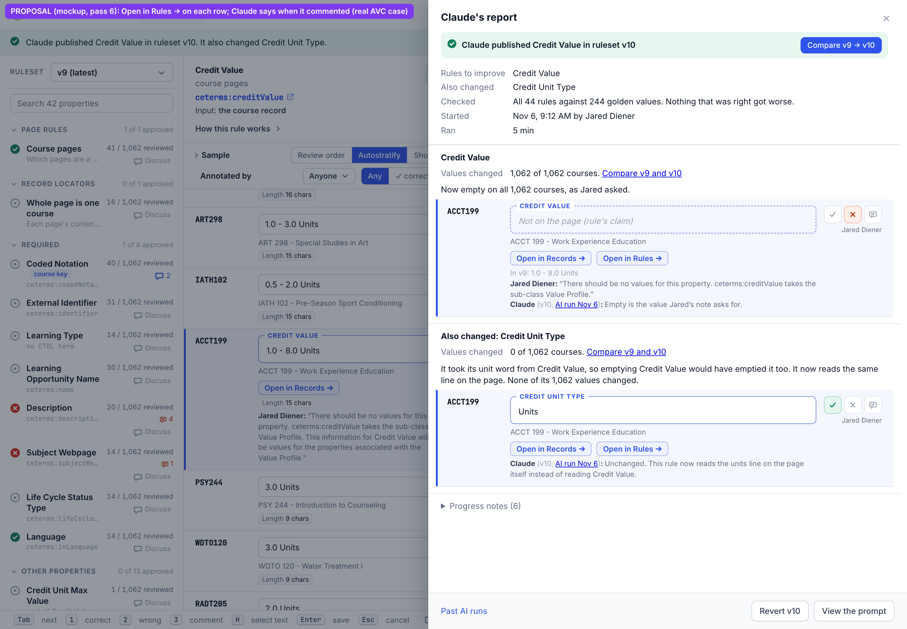
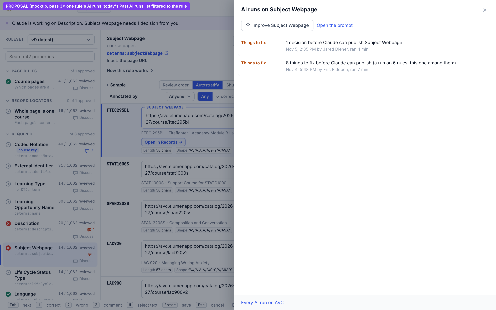
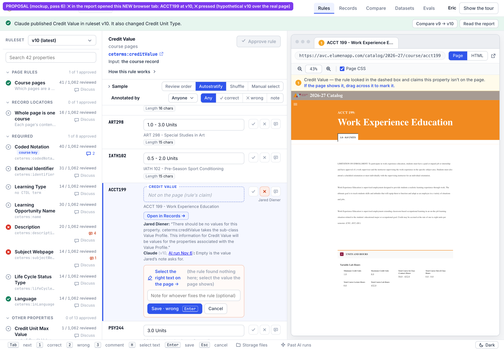
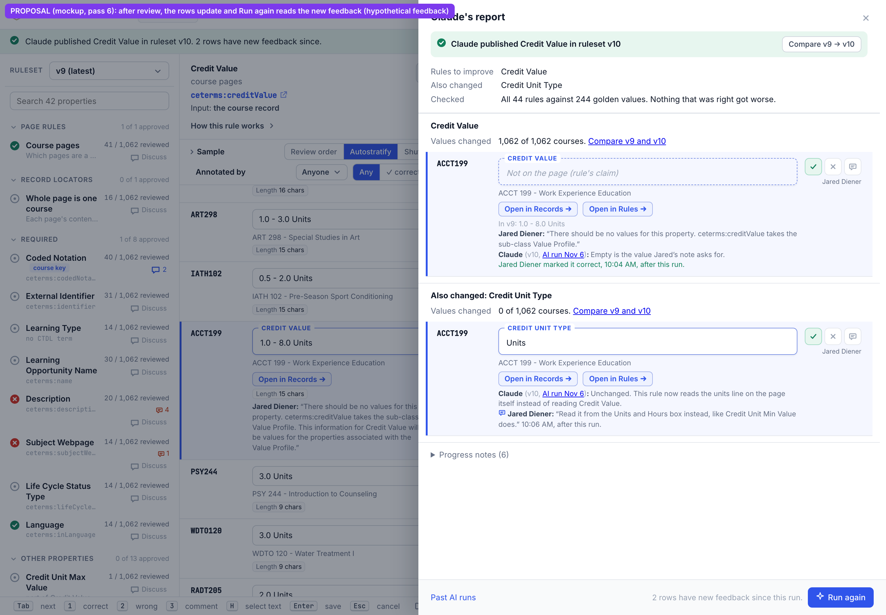
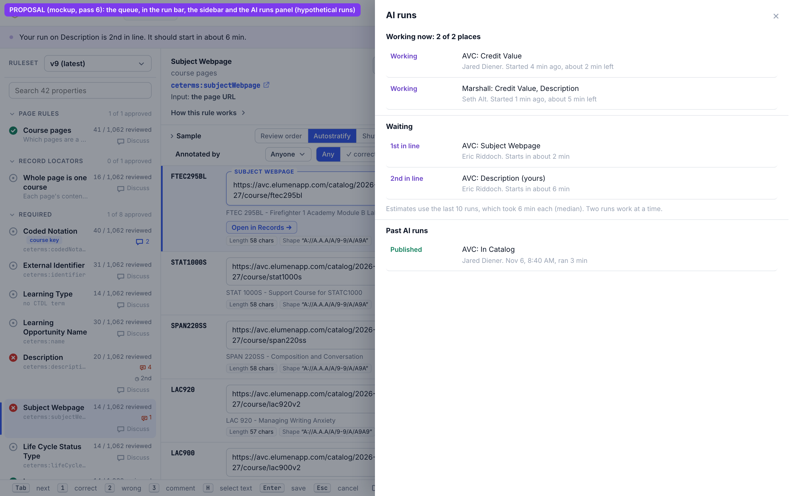

# S — Spec: AI runs toward a set of goal rules, two runs at once, reports that carry their own context (pass 4, 2026-11-05)

Based on Eric's answers ([`answers-pass1.md`](answers-pass1.md)) and the research
([`02-research.md`](02-research.md), new findings in §7; the K2 calls in [`k2-transcript.md`](k2-transcript.md)).
Builds on the CLI-written report of [`../report-links/03-spec.md`](../report-links/03-spec.md) (branch
`studio-report-links`). Every picture says whether it shows the Studio **today (real)** or a **proposal (mockup)**.

**Pass 6 (Eric's answers, [`answers-pass5.md`](answers-pass5.md)).**
- **Open in Rules →** and **✕** open the row in a **new browser tab**, pinned to the ruleset the run published
  (`&ext=`), so the report is never lost. The report refetches on focus.
- The UI never says "goal": it says **"rules to improve"**. "Goal rules" stays as the spec's internal term (§3.1).
- Each changed rule shows **Values changed**, counted by the CLI, with a link to Compare.
- **Revert** (was "roll back") is for everyone, behind a confirm.
- **The queue is visible** (§1.7). Run again goes through the dialog.
- No `·` in report text, and the prompt asks for plain, short writing. The Rules tab is not changed.
- Claude's row comments are saved on the rows.
- The live test on the K2 server has a written plan (`k2-transcript.md`).

Sections marked **(changed in pass 6)**: §1.2, §1.4, §1.6, the new §1.7, §2.3, §3.1, §3.3, §3.6, §5, §6.2, §7, §8,
§9 and §12.

**Pass 5 (Eric, [`answers-pass4.md`](answers-pass4.md)): checking and correcting Claude's work from the report.** Each
row in the report gets **Open in Rules →**, which shows that row in the Rules tab, in the same browser tab, with its
page beside it. The report waits in the run bar, and **Back to the report** returns to it *(pass 6: replaced; the row
opens in a new browser tab)*. ✓ and comments work in the
report; ✕ goes to the Rules tab to select the right text. Claude's comments are saved on the rows with "(v10, AI run
Nov 6)". The report refetches its rows when the window regains focus. **Run again** starts a new run with the same
goals once rows have new feedback. Sections marked **(changed in pass 5)**: §1.4 (mockups 2 and 5, the footer), the new
§1.6, §2.1, §2.3, §4, §7, §8, §9, §12.

**Pass 4 (Eric, [`answers-pass3.md`](answers-pass3.md)): the rules you pick are the goal, not a fence.** Claude
may make surgical edits to any rule a goal needs (a page rule, a locator, a sibling property rule). Every check runs the
**whole golden suite**: every rule in the catalog against all its golden values, and a publish is refused if anything
that was right gets worse. That replaces three pass-2 ideas: a run publishing only its own rules, the CLI refusing other
rules inside a run, and `together` as a fence. Per-rule locks go; runs publish with **optimistic concurrency**
(§3.5). Sections marked **(changed in pass 4)**: §1.1, §1.2, §1.4 (mockup 2 and the order), §2.1, §2.2, §3, §4, §5,
§7, §12. Measurements: research §7.8 (whole suite: 5.95 s, 335 MB) and §7.9 (a real surgical edit on AVC).

**Pass 3 (Eric's review of the report mockups, [`answers-pass2.md`](answers-pass2.md)):** no `·` separators;
only the app's own components; each course shown as its Rules tab row card, with the row's ✓ as the save action;
less prose. See §1.0–§1.4; the screens and mockups are redone.

**What pass 2 changed.** Sections marked **(changed in pass 2)** replace what pass 1 proposed:
- **A run works on a set of rules, in one Claude session.** Pass 1 had one rule per run, and "improve every rule"
  started one run per rule. Now the sidebar button starts a run with a set of one, and the catalog button opens a
  **rule picker**.
- **Rules that depend on each other change as one transaction**: tested together, published in one ruleset
  version, reverted together. Pass 1 published only a run's own rule and asked for a second run. *(Pass 4: replaced
  by goals, surgical edits to any rule, and the whole-suite check, §3.)*
- **2 runs at once** (pass 1: 3), on today's K2 memory. The Studio drives the queue; the K2 calls are shown with real
  request and response bodies.
- **Publishes are serialized** with a publish lock, so versions can't race.
- **Missing expected values are inferred** and shown as structured data the CLI renders, with a ✓ on the course's row card that saves it (§1.4).
- **No refusal of vague words.** The fix is structural: the report refers to courses, values, comments and page
  passages by reference, and the CLI **dereferences** them (resolves each reference to its real data) into readable
  context, with progressive disclosure.
- **Prompt visibility as today**, plus **View the prompt** on a finished run's report.

Unchanged from pass 1: the ✦ button on the hovered or selected sidebar row; at most 3 to-dos per report; inline
quotes, each followed by a citation link and checked by the CLI; K2 host sessions, one fresh Claude session per run.

---

## 1. What changes for the user

### 1.0 Design rules for everything below (changed in pass 3)

Eric reviewed the pass-2 mockups ([`answers-pass2.md`](answers-pass2.md)). Three rules follow from that review:
- **No `·` middle dots** as separators, anywhere: not in the report, the run bar, the sidebar or the dialogs. Metadata
  goes in label/value rows (`dl.run-facts`, as in Past AI runs) or on separate lines, or it is dropped.
- **Only the app's own components and classes.** A new style is allowed only where nothing existing fits (the end of §1.4 lists
  the two exceptions).
- **A course is shown as its Rules tab row**, the card you see while you Tab through the list. The report reuses that
  card, so the reader knows which row is meant.

### 1.1 The rule list (sidebar) (changed in pass 3)


**Proposal (mockup):** the selected row (or the row under the mouse) gets an **Improve** button. It is the same
button as **Discuss** (`rule-talk-btn` in `RuleList.tsx`), with the ✦ icon, and its tooltip is the app's `Tip`
(`evals/EvalsTab.tsx`). A rule in a run shows its AI status as one more row counter, like the comment count
(`.stat` in `RuleList.tsx`). Description shows the run bar's pulsing dot and "3 min". Subject Webpage shows "? 1"
(1 decision for you, amber `.stat.sig`). The run bar says it in sentences: "Claude is working on Description.
Subject Webpage needs 1 decision from you." [`mockups/1a-sidebar-hover.html`](mockups/1a-sidebar-hover.html)

- **Improve** starts a run whose goal is that one rule. Claude may make small changes to other rules if the goal needs them, and every check covers all of the catalog's rules (§3) **(changed in pass 4)**. Tooltip: "Improve Subject Webpage with AI. Claude may make small changes to other rules if this one needs it. Every check covers all 44 rules."
- Clicking an AI counter opens the rule's runs (§1.5).

### 1.2 The rule picker (changed in pass 3 and pass 4)


**Proposal (mockup):** "Improve rules with AI…" (the button at the end of the rule list, replacing "Improve all 6
rules with Claude") opens **today's "Run with Claude?" dialog** (`RunButton.tsx`, `.ac.run-ask`). The dialog now has
a list of rules with a checkbox each ([`mockups/1c-rule-picker.html`](mockups/1c-rule-picker.html)).
- Each rule is shown as its sidebar row (`.rule-item`: status icon, name, "N / 1,062 reviewed"). The grey line under
  the name says why it is ticked ("3 open, 4 comments").
- **Ticked by default:** rules with open annotations, or with annotations newer than their last run. On AVC today
  that is the 6 rules that need work. Rules with nothing open are listed unticked.
- **A flat list of goals (pass 4).** Ticking says what to improve, nothing more. There is no tree and no
  auto-ticking of upstream or downstream rules (Eric considered it and set it aside), because Claude may change any
  rule a goal needs. The dialog's first line says so: "Tick the rules you want improved. Claude may also make small
  changes to other rules when that helps, and every check covers all 44 rules."
- The dialog's existing note line (`.run-note`) says where the run will stand: "1 of 2 AI runs is working on AVC, so
  this one starts now".
- The buttons are the dialog's own: **Cancel**, and **✦ Run on 6 rules** (`btn primary`).
- A rule that is already **being improved by another live run** is disabled, with the reason in its grey line ("Being
  improved in Jared's run, 4 min") **(changed in pass 6)**. Only goals are claimed this way; any rule may still be *edited* by any run (§3.5; question P6).

### 1.3 The run bar (changed in pass 3)

The run bar is today's component (`RunBar.tsx`). Its text is full sentences, with no separators: "Claude is working
on Description. Subject Webpage needs 1 decision from you." "Claude needs 1 decision before it can publish
Description." The buttons are the run bar's own (`btn`): **Open**, **Read the report**, **Compare v9 → v10**. Today's
" · started by …" suffix (`RunBar.tsx:86`) is dropped; who started a run is in the report's facts.

### 1.4 The report (changed in pass 3 and pass 5)

The report is today's report panel (`RunReport` inside `WatchPanel`, `RunBar.tsx:153-183`, and the Past AI runs
drawer, `RunsPanel.tsx`), with these parts:

| Part | Component reused |
|---|---|
| Title "Claude's report", close × | `.run-watch` `.ac-head` (as today) |
| Outcome band ("1 decision before Claude can publish Description"), and **Compare v9 → v10** | `.run-done` with `endedIcon`, and `CompareLink` (`RunBar.tsx:47-50, 164-168`) |
| Facts: Goal, Also changed, Checked (the whole-suite line), Started, Ran, Ruleset ("Based on v11; started on v9" after a rebase) | `dl.run-facts` (`RunsPanel.tsx:82-90`), one fact per row |
| Section headings ("A value Claude worked out", "What you need to decide", one per rule) | `.runs-sec h3` |
| **A course** | **the Rules tab row card** (the row JSX in `RulesTab.tsx:660-700`, moved into a shared `RowCard`). It shows `.code`; the `.valbox` with its `.valbox-k` legend (DESCRIPTION) and value, or `empty claim` for "Not on the page (rule's claim)"; `.pg` (the course title); `.row-links` with **Open in Records →** (`.xbtn`); the strata chips (`.sm-tags`); the history line (`HistoryLine`, `parts.tsx:97-119`) with the verdict and every comment; and the ✓ ✕ comment controls (`Controls`, `parts.tsx:8-37`) with the byline |
| A page passage Claude left out of a value | the "wrong" expansion's pieces (`Expansion`, `parts.tsx:65-72`): `.sel-piece`, `.sel-pol` "✕ not in answer", `.sel-quote.out` |
| A comment or note | an item of the row's history line (`.h-comment` with the bubble icon, author in bold) |
| Claude's sentence about a row ("The value in the box is the expected one…") | one more history item, author "Claude", followed by "(v10, AI run Nov 6)" with the run linked (pass 5, §1.6) |
| A list of courses ("The other 12") | course codes as `linkish` buttons. Hover shows the app's `Tip` with the course's title, value and verdict; click opens the row |
| Folded items (other decisions, progress notes, what Claude drafted for another rule) | `details.runs-sec.run-fold` (`RunBar.tsx:174-180`) |
| Footer: **Past AI runs**, **View the prompt**, **Revert v10** (pass 6) | `.ac-foot` with `linkish` and `btn` (`RunBar.tsx:143-147`) |

**Save is the row's own ✓.** An inferred value is shown in the course's row card, in its value box. The row's ✓
button saves it: its tooltip says "Correct (1): this is the right value. Saves it as BIOL110's expected Description".
If the run didn't publish the value, the value box shows the inferred value, and ✓ saves it as the expected value
(§2.4). There is no separate Save button.


**Proposal (mockup): BIOL110's Description, a value Claude worked out** (real annotations and page text). Eric marked
it ✕ on Oct 27 without selecting the right text. The report shows BIOL110's row card: the Description box holds the
value Claude worked out, which is already today's value. Under it are the two lines Claude left out ("✕ not in
answer"). The history line holds Eric's comment, Eric's DA107A comment about Advisory lines, and Claude's one
sentence. ✓ saves it. The one other decision (ACCT199) is folded.
[`mockups/5-report-missing-expected.html`](mockups/5-report-missing-expected.html)


**Proposal (mockup): a decision, with the rows it rests on** (real annotations, today). The question is the heading:
"Should Subject Webpage be empty for every course in the catalog?" Below it:
- ACCT199's row card, with Jared's ✕ and his comment;
- GEOG222's row card, marked ✓ by Jared;
- "The other 12" as course codes;
- two short sentences, "If yes, …" and "If no, …".

What Claude drafted for In Catalog is folded. [`mockups/3-report-dereferenced.html`](mockups/3-report-dereferenced.html)


**Proposal (mockup):** hovering a course code shows the app's `Tip` with its title, value and verdict.


**Proposal (mockup, pass 4): a goal rule plus a surgical edit to another rule.** This is a real AVC case, with values
from a real `rule try` (research §7.9). The goal is Credit Value: Jared's note on ACCT199 says it should have no
values. Credit Unit Type took its unit word from Credit Value, so Claude also changed it, to read the same line on
the page.
- The facts read *(pass 6 wording)*: Rules to improve Credit Value; Also changed Credit Unit Type; Checked "All 44 rules against 244 golden values.
  Nothing that was right got worse."
- The Credit Value section shows ACCT199's row card. It is now empty. The history line has "In v9: 1.0 - 8.0
  Units", Jared's note, and Claude's comment "Empty is the value Jared's note asks for", marked "(v10, AI run Nov 6)".
  The ✓ saves "empty" as the expected value. *(Pass 5: Claude no longer tells people to press anything; each row has
  **Open in Rules →** next to **Open in Records →**.)*
- The "Also changed: Credit Unit Type" section has one sentence on why, and ACCT199's row card: still "Units", ✓ by
  Jared. None of its 1,062 values changed.
- Each rule's section starts with **Values changed** *(pass 6)*: "1,062 of 1,062 courses. Compare v9 and v10" for
  Credit Value, "0 of 1,062 courses" for Credit Unit Type. The CLI counts these from the draft against the base
  version, never Claude. The link opens Compare for that rule and those two versions
  (`#/c/avc/compare?a=9&b=10&rule=course-credit-value`, a link the Compare tab already takes).
- **Revert v10** (pass 6; was "Roll back") restores both rules. [`mockups/2-report-transaction.html`](mockups/2-report-transaction.html)

The order, always (empty parts are left out):
1. outcome band;
2. facts;
3. values Claude worked out, the first open and the rest folded;
4. what you need to decide, the first open and the rest folded (at most 3);
5. the goal rules, one section each; then each rule Claude **also changed**, one section each. An "also changed" section has one sentence on why, and row cards for the courses whose value changed (or, when none did, one card showing a golden value that held) **(pass 4)**;
6. progress notes, folded;
7. footer: **Past AI runs**, **Revert vN**, **View the prompt**; and, once rows have new feedback, "2 rows have new feedback since this run." with **✦ Run again** (pass 5, §1.6).

Each section has one or two short sentences of prose, and the row cards carry the rest.

#### Where the report needed something new (pass 3)

- **History items on separate lines.** `HistoryLine` joins items with " · " (`.h-sep`, `parts.tsx:109`). The report
  shows each item on its own line: a `stacked` prop on `HistoryLine` hides `.h-sep` and makes each item a block.
  (Should the Rules tab drop its " · " too? Question P5.)
- **A row card without the list around it.** The row JSX lives inside the Rules tab's list rendering
  (`RulesTab.tsx:660-700`). It moves into a `RowCard` component that both the Rules tab and the report use. In the
  report, the card is not selectable and has no keyboard focus.

### 1.5 A rule's AI runs


**Proposal (mockup):** opened from a rule's AI status, or from the rule header's ⋯
([`mockups/4-rule-history.html`](mockups/4-rule-history.html)). The rule's runs, newest first, including runs on a
set that contained it. **Read** opens a report. **Open the prompt** at the top (the prompt a new run on this rule
would get) is shown to Eric and Seth only, as the run button's menu is today **(decided: visibility unchanged)**.
This is today's Past AI runs panel (`RunsPanel.tsx`) filtered to one rule. Its meta line drops today's " · " (`RunsPanel.tsx:50`): "Nov 5, 2:35 PM by Jared Diener, ran 4 min" **(pass 3)**.

---

### 1.6 Checking and correcting Claude's work from the report (new in pass 5)

#### Seeing the page: Open in Rules → in a new browser tab (changed in pass 6)


**Proposal (mockup):** the reviewer pressed **✕** on ACCT199's Credit Value row in the report. A **new browser tab**
opened on the Rules tab:
- Credit Value, at **ruleset v10** (the version the run published);
- ACCT199 selected, its value "Not on the page (rule's claim)", Claude's comment in its history;
- ✕ already pressed, waiting for the right text to be selected on the page beside it.

The run bar is today's ended-run bar, with nothing new. The page and the Rules tab are real; ACCT199's v10 value is
hypothetical (AVC has no v10 yet). [`mockups/6-verify-in-rules.html`](mockups/6-verify-in-rules.html)

How it works:
- **Open in Rules →** is an `.xbtn`, beside the row's existing **Open in Records →** (`RulesTab.tsx:664-669`). The
  Records and Evals tabs already have the same button (`RecordsTab.tsx:221-224`, `EvalsTab.tsx:717`). In the report it
  opens a **new browser tab** (`target="_blank"`), and so does **✕**, so the report is never lost.
- The link is `#/c/avc/rules/<rule>?row=<course>&by=anyone&ext=<extraction of the published version>`. For example:
  `#/c/avc/rules/course-credit-value?row=ACCT199&by=anyone&ext=rs-0010`.
  - The Rules tab already picks a ruleset's extraction through `?ext=` (`RulesTab.tsx:139-140`, the same parameter
    the ruleset picker sets). So the reviewer checks **Claude's** value, not an older one.
  - When the run published nothing, `ext` is the version the run started from.
  - The Rules tab already selects the `?row=` row (`RulesTab.tsx:137`) and shows its page with the value highlighted.
  - The row's rule may be any rule.
- In that tab the reviewer has everything the Rules tab offers: ✓, ✕ with the right text selected, comments, Tab to
  the next row. Nothing is re-implemented in the report.
- **No new bar note.** The tab's ruleset picker already says "v10", and today's run bar already names the run. The
  pass-5 "Back to the report" bar is dropped.

Why not the others:
- **The same browser tab** (pass 5's recommendation) risks losing the report. Eric ruled it out.
- **A page preview inside the report** would re-implement the page pane. The report shows only the passages Claude
  quotes or left out (`.sel-quote` pieces, as in mockup 5).

#### Correcting

- **✓** and **comment** act in the report, on the row's own controls. They post to the existing annotation route; the
  comment appends to the row's history, after Claude's comment.
- **✕** in the report opens the row in a new browser tab, like **Open in Rules →** (pass 6), with ✕ already pressed
  (`&mark=wrong`, a new parameter that opens the row's existing ✕ expansion, `Expansion` in `parts.tsx`). The
  reviewer drags across the right text on the page, as always, and saves.

#### Claude's comments on rows, and when it said them

- Claude's sentences about a row are **saved as comments on that row** (decided in pass 6), so they also appear in
  the Rules tab's history line. Each one says when, in parentheses after the name, with the run linked:
  **Claude** (v10, [AI run Nov 6](#)): Empty is the value Jared's note asks for.
  - "v10" is the ruleset the run published (or started from, if it published nothing). "AI run Nov 6" links to the
    report (`?run=<run id>`).
  - Claude never tells people what to press. The prompt says so (§5).

#### Freshness: a verdict made elsewhere reaches the report

- **Recommended: refetch the report's rows when its window gets focus or becomes visible**, plus when the report
  opens. That is the pattern the run poll already uses (`agent/state.tsx:65-70`). The request is cheap: the server
  reads only the bytes appended to the annotation log since its last read (`log.py:85-97`). Coming back to the
  report's tab from the new tab gives it focus, which refetches.
- Left out: `BroadcastChannel` between Studio tabs. It would update a report showing side by side in another
  window without a click, but focus already covers the common case. Polling while open isn't needed.
- **A row whose verdict changed after the run** shows its current verdict on the row's controls and byline. A history
  item says when: "Jared Diener marked it correct, 10:04 AM, after this run." New comments appear in order after
  Claude's.

#### Run again


**Proposal (mockup):** after review, Jared's ✓ on Credit Value and his comment on Credit Unit Type show on the rows
(hypothetical feedback). The footer says "2 rows have new feedback since this run." and offers **✦ Run again**
(`btn primary`). The run bar says the same. [`mockups/7-report-rerun.html`](mockups/7-report-rerun.html)

- "New feedback" = verdicts and comments, on any rule the run touched (goals and "also changed"), made after the run
  read its annotations (`annotations_as_of`).
- **Run again** opens the existing "Run with Claude?" dialog with the same rules to improve ticked (decided in pass 6:
  a person decides when a run starts). The new run reads every
  annotation, the new ones included, plus the last run's report (`run context`, §4).

#### Can Claude Code and the CLI really produce all of this?

Yes. Claude writes only ids, short sentences and quotes. Everything else is read by the CLI or the Studio from data
that exists today:

| Element | Who produces it | From |
|---|---|---|
| Outcome band, Compare | CLI at `run done` | `run.json` (`ruleset_before`, `ruleset_after`), report `ending` |
| Goal, Also changed | Claude's `report.json` (`rules`, `also_changed`), checked by the CLI | the published ruleset's `changed_rules` |
| Checked (whole-suite line) | CLI, from the last `rule try` / `rule publish` | `last-try.json` (§3.3) |
| Started, Ran | Studio | `run.json` |
| Row card: code, legend, value, title | CLI resolves `{course, rule}` | the extraction (`snap.rows`, occurrences' `page_title`) |
| "In v9: 1.0 - 8.0 Units" | CLI | the base ruleset's extraction |
| Verdict, byline, history (reviewers) | Studio at display time | the annotation log (`rule_annotations`), refetched on focus |
| Claude's comment and "(v10, AI run Nov 6)" | Claude writes the sentence (`report.json` `rows[].comment`); the CLI appends it to the log | log event `{type: comment, author: "Claude", author_role: "ai", run_id, ruleset_version}` |
| Passages left out (`.sel-quote.out`) | Claude gives quotes; the CLI checks them in the page text | the saved page (`engine.text_of`) |
| Inferred value and its ✓ | Claude's `inferred`, checked by the CLI | the published or last-try value |
| Open in Records / Open in Rules | Studio | the row's rule and course |
| "2 rows have new feedback", Run again | Studio | annotation log events after `annotations_as_of` |

### 1.7 The queue, visible (new in pass 6)


**Proposal (mockup):** Eric's run on Description is waiting (hypothetical runs). The queue shows in three places,
all with existing components ([`mockups/8-queue.html`](mockups/8-queue.html)):
- **Run bar** (today's): "Your run on Description is 2nd in line. It should start in about 6 min." with **See the
  queue** and **Cancel**.
- **Sidebar**: the rule's AI counter (`.stat`) shows a clock and "2nd"; its tooltip says "Waiting for a free place:
  2nd in line, about 6 min".
- **AI runs panel** (today's Past AI runs drawer, `RunsPanel.tsx`, with two sections above the past runs):
  - "Working now: 2 of 2 places": each run's catalog, rules, who started it, time so far, and about how long is left;
  - "Waiting": place in line, catalog and rules, who, and an estimated start;
  - one line on where the estimate comes from: "Estimates use the last 10 runs, which took 6 min each (median). Two
    runs work at a time."

The "Run with Claude?" dialog's note line (`.run-note`) says the same before you start: "2 AI runs are working. This
one would be 1st in line, about 2 min."

**The estimate.**
- *d* = the median duration of the last 10 runs that ended, across catalogs (`run.json` `sent_at` → `ended_at`);
  6 min if there are none yet.
- Each working run has *max(1, d − time so far)* minutes left.
- The *k*-th run in line starts when the *k*-th earliest of those places frees up. Places that free up go to the runs
  ahead in order, each taking *d* again.
- Shown rounded to whole minutes, as "about N min", never as a promise. When an estimate is wrong (a run runs long),
  the next poll corrects it.

**Data it needs** (all on the storage root, read by `GET /api/agent-runs/queue`):
- the slots file (§6.2): cap, and each working run's id, catalog and start time;
- the waiting runs, oldest first, from each catalog's live runs (`state: waiting`, `created_at`);
- for each run, its rules to improve and who started it (`run.json`);
- the last 10 ended runs' durations: a small index `golden-dataset-studio/agent-runs-recent.json`, updated when a run
  ends, so the Studio doesn't list every catalog's run folders.

## 2. Report file and rendering (changed in pass 2)

### 2.1 What Claude writes (`report.json`, version 2) (changed in pass 4: goals and `also_changed`)

Claude's free text is limited to short **titles, reasons and outcomes**. Everything else is a **reference**, which
the CLI checks and resolves. A reference is one of:

```json
{"course": "ACCT199"}                                   // a course (title, address, values, verdicts)
{"value": {"course": "GEOG222", "rule": "course-subject-webpage"}}   // a course's value in a rule (now, or in the try)
{"note": "an-39127172c8e8"}                             // a verdict's note or a comment
{"page": {"course": "BIOL110", "quote": "A comprehensive and in-depth introduction for all biology majors"}}
{"courses": {"rule": "course-subject-webpage", "verdict": "correct"}}  // a set, by filter, resolved by the CLI
{"courses": ["AERO199", "AJ912"]}                         // or listed
```

```json
{
  "ending": "published | needs_you | failed",
  "reason": "failed only, one line",
  "rules": [
    {"rule": "course-subject-webpage", "outcome": "published | held | not changed | failed",
     "now": "empty on every course", "why": "optional, one line"}
  ],
  "also_changed": [
    {"rule": "course-credit-value-credit-unit-type",
     "because": {"reads": "course-credit-value"},
     "why": "It took its unit word from Credit Value; it now reads the same line on the page."}
  ],
  "rows": [
    {"rule": "course-credit-value", "course": "ACCT199", "comment": "Empty is the value Jared's note asks for."}
  ],
  "together": [
    {"rules": ["course-subject-webpage", "course-in-catalog"],
     "because": {"quote": "When the resource is in a catalog, use the property ceterms:inCatalog instead of ceterms:subjectWebpage.",
                 "from": {"note": "an-39127172c8e8"}}}
  ],
  "inferred": [
    {"rule": "course-in-catalog", "course": "ACCT199", "annotation": "an-441bd81433b2",
     "value": "https://avc.elumenapp.com/catalog/2026-27/course/acct199",
     "evidence": [{"quote": "https://avc.elumenapp.com/catalog/2026-27/course/acct199", "from": {"note": "an-441bd81433b2"}}],
     "left_out": []}
  ],
  "to_do": [
    {"ask": "Should Subject Webpage be empty for every course in the catalog?",
     "about": [{"course": "ACCT199"}],
     "evidence": [
       {"quote": "When the resource is in a catalog, use the property ceterms:inCatalog instead of ceterms:subjectWebpage.",
        "from": {"note": "an-39127172c8e8"}},
       {"set": {"courses": {"rule": "course-subject-webpage", "verdict": "correct"}}, "label": "marked correct"}],
     "options": [
       {"answer": "yes", "do": {"mark": "not_on_page", "courses": {"rule": "course-subject-webpage", "verdict": "correct"}},
        "then": {"publish": ["course-subject-webpage", "course-in-catalog"]}},
       {"answer": "no", "do": {"mark": "correct", "courses": ["ACCT199"], "rule": "course-subject-webpage"},
        "then": {"publish": ["course-in-catalog"]}}],
     "effect": [{"rule": "course-subject-webpage", "after": ""}, {"rule": "course-in-catalog", "after": {"source": "page_url"}}]}
  ],
  "notes": "free text, at most 5 lines (optional)"
}
```

- `ask` is the only free text in a to-do. It names its subject ("Should Subject Webpage be empty…") because the
  prompt asks for a question someone could answer after reading only the evidence below it. What it is about, the
  evidence, the options and their effects are all references or fixed words.
- `do.mark` is one of `correct`, `wrong`, `not_on_page`, `save_expected`. The CLI words it ("mark the 13 courses
  'Not on the page' for Subject Webpage"), and links to a filtered list when there are several courses.
- `then.publish` names the rules the next run would publish. The CLI writes "The next run publishes both rules
  together".
- **Pass 4:** `rules` lists the **goal** rules. `also_changed` lists every other rule the run changed, each with a
  one-line `why` and, when it applies, `because: {"reads": <rule>}` or `because: {"read_by": <rule>}`. The CLI checks
  this list against the published ruleset: a changed rule missing from it, or listed but not changed, is refused.
  `together` stays only to explain a link that isn't a data link (a note saying one rule replaces another). It no
  longer fences anything.
- **Pass 5:** `rows[].comment` is Claude's one sentence about a row, shown in the row's history. It must not tell
  people what to press. `run done` appends each as a comment event to the annotation log: author "Claude",
  author_role "ai" (a new value next to `sme` and `engineer`, `log.py`), plus `run_id` and `ruleset_version`. The
  Studio renders "(v10, AI run Nov 6)" from those two fields.
- `inferred[].left_out` (optional) lists page passages the value leaves out, by reference. They render struck through,
  like BIOL110's Advisory and Prerequisite lines.

### 2.2 What the CLI checks (`run done --report`) (changed in pass 4)

On top of report-links §1:
- every reference resolves: the course exists, the rule exists, the annotation is on that course and rule, and the
  page passage is found in that course's saved page text (whitespace collapsed; `…` joins pieces that must appear
  in order);
- every quote is found in its source (**unchanged from pass 1**);
- `ending: published` needs every `published` rule in the new ruleset version and every `together` group published
  in the same version *(pass 4: `together` no longer gates publishing; the whole-suite check does, §3.3)*;
- each `inferred` value: if its rule was published, it must equal the course's value in the published extraction; if
  not, it must equal the course's value in the run's last try (`last-try.json`). So the CLI never shows a guess the
  rule doesn't produce.
- To-dos: at most 3 are rendered open, the rest folded.

**No check on wording.** Pass 1 proposed refusing "this", "that", "here"; Eric rejected that as a band-aid. The
words matter less once the report can't lean on them: context comes from references, and the prompt (§5) asks for
`ask` to stand on its own.

### 2.3 What the CLI renders

`run done` writes two files next to `report.json`:
- **`report.resolved.json`**: every reference replaced by its data: course code, title and address; values (now, and
  v-before / v-after); verdicts as of the run's end (who, when, ✓/✕, expected value); comment text with author and date; page passages
  with one line of context before and after; and the courses in a set, each with its value and verdict. **The Studio
  renders the report from this file**, with the app's own components (§1.4): each course as its Rules tab row card
  (`RowCard`, with `HistoryLine`, `Controls` and the `Expansion` pieces), facts as `dl.run-facts`, folds as
  `details.run-fold`, hovers as `Tip`. **No `·` separators in anything rendered**: one fact per row, one history item
  per line, and sentences instead of joined fragments (pass 3). The data is all real, because the CLI read it; the
  layout is the Studio's, so it is the same on every run. *(Pass 6: for each changed rule, the resolved report has
  `values_changed: {count, of, base, published, compare_url}`, which the CLI counts from the draft's extraction against
  the base version's. The report shows it as "Values changed: 1,062 of 1,062 courses. Compare v9 and v10". No `·` in any
  text the CLI writes.)* *(Pass 5: the verdict, byline and history of each row card
  are refetched from the annotation log when the report opens or its window regains focus, so they are always
  current; the resolved file supplies the rest. Each row card has **Open in Records →** and **Open in Rules →**, §1.6.)*
- **`summary.md`**: the same report as Markdown, for Slack and for older Studios. Folds become lists, hovers
  become nothing, and the row's ✓ becomes a link that opens the course's row with the value ready.

A report from an older run (`summary.md` only) is shown as today.

### 2.4 Saving an inferred value (changed in pass 2: feasible; pass 3: it is the row's ✓)

- The rule was published with the inferred value: the row card's ✓ posts a ✓ on the course's current value through the
  existing route (`POST /api/catalogs/{c}/annotations`). That makes it a golden value.
- The rule wasn't published: the row card's ✓ posts a ✕ with `expected.text` = the inferred value and `supersedes` the open ✕.
- After saving, the row card shows the new verdict and byline, as in the Rules tab, and the course stops counting as an inferred value in later runs.
  The run record isn't changed.

---

## 3. Goals, surgical edits and the whole golden suite (changed in pass 4)

Pass 2 tied a run to a set of rules and treated dependent rules as a transaction to fence. Pass 4 replaces that.

### 3.1 The goal (changed in pass 6: the UI says "rules to improve")

The rules picked in the sidebar or the picker are the **goal rules** (the spec's internal term; **the UI calls them
"rules to improve"** and never says "goal"): what the run must improve. They decide the prompt's
focus and the report's first sections. They don't limit what Claude may edit.

### 3.2 Surgical edits to any rule

Claude may change any rule that a goal needs: a page rule, a locator, the rule a goal reads, a rule that reads the
goal, or a sibling. The prompt asks for the smallest change that works (§5). The CLI makes the cost visible: for each
changed rule, `rule try` prints how many values changed across the catalog. The report lists every non-goal rule
under "Also changed", with its reason.

`golden-datasets rule downstream <rule>…` (from `depends_on`, `model.py:168-175`) still exists. It helps Claude see
the blast radius before editing (AVC: page rule 43 rules, locator 42, Credit Value 1). It is no longer a limit.

### 3.3 The whole golden suite

**Every** `rule try` and every `rule publish` reruns **all** of the catalog's rules over every saved page and compares
them with all their golden values. Golden values are the latest ✓ values, ✕ verdicts with an expected value, and
values Claude inferred in this run (marked as such). On AVC that is 44 rules and 244 golden values.

- **Cost:** 5.95 s and 335 MB on a laptop, against 5.3 s and 312 MB for one rule (research §7.8). So every try runs
  the whole suite; there is no smaller "blast radius" mode. The first try on a new machine downloads the saved pages
  (47 s on AVC); on the K2 server that cache is shared and kept.
- **Regression** (blocks the publish) means:
  - a golden value that matched before no longer matches: a ✓ value changed, a ✕'s expected value no longer
    produced, or an inferred value no longer produced;
  - or a rule matches fewer of its golden values than before.

  Nothing else blocks, including values with no verdict. Their counts are printed, and the report shows them per
  rule as **Values changed** with a Compare link (pass 6: no percentage threshold, decided).
- **Output:** one line first, then detail only where something moved:

  ```text
  Whole suite: 44 rules, 244 golden values. 1 now right, 0 got worse.
  Changed: Credit Value (1,062 values), Credit Unit Type (0 values)
  ```

  The report shows the same result in the facts: "All 44 rules against 244 golden values. Nothing that was right
  got worse."
- Rules whose values didn't change can't regress, so scoring covers the rules whose values changed
  (`scorecard.changed_rules`). The guarantee comes from rerunning everything.

### 3.4 Publishing

`rule publish <draft>` publishes every rule in the draft as **one ruleset version** (one commit,
`rulesets.py:140-150`). Before it does, it runs the whole suite on the result and refuses on any regression. There is
no list of allowed rules.

### 3.5 Two runs at once: optimistic concurrency (no edit locks)

Either run may edit any rule, so a per-rule lock no longer keeps them apart. Instead:

1. **Base.** Each run records its base: the latest ruleset version when it started (`run.json`
   `ruleset_before`, already stored).
2. **At publish**, under the catalog's publish lock (research §7.4, so publishes go one at a time), the CLI compares
   two sets:
   - **mine:** the rules the draft changes compared with the base;
   - **theirs:** the rules changed by every version published since the base (each ruleset file's
     `changed_rules`, `rulesets.py:114-121`).
3. **No overlap: rebase.** The draft's rules are applied on top of the latest version (this is what `plan_draft`
   already does, `loop.py:390-396`). The whole suite reruns on the result, against the latest golden values. If
   nothing got worse, the CLI publishes and prints "Rebased on v11 (Seth's run published Description meanwhile)".
   This includes the case where theirs changed a rule that mine reads, because the suite reruns it.
4. **Overlap: refuse.** "Credit Unit Type was also changed in v11 by Seth's run. Draft it again from v11 and redo
   your change." Nothing is written. Claude, in the same session, runs `rule draft` again, reapplies its edit by hand,
   tries, and publishes.
5. **What the Studio shows meanwhile.** The run's progress notes say it: "Publishing: waiting for Seth's run to finish
   publishing", "Rebased on v11", or "Redoing Credit Unit Type on v11". The run bar keeps saying the run is working.
   A rebase or redo also appears in the report's facts ("Based on v11; started on v9").

**Locks that remain:**
- the **publish lock** (one publish at a time per catalog);
- a **goal claim**: a rule may be the goal of only one live run at a time **(default, question P6)**. It doesn't
  stop edits. It stops two Claudes working toward the same goal and then colliding on the same rule. The pass-2
  per-rule edit lock is gone.

### 3.6 Revert (changed in pass 6: renamed, for everyone)

`golden-datasets ruleset revert <version>` publishes one new version in which **every rule that version changed**
(goals and "also changed") is back to its previous version. Example: v11 = v10 with Credit Value and Credit Unit Type
back to their v9 versions. The revert runs the whole suite too, and refuses if a later version changed one of those
rules again, naming it. The report's **Revert v10** button runs it, **for everyone**, behind a confirm: "Revert v10?
This publishes v11 with Credit Value and Credit Unit Type back to how they were in v9." (decided in pass 6).

## 4. CLI (changed in pass 2, pass 4 and pass 5)

- **Per-run install** (unchanged): `UV_TOOL_DIR=<run>/.tools UV_TOOL_BIN_DIR=<run>/bin uv tool install '<spec>'`;
  commands run as `cd <run> && ./bin/golden-datasets …`.
- **`run note`** records `$K2_SESSION_ID` with the first note of a run (research §7.1.1).
- **`rule downstream <rule>…`** (§3.2): the blast radius, for Claude's information.
- **`rule try` / `rule publish`** (changed in pass 4): always the whole suite (§3.3); publish rebases or refuses (§3.5); inferred values from `inferred.json` in the run folder
  (`{rule, course, annotation, value}`), counted as "now right (inferred)". There is no refusal of rules outside the goal.
- **Publish lock** (§7.4 of the research): `rule publish` takes `<catalog>/golden-dataset-studio/publish.json` (ETag,
  10-minute expiry), plans against the latest version, evaluates, writes, and releases. A second publish waits and
  prints "waiting for run 20261105T… to finish publishing (12 s)". So **version N+1 is always built from version N**,
  and a v10 → v12 sequence within minutes is expected and safe.
- **`ruleset revert <version>`** (§3.6; renamed in pass 6).
- **`run done --report`**: version 2 (§2), writes `report.resolved.json` and `summary.md`. *(Pass 5: it also appends
  each `rows[].comment` to the annotation log as a comment by "Claude" with `author_role: "ai"`, `run_id` and
  `ruleset_version`, after the report passes its checks; nothing is appended if it is refused.)*
- **`run context <rule>…`**: each rule's last run and the annotations since (new information for a fresh session).

## 5. Prompt (changed in pass 2, pass 4, pass 5 and pass 6)

- **Scope (pass 4: the goal):** the goal rules, `build_prompt(ctx, rules=[…])` (today: one rule or every rule needing work,
  `prompt.py:307-315`). For each goal rule: what reads it (`rule downstream`, §3.2) and `run context`.
- **Goals and edits (changed in pass 4):** "The rules listed above are your goal. You may change any other rule if
  a goal needs it: a page rule, a locator, a rule a goal reads or that reads it. Keep every change as small as
  possible. `rule downstream <rule>` shows what reads a rule. Every `rule try` checks all the catalog's rules against
  all their golden values; publish only when it says nothing that was right got worse. List every rule you changed
  that isn't a goal under `also_changed`, with one line on why. If `rule publish` says another run changed one of your
  rules meanwhile, run `rule draft` again and redo your change on the latest version."
- **Inferred values** (replaces the publish-only-on-BETTER rule, `prompt.py:359-360`): "When a course is marked wrong
  with no expected value, work out the value from the page and the annotations. Record it in `inferred.json`, with the
  quotes it rests on. Publish when nothing marked correct changes and every open annotation is right, against its
  expected value or the value you inferred."
- **Writing the report:** "Your text is only titles and reasons. Never restate a value, a course's details, a comment
  or a page passage in your own words: refer to it (§2.1 references), and the report shows it. Write each `ask` as a
  question someone who knows the catalog could answer after reading only the evidence you attach."
- **Row comments (pass 5):** "For a row you changed or reason about, write one sentence in `rows[].comment`: what the
  value is now and why. It appears on that row, next to the reviewers' comments. Don't tell people what to press or
  what to do."
- **Writing (pass 6):** "Write plainly and briefly, for someone who knows the catalog: short sentences, everyday
  words, one idea per sentence. Don't join fragments with `·` or other separators."
- **K2:** "Report with `./bin/golden-datasets run note` and `run done` only; don't use `k2 respond` or `k2 done`."

## 6. K2 (changed in pass 2: 2 at once, the exact calls)

### 6.1 The calls the Studio makes

All checked on a local K2 v0.46.5 with the cap at 2; real bodies in [`k2-transcript.md`](k2-transcript.md). `<ws>`
is `golden-rules`; every call sends `Authorization: Bearer <Studio key>`.

| When | Request | Response | Studio does |
|---|---|---|---|
| A run reaches the front of the queue and the Studio counts fewer than 2 live sessions | `POST /v1/w/<ws>/host-sessions` `{"prompt": "<prompt.md>", "timeoutSecs": 5400, "clientRequestId": "<run id>"}` | **200** `{"sessionId": "df01d0f9-…", "agentName": "api-…", "workspace": "golden-rules", "stream": {…}}` | state `running`, keep `k2.session_id` |
| K2 is full anyway (sessions from elsewhere) | same | **429** after 30 s `{"code": "workspace-cell-cap", "error": "concurrent host-session limit reached for this workspace"}` | back to `waiting`, same place in line; try again after the next session ends (or in 20 s) |
| Every poll, per running run | `GET /v1/w/<ws>/host-sessions/<sessionId>` | 200 `{"phase": "working", "live": true}`; **404** once Claude has exited | 404 with no `run done` → wait 2 min for a late `done`, then end the run as failed ("Claude stopped without finishing") |
| `run done` seen, Cancel, Mark as ended, or past the deadline | `POST /v1/w/<ws>/host-sessions/<sessionId>/kill` `{}` | 200 `{"killed": true, "resumable": true}`; if already gone: 200 `{"killed": false, "reason": "not_live"}` | the slot is free; start the next waiting run |
| Wrong key | any | 401 `{"error": "invalid or missing API key"}` | runs fall back to the prompt, as today |
| Workspace unknown or not allowed | any | 404 `{"error": "no such workspace"}` | same |

The Studio enforces the deadline itself, because K2 didn't (a session with `timeoutSecs: 20` was still working after
4 minutes). `timeoutSecs` is still sent, so it's right if K2 enforces it later.

### 6.2 The queue (in the Studio) (changed in pass 6: cap 2, shown to people, §1.7)

- **Slots file** on the storage root: `golden-dataset-studio/agent-slots.json`
  `{"cap": 2, "live": [{"run": "…", "catalog": "avc", "session": "…", "since": "…"}]}`. It is updated with ETags, so
  two Studios never start the same run or overfill. The cap is a Studio setting (`--k2-max-runs`, default 2) and is
  set to the same number on K2 (`host_session_cell_cap`), so K2 enforces it too.
- **Order:** waiting runs start oldest first, across catalogs. The position shown ("2nd in line") is from the slots
  file plus the waiting runs.
- **Background loop:** each Studio advances runs every 5 s in a background task, not inside browser requests, because
  a "full" answer takes 30 s. The Studio's K2 timeout becomes 45 s (today 15 s, `agent_runs.py:43`).
- **No resend** of a start whose answer was lost (a retry isn't idempotent for live sessions). The run's first note
  carries `$K2_SESSION_ID`, so the Studio learns the session anyway, and a run with no note after 2 minutes ends as
  failed.

### 6.3 What changes on the K2 server

| Change | How (no python3 needed: `deploy.sh`'s curl-to-`/cli` pattern) | Why |
|---|---|---|
| A Studio key that can start host sessions | `/cli/api-keys/create` (or `k2 api-key create --label studio --workspaces golden-rules --allow host-sessions,canonical-message`) | today's key allows only `canonical-message` |
| Cap the workspace at 2 | `/cli/workspace/set` `fields.host_session_cell_cap: 2` | K2 enforces the Studio's cap |
| The workspace's guest policy | `/cli/workspace/set` `fields.api_guest_policy: "[Golden Dataset Studio] This session is a Golden Dataset Studio run. Follow the prompt below; it may change files in its run folder and publish through golden-datasets. Report only with golden-datasets run note / run done, not k2 respond."` | K2's default tells the agent to prefer read-only work (tested, research §7.1) |
| Memory | none (2 runs fit in 4 GiB) | **(decided)** |
| Close the two idle Claude tabs from Oct 30 | in the K2 app | 560 MB back |

### 6.4 Still to validate on the K2 server (needs Eric, question P3)

On the laptop K2 every call behaved as above, with a stand-in agent. On the K2 server, still unchecked:
1. that its key can be made with `host-sessions`;
2. that a host session runs the real Claude with its login, in `/var/lib/k2/work/golden-rules`, and can reach
   Azure;
3. that two real Claude runs fit in memory side by side;
4. that the guest policy text replaces the default there too.

One test prompt ("write a note and end the run") over two sessions would check all four.

## 7. Storage and API (changed in pass 2, pass 4, pass 5 and pass 6)

| Path | What |
|---|---|
| `agent-runs/goals/<rule id>.json` | **goal claim (changed in pass 4)**: the rule's latest run that had it as a goal. Taken with ETags at start; doesn't limit edits (§3.5) |
| `agent-runs/<run id>/run.json` | `scope: {"kind": "rules", "rules": [...], "added": [{"rule", "because"}]}`, `k2.session_id`, `annotations_as_of` |
| `agent-runs/<run id>/report.json`, `report.resolved.json`, `summary.md`, `inferred.json`, `last-try.json` | §2 |
| `golden-dataset-studio/agent-slots.json` | the queue's slots (§6.2) |
| `golden-dataset-studio/agent-runs-recent.json` | pass 6: the last 10 ended runs' durations, for the queue's estimate (§1.7) |
| `<catalog>/golden-dataset-studio/publish.json` | the publish lock (§4) |

| Route | |
|---|---|
| `POST /api/catalogs/{c}/agent-runs` | `{"scope": {"kind": "rules", "rules": [...]}, "author"}` → `201 {run}` (state `waiting`, with its place in line); `409 {rule, run}` if a rule is already a goal of a live run (pass 4); `400` if no rule in the set has anything open. `first_rules` as today. |
| `GET /api/catalogs/{c}/agent-runs/current` | `{runs: [live], recent: {rule: latest ended run}, slots: {cap, live, waiting}, now}` |
| `GET /api/catalogs/{c}/agent-runs/{id}` | adds `report` (the resolved report) next to `summary` |
| `GET /api/catalogs/{c}/agent-runs?rule=<id>` | a rule's runs |
| `GET /api/catalogs/{c}/rules/picker` | the picker's rules: ticked by default or not, why, downstream rules, which live run holds each |
| `POST /api/catalogs/{c}/rulesets/{v}/revert` | §3.6, anyone (pass 6), behind a confirm in the UI |
| `GET /api/agent-runs/queue` | **pass 6**: `{cap, working: [{run, catalog, rules, started_by, since, left_min}], waiting: [{run, catalog, rules, started_by, place, start_in_min}], median_min, from_runs}` (§1.7) |
| `GET /api/catalogs/{c}/agent-runs/{id}/rows` | **pass 5**: for every row the report shows, its current verdict, byline and history (with Claude's comments), and `new_feedback`: the count of verdicts and comments after `annotations_as_of` on the rules the run touched. Fetched on open, on window focus and on visibility change |
| `POST /api/catalogs/{c}/annotations` | unchanged; the report's ✓ and comment use it |

## 8. Web (changed in pass 2, pass 5 and pass 6)

- `rules/RuleList.tsx`: ✦ on hover and selected rows; AI status.
- `agent/FixBar.tsx`: "Improve rules with AI…" + the picker popover.
- `agent/RunBar.tsx`: summary line.
- `agent/RunsPanel.tsx`: a rule filter; the report rendered from `report.resolved.json` (today's `RunReport`, rebuilt from
  the components listed in §1.4, with `RowCard` moved out of `RulesTab.tsx`);
  `summary.md` for older runs.
- **Pass 5, changed in pass 6:** **Open in Rules →** and **✕** on each report row card open a new browser tab with
  `&ext=` pinned to the run's published version. `rules/RulesTab.tsx` reads `&mark=wrong` to open the row's ✕ expansion. The report refetches `…/rows` on open,
  `focus` and `visibilitychange` (the same pattern as `agent/state.tsx:65-70`). The footer shows **✦ Run again** when
  `new_feedback` > 0; it opens the existing "Run with Claude?" dialog with the run's goals ticked.
- **Pass 6:** the queue in the run bar, the sidebar counter and `RunsPanel` (§1.7); "Revert" everywhere; "rules to
  improve" in the picker, tooltips and report facts.
- No change to `prompt/markdown.tsx` is needed for the new report. It renders only `summary.md` of older runs.

## 9. Tests (changed in pass 4, pass 5 and pass 6)

- CLI: references resolve and refuse (each kind); quotes; inferred values against published and last-try values;
  `report.resolved.json` contents; `rule downstream`; the whole-suite line and each kind of regression (a ✓ value
  changed, an expected value lost, an inferred value lost, a rule's match count down); `also_changed` against the
  published ruleset; publish with no overlap (rebased, suite rerun) and with overlap (refused, nothing written); the
  publish lock (two threads); `ruleset revert` of a multi-rule version (pass 4).
- Studio: the queue with a fake K2 (cap 2, a 429, a lost start answer, a 404 session, a kill at the deadline); goal claims
  (a second run on the same goal refused); the picker's defaults (pass 4).
- Web: picker, run bar, report rendering and disclosure, the row card's ✓ in the report (both cases), no `·` in any rendered report text, revert confirm.
- Pass 5: `run done` appends Claude's row comments (and none when refused); `…/rows` returns current verdicts and the
  new-feedback count; web: Open in Rules → and ✕ open a new tab with `ext` pinned, `&mark=wrong`, refetch on focus, Run again shown only with new feedback.
- Pass 6: `values_changed` counts and Compare links; the queue estimate (no history, 1 working run, 2 working and 2
  waiting); revert of a two-rule version; no "goal" in any UI string.
- K2 server, by hand: the live test plan in [`k2-transcript.md`](k2-transcript.md).

## 10. Left out

- K2's own spawn queue (`K2_HOST_SESSION_SPAWN_QUEUE`): the Studio queues itself.
- Restarting a run when annotations change mid-run.
- Bulk marking from a report (e.g. marking the 13 courses in one click). The to-do links to the filtered list.

## 11. Order of work

1. K2 server: §6.3 and the §6.4 test.
2. CLI: references and the resolved report; inferred values; whole-suite check; rebase or refuse at publish; publish lock; revert.
3. Studio: sets, slots and the background queue; K2 `spawn` / `get` / `kill`.
4. Web: `RowCard` out of `RulesTab.tsx`, picker, report.
5. A simulated run on AVC's scratch copy (Subject Webpage + In Catalog), then two real runs at once.

## 12. Questions (changed in pass 6: all answered)

Answered (the spec above applies each answer):

| # | Question | Answer |
|---|---|---|
| P1 | A change affects a rule nobody ticked | Claude may change any rule; the whole-suite check covers it (pass 4) |
| P2 | Roll back from the Studio | **Revert**, for everyone, behind a confirm (pass 6) |
| P3 | Test on the K2 server | Yes, with a cap of 2. The main session runs the live test plan in [`k2-transcript.md`](k2-transcript.md) after Eric confirms the steps (pass 6) |
| P4 | Picker default | Approved: tick rules with open annotations or annotations newer than their last run (pass 6) |
| P5 | Drop " · " in the Rules tab | No change to the Rules tab. It's a writing-style rule for report text and the prompt (pass 6) |
| P6 | The same rule in two runs | Refused in the second person's picker: "Being improved in Jared's run, 4 min" (pass 6) |
| P7 | Block on many unreviewed values changed | No threshold. The report shows **Values changed** per rule, counted by the CLI, with a Compare link (pass 6) |
| P8 | Claude's comments | Saved on the row, author "Claude" (pass 6) |
| P9 | ✕ in the report | Opens the row with ✕ pressed, **in a new browser tab** (pass 6) |
| P10 | Run again | Through the "Run with Claude?" dialog (pass 6) |

No open questions.
