# S — Spec: Credit Unit Value, Reset rule, and correcting a duration

Three follow-ups to the Phase 1 property rules, asked on 2026-11-05 ([`prompt.md`](prompt.md)). Built in this order:

- **A. Credit Unit Value:** the sheet's new row 18, `ceterms:creditValue>schema:value`, and Credit Value with no value
  of its own.
- **C. Correcting a found duration:** Estimated Duration's sub-values picked from the page.
- **B. Reset rule:** clear one property's reviews in one catalog, when the right answer turns out to be different.

**Sources:**
- Seth's answers in [`01-questions.md`](01-questions.md): the first pass, by voice, and Part E.
- The research in [`02-research.md`](02-research.md), with the code notes in [`research/`](research/) and live data
  from the shared Studio root read on 2026-11-05.

**This QRSPI ended with this spec** (questions, research, spec). It was then built straight from the spec, in the
order of §6, on 2026-11-05. §10 records the build and has screenshots of the built screens.

**Screens** are in [`screens/`](screens/). They were taken on 2026-11-05 from the real Studio, running on a local copy
of the shared root's AVC and Marshall data (nothing was written to the shared root):
- **today**: the app as it is;
- **mock**: the same real screen, with the proposed change drawn into it. Real data throughout, except where a
  caption says otherwise.

---

## 0. Scope

**In scope**

| | What |
|---|---|
| S1 | **Credit Unit Value**, `ceterms:creditValue>schema:value`, in `properties.csv` and every catalog (§2.1) |
| S2 | **Credit Value holds nothing.** Value, Min Value and Max Value read the page themselves. The Generate rules prompt teaches this (§2.2, §2.3) |
| S3 | **Correcting a found duration** from the page, one sub-value at a time, without adding it again (§3.1–§3.3) |
| S4 | **The smaller duration gaps:** remove an added duration, keys 1 / 2 on the whole row, 💬 on the sub-value bar (§3.4) |
| S5 | **Reset rule:** a `reset` event, a confirm dialog with counts and a reason, and the button beside Approve rule / Reopen (§4.1–§4.4) |
| S6 | **A reset withdraws the column** from that catalog's silver dataset, and its values leave the golden dataset (§4.5) |

**Out of scope**

| | What | Why |
|---|---|---|
| O1 | **Exact, Minimum and Maximum Duration as sub-values** | E2: left to transformation for now |
| O2 | **A reset across catalogs, or of every property at once** | B2: one property in one catalog |
| O3 | **Undo for a reset**, and a CLI command for it | B7. The log keeps every old verdict, so an undo can be added later |
| O4 | **Starting a new duration from a bare selection** | C1: **+ Add a duration** stays the way to start one |
| O5 | **Changes to xtra-cli** | As in the property-rules spec. Credit Unit Value is scored once xtra emits it (A4) |
| O6 | **Words to numbers** (UALR `Three` → 3) | Transformation, later. The prompt's rule stands |
| O7 | **Resetting Subject Webpage** in any catalog | §8.1: a decision for Seth and Jared once the button exists, not part of the build |

---

## 1. Decisions

| # | Decision | From |
|---|---|---|
| D1 | The new property is `ceterms:creditValue>schema:value`, named **Credit Unit Value** | A1, E1 |
| D2 | **Credit Value (the parent) holds nothing.** Value is a single number (`7`), Min / Max Value a range (`1`, `4`), Unit Type the words (`Credit hours`) | A2, Jared's ✕s |
| D3 | Every catalog gets Credit Unit Value with no rule. Claude writes the rules through **Improve all rules**, with Marshall as the worked example | A3 |
| D4 | Credit Unit Value is scored once xtra's extract emits it. No change in the Studio | A4 |
| D5 | Jared's four Max Value ✕s on Marshall are reset with Reset rule, once it exists | A5 |
| D6 | "Approved" covers **both** the rule's approval and the experts' verdicts on values | B1 |
| D7 | **One property in one catalog** per reset | B2 |
| D8 | A reset clears every verdict that makes a value human: ✓, and ✕ with an answer. Comments, questions and ✕ with no answer stay | B3 |
| D9 | Recorded as a new **`reset`** event. Nothing is deleted or rewritten | B4 |
| D10 | Reset values go back to **not reviewed**, with a faint hint of the old verdict that counts nowhere | B5 |
| D11 | Reset values **leave the golden dataset**. The column **leaves the silver dataset** until the rule is approved again. Evals rescore | B6, E4 |
| D12 | **Anyone signed in** can reset, through a confirm dialog with the counts and a required reason | B7 |
| D13 | The button is **Reset rule**, beside **Approve rule** and **Reopen** | B8 |
| D14 | After a reset, `rule publish` no longer refuses over the old ✓s. This follows from D8, with no extra work | B9 |
| D15 | Correcting a duration is mainly **fixing a found one** from the page | C1 |
| D16 | With a found duration selected, a page selection offers one button per sub-value. The correction is the ✕ on that duration, carrying the corrected duration as its answer | C2 |
| D17 | An added or corrected duration needs its description plus at least one other sub-value | C4 |
| D18 | Remove an added duration, keys 1 / 2 on the row, and 💬 on the sub-value bar all come along | C5 |

---

## 2. A — Credit Unit Value

### 2.1 The property list

- **Sync the sheet as it stands:** `golden-datasets properties sync`, from the live xlsx.
  - **Added:** `course-credit-value-value`, path `ceterms:creditValue>schema:value`, parent `ceterms:creditValue`,
    profile `ceterms:ValueProfile`, Single, sheet row 18.
  - **Credit Value's sample** becomes empty. Later rows' `sheet_row` move down by one.
- **The name.** Sync makes "Value" from column D. A small map in `properties.py`, `LABELS = {path: name}`, holds
  `"ceterms:creditValue>schema:value": "Credit Unit Value"`, and `from_sheet` applies it.
  - The map is dropped once the sheet's column D says Credit Unit Value. §8.2 tells the sheet's owner.
- **Shown as the siblings are:**
  - the rule list: "Credit Unit Value", with "part of Credit Value" under it;
  - the rule header: `ceterms:creditValue → schema:value`, linked to `schema:value`;
  - the home table and Evals: `creditValue → value`.
- **`properties apply --all`** adds it to each catalog with no rule (`rule_type: none`), in one ruleset version per
  catalog. No values change.
- **Tests:**
  - every count of 36 properties becomes 37 (02-research §A.1);
  - `test_properties.py` checks the new row's path, parent and name, and that `LABELS` wins over column D.

### 2.2 Credit Value holds nothing

**Today:** Marshall BMS600's Credit Value is `7 Credit hours`. Jared marked it ✕: "The values for credit hours go in
the subsidiary properties for Value Profile".

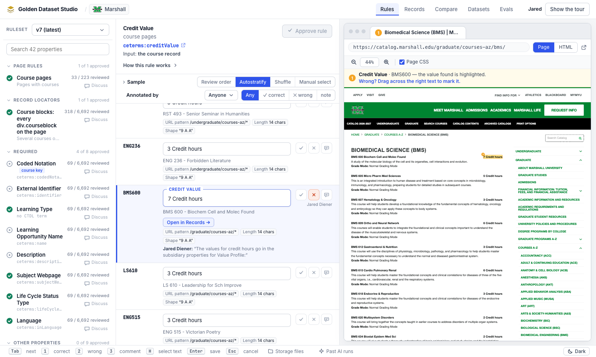

**Today:** with nowhere for a single number to go, Jared marked Credit Unit Max Value ✕ on the same course: "The
correct value is 7." Max Value is empty there, because Marshall's Min and Max rules only fill ranges.

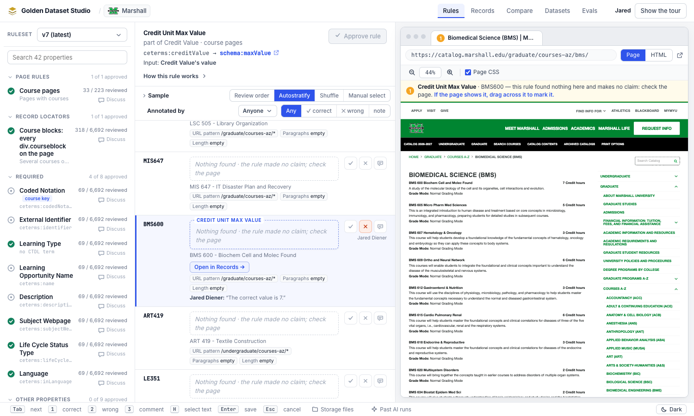

**Mock:** Credit Unit Value, `ceterms:creditValue → schema:value`, reading the page, with "part of Credit Value"
under its name. The values are Marshall's real credits (BMS600 `7 Credit hours`; MIS647, ART419, LE351 and JMC458
`3 Credit hours`).

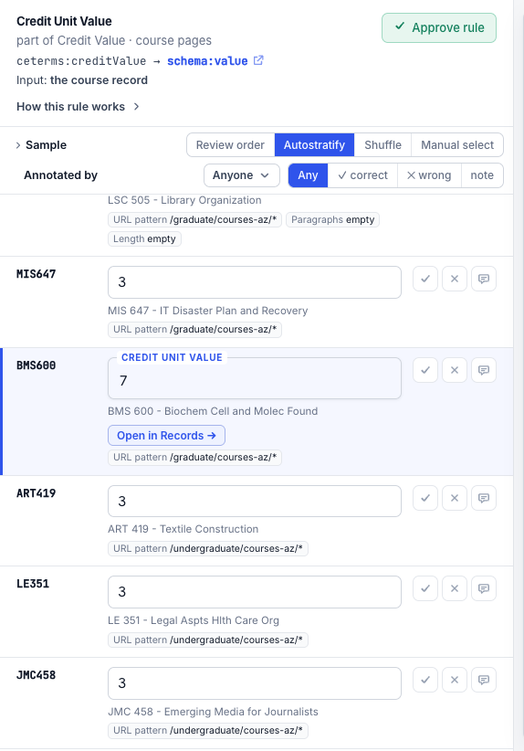

- **No code change is needed.** `none` is an existing rule type, and a parent with no output leaves an `input: rule`
  child empty (`engine.py:431`).
- **The change is in the rules,** written by Claude through Improve all rules (§2.3, §6):
  - **Credit Value** becomes `rule_type: none` in every catalog.
  - **Credit Unit Value, Min Value, Max Value and Unit Type** stop reading Credit Value's output (CCSF, Marshall,
    UALR and WVU do today; AVC's read the page). They read the page: `css+regex` on the credits element, or
    `labelled`.
- **Expected values:**

  | Page text | Value | Min Value | Max Value | Unit Type |
  |---|---|---|---|---|
  | Marshall `7 Credit hours` (BMS600) | `7` | — | — | `Credit hours` |
  | Marshall `1-4 Credit hours` | — | `1` | `4` | `Credit hours` |
  | AVC `3.0 Units` | `3.0` | — | — | `Units` |
  | AVC `1.0 - 8.0 Units` (ACCT199) | — | `1.0` | `8.0` | `Units` |
  | WVU `3 Hours.` | `3` | — | — | `Hours` |
  | UALR `Three credit hours` | `Three` | — | — | `credit hours` |
  | UALR `One, two, or three credit hours` | — | `One` | `three` | `credit hours` |
  | CCSF `3.0` | `3.0` | — | — | (no rule finds one today) |

  Rows marked — are empty on that course. Numbers stay as printed (`3.0`, `Three`): words become numbers at
  transformation (O6). UALR's "One, two, or three" is a range of words, read as its first and last; §8.3 asks Jared
  to confirm.

- **The guard doesn't stand in the way.** No catalog has a ✓ on Credit Value, and the Min / Max ✓s on AVC ACCT199 are
  a range that doesn't change. Jared's four Max Value ✕s on Marshall carry no answer. They are reset under §4 (D5).

### 2.3 The Generate rules prompt

In `prompt.py`:

- **`RULE_TYPES`, the `regex` row:** the example becomes Min Value `1-4 Credit hours`, `^(\d+)` → `1`. The rule reads
  the page's credits element, not the parent.
- **`RULE_TYPES`, the `input: rule` row:** the credit example goes. It becomes a chain the live catalogs use, checked
  on 2026-11-05 in AVC, CCSF, Marshall, UALR and WVU: "Content Description reads Description's value: AVC `Topics
  include Linear Functions, Matrices, …`".
- **`REQUISITE_WORDS`**, which already holds the per-property guidance, gets one line:

  > - **Credits are a Value Profile: Credit Value itself gets no rule (`none`).** One number is **Credit Unit Value**
  >   (Marshall `7 Credit hours` → `7`). A range is **Credit Unit Min Value** and **Max Value** (`1-4 Credit hours` →
  >   `1`, `4`), with Value left empty. The words are **Credit Unit Type** (`Credit hours`). Each reads the page
  >   (the credits element), not Credit Value.

- **Test:** `tests/test_prompt.py` checks that the line is there and that no credit example still
  reads `input: rule`.

---

## 3. C — Correcting a found duration

### 3.1 What the expert sees

**Today:** AVC ACCT199 has four durations found. Jared's only option was a ✕ on the whole row, with no answer. The
red banner is Claude's Improve all rules run, stopped by that ✕: "new Estimated Duration ✕ on ACCT199 has no note or
expected value".

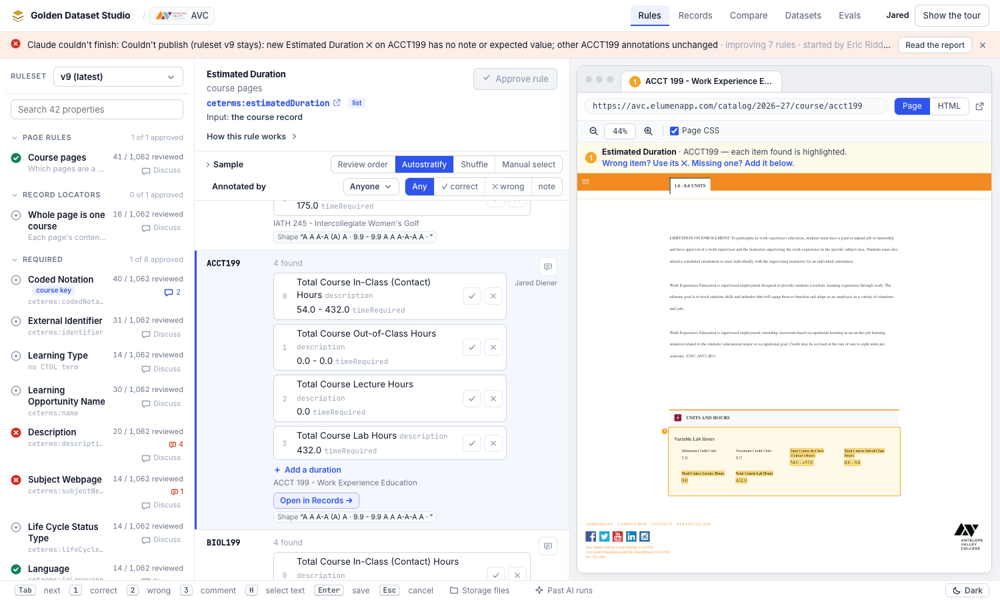

**Mock:** Total Course Lab Hours is selected (blue). Text selected on the page opens the bar with 💬, **Description**
and **Time required**. Picking Time required drafts the correction under the duration, with **Save correction** and
**Cancel**. *The correction shown (`432.0` → `54.0 - 432.0`) only illustrates the steps. Jared's ✕ recorded no
answer, so the right value isn't known.*

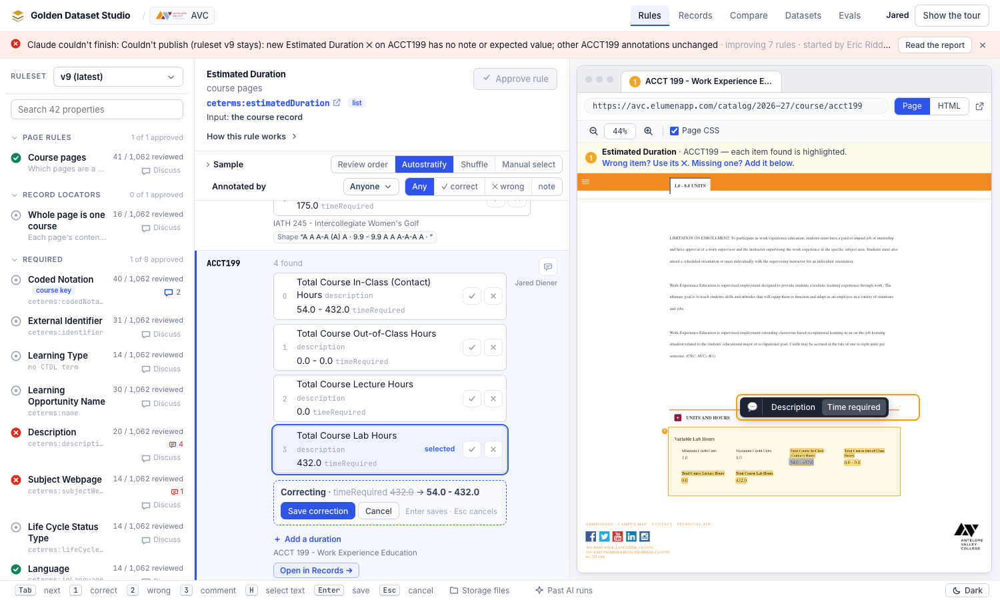

```
 Estimated Duration · AVC ACCT199                                 needs work
 ┌───────────────────────────────────────────────────────────────────────┐
 │ ▸ Total Course In-Class (Contact) Hours   54.0 - 432.0        ✓  ✕    │
 │ ▸ Total Course Out-of-Class Hours         0.0 - 0.0           ✓  ✕    │
 │ ● Total Course Lab Hours                  432.0     selected  ✓  ✕    │ ← click a duration to select it
 │     correcting: Time required  432.0 → 54.0 - 432.0                   │ ← the draft, before saving
 │     [ Save correction ]  [ Cancel ]                                   │
 │ + Add a duration                                                      │
 └───────────────────────────────────────────────────────────────────────┘

 Page pane, with text selected:   [ Description ] [ Time required ] [ 💬 ]
```

- **Click a found duration to select it.** Its sub-values light up on the page in the usual "found" colour, so the
  expert sees where each came from. Click it again, or press Escape, to unselect.
- **With a duration selected, select text on the row's page.** The highlight bar shows one button per sub-value
  (**Description**, **Time required**) and 💬. It's the same bar **+ Add a duration** uses today (`fieldBar`), now
  also shown for a selected duration.
- **Pick a sub-value.** The selection replaces that sub-value in a **draft correction** under the duration:
  "correcting: Time required 432.0 → 54.0 - 432.0".
  - Several sub-values can be corrected before saving.
  - The sub-values not touched keep the rule's text and location.
- **Save correction** (or Enter) saves it. **Cancel** (or Escape) drops the draft.
- **A selection with no duration selected and no add open** shows a short note in the bar instead of buttons: "Select
  a duration first, or + Add a duration". Nothing is dropped silently (the lesson of sme-fixes #1).
- **+ Add a duration** works as today (C1). D17 replaces "every sub-value labelled" as the save rule: the description
  plus one more.

### 3.2 What is stored

**One `verdict` event per correction,** of the kind `itemEvent` already writes, plus an answer:

```json
{"type": "verdict", "verdict": "wrong", "supersedes": "<the duration's previous verdict, if any>",
 "target": {"kind": "match", "rule_id": "course-estimated-duration", "occurrence_key": "…", "item": true,
            "value_index": 3},
 "expected": {"text": "<canonical JSON of the corrected duration>", "located_by": "corrected in the Studio",
              "css_path": "…", "char_start": 0, "char_end": 0,
              "objects": [{"fields": {
                "ceterms:description":  {"text": "Total Course Lab Hours", "css_path": "…", "char_start": …, "char_end": …},
                "ceterms:timeRequired": {"text": "54.0 - 432.0",           "css_path": "…", "char_start": …, "char_end": …}}}]}}
```

- **`expected.objects`** has the same shape as an added duration's (`claims.ts`, `objectEvent`). The server fills
  `expected.text` the same way (`profiles_rule.with_object_text`).
- **`value_seen`** is the found duration's JSON, as for any item verdict. So the correction stays tied to the duration
  it corrects.
- **A ✕ with no answer** (the ✕ button alone) is unchanged: "this duration shouldn't be here".

### 3.3 What it does

- **The duration's state:**
  - **wrong**, while the rule still gives the old duration;
  - **fixed**, once the rule gives the corrected one (same normalized JSON), as for a flat value whose rule now finds
    the answer (`review.py`, `_carry`).
  - The row is **needs work** while any duration is wrong, as today.
- **The golden dataset** publishes the corrected duration, `approval: human`, in place of the found one
  (`golden_answers.fields`). A ✕ with no answer still leaves the duration out (`golden_answers.py:111-116`).
- **Human-reviewed counts:** a corrected duration counts, as a flat ✕ with an answer does in
  `human_reviewed_counts` and the golden dataset (`approval: human`).
- **Scoring:** unchanged. Durations pair on their description (`OBJECT_KEYS` in xtra-cli's scorer).
- **The Generate rules prompt:** the rule's annotations already reach Claude through `rule annotations`. A correction
  shows there as the ✕ with its corrected duration, so Improve all rules can learn from it with no prompt change.

### 3.4 The smaller gaps

- **Remove an added duration.** Added durations get an **✕** ("Remove this duration"). It writes a `verdict: wrong`
  item event that supersedes the add. Review drops a removed add from the row's missing items, and the golden
  dataset leaves it out.
- **Keys 1 / 2 on a list rule.** **1** marks every found duration of the row ✓. **2** marks every one ✕, with no
  answer. Each is one item event per duration, posted one after another, so a row of four durations is four events.
  A duration that already has the same verdict is skipped.
- **💬 on the sub-value bar,** as on the flat bar: a comment anchored to the selection.
- **The ✕ tooltip** says what it does now: "Wrong: this duration shouldn't be here. To fix one part, select the
  duration and pick the right text on the page."

### 3.5 Tests

- **Web, `ProfileItems.test.tsx` and `RulesTab.test.tsx`:**
  - selecting a duration shows the sub-value bar;
  - picking Time required drafts the correction;
  - Save sends one item ✕ with `expected.objects`;
  - Escape cancels;
  - a selection with nothing selected shows the note;
  - 1 / 2 send one event per duration;
  - the ✕ on an added duration supersedes it.
- **Python, `tests/test_profiles_rule.py`:**
  - a correction is `wrong` and then `fixed` once the rule gives the answer;
  - the golden dataset publishes the corrected duration as `approval: human`;
  - a removed add is gone from the golden dataset;
  - `human_reviewed_counts` counts a correction.

---

## 4. B — Reset rule

### 4.1 What the expert sees

**Today:** Marshall's Subject Webpage is approved. The approval came from the v2 import, on 2026-10-27, and 69 values
are reviewed. Jared's ✕ on BMS600 says the URL belongs in In Catalog. Reopen is the only undo, and it leaves the 69 ✓s
in place.

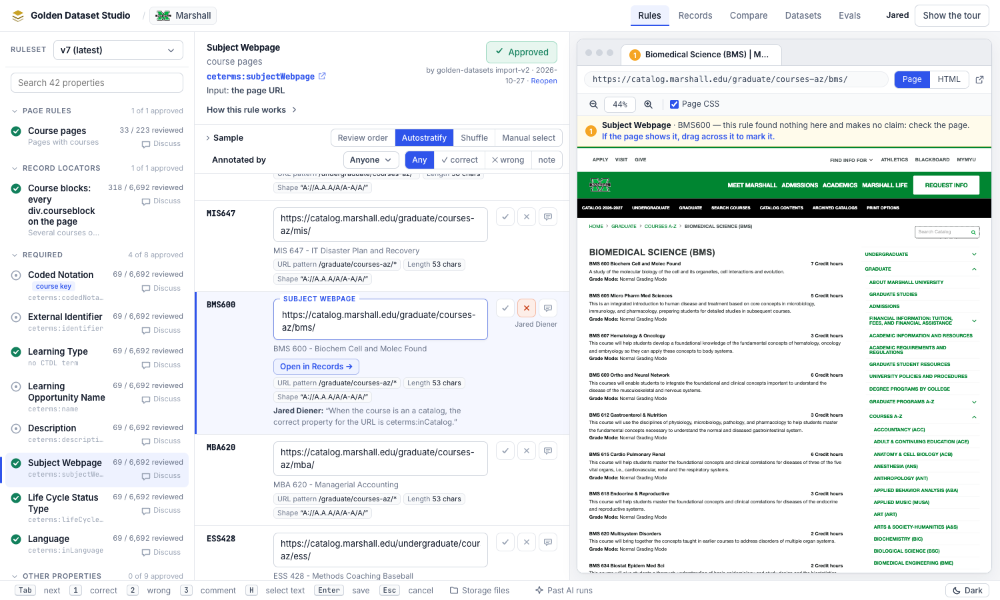

**Mock:** **Reset rule** beside Reopen.

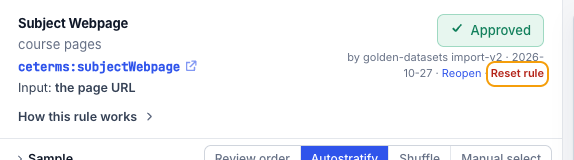

**Mock:** the confirm dialog, with Marshall's real counts. *The reason is an example, written from Jared's notes.*

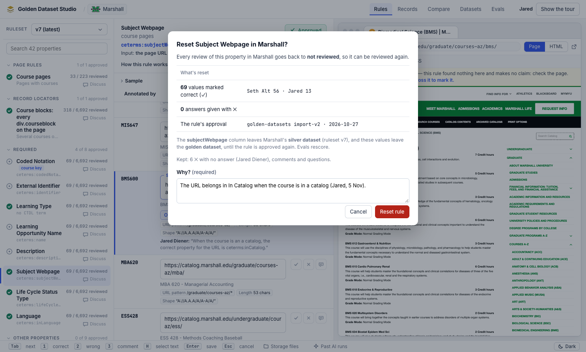

**Mock:** after the reset. The rule is back to **Approve rule**, the rule list shows 0 / 6,692 reviewed, and each row
shows a faint hint of its old ✓. The toast confirms the reset. *The hints' names and dates are illustrative: Seth and
Jared's ✓s are from 22–23 Oct.*

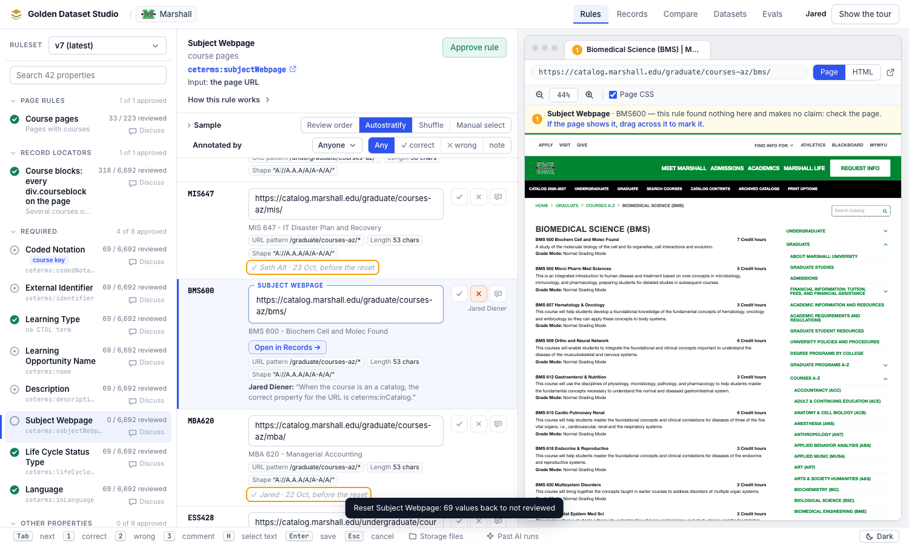

The sketches below give the same in text, for the states the screens don't show.

**In the rule header** (`RuleHead.tsx`):

```
 Approved:      [✓ Approved] by Seth · 2026-10-23 · Reopen · Reset rule
 Not approved:  [✓ Approve rule]  Reset rule
```

- **Reset rule** is a link button like Reopen. It is shown when the rule is approved, or when any of its values is
  human-reviewed.
- It is disabled, with a tooltip saying why, when there's nothing to reset: "No reviewed values and no approval to
  reset".

**The confirm dialog** (`ResetDialog`, built like `ApproveDialog`):

```
 ┌──────────────────────────────────────────────────────────────────────────────┐
 │  Reset Subject Webpage in Marshall?                                          │
 │                                                                              │
 │  Every review of this property in Marshall goes back to "not reviewed":      │
 │    69   values marked correct (✓) · by Seth (56), Jared (13)                 │
 │     0   answers given with ✕                                                 │
 │     ✓   the rule's approval (Seth, 2026-10-23)                               │
 │  The subjectWebpage column leaves Marshall's silver dataset (ruleset v4),    │
 │  and these values leave the golden dataset, until the rule is approved again.│
 │                                                                              │
 │  Kept: 6 ✕ with no answer, 0 questions, 0 comments.                          │
 │                                                                              │
 │  Why? (required)                                                             │
 │  ┌────────────────────────────────────────────────────────────────────────┐  │
 │  │ The URL belongs in In Catalog when the course is in a catalog (Jared). │  │
 │  └────────────────────────────────────────────────────────────────────────┘  │
 │                                              [ Cancel ]  [ Reset rule ]      │
 └──────────────────────────────────────────────────────────────────────────────┘
```

- **The counts come from a preview endpoint** (§4.3), as Approve's do.
- **Reset rule** is enabled once the reason has text. It is styled as a destructive action.
- **After the reset, a toast:** "Reset Subject Webpage: 69 values back to not reviewed".
  - The rule shows **in review**.
  - Its rows show not reviewed, each with the faint hint "✓ Seth · 23 Oct, before the reset".
- **The tour's `approve` step** gets one sentence: "Changed your mind about what a property should hold? **Reset rule**
  clears its reviews in this catalog and takes it out of the datasets, so you can review it again."

### 4.2 What is stored

**One event in the catalog's log:**

```json
{"type": "reset", "author": "Jared Diener", "author_role": "sme", "at": "2026-11-06T15:00:00Z",
 "target": {"kind": "rule", "rule_id": "course-subject-webpage", "rule_version_seen": 1},
 "note": "The URL belongs in In Catalog when the course is in a catalog.",
 "counts": {"correct": 69, "answered": 0, "approval": true}}
```

- **`log.py`:** `reset` joins `EVENT_TYPES`. The note is required for a `reset`. `counts` is a record of what the dialog
  showed; nothing reads it back.
- **Nothing is deleted or rewritten.** The offset readers and `sync` keep working.

### 4.3 What it means

**A `reset` on rule R at time T:**

- **Clears** every verdict on R with `at` ≤ T that makes a value human. This is the same set `golden_answers` publishes as
  `approval: human`:
  - ✓ on a value, on a list item, or on a row where the rule found nothing ("not on the page");
  - ✕ with an answer (`expected` text or segments), or with the reason `not_on_page`;
  - a duration's correction (§3.2), and an added duration or list item (`missing` with an answer).
- **Keeps:** comments, questions, ✕ with no answer, `missing` with no answer, and notes on the rule.
- **Ends the rule's approval.** For rule status, `reset` counts like `reopen` (`review.py`, `_rule_status`): the
  latest of `approve` / `reopen` / `reset` decides.
- **Reaches every rule version.** Verdicts carry forward across versions (`review.py:501-515`), so the reset filters
  by rule and time, not by version.
- **Reaches experts' verdicts** even when an engineer resets (D12). The rule that an engineer's verdict can't
  supersede an expert's (`review.py:308-311`) doesn't apply to a reset. The dialog names whose verdicts go.

**Where it's applied:**

- **`Review.__init__`:** a cleared verdict leaves `self.live`, as a superseded one does. Every reader built on
  `Review` follows:
  - the Rules tab,
  - `golden.plan` and `golden_answers`,
  - the scorecard,
  - `rule publish`'s guard (D14).
- **`human_reviewed_counts`** (`review.py:853-888`) builds its own pass over the logs, so it applies the same filter.
  A shared helper, `cleared_by_resets(events) -> set[annotation_id]`, is used by both.
- **The hint (D10):** `Review` keeps the cleared verdicts aside (`self.cleared`), and a row's state carries the latest
  one as `before_reset: {verdict, author, at}`. Nothing counts it.

**API:**

| Route | What |
|---|---|
| `GET /api/catalogs/{c}/rules/{rule_id}/reset-preview` | `{property, counts: {correct, answered, by_author}, approval: {by, at} \| null, kept: {wrong_no_answer, questions, comments}, column, golden}`, for the dialog |
| `POST /api/catalogs/{c}/annotations` with `type: "reset"` | Appends the event, then §4.5. Returns the rule summary and `published`, as an approve does |

### 4.4 Who and how

- **Anyone signed in** (D12). The event records author and role.
- **One property, one catalog** (D7). Resetting Subject Webpage in five catalogs is five resets.
- **No undo** (O3). The cleared verdicts stay in the log, so an undo could later be a `reset` superseded by an
  `unreset`. Not now.

### 4.5 The golden and silver datasets

- **A withdrawn column.** A column is in a catalog's silver dataset while its rule's latest `approve` / `reopen` /
  `reset` is not a `reset` later than its latest `approve`.
  - In `golden.publish`, the columns become `(chosen ∪ before ∪ inherited) − withdrawn`. `withdrawn` is the set of
    properties whose rule's latest such event is a `reset` (`golden.py:484`).
  - **Approving the rule again brings the column back.**
  - **"Columns only grow" holds in every other case** (E4). `golden.py`'s docstring and the Evals spec's question 3
    (`docs/qrspi/evals/03-spec.md:13`) get one line saying so.
- **On a reset, the server runs `golden.publish`** for the latest version, as Approve does (`routes_review.py:740-753`):
  - the silver dataset is rewritten without the column;
  - every page is rewritten, so the golden dataset loses the cleared values.
- **Then a rescore,** through `scores.after_publish`, as after an approve.
- **The publication's note** says "reset Subject Webpage (Jared Diener): <reason>". The Datasets tab shows it in the
  version's history.
- **Cost:** a reset publishes as much as an approve does: the whole version. That is acceptable at today's sizes, WVU's
  22k courses included, because approve already does it.

### 4.6 Tests

- **Python, a new `tests/test_reset.py`:**
  - a reset clears ✓ and ✕-with-answer and keeps comments, questions and ✕ without an answer;
  - it ends the approval, and approving again works;
  - it clears verdicts from earlier rule versions;
  - an engineer's reset clears an expert's ✓;
  - `human_reviewed_counts` agrees with the Rules tab after a reset;
  - `rule publish` no longer refuses over a cleared ✓;
  - `golden.publish` drops the column and the cleared human values, and puts them back on re-approval;
  - the preview's counts.
- **Web, `RulesTab.test.tsx`:**
  - the button shows and is disabled as in §4.1;
  - the dialog needs a reason;
  - confirming posts one `reset` event;
  - the toast;
  - rows show the hint.
- **Reopen gets its first test** alongside these: it ends an approval and keeps the verdicts.

---

## 5. Words

- **"Reset rule"** in the UI. A **reset** in docs, code and the log.
- **"Not reviewed"** for a value after a reset, the same as one nobody reviewed.
- **"Correct a duration"** and **"correction"** for §3. **"Sub-value"** for a duration's description and time required
  in prose.
  - In code, `fields` stays: it's the stored key (`expected.objects[].fields`, `profile.fields`), as the property-not-field
    rule allows for on-disk formats.

---

## 6. Order of work

1. **A, the build:**
   - `LABELS` in `properties.py`;
   - `properties sync`, then review the `properties.csv` diff;
   - the prompt lines (§2.3);
   - the tests (36 → 37);
   - save the sheet as `docs/qrspi/property-rules/phase1-extraction.csv` and keep the 3 Nov copy dated, as before.
2. **A, on the shared root:**
   - `properties apply --all`;
   - in Marshall first, **Improve all rules**: Credit Value to `none`, and Value / Min / Max / Unit Type reading the
     page;
   - Jared reviews a sample. Then the other four catalogs.
3. **C:** §3.1–§3.4, with the tests in §3.5.
4. **B:** the `reset` event and `Review` (§4.2–§4.3), then the datasets (§4.5), then the preview, dialog and button
   (§4.1, §4.3), then the tour line.
5. **B, on the shared root:** reset Marshall's Credit Unit Max Value (D5), so Jared's four "the correct value is 7"
   ✕s are cleared.

---

## 7. Call-outs for the subject-matter experts

- **Credit Value now stays empty,** as Jared said. The number goes in Credit Unit Value (one number) or Min / Max Value
  (a range), and the words in Credit Unit Type.
- **Numbers stay as the page prints them:** `3.0`, `Three`. Turning `Three` into 3 is transformation, later.
- **Correcting a duration:** click the duration, select the right text on the page, pick **Time required** (or
  **Description**), then **Save correction**. The ✕ alone still means "this duration shouldn't be here".
- **Reset rule** clears every ✓ and every typed answer for one property in one catalog, and takes the property out of
  the datasets until the rule is approved again. It asks why, and the log keeps who did it and what was cleared.

---

## 8. Open questions

1. **Subject Webpage in Marshall (and the other four catalogs).** Jared's notes say the URL belongs in In Catalog when
   the course is in a catalog.
   - Reset rule makes that change possible. Whether to reset Subject Webpage, and in which catalogs, is a decision for
     Seth and Jared once the button exists (O7).
   - It also touches a required property: Subject Webpage would be empty on most courses.
2. **The sheet's column D for row 18** says "Value". Ask the sheet's owner to make it "Credit Unit Value", then drop the
   `LABELS` entry.
3. **UALR's `One, two, or three credit hours`:** a range read as Min `One`, Max `three` (§2.2). Jared to confirm.

---

## 9. Follow-ups (not now)

- Exact, Minimum and Maximum Duration as sub-values (O1).
- A reset across catalogs, and an undo for a reset (O2, O3).
- A CLI `rule reset`, if Claude ever needs one. The prompt keeps Claude away from undoing experts' work, so not now.

---

## 10. Built (2026-11-05)

Built from this spec in the order A, C, B. These screens come from the built app, running on a local copy of AVC's
and Marshall's data from the shared root. The resets and corrections in them were made on that copy only, never on
the shared root.

### 10.1 A — Credit Unit Value

- `properties.LABELS` names the new row; `properties sync` from the live sheet added `course-credit-value-value` and
  nothing else.
- `phase1-extraction.csv` is the 5 Nov sheet; the previous one is kept as `phase1-extraction-2026-11-03-final.csv`.
- The Generate rules prompt teaches credits as a Value Profile (§2.3).
- `properties apply --all` hasn't been run on the shared root yet: that, and the rules themselves, are §6 step 2.

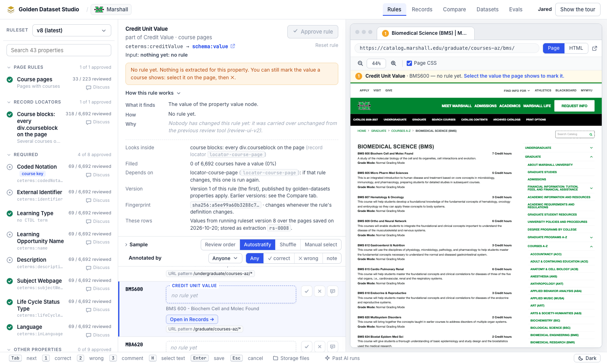

### 10.2 C — correcting a found duration

1. **With no duration selected,** a selection on the page shows how to start, instead of nothing.
2. **With a duration selected,** the bar offers its fields and 💬.
3. **Picking a field** drafts the correction.
4. **Save correction** stores it. The duration shows ✕ with the corrected one under it, and the golden dataset
   publishes the corrected duration.

*The correction shown (Lab Hours `432.0` → `54.0 - 432.0`) only illustrates the steps.*

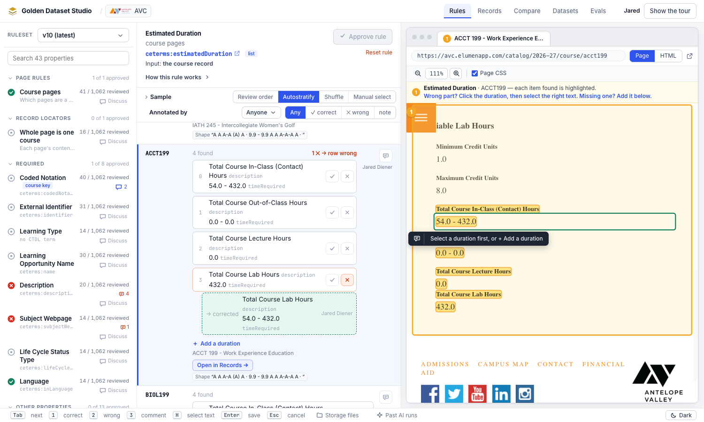
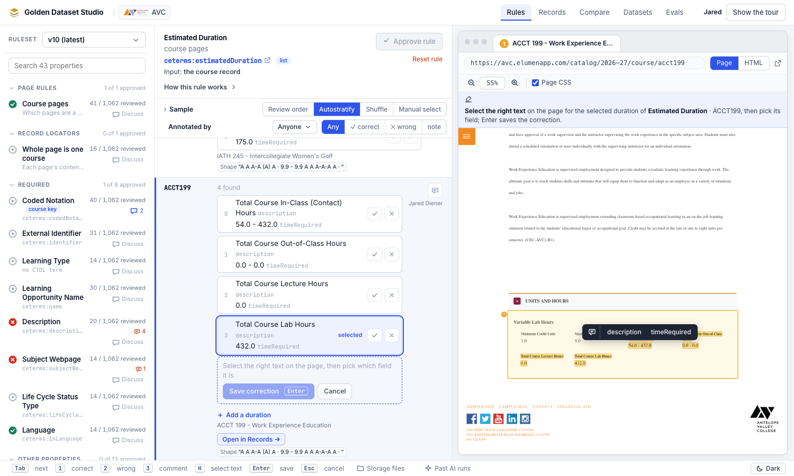
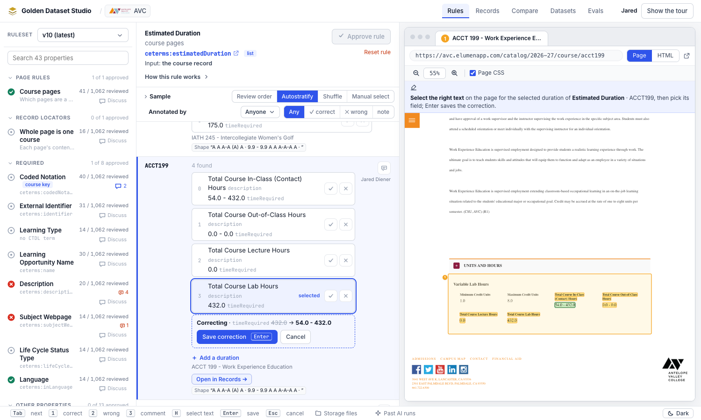
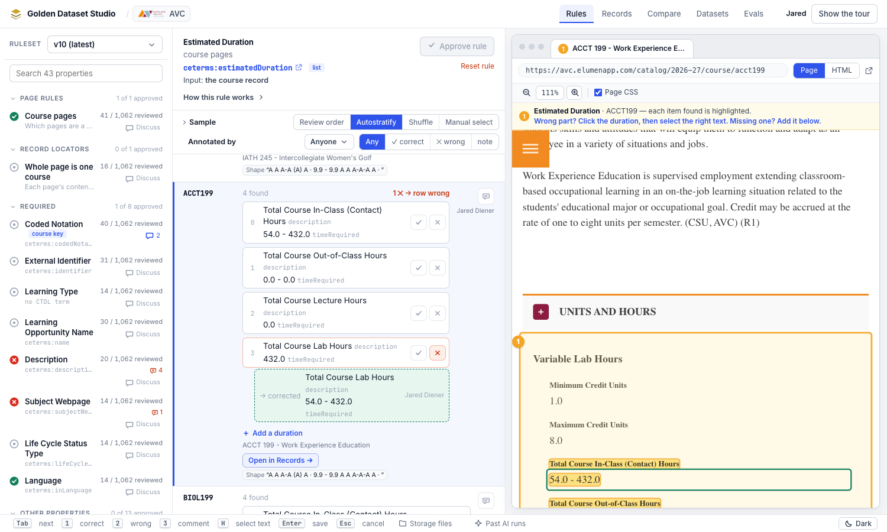

**Small differences from §3:**
- **Field names** read as stored (`description`, `timeRequired`), as on the existing add bar.
- **Corrections count once.** A correction is stored as a ✕ that also carries an answer. In "needs work", it counts
  once (its ✕), not again as a missing duration.

### 10.3 B — Reset rule

**On Marshall's Subject Webpage, in the local copy:**
- The dialog counted 64 ✓: Seth Alt 56, Jared Diener 8.
  - Five of Jared's 13 were already superseded by his 5 Nov ✕s.
  - The ✕s with no answer are kept.
- After the reset, the rule is **needs work**, because of those kept ✕s.
- Each formerly ✓ row shows "✓ Seth Alt · 23 Oct, before the reset".
- The dialog doesn't name a column, because the local copy has no published golden dataset. On the shared root it
  names `subjectWebpage` and the version.

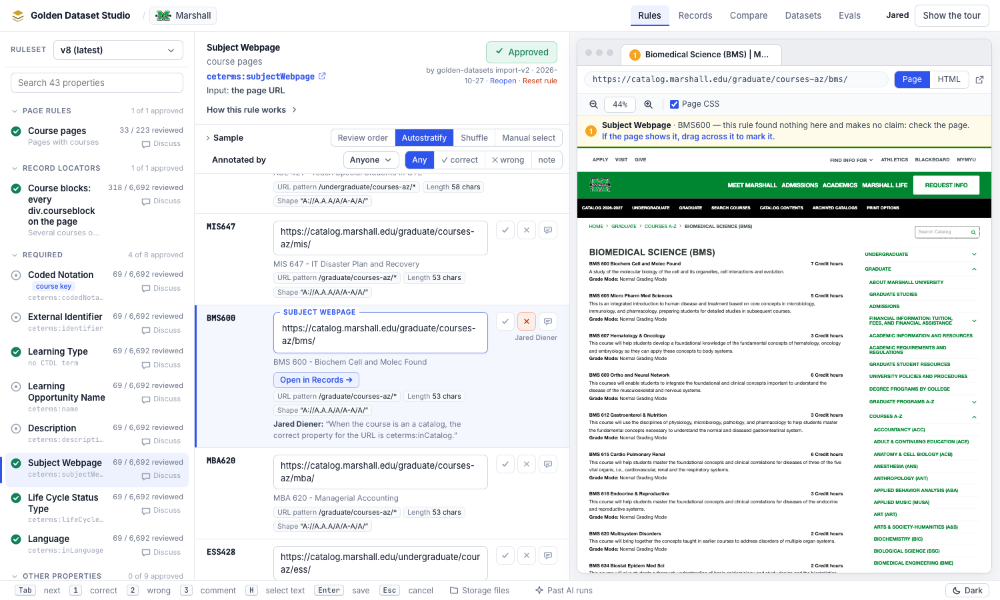
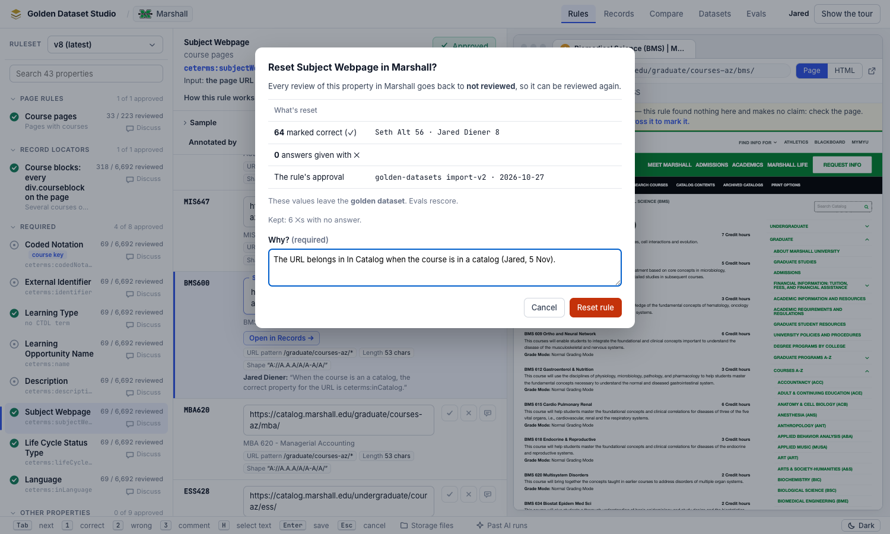
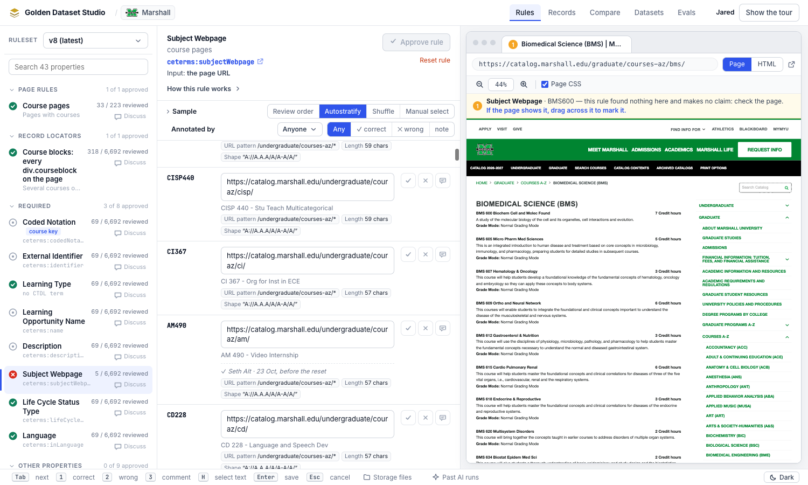

**Small differences from §4:**
- **Log order, not time.** A reset clears the verdicts appended before it in the log, not those with an earlier
  `at`. A verdict saved in the same second after a reset still counts.
- **The link is always there on a property rule,** greyed out with the reason when there's nothing to reset.
- **The hint re-attaches by course and page,** like any verdict. Otherwise verdicts saved under an older occurrence key
  would show no hint.
