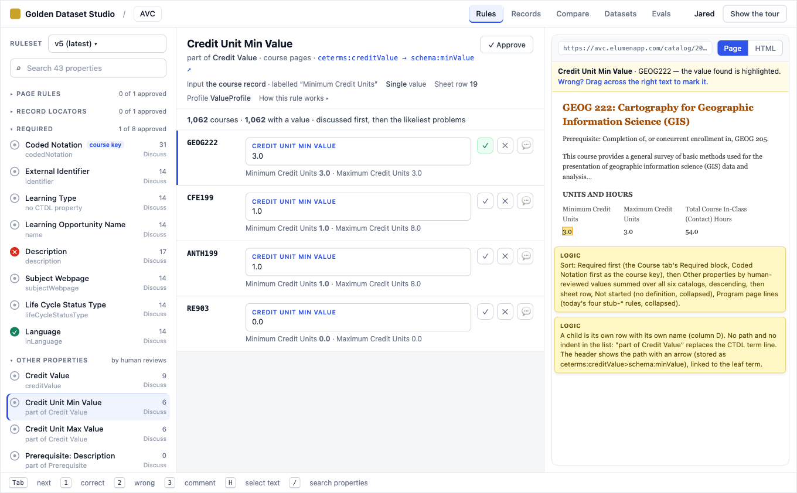
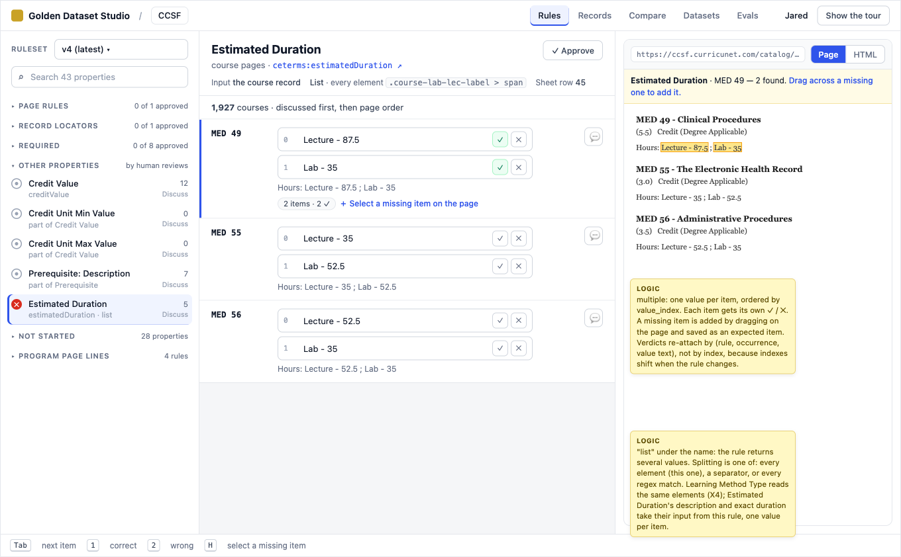
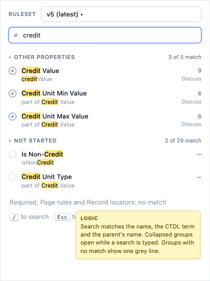
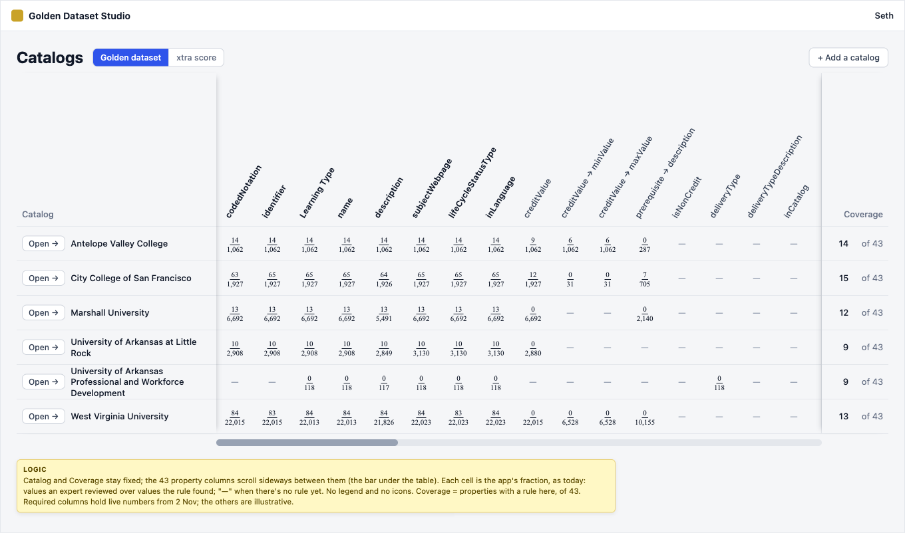
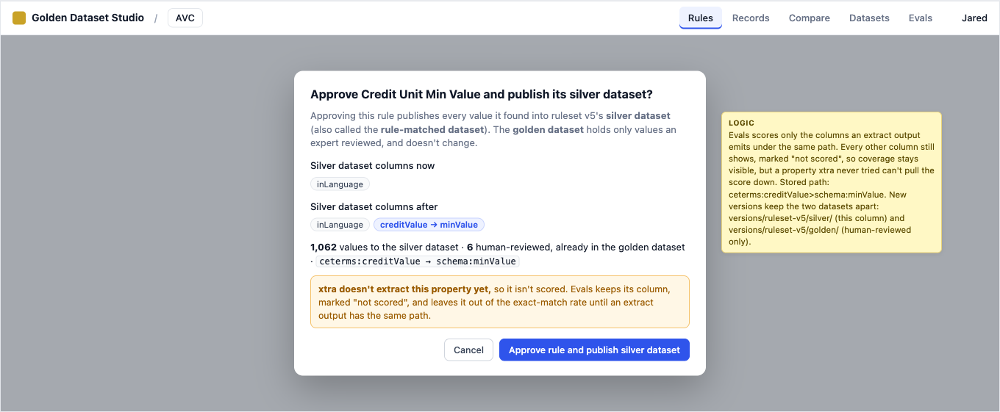
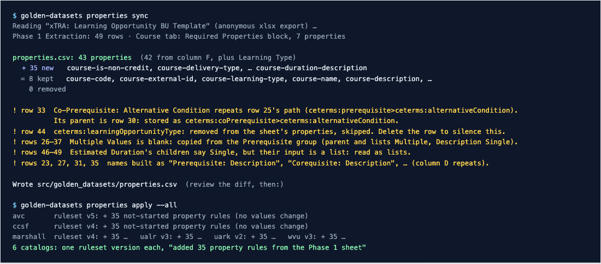
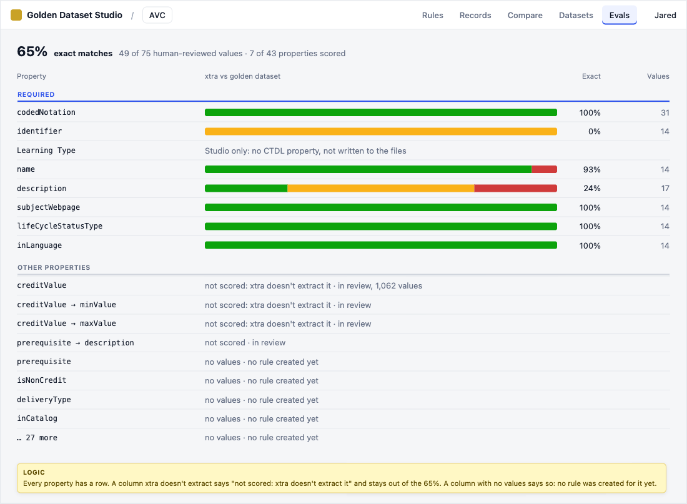

# S — Spec: every CLI extraction label as a property rule

How the CTDL Golden Dataset Studio grows from eight property rules to one property rule per CLI Extraction Label in
column F of the Phase 1 Extraction tab of "xTRA: Learning Opportunity BU Template". The spec was written 2026-11-02
and revised 2026-11-03, from these sources:
- Seth's answers in [`01-questions.md`](01-questions.md);
- the research in [`02-research.md`](02-research.md);
- Seth's and Eric's review of that research (`02-research.md`, last section);
- Seth's review of this spec's first draft (§1.4);
- Seth's second review, and the sheet as re-read on 2026-11-03 (§1.5);
- Seth's and Eric's third review, on the approve screen and the last call-outs (§1.6).

**Mockups (§6) come first: review them before anything is built.**

- **Two forms:** this markdown file with its images in `mockups/`, and the same content as one self-contained HTML
  page, [`03-spec.html`](03-spec.html), with the images inside it.
- **This QRSPI ends with this spec** (questions, research, spec). §7 gives the order of work, and §10 lists the
  follow-ups that are out of scope now.
- **Words:** this spec says **property** wherever the Studio used to say "field". That's CTDL's word (R2, §4.13).
- **Decisions come in five kinds:** Seth's answers (§1.1), the research review (§1.2), Claude's proposals (§1.3) and
  the three spec reviews (§1.4–§1.6). A later row overrides an earlier one where they differ.
- **Questions only subject-matter experts can settle** are collected in §8.

## 0. Scope

**In scope**

| | What |
|---|---|
| S1 | **The property list from the sheet.** One property rule per column F label: 42 on the sheet of 3 Nov, plus Learning Type, **43 properties**. The list is synced into a checked-in `properties.csv` (§4.1) |
| S2 | **Rules declare their input:** the record, the whole page, the URL, or another rule's output. Rules run parents first (§4.2) |
| S3 | **New rule abilities, each backed by real pages:** lists, inputs, attributes, labelled text, joined text, and script text left out (§4.3) |
| S4 | **Lists (`multiple`)**, including the fix for second values that are silently dropped today (§4.4) |
| S5 | **Nested properties stored as flat paths**, shown to people with an arrow (§4.5) |
| S6 | **Properties with no rule yet** sit in the rule list without a wizard. A human can annotate any property (§4.6) |
| S7 | **The Rules tab:** required properties first, then by human-reviewed count, plus groups and search. Counts render as they do today (§4.8) |
| S8 | **Every property gets a column** on the home table, with today's fractions, fixed Catalog and Coverage columns, and scrolling property columns. Evals lists every property too (§4.9) |
| S9 | **Approving and scoring new columns** (§4.10) |
| S10 | **The Generate rules prompt**, structured and exhaustive, covering every property and rule type (§4.11) |
| S11 | **First rules for all six existing catalogs**, generated with S10's prompt (§4.12) |
| S12 | **"Property", never "field":** UI text, CLI, prompts, docs and code (§4.13) |
| S13 | **Speed** (§4.14), **`check` rules** (§4.15), and **notes in the main spec** (§5) |
| S14 | **Golden and silver datasets:** the golden dataset is only human-reviewed values; approving a rule publishes its values to a separate silver dataset (§4.16) |

**Out of scope**

| | What | Why |
|---|---|---|
| O1 | **Changes to xtra-cli**, including how it names or scores credits | A4.16. The Studio only filters which columns it scores (§4.10) |
| O2 | **review-ui-v2's rules** (its credit and requisite rules) | A5.18 |
| O3 | **Transformation:** turning page words into CTDL vocabulary values, words into numbers ("Three" → 3), and putting one profile's parts back together | A3.11–A3.13 |
| O4 | **A nested CTDL view of the golden dataset** | A4.15: flat files only |
| O5 | **Resource types other than Course**, and the four `LearningOpportunityProfile` rows under `hasPart` (rows 39–42) | They have no column F label |
| O6 | **Editing the sheet** | It's owned outside this work. §8 lists what to tell its owner |
| O7 | **Rewriting stored rule versions or golden files** to the new words | They're immutable. Old values stay readable (§4.13) |
| O8 | **A wizard for properties with no rule yet** (the old "Not started" panel, "Write the first version with Claude", "Not printed in this catalog") | V4. Seth will give instructions for properties left without a rule (§10) |
| O9 | **A view of the rule dependency graph** ("How this rule works" as a chain) | V7. A follow-up to consider (§10) |
| O10 | **Implied values** (rules that give a value the page doesn't print, with a stated basis) | V8. A follow-up (§10) |
| O11 | **Page text with no CTDL property**, such as UARK's `Access to Course: 6 Months` | W7 |
| O12 | **Parsing a condition's text into its parent, targets and alternatives** (`ACCT 1` as a target) | X2. The text goes into the condition's description for now (§10) |

## 1. Decisions

### 1.1 Seth's answers to the questions (2026-11-02)

| # | Question | Decision |
|---|---|---|
| 1 | Which labels become rules? | **Every row with a column F label** (33 then, 42 on 3 Nov, §1.5). Content Description counts as Include. The blank row (35 then, 43 now) is ignored. |
| 2 | Required properties without a column F label | **Named by their column E shorthand:** `ceterms:lifeCycleStatusType`, `ceterms:inLanguage`. *The sheet now labels both (W13).* |
| 3 | Source of truth | **The sheet, through a checked-in file.** A new row in the sheet means a new rule after a re-sync. The app never reads the sheet at run time. |
| 4 | The sheet's typo | **Fixed in the sheet** by Seth (`targetLearningOpportunity`). |
| 5 | Required properties | **identifier, Learning Type, name, description, subjectWebpage, lifeCycleStatusType, inLanguage.** |
| 6 | "Annotated before" | **Expert verdicts only (human-reviewed), counted across all catalogs.** |
| 7 | When the order changes | **Live**, unless that turns out to be disruptive. |
| 8 | Nested properties in the rule list | **No path and no indented hierarchy in the sidebar.** |
| 9 | Long list | **Collapsible groups Required, Other properties, Not started, plus a search input.** |
| 10 | A child's value | **A property rule on the same course** that extracts its own part ("3" from "3–5 units"). |
| 11 | Parents with children | **The parent is a rule too.** A part that obviously belongs to a child goes to the child. Otherwise the whole paragraph goes to the parent, for transformation to map later. |
| 12 | Values not printed the way CTDL wants | **Extract the page's words, as close as possible.** No vocabulary mapping here. |
| 13 | Repeating profiles | **Out of scope:** grouping belongs to transformation. |
| 14 | Several values | **A list: rules can say `multiple`.** |
| 15 | Golden files | **Flat, one entry per leaf, with `ctdl_property` set to the full path.** |
| 16 | xtra-cli | **Out of scope.** |
| 17 | New columns | **They publish when their rule is approved, like today's.** The home table shows them. |
| 18 | v2's credit rules | **Not imported.** |
| 19 | First definition | **The usual loop:** annotate, Improve with Claude, `rule publish`. |
| 20 | Main spec | **Updated** (§5). |
| 21 | Catalogs | **All six.** |
| 22 | Where to build | **`golden-dataset-studio-local`**, merged into `golden-dataset-studio` when ready. |

### 1.2 From the research review (Seth and Eric, 2026-11-02)

| # | Topic | Decision | Where |
|---|---|---|---|
| R1 | Properties a catalog doesn't print | **They still exist everywhere in the UI.** A human can annotate a value on any property, in any state, in case the rules were wrong (Seth, Eric) | §4.6, §4.9 |
| R2 | Words | **"Property", never "field"**, across UI, CLI, prompts, docs and code (Eric) | §4.13 |
| R3 | Coverage | **The home table and Evals show every property**, even when blank (Eric) | §4.9 |
| R4 | Implied values | *Superseded by V8: out of scope.* | §10 |
| R5 | Condition `→ description` equals its parent | **Kept.** The generated rules carry a note for the subject-matter experts (Seth, Eric). *Superseded by X2* | §4.12 |
| R6 | New rule types | **In scope**, with real examples in the spec (Eric). Implied values are moved out by V8 | §4.3 |
| R7 | Rules as a graph | **Every rule declares its input**, including another rule's output. Rules run parents first (Eric). Its visualization is a follow-up (V7) | §4.2 |
| R8 | Showing paths | **An arrow (→) for people.** The stored path keeps `>`, as the sheet writes it (Eric) | §4.5 |
| R9 | Sort | **Required properties first, then by human-annotated values, descending** (Eric) | §4.8 |
| R10 | CTDL mismatches | **Do what's most true to CTDL**, and collect real ambiguity in §8 (Eric) | §4.1, §8 |
| R11 | `learningOpportunityType` | **Not a valid CTDL term**, and not to be confused with `targetLearningOpportunity` (Seth). *Superseded by W3: the row is removed* | §4.1 |
| R12 | A new catalog's first rules | **A structured, exhaustive Generate rules prompt** with every property and rule type (Eric) | §4.11 |
| R13 | Coverage counts | **Built into the first rules for each catalog** and iterated on (Eric) | §4.12 |
| R14 | Cost | **Accepted:** about 590 MB for WVU and 3.5 s for every status, before the cache (Seth, Eric) | §4.14 |

### 1.3 Proposals (Claude)

Seth said the open questions stand, and Eric asked for a proposal on each. These are the proposals, and the design
follows them.

| # | Question | Proposal | Why |
|---|---|---|---|
| P1 | Coded Notation's place | **First in Required, tagged "course key".** | Every other property's annotations hang on it. |
| P2 | Where "required" comes from | **The sheet's Course tab**, read by sync into a `required` column. | Decision #5 is exactly that block. |
| P3 | Order while new properties tie | **Sheet row.** | Nothing else is known yet. |
| P4 | Blank Single / Multiple | **Revised for the 3 Nov sheet:** rows 26–37 are blank. Each condition group copies the Prerequisite group (rows 22–25): parent Multiple, Description Single, Target and Alternative Condition Multiple. Sync warns about each one. | The four condition groups have the same shape. |
| P5 | Ruleset versions for new rules | **One version per catalog per sync that adds rows.** | The rule list always equals the current ruleset version. |
| P6 | Names where column D is blank or repeats | **"Parent: Child"** from the parent's name ("Prerequisite: Description"), or the term in words for a flat row ("Has Part"). Sync refuses duplicates. | Names must be unique. The 3 Nov sheet names four rows "Description" and three "Target Learning Opportunity". |
| P7 | Row 24, blank statuses | *Settled:* the 3 Nov sheet gives row 24 its prefix back and Content Description a status. The rule stands: any row with a column F label is a rule, and a blank status is a warning. | |
| P8 | Prerequisite paths | *Superseded by W2:* stored as the sheet writes them, `ceterms:prerequisite>ceterms:targetLearningOpportunity`. | |
| P9 | Program-page rules | **Their own collapsed group, "Program page lines".** Unchanged. | They read program pages and aren't in `properties.csv`. |
| P10 | Evals and new columns | **Score only the columns an extract output emits under the same path.** The other columns still show, marked "not scored" (R3). | Otherwise every approved new column lowers xtra's score for a property xtra never tried. |
| P11 | Rule status speed | **Cached per (ruleset version, annotation log ETag).** A verdict recomputes its own rule only. | 3.5 s per verdict on WVU. |
| P12 | Contact hours | **Extracted as `estimatedDuration`'s text where that's what the page prints.** *Confirmed and extended by W6.* | Decision #11, "as close as you can". |
| P13 | Stored `kind` for property rules | **New rule versions say `"kind": "property"`, and readers accept the old `"field"`.** | Stored versions are immutable (O7). |
| P14 | A child of a list | **A child whose input is a list rule gives one value per item, so it's a list too**, even where the sheet says Single (Estimated Duration's children). Sync warns. | W6: a course with in-class and out-of-class hours has two durations, so two Exact Durations. |
| P16 | X2 for the other conditions | **Corequisite, Co-Prerequisite and Recommends work like Prerequisite:** only `→ description` gets a rule for now. | The four groups have the same shape, and the same parsing problem. |
| P15 | Row 33's path | **Read as `ceterms:coPrerequisite>ceterms:alternativeCondition`**, with a warning. | The sheet repeats row 25's path there, but row 33 sits under Co-Prerequisite (row 30), and paths must be unique. |

### 1.4 Seth's review of the spec (2026-11-02)

| # | Feedback | Decision | Where |
|---|---|---|---|
| V1 | Rule list counts ("9 / 1,062", "41 in all") | **Leave the rule list's counts as the app renders them today.** The two extra counts don't mean anything to a reviewer. The sort still uses the human-reviewed count across catalogs, without showing it | §4.8, m1 |
| V2 | The prerequisite paths | **"prerequisite" must be in the path.** *W2 keeps that, and drops the `requires` this row had added* | §4.1, m2 |
| V3 | m2's rows didn't match its page | **Every mockup's rows match the page shown beside them** | m2 |
| V4 | The new-rule wizard | **Left out.** Rules are created for the new properties on the existing catalogs (§4.12). Where none can be, Seth will give instructions later | §4.6, O8 |
| V5 | Home table | **Property labels scroll sideways, and Catalog and Coverage stay fixed.** No legend, and no coloured circles: **fractions, as the app shows today** | §4.9, m5 |
| V6 | Do rule-matched values publish only on Approve and publish? | **Yes** (answered in §4.10) | §4.10 |
| V7 | The dependency-graph view (old §6.9) | **Out of scope.** A follow-up to consider | O9, §10 |
| V8 | Implied values (old §6.10) | **Out of scope** | O10, §10 |

### 1.5 Seth's second review of the spec (2026-11-03)

Seth answered §8 and §9 with the subject-matter experts, and the sheet changed the same day.

| # | Topic | Decision | Where |
|---|---|---|---|
| W1 | **WVU MUSC 720S** (`PR: Consent. Doctoral seminar … skills acquired in MUSC 432 and MUSC 433 .`) | **PR means prerequisite. The prerequisite is `Consent`**: the instructor's consent. "Doctoral seminar intended to refine and further the skills acquired in MUSC 432 and MUSC 433" is part of the course's description. So MUSC 432 and 433 aren't targets, and the Prerequisite rule cuts out the `PR:` sentence first (§9's option b) | §4.3 G5, §9 |
| W2 | **Prerequisite paths** | **`ceterms:prerequisite` is correct, and stands in for `requires`.** Paths are stored as the sheet writes them: `ceterms:prerequisite>ceterms:description`, `ceterms:prerequisite>ceterms:targetLearningOpportunity`, `ceterms:prerequisite>ceterms:alternativeCondition`. The same goes for Corequisite, Co-Prerequisite and Recommends. Overrides V2's `requires` and P8 | §4.1, §4.5, m2, m7 |
| W3 | **`learningOpportunityType`** | **Removed from the sheet.** It's not a property | §4.1 |
| W4 | **`contentDescription`** | **Used.** It's a new CTDL term, not yet in the schema repo | §3, §4.12 |
| W5 | **"PR or CONC"** (WVU), `Prerequisite or Corequisite:` (UALR) | **CONC means concurrent, another way of saying corequisite** (CTDL: "resources that must be pursued concurrently"). Strictly, "PR or CONC" is a condition with two alternative conditions, a prerequisite and a corequisite. **For now, since PR comes first, the whole value is extracted as the Prerequisite** | §4.11, §4.12, §9 |
| W6 | **Contact hours** | **They belong in `estimatedDuration`, which is a list.** Each kind of time separate from credit (in-class, out-of-class) is its own duration: one set of Estimated Duration values for the in-class contact hours, a second for the out-of-class hours. **`estimatedDuration → description` is what says which is which** | §4.4, §4.12 |
| W7 | **UARK's `Access to Course: 6 Months`** | **Ignored.** It's course registration, not catalog content, and there's no CTDL property for it | O11, §4.12 |
| W8 | **A condition's description equals its parent** | **Keep both.** Err on keeping more, and let transformation fix it. *Superseded for conditions by X2: only the description has a rule for now* | §4.12 |
| W9 | **UARK's modality list** (`Online`, `Self-Paced`) | **Both properties, each with its own words:** `Online` is a Delivery Type, `Self-Paced` a Learning Method Type | §4.4, §4.12 |
| W10 | **Marshall's `Attributes`, UALR law's `Practice Area`** | **Marshall's Attributes are skipped for now. UALR's practice areas are subjects:** the catalog says they "group courses together by fields of law", which matches `subject`'s definition | §4.12 |
| W11 | **UARK's "Prior Learning"** | **Part of the description, not `recommends`.** It says `with no prior expertise required`, and a text that only advises isn't a requirement. **The catch-all: when it isn't clear which property a text belongs to, put it in the description.** Transformation, or a later round of extraction, moves it. Better in the description than lost | §4.3 G10, §4.11, §4.12 |
| W12 | **Unstable CTDL terms** (`isNonCredit`, `inCatalog`, `lifeCycleStatusType`) | **No concern** | §8 |
| W13 | **The sheet as re-read on 3 Nov** ([`phase1-extraction-2026-11-03.csv`](phase1-extraction-2026-11-03.csv); the 2 Nov copy is [`phase1-extraction-2026-11-02.csv`](phase1-extraction-2026-11-02.csv)) | **New condition groups:** Corequisite (rows 26–29) and Co-Prerequisite (rows 30–33). Recommends moved to rows 34–37, Has Part to 38, Estimated Duration to 45–49. Rows 6 and 7 now have column F labels, row 24 has its prefix again, Content Description is Include, and row 11 is Single. **43 properties:** 42 labelled rows (row 44 left out, W3) plus Learning Type. A new **Prerequisite Mapping** tab shows how a prerequisite splits (§3) | §4.1, §4.12 |
| W14 | **The final sheet** (column F finalized, [`phase1-extraction.csv`](phase1-extraction.csv)) | **41 properties:** 40 labelled rows plus Learning Type. **Removed:** Keywords, Has Part, and the four Alternative Condition rows (kept in `properties.csv` as `removed`; every catalog had them as `none`). **Added:** Entry Condition (rows 33–35: requirements to enroll that aren't requisites or recommendations) and Estimated Duration's **Time Required** (row 41: the hours spent, "for Course, typically hours"). **Meaning changed:** a condition's description is its whole verbatim text, course codes included; targets are External Identifiers; Co-Prerequisite is "Prerequisite or Corequisite" / "Pre- or Corequisite" text, which answers §9.2 (W5's "for now" ends); Estimated Duration is one Duration Profile per kind of hours, its description the kind (`Total Course In-Class (Contact) Hours`) and Time Required the hours (`54.0`), while Exact, Minimum and Maximum Duration are the overall span (`6 months`, no longer `P6M`). Single / Multiple is filled in on every condition row (P4 no longer applies) | §4.1, §4.11, §4.12 |

### 1.6 Seth's and Eric's third review (2026-11-03)

| # | Topic | Decision | Where |
|---|---|---|---|
| X1 | **The approve screen** ("Approve and publish" a rule's values into the golden dataset) | **Golden datasets are only the human-labelled values. Silver datasets are all the values published for a rule.** Approving a rule publishes a silver dataset, into a separate place from the hand-labelled values, and the screen says so plainly. Claude proposes the design (§4.16) | §4.10, §4.16, m6 |
| X2 | **The Prerequisite Mapping tab** (§8 call-out 12) | **The condition's text goes into its description for now** (`ceterms:prerequisite>ceterms:description`), and is parsed into the parent and its targets later. So `ceterms:prerequisite`, `→ targetLearningOpportunity` and `→ alternativeCondition` have no rule for now. *Claude applies the same to Corequisite, Co-Prerequisite and Recommends (P16)* | §4.3, §4.12 |
| X3 | **WVU's `PR: Corequisite of AGBI 514L`** (call-out 13) | **Prerequisite leaves it out:** corequisite is its own property. Corequisite: Description reads `Corequisite of AGBI 514L` | §4.11, §4.12 |
| X4 | **CCSF's `Lecture - 52.5` / `Lab - 17.5`** (call-out 14) | **Both:** an Estimated Duration and a Learning Method Type each | §4.12 |

---

## 2. Vocabulary

| Term | Meaning |
|---|---|
| **Property** | A CTDL property the Studio extracts: one row of `properties.csv`. It replaces "field" everywhere (R2). |
| **Property rule** | A catalog's rule for one property (`kind: property`). Page rules and record locators are unchanged. |
| **Path** | A property's CTDL location, stored flat as `ctdl_property`. On the course it's just the term (`ceterms:description`). In a profile, terms are joined by `>` (`ceterms:creditValue>schema:minValue`, `ceterms:prerequisite>ceterms:description`). **Shown to people with arrows** (R8). |
| **Parent / child** | The row a path starts with (Credit Value, Prerequisite) / a property whose path has a `>` (Credit Unit Min Value). |
| **Input** | What a rule reads: the course record, the whole page, the page URL, or another rule's output (§4.2). |
| **No rule yet** | A property rule with no definition (`rule_type: none`). It writes no rows, and it sits in the Not started group. |
| **List property** | A property whose rule has `multiple`: several values per course, ordered by `value_index`. |
| **Required** | In the Course tab's Required Properties block, or Coded Notation (P1, P2). |
| **Human-reviewed count** | The values an expert gave a verdict on, for one property, summed over all six catalogs. It sorts the list (R9). |
| **Coverage** | For one catalog, how many of the 43 properties have a rule there. |
| **Golden dataset** | **Only the values a subject-matter expert reviewed** (`approval: human`), for every property, published or not (X1). |
| **Silver dataset** | Also called the **rule-matched dataset**. **Every value published for an approved rule**, its rule-matched values. Approving a rule publishes its column into its ruleset's silver dataset (X1, §4.16). |

---

## 3. Facts the design rests on (checked 2026-11-02)

Each fact comes from [`02-research.md`](02-research.md) and its detail files, or from the code.

- **The property list is hard-coded,** with 14 Python readers and 8 hard-coded ids in the web app. Three readers stay
  frozen at today's eight:
  - `import_v2.IN_SCOPE`: re-importing must not bring in v2's credit rules (decision #18);
  - the two "old publications" fallbacks (`golden.py:208`, `check.py:370`).
- **Rules already have a `depends_on` list,** derived from what a rule points at (`model.dependencies`,
  `model.py:137`). The engine runs every property rule of a locator against the record element (`engine.py:286`).
- **Every Parquet table has `value_index`.** Nine in-memory lookups ignore it, so a second value is silently dropped
  from the Rules tab, the golden files and the Records tab. Compare even counts it as new against the same version
  (tested).
- **A `>` path keys correctly through the Studio.** Only `termUrl` in the web app breaks on it.
- **A rule with no definition is refused.** A property rule with no selector extracts the whole course block.
- **WVU with 35 property rules** (the count researched; 43 costs a little more): extraction takes ~1–2 s. The
  snapshot grows from 120 MB to ~590 MB, and every
  rule's status from 0.7 s to ~3.5 s.
- **How values reach the golden dataset today** (`golden.py`, module docstring and `publish_page`):
  - **Approving a column's rule** publishes that column, with every rule-matched value, into the ruleset's golden
    dataset (`golden.publish`).
  - **Each version is kept as two trees:** `versions/ruleset-vN/rule-matched/` (every value) and
    `versions/ruleset-vN/human-reviewed/` (only `approval: human`). The latest rule-matched tree is also copied to
    each page's usual location, `<golden root>/<catalog>/<crawl>/<page_stem>/<page_stem>.json`, which xtra's scorer
    reads. The UI calls all of it "the golden dataset" (X1 changes that).
  - **An expert's verdict** is written straight away into the latest golden dataset's files, for that page, in any
    column, published or not (`golden.publish_page`, called from the verdict route, `routes_review.py:575`).
- **Today's home table** shows each column as a fraction: values an expert reviewed over values its rule found
  (`14 / 1,062`). A grey "—" means the property isn't in the Studio.
- **The sheet exports anonymously** as xlsx with every tab.
- **CTDL:**
  - `ceterms:prerequisite` has range `ceterms:Course`. The sheet uses it as a stand-in for `requires` (W2).
  - `ceterms:corequisite`: "Resources that must be pursued concurrently." `ceterms:coPrerequisite`: "Resource that
    must be completed prior to, or pursued at the same time as, this resource." Both have range
    `ceterms:ConditionProfile`, as does `ceterms:recommends`.
  - `contentDescription` is new: not in the schema repo yet, but Credential Engine's publishing API accepts it (W4).
  - `isNonCredit`, `inCatalog`, `lifeCycleStatusType` and `coPrerequisite` are marked `vs:unstable`. No concern
    (W12).
- **The sheet's Prerequisite Mapping tab** (3 Nov) shows how a prerequisite splits, with a screenshot of each page:

  | Page | Prerequisite printed | Sheet's values |
  |---|---|---|
  | CCSF ACCT 2 | `Prerequisite: ACCT 1` | `ceterms:prerequisite`: `ACCT1` |
  | UALR ACCT 20003 | `Prerequisites: 70% score on Information Technology Qualifying Exam and MATH 11003.` | `→ description`: the whole text. `→ targetLearningOpportunity`: `MATH11003` |
  | University of Arkansas BIOL 38773 *(not one of the six)* | `Prerequisite: 7 hours of biological science.` | `→ description`: `7 hours of biological science.` |
  | University of Arkansas AGED 51103 *(not one of the six)* | `Prerequisite: AGED 54603 or HESC 54603 or other instructor approved Research Methods course.` | *(headers only, no values yet)* |

  The Studio extracts the page's words for the parent and both children on every course (W8). Choosing between
  them, and writing `MATH 11003` as `MATH11003`, is transformation (O3). §8 asks the experts to confirm.
- **Requisite words on the saved pages** (3 Nov, every saved page):

  | Catalog | Corequisites | Before *or* at the same time |
  |---|---|---|
  | AVC | `Corequisite: Concurrent enrollment in ATH 102L` (9 pages) | `Corequisite: Completion of or concurrent enrollment in DFST 102` |
  | CCSF | `Corequisite: MATH 75` (44 pages) | |
  | Marshall | `<strong>Co-req:</strong>` then `a.bubblelink.code` links, `Co-req: BIC 620` (36 pages) | `Pre-req: BMR 628 (may be taken concurrently)`, `Concurrent PR: BMR 628` |
  | UALR | `<strong>Corequisites:</strong> ECET 25233` (7 pages) | `Prerequisite or Corequisite: GEOL 11103` (1 page) |
  | WVU | `PR: Corequisite of AGBI 514L` (290 times), inside the `PR:` sentence | `PR or CONC: EDUC 633` (1,078 times), `PR: COUN 501 and PR or CONC: COUN 606 or Consent` |
  | UARK | none | none |
- **"Field" in the code:** 187 lines in 34 Python files and 104 lines in 27 web files. The golden files' `fields` key
  is read by xtra's scorer (O1).

---

## 4. Design

### 4.1 The property list

**File: `src/golden_datasets/properties.csv`**, one row per property rule on course pages, in sheet order:

| Column | Example | Filled from |
|---|---|---|
| `rule_id` | `course-credit-min` | Assigned once by sync and never changed, so a property has the same id in every catalog. Today's eight keep theirs (`course-code`, `course-description`, …) |
| `path` | `ceterms:creditValue>schema:minValue` | Column F, or column E where F is blank (#2), corrected only where the sheet's own rows disagree (P15) |
| `sheet_path` | `ceterms:prerequisite>ceterms:alternativeCondition` | Column F as written. Kept for tracing |
| `path_note` | `Row 33 repeats row 25's path; its parent is row 30` | Why `path` differs from `sheet_path`. Empty otherwise |
| `label` | `Credit Unit Min Value` | Column D, or a built name (P6). Unique |
| `parent` | `ceterms:creditValue` | The row the path starts with. Empty for a flat property |
| `profile` | `ceterms:ValueProfile` | Column C |
| `multiple` | `false` | Column K, or P4 |
| `required` | `false` | The Course tab's Required block, plus Coded Notation |
| `course_key` | `false` | `true` for Coded Notation only |
| `sheet_row` | `19` | Row in the Phase 1 tab |
| `status` | `Include` | Column A, as written. `removed` when a row has gone from the sheet |
| `vocabulary`, `definition_text`, `sample` | | Columns J, G and L, shown to reviewers and to Claude only |

**Paths are stored as the sheet writes them (W2).** The four condition groups:

| Sheet rows | Parent | Its children (stored `path`) | Names shown |
|---|---|---|---|
| 22–25 | `ceterms:prerequisite` | `ceterms:prerequisite>ceterms:description`, `>ceterms:targetLearningOpportunity`, `>ceterms:alternativeCondition` | Prerequisite: Description, Prerequisite: Target Learning Opportunity, … |
| 26–29 | `ceterms:corequisite` | the same three under `ceterms:corequisite>` | Corequisite: … |
| 30–33 | `ceterms:coPrerequisite` | the same three under `ceterms:coPrerequisite>` | Co-Prerequisite: … |
| 34–37 | `ceterms:recommends` | the same three under `ceterms:recommends>` | Recommends: … |

**Two rows sync doesn't take as written:**

| Sheet row | Sheet's column F | What sync does |
|---|---|---|
| 33 | `ceterms:prerequisite>ceterms:alternativeCondition`, repeating row 25 | Stores `ceterms:coPrerequisite>ceterms:alternativeCondition`, with a warning (P15) |
| 44 | `ceterms:learningOpportunityType` | Skips it with a warning: removed (W3), though the 3 Nov export still has the row |

- **Learning Type** is required, and isn't on the Phase 1 tab. It stays a constant `Course` rule with no path, as
  today.

**Readers.**
- `model.PROPERTIES`, `PROPERTY_ORDER` and `CTDL_TERM` become views of the file.
- `import_v2.IN_SCOPE` and the two fallbacks stay frozen at today's eight (§3).
- `scores.NOT_IN_STUDIO` goes: every property is in the Studio now.

**CLI** (m7):

```sh
golden-datasets properties sync [--from bu.xlsx]   # sheet → properties.csv; added / kept / removed and warnings
golden-datasets properties list                    # the file as a table
golden-datasets properties apply -c avc | --all    # add the file's new properties to each catalog, with no rule yet
```

- **`sync` writes only the file.** The diff is reviewed like code, then `apply` runs.
- **`sync` never removes a property.** A row that has gone from the sheet becomes `status: removed`. A changed path
  or name on an existing `rule_id` is written only with `--accept-renames`.
- **`apply` publishes one ruleset version per catalog** that has new properties (P5): "added N property rules from
  the Phase 1 sheet". No values change.

### 4.2 Rules declare their input (R7)

Every property rule declares **what it reads**. A rule's output is what other rules can read in turn, so values flow
from parents down to their children.

```json
"definition": {
  "locator": "locator-course-page",
  "input": {"from": "rule", "rule": "course-credit"},
  "rule_type": "regex", "regex": "-\\s*(\\d+(?:\\.\\d+)?)", "group": 1
}
```

| `input.from` | Reads | Today | Example |
|---|---|---|---|
| `record` *(default)* | The course record's element, as today | ✓ | `span.credits` inside `div.courseblock` |
| `page` | The whole saved page: headings and sections outside the record. One output is shared by every course on the page | new | Marshall's `h1` `Statistics (STA)` for `subject` |
| `url` | The page URL, as text | partly (`source_url` gives the whole URL with no regex) | UARK's `course=bookkeeping-quickBooks` for `identifier` |
| `rule` | Another property rule's output on the same course: its text, or with `"use": "element"` its matched element (for CSS inside it). Once per value if that rule is a list | new | Credit Unit Max Value reads Credit Value's `1-4 Credit hours` |

- **`depends_on`** is derived from the definition: the locator, plus `input.rule` if there is one. `rule publish`
  refuses a cycle, and refuses an input rule on a different locator.
- **The engine runs a locator's property rules in dependency order,** parents first. When a parent finds nothing on
  a course, its children have no input there and find nothing.
- **A child's location** points into the page where its text came from, so the page pane highlights the child's own
  part.
- **The rule header shows the input in words** ("Input: the course record", m1). A view of the whole graph is a
  follow-up (O9, §10).
- **Why this fits Seth's answers:** a child carved out of its parent (#10, #11) is literally a rule whose input is the
  parent. Fixing the parent fixes every child.

### 4.3 New rule abilities, with evidence (R6)

Today a property rule takes **one** element with `select_one` and applies **one** `re.search` to its text
(`engine.py:174, 227`). Its types are `css`, `css+regex`, `regex`, `constant` and `source_url`. Each gap below comes
from the saved pages (`research/pages.md`). The quoted text is real.

| # | Gap today | Real content | What's lost today | New ability | Properties it unblocks |
|---|---|---|---|---|---|
| G1 | **One value per rule** | Marshall CYBR 210 prerequisite: `CS 105 or CS 110 or CS 110H.`, three `a.bubblelink.code` links | Only `CS 105`. And if a second value were written, nine lookups would drop it (§3) | **`multiple`**, with three splits (§4.4) | every list property |
| G2 | **Only inside the record** | CCSF page heading `MGT - Management`, Marshall `h1` `Statistics (STA)`: both outside `.course-summary-wrapper` / `div.courseblock` | `subject` can't be read at all | **`input: page`** | `subject` (CCSF, Marshall) |
| G3 | **The URL can't be cut** | UARK page `https://training.uark.edu/portal/training?cmd=catalog&course=bookkeeping-quickBooks`. UARK prints no course code | UARK has no identifier and no code | **`input: url`** with any rule type (regex) | `identifier`, `codedNotation` (UARK) |
| G4 | **Children can't read their parent** | Marshall `span.credits`: `1-4 Credit hours`. WVU title: `CCMD 741. Behavioral Science and Psychopathology. 2 Hours.`, and `1-6 Hours.` on the ranges | Each child repeats the parent's selector and a bigger regex. A fix to the parent has to be made four times | **`input: rule`** (§4.2) | credit min / max / unit type; Estimated Duration's children; `contentDescription` |
| G5 | **Scoping a list to one part of the text** | WVU: `PR: ECON 202 and (ECON 225 or STAT 211 or STAT 215) with a minimum grade of C- in all.`, followed in the same paragraph by the description with more `a.bubblelink.code` links. WVU MUSC 720S: `PR: Consent. Doctoral seminar … skills acquired in MUSC 432 and MUSC 433 .`: the prerequisite is just `Consent`, and both links are in the description (W1). 536 WVU courses add `… and PR or CONC: FIS 324.` UALR has links for corequisites too | "Every link in the record" mixes prerequisite, corequisite and description courses | **A regex that cuts out one sentence** (`PR: (.*?)\.\s`), with a corequisite inside it left out (X3). The targets themselves are parsed later (X2, O12) | `prerequisite → description`, `corequisite → description` (WVU, UALR, AVC, CCSF) |
| G6 | **Text without its own element** | UALR: `<strong>Prerequisites:</strong> HIST 21103 , HIST 21203 , and six hours of upper-level United States history.<br>`. The text after the label is a bare text node. The record's text also runs together: `Computer SecurityThree hours lecture.` | Only a whole-record regex reaches it, and that regex breaks when the order changes | **`rule_type: labelled`**: `{"label": "Prerequisites:", "until": "br"}` takes the text after an element whose text matches the label, up to the stop | `prerequisite`, `corequisite` (`Corequisites:`), `creditValue`, `learningMethodDescription` (UALR) |
| G7 | **Attributes can't be read** | UARK modality links `a.btn-link` `Online`, `Self-Paced`, each explained in a popover `data-bs-content="…"` | The explanation is never visible text | **`attribute`** on css types: `{"selector": "a.btn-link", "attribute": "data-bs-content"}` | `deliveryTypeDescription` (UARK, if the experts agree), any `href` |
| G8 | **Script text inside the record** | UARK's record text contains inline `<script>` content | A whole-record regex can match inside the script | **Not a new type:** `text_of` leaves out `script` and `style`. This changes today's results only where they included script text, and `rule try` shows it | all UARK rules |
| G9 | **No rule yet** | 35 new properties | `rule publish` refuses a rule with no definition | **`rule_type: none`** (§4.6) | any property no first rule can be written for |
| G10 | **One value from several places** | UARK: the description, and a separate `Prior Learning` section (81 saved pages): `This professional skills training course is beginner-friendly, with no prior expertise required.` W11 puts it in the description | One rule reads one element | **`join`** on css types: `{"selector": "…, …", "join": "\n\n"}` takes every matched element, in page order, as one value | `description` (UARK, the catch-all) |

*Out of scope (V8):* values a page implies but never prints. Examples: AVC's `0.0 Units` with no "noncredit" word,
CCSF's `(3.0)` with no unit word, and every catalog's `inCatalog`. They stay without a rule (§10).

### 4.4 List properties (`multiple`)

`"multiple": {"split": "elements" | "separator" | "regex", "separator": ",", "regex": "…"}`. Each split is needed
by real pages:

| `split` | What it does | Real example | Values |
|---|---|---|---|
| `elements` | Every element the selector matches (`select`, not `select_one`), one value each | CCSF MED 49 `.course-lab-lec-label > span`: `Lecture - 87.5`, `Lab - 35` | `Lecture - 87.5`, `Lab - 35` |
| `separator` | One text, split on the separator (`,` `;` or a line break) | Marshall `Attributes: No Textbook Required, Onsite Learning Experience` | `No Textbook Required`, `Onsite Learning Experience` |
| `regex` | Every match of a regex in one text (group 1 if there is one) | AVC ABDY 212: `Total Course In-Class (Contact) Hours 180.0 Total Course Out-of-Class Hours 90.0` | `Total Course In-Class (Contact) Hours 180.0`, `Total Course Out-of-Class Hours 90.0` (W6) |

- **`keep`** (any split): only the items that match a regex are kept. UARK's modality links `a.btn-link` read
  `Online`, `Self-Paced` (W9). Delivery Type keeps `^(Online|Hybrid|In-Person|Blended)$` and gets `Online`. Learning
  Method Type keeps `^(Self-Paced|Instructor-led)$` and gets `Self-Paced`. The values are still the page's words: no
  vocabulary mapping (O3).

- **Why one kind isn't enough:**
  - `elements` can't split AVC's durations, which are one text.
  - `separator` can't pull a pattern out of a sentence.
  - `regex` would over-match where the page already gives one element per item (CCSF).
- **Values are numbered `value_index` 0…n in page order.** Transforms and `map` apply to each value.
- **The silently dropped second value is fixed** in the nine lookups (`research/code.md` B4.4). Rules tab rows,
  verdict re-attachment, `golden.plan` / `tree_pages`, the Records tab and Compare all key on (rule, occurrence,
  `value_index`).
- **The Rules tab shows one row per course, with one line per item** (m2). Each item has ✓ / ✕, and dragging on the
  page adds a missing item.
- **Verdicts attach to (rule, occurrence, value text).** The index only orders, because it shifts when a rule
  changes.
- **Compare** pairs items by text within a course: added, removed or changed.
- **Golden files** hold one entry per item.

### 4.5 Nested properties as flat paths (R8)

- **A child is an ordinary property rule** whose `ctdl_property` is the full path (#10, #15), usually with its
  parent as its input (§4.2).
- **Parents and children are independent.** A course can have the parent's whole text, some children, or both
  (#11).
- **There is no `group_index`** (#13).
- **Stored and shown:**

  | Where | How |
  |---|---|
  | `properties.csv`, rule files, golden files, Parquet | `ceterms:prerequisite>ceterms:targetLearningOpportunity`, with `>` as the sheet writes it |
  | Rule header, approve dialog, `rule show` | `ceterms:prerequisite → ceterms:targetLearningOpportunity`, linked to the leaf term |
  | Home table and Evals column headers | `prerequisite → targetLearningOpportunity` (no prefix, as in the Evals spec's decision 13) |
  | Rule list (sidebar) | The name only, with "part of Prerequisite" underneath. No path, no indent (#8) |

- `termUrl` links the part after the last `>`.

### 4.6 Properties with no rule yet, and human annotation everywhere (R1, V4)

- **No wizard** (O8). `properties apply` adds every new property to every catalog with `rule_type: "none"`, then
  §4.12 writes a first rule for each property it can.
- **A property still without a rule** sits in the **Not started** group. It looks like any other row, with no
  values, Approve off, and the sheet's definition as its "How this rule works". The engine skips it and writes no
  rows.
- **Seth will give instructions for those properties later** (§10).
- **A human can annotate any property, in any state** (R1). That includes a property with no rule yet, or a rule
  that finds nothing on a course. Dragging across text on the page saves an expected value for that course, the
  same way as ✗ missing today. That's how a reviewer catches a property the rules missed, such as `hasPart` or
  `deliveryTypeDescription`.

### 4.7 *(Removed)*

Implied values were here, and are out of scope (V8, §10).

### 4.8 Rules tab: sort, groups and search (R9, V1)

- **The sort:**
  1. **Required properties first,** in a fixed order: Coded Notation (course key), External Identifier, Learning
     Type, Learning Opportunity Name, Description, Subject Webpage, Life Cycle Status Type, Language.
  2. **Then every other property by its human-reviewed count across all six catalogs, descending.**
  3. **Then by sheet row.**
- **The groups,** after Page rules and Record locators:
  - **Required** (1 above);
  - **Other properties** (2–3, those with a rule);
  - **Not started** (no rule yet, sheet order, collapsed);
  - **Program page lines** (P9, collapsed).
- **Each row renders as the app does today** (V1): the name, its CTDL term underneath ("part of Credit Value" for a
  child), the count the app shows now, the comment count and **Discuss**. The cross-catalog count only sorts, and
  isn't shown.
- **Live (#7):**
  - The server sorts when the list loads and after a publish.
  - A verdict doesn't re-sort the list you're looking at.
- **Search** (m4):
  - `/` focuses it.
  - It matches the name, the CTDL term and the parent's name.
  - Collapsed groups open while there's text.
  - `Esc` clears the search, and `↓` / `Enter` open a result.

### 4.9 Every property gets a column (R3, V5)

- **Home table (m5):**
  - **One column per property**, 43 in all, in the Rules tab's order.
  - **Each cell is today's fraction:** values an expert reviewed over values the rule found. A property with no rule
    in that catalog shows "—".
  - **No legend, and no coloured circles.**
  - **Catalog (on the left) and Coverage (on the right) stay fixed,** and the property columns between them scroll
    sideways. Coverage is the properties with a rule in that catalog, of 43.
- **Evals (m8):**
  - **A row for every property.** Scored ones show their bar.
  - Every other row says why it has no score:
    - "not scored: xtra doesn't extract it" (P10);
    - "no values · no rule created yet".
  - Learning Type says "Studio only: no CTDL property".
- `/catalogs-summary` returns the columns, their order and fractions. The web keeps no list of its own.

### 4.10 Approving and scoring (V6, X1)

- **Do rule-matched values publish only on Approve? Yes.** They're published only when their rule is approved, and
  after X1 they go to the **silver dataset**, never the golden one (§4.16). Until then they sit in the Studio's
  extraction, and nothing outside the Studio reads them.
- **Human-reviewed values stay as they are:** each expert verdict writes that page's file in the latest golden
  dataset straight away, in any column, published or not (`golden.publish_page`, §3).
- **The dialog (m6)** says what it publishes: "Approve rule and publish its silver dataset", the number of values
  going to the silver dataset, and that the golden dataset doesn't change. It shows the path with its arrows, and
  says when xtra doesn't extract the property yet.
- **Evals scores only the columns an extract output emits under the same path** (P10). The exact-match rate and its
  count cover those columns only, and `score.json` keeps xtra's own unfiltered numbers too. Its dataset picker names
  both: "Golden dataset (human-reviewed)" and "Silver dataset ruleset-vN".

### 4.11 The Generate rules prompt (R12)

**Generate rules** (`prompt.build_first_rules_prompt`, behind **✦ Generate rules** on a new catalog's card) is
rewritten to be **structured and exhaustive**:

| Section | What it says |
|---|---|
| Context | As today: the catalog, crawl, URL shapes and template catalogs |
| **Every property** | One table generated from `properties.csv`: name, path (with arrows), parent, Single / list, required, the sheet's definition and sample. It says which catalogs already have a rule for it, and how they read it (`input`, type, split) |
| **Every rule type and input** | `css`, `css+regex`, `regex`, `labelled`, `constant`, `source_url`, `none`; inputs `record` / `page` / `url` / `rule`; `multiple`, its three splits and `keep`; `attribute`; `join`. Each has a one-line real example from §4.3–§4.4 |
| **Requisite words** | `PR` is prerequisite (W1). `CONC`, "concurrent" and `Co-req` mean corequisite (W5). **A condition's text goes into its `→ description`; the parent and targets get no rule for now** (X2, P16). **"PR or CONC", `Prerequisite or Corequisite:`, "Completion of or concurrent enrollment in" and "(may be taken concurrently)" go whole into Prerequisite: Description for now** (W5). **A corequisite inside the prerequisite sentence is left out of it and goes to Corequisite: Description** (X3). `Consent` is a prerequisite's text. Courses named only in the course description aren't requisites (W1). "Advisory", "Recommended Prep" and "Recommended" go to Recommends: Description. The real examples are §3's tables |
| **When the property isn't clear** | **Put the text in the course's description** (W11), with `join` if it's a separate section. Never drop it |
| **Order of work** | Page rule → locator → required properties → parents → children (input: parent) → the rest. `rule try` after each group |
| **When a property isn't on the pages** | Leave it with no rule (`none`). Never invent a value. List it in the report |
| **Notes for the experts** | Write in a rule's `why` whenever a value is ambiguous ("PR or CONC", W5). The Rules tab shows `why` |
| **Report back** | Per property: the rule written, or why none; the `rule try` table; coverage (properties with a rule, of 43) |

- **The limit "requisites, credit units and other properties are out of scope" goes.**
- For the six existing catalogs, the same prompt says "this catalog's rules so far" instead of "no rules yet". That's
  how §4.12 is done.

### 4.12 First rules for the six existing catalogs (R13, V4)

The build **tries to create a rule for every new property on every existing catalog**, with §4.11's prompt. This
table is what research says each first rule should read. **Every rule is reviewed by an expert afterwards.** An
empty cell means no rule can be written from these pages. It stays in Not started until Seth's instructions (§10),
and anyone can still annotate it.

| Property | AVC | CCSF | Marshall | UALR | WVU | UARK |
|---|---|---|---|---|---|---|
| `description` | as today | as today | as today | as today | as today | as today, **plus** the `Prior Learning` section with `join` (W11) |
| `creditValue` | `p.header-x-meta` `3.0 Units` | `.course-unit-range` `(3.0)` | `span.credits` `1-4 Credit hours` | labelled, `Three credit hours.` | regex on the title, `1-6 Hours.` | — |
| `→ minValue` / `→ maxValue` | labelled `Minimum / Maximum Credit Units` | input Credit Value, regex `N-M` | input Credit Value | input Credit Value (words: `One, two, three, or four`) | input Credit Value | — |
| `→ creditUnitType` | input Credit Value: `Units` | — (no unit word) | input Credit Value: `Credit hours` | input Credit Value: `credit hours` | input Credit Value: `Hours` | — |
| `isNonCredit` | — | `.course-Type` `Noncredit` | — | — | — | regex on the prose (6 of 22) |
| `prerequisite → description` | `.introtext` line starting `Prerequisite:` | `.course-requisites` line `Prerequisite:` | `.courseblockextra` starting `Pre-req:` | labelled `Prerequisites:` | regex `PR: … .` in `.courseblockdesc`, leaving out `Corequisite of …` (X3). MUSC 720S: `Consent` (W1) | — |
| `corequisite → description` | `.introtext` line starting `Corequisite:` | `.course-requisites` line `Corequisite:` | `.courseblockextra` starting `Co-req:` | labelled `Corequisites:` | regex `Corequisite of …` inside the `PR:` sentence (X3) | — |
| `recommends → description` | line `Advisory:` | line `Recommended Prep:` | — | labelled (1 of 22) | — | — (Prior Learning is description, W11) |
| `learningMethodType` | — | split elements `.course-lab-lec-label > span`, the same items as Estimated Duration (X4) | — | split regex `N hours lecture / laboratory` | — | split elements `a.btn-link`, keep `Self-Paced`, `Instructor-led` (W9) |
| `learningMethodDescription` | — | — | — | regex on the hours sentence | — | — |
| `deliveryType` | — | — | — | — | — (prose in 114 of 18,358) | split elements `a.btn-link`, keep `Online`, `Hybrid`, `In-Person`, `Blended` (W9) |
| `subject` | — | **input page**, the heading `MGT - Management` | **input page**, `h1` `Statistics (STA)` | law `Practice Area` links (W10) | — | — |
| `keyword` | — | — | — (Attributes skipped for now, W10) | — | — | — |
| `estimatedDuration` | split regex: `Total Course In-Class (Contact) Hours 180.0`, `Total Course Out-of-Class Hours 90.0` (W6) | split elements: `Lecture - 87.5`, `Lab - 35` (X4, m2) | — | `per week` sentence | — | labelled `Contact Hours:` `96`. Not `Access to Course:` (W7) |
| `estimatedDuration → description` | input Estimated Duration, the words: `Total Course In-Class (Contact) Hours` | input Estimated Duration: `Lecture` | — | input Estimated Duration (same text) | — | input Estimated Duration: `Contact Hours` |
| `estimatedDuration → exactDuration` | input Estimated Duration, the number: `180.0` | input Estimated Duration: `87.5` | — | — | — | input Estimated Duration: `96` |
| `contentDescription` | input Description, regex sentence `Topics include …` (7 of 22) | same (2) | same (1) | same (3) | same (4) | `Course Content` heading (2 of 118 pages) |
| `identifier`, `codedNotation` | as today | as today | as today | as today | as today | **input url**, regex `course=([^&]+)` |

- **No rule on any catalog for now:** `hasPart`, `deliveryTypeDescription`, `inCatalog`, `keyword`;
  **the four conditions' parents, targets and alternative conditions** (X2, P16: parsed out of the descriptions
  later); **Co-Prerequisite: Description** ("PR or CONC" goes to Prerequisite for now, W5, §9);
  `estimatedDuration → minimumDuration` and `→ maximumDuration`.
- **Durations are lists** (W6, P14): `estimatedDuration`, its description and its exact duration each give one value
  per kind of hours, in page order, so the n-th values belong together. Writing `180.0` hours as `PT180H` is
  transformation (O3).
- **Expected coverage after first rules** (properties with a rule, of 43; *inferred* from the sampled table):

  | AVC | CCSF | Marshall | UALR | WVU | UARK |
  |---|---|---|---|---|---|
  | ~19 | ~22 | ~16 | ~21 | ~15 | ~15 |

### 4.13 "Property", never "field" (R2)

| Where | Change |
|---|---|
| UI text | "Field rules" → the groups of §4.8. "field" → "property" in every label, tooltip, tour step, empty state and dialog |
| CLI | Help text and messages. `rule draft` / `rule show` output |
| Prompts | `FORMAT["field"]` → `FORMAT["property"]`, "Field rule format" → "Property rule format", and the Generate / Improve prompts |
| Code | Identifiers: `run_field` → `run_property`, `KIND_NAME`, `KINDS = ("page", "locator", "property")`, the web types. Tests follow |
| Stored data | New rule versions write `"kind": "property"`. Readers accept `"field"` (P13). Nothing already stored is rewritten (O7) |
| Docs | README, this folder. Earlier QRSPI docs keep their words where they quote people |
| **Unchanged** | The golden files' `fields` key and `field_id` in xtra's records: xtra's scorer reads them (O1) |

### 4.14 Speed (P11)

- **Rule status is cached per (ruleset version, annotation log ETag).** A verdict recomputes only its own rule, and
  `golden.plan` replans only its column.
- Rules with no definition cost nothing.
- *Expected:* under 0.5 s after a verdict on WVU, instead of ~3.5 s. Step F4 measures it.

### 4.15 `check`

New checks:
- `properties.csv`:
  - `rule_id`, `label` and `path` are unique;
  - every `parent` is a row;
  - every `sheet_path` that differs from `path` has a `path_note`.
- **Every catalog's latest ruleset** has one property rule per row (unless `removed`).
- **`input.rule`** points at a rule on the same locator, with no cycles.
- **Rules with no definition** have no matches.
- **Golden files:** every `ctdl_property` is a row's `path`.

### 4.16 Golden and silver datasets (X1)

**Proposal.** Two datasets per catalog, named for what they hold, and stored in separate places. The silver dataset
is also called the **rule-matched dataset**, the name of its tree today, and the UI says so wherever it names it:

| | Golden dataset | Silver dataset |
|---|---|---|
| **Holds** | Only values an expert reviewed (`approval: human`), in any property | Every value of every approved rule's column, as a rule found it. Values an expert has reviewed are marked `approval: human` |
| **Grows when** | An expert gives a verdict (`publish_page`, unchanged) | A rule is approved (`golden.publish`, unchanged) |
| **Versioned by** | Time: the latest version's tree, as today | Ruleset: `ruleset-vN` |
| **Stored at** (new versions) | `versions/ruleset-vN/golden/` | `versions/ruleset-vN/silver/` |
| **Today's tree name** | `human-reviewed/` | `rule-matched/` |

- **Stored versions keep their tree names** (O7). Readers accept both names.
- **The latest location** (`<catalog>/<crawl>/<page_stem>/<page_stem>.json`) is what xtra's scorer reads by default,
  and xtra is out of scope (O1). It keeps holding the latest silver tree, and the Datasets tab says so. *Question for
  Seth and Eric (§9.3):* should it hold the golden tree instead?
- **Words in the UI:**

  | Where | Today | After |
  |---|---|---|
  | Approve dialog (m6) | "Approve Credit Unit Min Value and publish it?" / "Approve and publish" | "Approve Credit Unit Min Value and publish its silver dataset?" / **"Approve rule and publish silver dataset"**. The dialog says the silver dataset is also called the rule-matched dataset |
  | Tab | Golden datasets | **Datasets**: a Golden section (human-reviewed values, by property) and a Silver section (one row per ruleset version, its columns) |
  | Home table toggle | Golden dataset | Unchanged: each cell is golden values over values found |
  | Evals picker | ruleset-vN, human-reviewed | Silver dataset ruleset-vN, Golden dataset (human-reviewed) |
  | Tour, CLI help, README | "golden dataset" for both | The word that fits |

- **CLI:** `golden publish` keeps its name and says "silver dataset ruleset-vN". The app keeps its name, Golden
  Dataset Studio: the golden dataset is what it's for.

---

## 5. What changes in the main spec

Each item becomes a short note in [`../03-spec.md`](../03-spec.md) pointing here.

| Main spec | Change |
|---|---|
| §2 scope (`:73-83`, `:99-100`) | Requisites and credit units are in scope, as extraction. Every column F label is a property |
| §4.4 (1 page rule, 1 locator, 8 field rules) | 43 property rules from `properties.csv`, plus the program-page rules. `kind: property` |
| Rule definitions | `input`, `multiple` (with `keep`), `labelled`, `none`, `attribute`, `join` (§4.2–§4.6) |
| Evals spec decisions 20 and 32 | Every property gets a column with today's fraction (§4.9). Only emitted columns are scored (§4.10) |
| §7.1 Generate rules | The structured, exhaustive prompt (§4.11) |
| Evals spec §4 (golden datasets) | Golden = human-reviewed only, silver = an approved rule's values (§4.16) |

---

## 6. Mockups

The mockups are static, in [`mockups/mockups.html`](mockups/mockups.html), in the app's own styles.
- **Course text is real**, from the saved pages: AVC GEOG 222, CFE 199, ANTH 199 and RE 903; CCSF's MED 49, MED
  55 and MED 56 on `courses/3/120`; Marshall's `1-4 Credit hours`.
- **Each list of rows matches the page shown beside it** (V3).
- **The home table's required columns** hold live numbers from 2 Nov.
- **Other counts and statuses are illustrative.**
- **Yellow Logic notes** explain behaviour you can't see.

### 6.1 Rules tab: the sort, groups, and a child selected



- **Required** comes first, with Coded Notation tagged **course key**. Then **Other properties**, sorted by
  human-reviewed count across all catalogs.
- **Each row renders as today** (V1): its count and **Discuss**.
- **The child's row** reads "part of Credit Value". The header shows `ceterms:creditValue → schema:minValue` and the
  rule's input.

### 6.2 A list property



- **The rule:** Estimated Duration at CCSF (`ceterms:estimatedDuration`), one value per kind of hours (W6, X4).
- **The rows:** MED 49, MED 55 and MED 56, the first three courses on the page shown on the right
  (`courses/3/120`), in page order (V3).
- **How it reads them:** split elements `.course-lab-lec-label > span`: `Lecture - 87.5`, `Lab - 35`.
- **One line per item,** each with ✓ / ✕. **＋ Select a missing item on the page** adds one the rule missed.

### 6.3 Search



### 6.4 Home table: every property a column



- **43 property columns,** each cell today's fraction (expert-reviewed over found), "—" with no rule yet. No legend,
  no icons.
- **Catalog and Coverage stay fixed,** and the properties scroll between them (V5).

### 6.5 Approving a new column



- **"Approve rule and publish silver dataset"** puts the column's rule-matched values into the silver dataset. The
  golden dataset, only human-reviewed values, doesn't change (§4.16).

### 6.6 `properties sync` and `apply`



- **The warnings, from the 3 Nov sheet:** row 33's repeated path (P15), row 44 skipped (W3), blank Single /
  Multiple on rows 26–37 (P4), and Estimated Duration's children read as lists (P14).

### 6.7 Evals: every property listed



---

## 7. Order of work

All on `golden-dataset-studio-local`. Each step ends with `make check` green, the tour and screenshots updated, and
"as built" notes. Nothing is committed until Seth has reviewed it.

| Step | What | Shows up as |
|---|---|---|
| **F0** | **"Property", never "field"** (§4.13), as a rename on its own, with no behaviour change | Every screen's wording |
| **F1** | `properties.csv`, `properties sync / list`, CTDL corrections, frozen readers, `check` | The file, in review |
| **F2** | `rule_type: none`, `properties apply`, annotation on any property | 35 new properties in Not started, in all six catalogs |
| **F3** | Inputs (§4.2): `record` / `page` / `url` / `rule`, dependency order, cycles | The header's "Input" line |
| **F4** | `multiple` (three splits), `value_index` in the nine lookups, list rows, Compare by item, the status cache | m2. WVU timing measured |
| **F5** | `labelled`, `attribute`, `join`, `keep`, script text left out (§4.3, §4.4) | Rules that use them |
| **F6** | Rules tab sort, groups, search. Home table with fractions, fixed Catalog and Coverage, and scrolling. Evals listing every property and scoring only emitted columns | m1, m4, m5, m6, m8 |
| **F7** | The Generate rules prompt (§4.11). First rules for the six existing catalogs (§4.12), each checked with `rule try` | Coverage on the home table, and the list of properties left without a rule, for Seth |
| **F8** | Golden and silver datasets (§4.16): tree names, the Datasets tab, the dialog and the words | m6 |
| **F9** | Main spec notes (§5), the tour, the README | Docs |

**Dependencies:**
- F0 first, so later steps are written with the new words.
- F1 → F2, then F3 → F4 and F5 in either order.
- F6 can run beside F3–F5.
- F7 needs everything before it.
- F8 can run any time after F0.

---

## 8. Call-outs for the subject-matter experts

**Answered on 3 Nov** (§1.5), and folded into the design:

| # | Question | Answer |
|---|---|---|
| 1 | Prerequisite paths with `requires` (V2)? | No: `ceterms:prerequisite` is right, and stands in for `requires` (W2) |
| 2 | `learningOpportunityType` (row 36)? | Removed from the sheet (W3) |
| 3 | `contentDescription`? | Used: it's new (W4) |
| 4 | "PR or CONC", `Prerequisite or Corequisite:`? | The whole value goes to Prerequisite for now (W5). §9 asks about Co-Prerequisite |
| 5 | Contact hours as a duration? | Yes: one Estimated Duration per kind of hours, with a description (W6) |
| 6 | UARK's `Access to Course`? | Ignored: no property for it (W7) |
| 7 | A condition's description equal to its parent? | Keep both (W8) |
| 8 | UARK's modality list? | Both properties: `Online` delivery, `Self-Paced` method (W9) |
| 9 | Marshall `Attributes`, UALR `Practice Area`? | Attributes skipped for now. Practice areas are subjects (W10) |
| 10 | UARK's "Prior Learning"? | Description, the catch-all (W11) |
| 11 | Unstable terms? | No concern (W12) |

| 12 | The Prerequisite Mapping tab: extract parent, description and targets on every course? | No: the text goes into the description for now, parsed later (X2) |
| 13 | WVU's `PR: Corequisite of AGBI 514L`? | Prerequisite leaves it out; it's a corequisite (X3) |
| 14 | CCSF's `Lecture` / `Lab` hours: durations or learning methods? | Both (X4) |

None are open now.

**For the sheet's owner:**
- row 33's column F repeats row 25's `ceterms:prerequisite>ceterms:alternativeCondition`; under Co-Prerequisite it
  should be `ceterms:coPrerequisite>ceterms:alternativeCondition` (P15);
- row 44 (`ceterms:learningOpportunityType`) is still in the 3 Nov export (W3);
- rows 26–37 have no Single / Multiple (P4);
- Estimated Duration's children (rows 46–49) say Single, but a course can have several durations (W6, P14).

---

## 9. Open questions for Seth and Eric

1. *Answered (W1):* **prerequisite links at WVU and UALR.** The Prerequisite rule cuts out the `PR:` sentence first,
   and targets are taken only from that output (option b). For WVU MUSC 720S, the prerequisite is `Consent` and has
   no target. MUSC 432 and MUSC 433 are in the description. `rule try` shows how often the cut at the sentence's `.`
   is wrong.
2. *Answered (W14): yes, the final sheet's Co-Prerequisite examples are these phrases.* **"Before or at the same time" as Co-Prerequisite.** The sheet added Co-Prerequisite (rows 30–33) on 3 Nov, and
   CTDL defines `coPrerequisite` as a "resource that must be completed prior to, or pursued at the same time as,
   this resource". That's exactly WVU's `PR or CONC:` (1,078 times), UALR's `Prerequisite or Corequisite:`,
   Marshall's `(may be taken concurrently)` and `Concurrent PR:`, and AVC's `Completion of or concurrent enrollment
   in`.
   - **Today (W5):** the whole value goes to Prerequisite: Description, and Co-Prerequisite has no rule.
   - **Proposal:** once the experts agree, these phrases move to Co-Prerequisite: Description, and Prerequisite:
     Description keeps only plain `PR:` text. WVU's `PR: COUN 501 and PR or CONC: COUN 606 or Consent` would then split at
     `and PR or CONC:`. Is that what the new rows are for?
3. **The latest location** (§4.16) holds the silver dataset today, because xtra's scorer reads it. Should it hold the
   golden dataset instead? That changes what `xtra score` compares against by default.
4. **§1.3's proposals,** especially P10 (score only emitted columns), P14 (a child of a list is a list), P15 (row
   33's path) and P16 (X2 for every condition).

---

## 10. Follow-ups (out of scope for now)

| # | What | From |
|---|---|---|
| 1 | **Instructions for properties no first rule could be written for.** F7 ends with their list per catalog. Seth will say what to do with them | V4 |
| 2 | **Consider a view of the rule dependency graph:** "How this rule works" showing page rule → locator → parent → children, each with its input, regex and the value it gives. The data is there once rules declare their input (§4.2) | V7 |
| 3 | **Implied values:** rules that give a value the page doesn't print, with a stated basis and every value marked implied. Examples: AVC's `isNonCredit` from `0.0 Units`, `learningMethodType` from AVC's hours, and `inCatalog` from the crawl's catalog URL | V8 (Eric's R4) |
| 4 | **A first-version flow for a rule with no definition**: an Improve-with-Claude case, and a way to say "not printed in this catalog" | V4 |
| 5 | **Reading attributes and bare text nodes beyond the examples in §4.3,** if first rules need more | §4.3 |
| 9 | **Parse each condition's description** into its parent, targets and alternative conditions (`ACCT 1`, `MATH 11003`), following the Prerequisite Mapping tab. `input: rule` and `split: regex` (§4.2, §4.4) are how | X2 |
| 6 | **"PR or CONC" as two alternative conditions** (a prerequisite or a corequisite), as the experts described it, or as Co-Prerequisite (§9.2) | W5 |
| 7 | **Marshall's `Attributes`** (`No Textbook Required, Onsite Learning Experience`): revisit as keywords or something else | W10 |
| 8 | **Canvass more catalogs for requisite shorthand** (`CR`, `Conc`, `Coreq`) and add it to §4.11's Requisite words | W5 |
