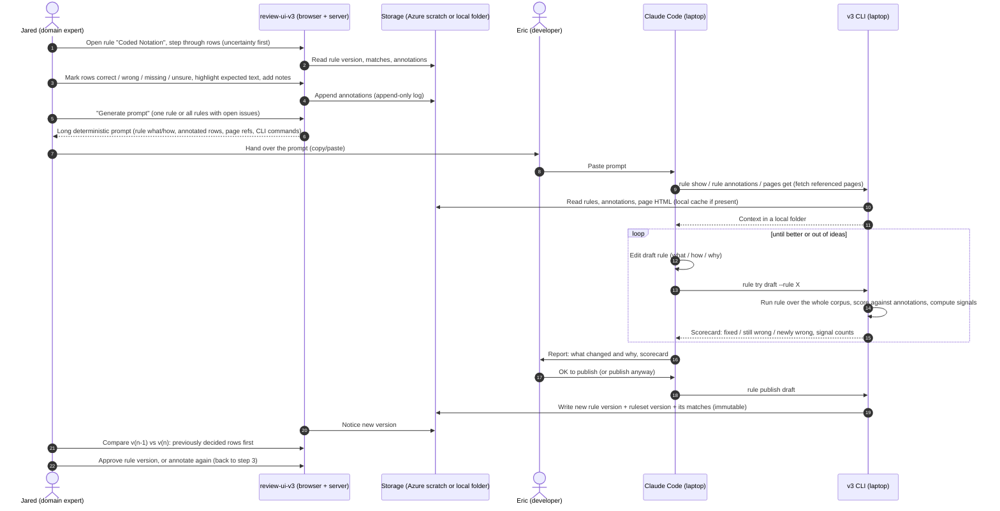

# Research notes: versioning, uncertainty, the Claude loop

Claude's own analysis. It's reasoning, not measurement, so it's kept apart from the measured research files. It
answers the **R-versioning**, **R-uncertainty** and **R-loop** items in `01-questions.md`.

## R-versioning: versioning single rules vs whole rulesets

Eric asked for the pros and cons of versioning each rule and making a ruleset from versioned rules. A1.3 already
settles on doing both. This section explains why that's the right call, and what it costs.

**The model.** A *rule version* is immutable: `(rule_id, version, definition, what, how, why, examples)`. A *ruleset
version* is also immutable: a list of rule versions plus the catalog-level settings (`content_root`, `page_types`,
…). Changing one rule creates a new rule version **and** a new ruleset version that reuses every other rule version
unchanged. An *extraction* always runs one ruleset version over one crawl.

| | Version the ruleset only (v2 today) | Version each rule only | **Both (chosen)** |
|---|---|---|---|
| "Iterate on one rule" | Every edit bumps everything. You can't tell which rule changed without a JSON diff. | Natural | Natural: one rule version changes, and the ruleset version records which one |
| "What produced this extraction?" | One number | Ambiguous: which combination of rule versions? | One ruleset version that resolves to exact rule versions |
| Diff a single rule | Hand-diff two JSON files | Direct | Direct |
| Diff the whole ruleset | Direct | Need to rebuild "the set as of time T" | Direct |
| Rerun one rule only | Must rerun everything (results stay consistent) | Possible, but the extraction is a mix of versions | Possible: rerunning one rule creates a new ruleset version whose other rules' matches are **reused** unchanged, so you don't recompute them |
| Batch publish (A5.1) | Natural | Many separate publishes | One ruleset version that changes many rules |
| Cost | Lowest | Medium | One extra table, plus content hashes so that "unchanged" is a fact, not a convention |

**Things to watch for.**

- **Dependencies between rules.** A field rule only runs on the records a *record locator* finds, and on pages a
  *page rule* accepts. A new locator version therefore changes the input of every field rule. Reusing old
  field-rule matches after a locator change would be wrong. Rule: when a page rule or record locator changes,
  every field rule beneath it is rerun. When a field rule changes, only that rule is rerun. The data-model research
  (`data-model.md`) checks what the engine actually depends on (for example `applies_to` and merge-by-code).
- **Version numbers.** A per-rule integer that only goes up, assigned at publish, for people to read. A content hash
  to detect "unchanged" (to reuse matches). Claude should never have to pick version numbers. The publish tool
  assigns them.
- **Approved state (D8).** Approval belongs to a rule *version*. A ruleset version is "approved" when all of its rule
  versions are approved. That gives the left column its check marks for free.

## R-uncertainty: uncertainty signals as a first-class idea

Eric (A2.4): "How might we discover areas of uncertainty for a row? That concept should be made a first-class
concept." Proposal: an **uncertainty signal** is a named, deterministic check that runs on every match of a rule (or
on every page, for page rules) and gives `(signal, severity, explanation)`. A row's uncertainty is the set of
signals it triggers. The default order in the rule view is *most signals first*, then a random sample of rows with
no signals, so a reviewer always sees some "boring" rows too.

Signals are computed from the extraction alone (no LLM). That makes them cheap, repeatable, and the same in the UI
and in Claude's `rule try` output. Candidates, grouped by where they come from:

**From the value itself**

| Signal | Example | Notes |
|---|---|---|
| `empty` | Course has no Description | The most important one. Separate "rule didn't match" from "matched an empty element" |
| `shape-outlier` | Most codes look like `AAAA 123`; this one is `AAAA 123L` or `Units: 3` | Reduce each value to a shape (`A`=letter, `9`=digit, keep punctuation), group the shapes, and flag rare ones |
| `length-outlier` | A 4-word Description, or a 3,000-character Name | Outside the 1st–99th percentile for the rule |
| `contains-label-text` | Value starts with "Description:" or "Units" | The rule grabbed the label along with the value |
| `markup-leak` | Value has `&nbsp;`, ` `, doubled whitespace | |
| `not-in-vocabulary` | Life Cycle Status is not one of the allowed CTDL concepts | For fields with a controlled vocabulary |

**From comparing with other rows**

| Signal | Example |
|---|---|
| `duplicate-value` | Two different courses have the same Description, or the same code |
| `duplicate-record` | The same code is found twice on one page (the record locator split one course into two) |
| `cross-field-mismatch` | Name contains a code that differs from the Coded Notation |
| `page-count-anomaly` | A department page has 31 course blocks but 29 records were found |

**From the page (for missed records and missed pages, A2.5 and D4)**

| Signal | Example |
|---|---|
| `uncovered-pattern` | Text on the page matches the catalog's course-code pattern but sits outside every found record ("possible missed course") |
| `page-not-classified` | A page the page rule called `info` contains several course-code patterns ("possible missed page") |
| `zero-records-on-course-page` | A course-type page produced no records |

**From history**

| Signal | Example |
|---|---|
| `changed-since-accepted` | Jared accepted the v2 value, and v3 gives something different |
| `previously-rejected` | Jared rejected this row before. Did the new version fix it? |
| `new-in-version` | Row didn't exist in the previous version (the locator now finds more) |
| `vanished-in-version` | Row existed before and is gone now |

The history signals are the same thing as Eric's A4.1 answer: "default to showing what Jared explicitly accepted
or rejected before." So the **comparison view and the uncertainty ordering are one mechanism**. The version diff is
just the rule view sorted by history signals and limited to rows that changed. I'm not pushing back on Eric's
preference. It falls out of this design: summary statistics on top (counts per signal, before vs after), then
Jared's previously decided rows side by side, then other signals, then a sample.

The definitions of these signals are code in the v3 CLI, not part of the ruleset. Each catalog can set thresholds
(for example the course-code regex used by `uncovered-pattern`) in its ruleset settings.

## R-loop: the Claude Code loop (sequence diagram)

Eric's description (A5.6): annotate in the UI → copy prompt → a developer runs it in Claude Code on a laptop →
Claude edits rules, fetches data, runs them, judges whether it's better → Claude publishes back → the UI shows the
new version → repeat.

Steps where the design is still open (for S): what exactly "publish" uploads (the matches computed on the laptop,
or a request for the server to compute them? Computing on the laptop is simpler and matches "the UI never runs
anything"), and whether `rule try` scores the *whole* corpus or the annotated pages plus a sample (it depends on the
measured extraction time in `speed-storage.md`).
