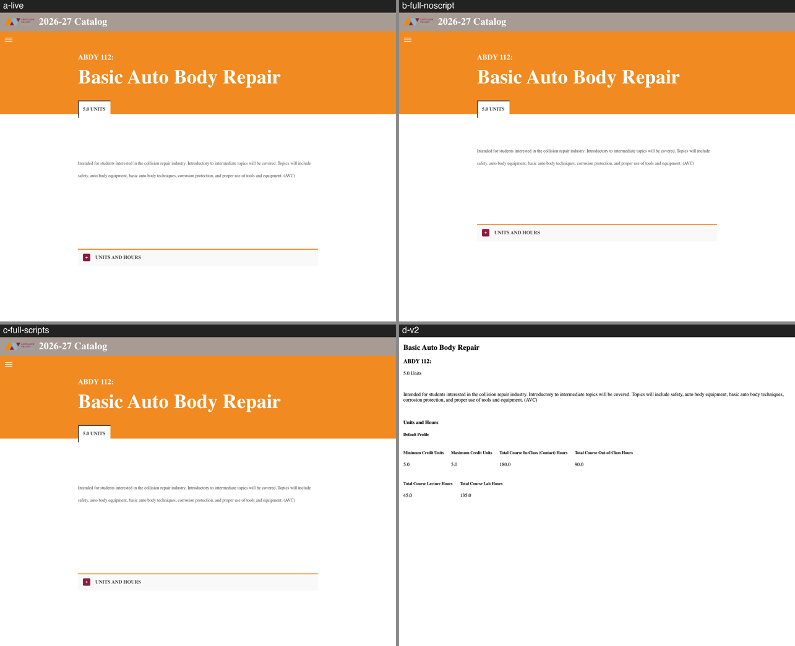
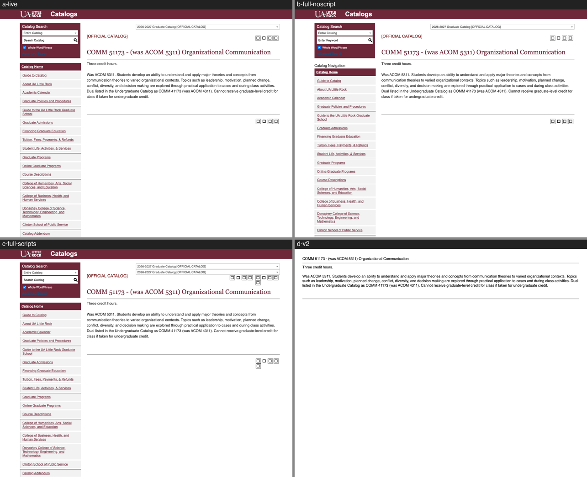
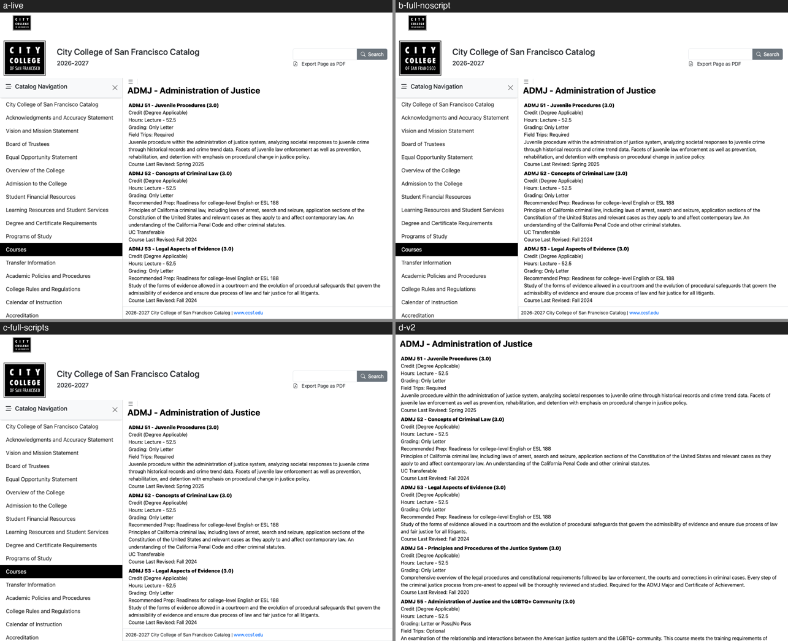
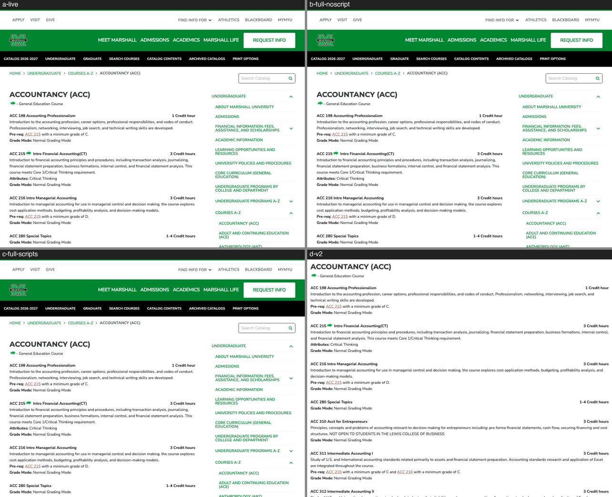
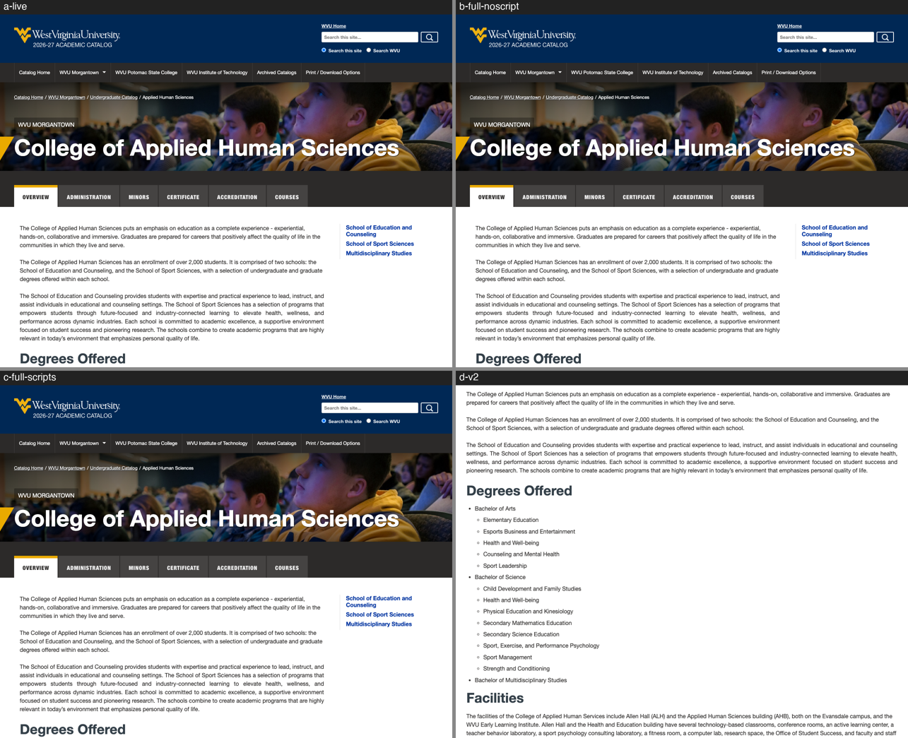
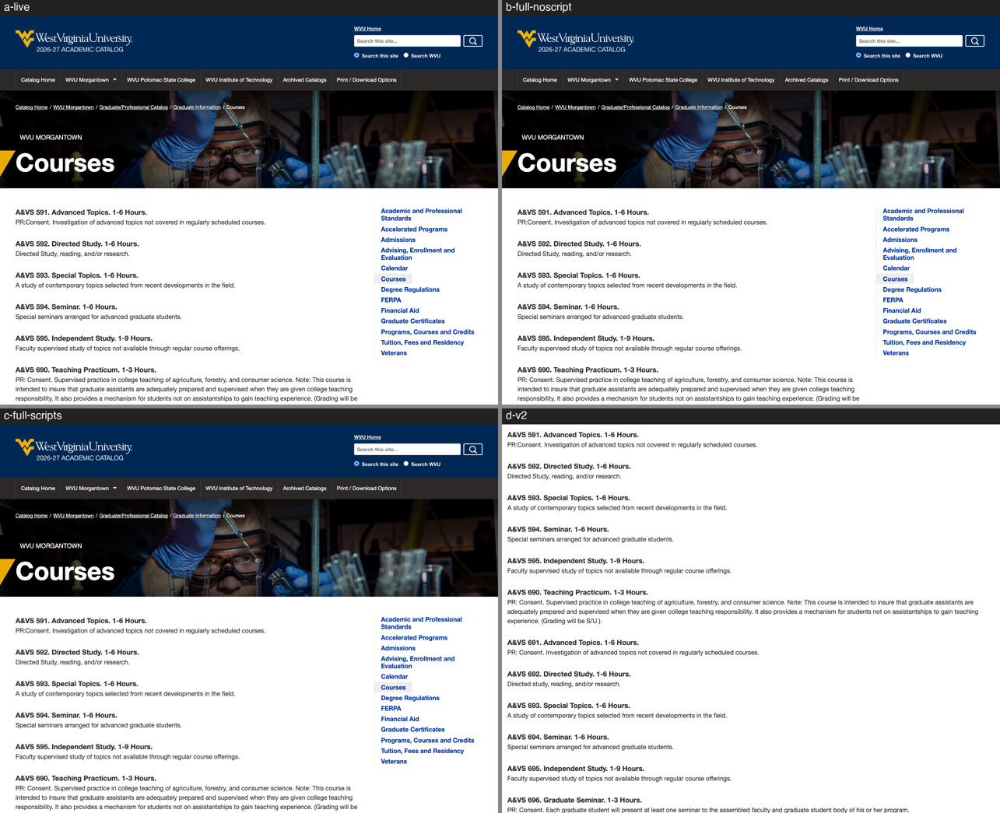
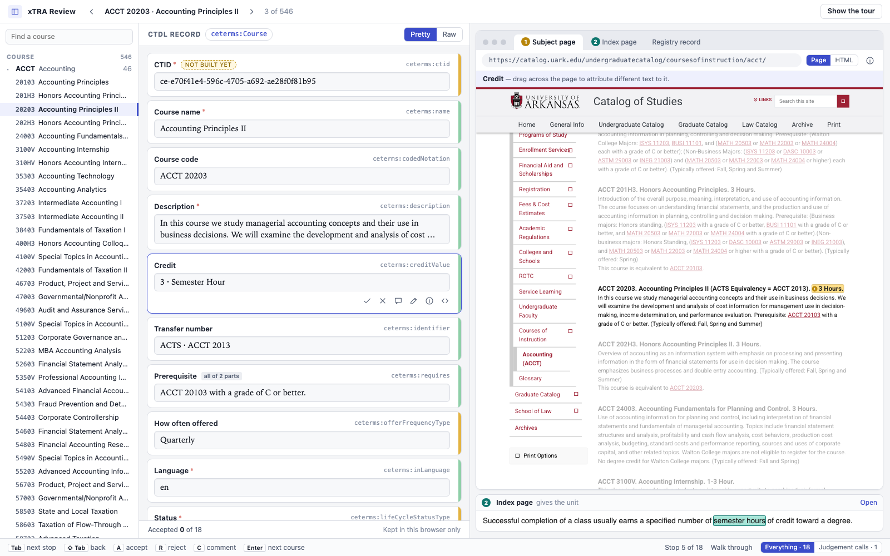
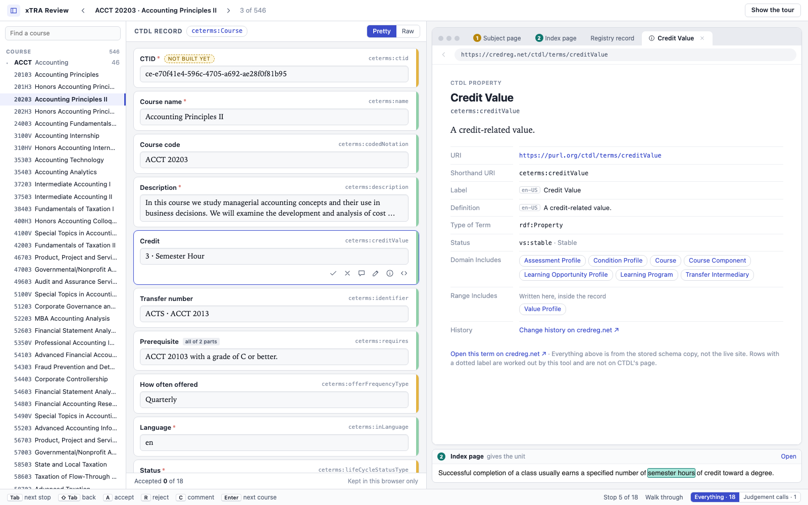
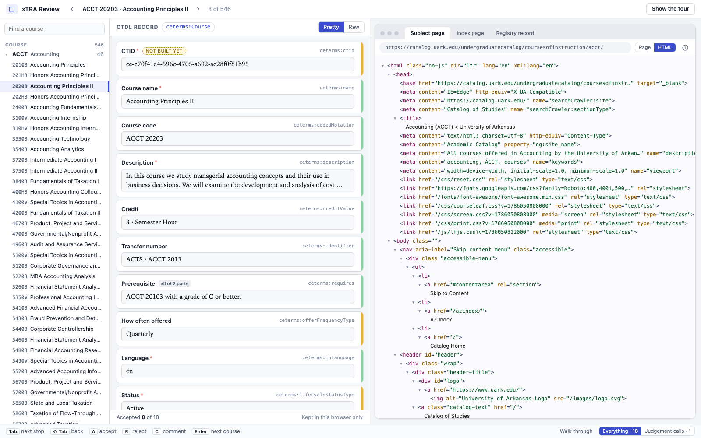
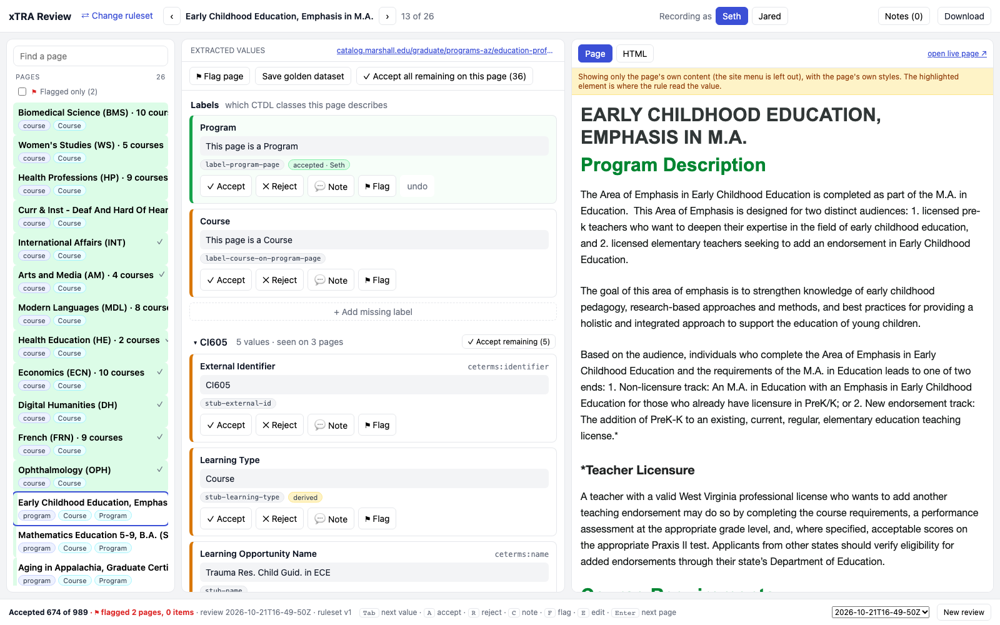

# Research: rendering the catalog page (W1, A6, D5, D7, I2)

Date: 2026-10-26. Facts only, plus a recommendation at the end (section 6). Scratch scripts, raw screenshots and
the asset cache are in
`/private/tmp/claude-501/-Users-eric--superset-worktrees-ctdl-xtra-glowing-conchoraptor-79248126/9a24ca32-87da-41f1-8d05-111d893d1142/scratchpad/rendering/`
(`scripts/render.py`, `cmp.py`, `ancestors.py`, `inventory.py`, `assets_size.py`, `paths.py`).

## 1. Summary

| Catalog | What v2's pane loses | Cause | Hypothesis |
|---|---|---|---|
| AVC (eLumen) | All of it: 45 of 45 elements in `#mainContent` get different font, colour or size | The theme (57 KB, which `@import`s Montserrat and Bootstrap) is a `<style scoped>` **in `<body>`** (`app-root > app-public > div#public-view`). `split_page` keeps only `//head/style`. | None of the three exactly. Closest to (1): a stylesheet outside what we keep. |
| UALR (Acalog) | 55 of 63 elements (87%) | `content_root` is `td.block_content`. Wrapped in `
`, the browser **drops the stray `<td>`**, and 25 of 76 matching selectors need ancestors (`table.block_n2_and_content a`, `.block_content_outer a`, `#gateway-page …`). | (3) |
| CCSF (CurricUNET) | Nothing in the content (0 of 1,323 elements) | — | — |
| Marshall (CourseLeaf) | Nothing in the content (0 of 342) | — | — |
| WVU (CourseLeaf) | Nothing in the content (0 of 2,340 and 0 of 3,000) | — | — |

Seth's hypothesis (1), "we only keep `<body>`", is **wrong as stated**: every saved page has its full `<head>`, and
`split_page` does carry the head's `<link rel="stylesheet">` hrefs and `<head><style>` into the pane. Hypothesis (2), "the
CSS was never downloaded", is **true but not the cause**: no crawl saved any CSS (section 2.1), yet every stylesheet the
pages reference still loads from the live site today (section 2.3). Hypothesis (3), Claude's, is right for **UALR**. AVC is a
fourth cause: a `<style>` in `<body>`. On the three CourseLeaf/CurricUNET catalogs the pane's content is styled
correctly. What makes them look different from the site is that the header, side menu and column width are missing,
and the text reflows to the pane's width at 1:1 scale (see `img/v2-page-pane.png`).

Two more v2 defects turned up along the way:

- **v2 highlighting is broken on UALR.** The rules compute `css_path` with BeautifulSoup and lxml, which keep the stray
  `<td>` (`#xtra-root > td:nth-of-type(1) > h1:nth-of-type(1)`). The browser drops it, so on 5 UALR pages only 4 of 23 paths
  resolve in v2's pane. In a full-page render, with `#xtra-root > X:nth-of-type(1)` mapped to `content_root`, 23 of 23 resolve
  (19 with exact offsets; the other 4 are whole-root paths whose offsets differ by leading whitespace). CCSF (319 paths) and Marshall (245)
  resolve 100% both ways.
- `split_page` matches `@rel="stylesheet"` exactly and only `//head/style`. CCSF has 5 `<style>` blocks in `<body>`
  (the Font Awesome kit, 618 `@font-face`) that are also dropped. They are harmless there, but this is the same bug as AVC's.

## 2. The saved pages

### 2.1 How the pages were fetched

- The crawls hold only `pages/<stem>.html` and `<stem>.meta.json`. Listing all blobs of the five catalogs shows no CSS, JS,
  font or image (AVC 1,467 html, CCSF 521, Marshall 914, UALR 4,979, WVU 900).
- Every sampled `meta.json` says `"strategy": "playwright"` with `render: {load_event: "load", networkidle: true, dom_quiet: true}`.
  `xtra-cli/src/implementations/crawl_browser.py` (`PlaywrightFetcher.fetch`) navigates, waits for load, network idle and
  DOM quiet, then saves `page.content()`. **The saved HTML is the DOM after the site's JavaScript ran**, not the server's
  raw response. Proof: a raw HTTP GET today returns 753 bytes for the AVC course page (an empty Angular shell) and 10 KB
  for the CCSF page, against 2.7 MB and 738 KB saved.
- Side effects of saving a post-JS DOM: the snapshot contains script-made markup (Modernizr classes on `<html>`, Font
  Awesome's injected `<style>`, select2 widgets, `googleads…` script tags with one-off `random=` URLs on WVU), and
  re-running the scripts on it can apply them twice (section 3.2).

### 2.2 What each `<head>` references (one course page each)

| Catalog | `<head>` | Stylesheets (`<link>`) | `<style>` | Scripts | Notes |
|---|---|---|---|---|---|
| AVC | yes, `<base href="/catalog/">` | Material Icons (Google), `/catalog/styles.css` | head: 7.8 KB Font Awesome + 1 empty; **body: 57.9 KB theme, `@import` Montserrat + Bootstrap 4** | 2 trackers, 10 app (Angular `main-es2015.js` and others, S3 template JS, `unpkg.com/wicg-inert`) | 2,986 inline `<svg>`, 13 `style=` |
| CCSF | yes | bootstrap-icons, Bootstrap 5.3 (jsDelivr), `/cssbundles/curriqunet`, `theme-ccsf.css` (`@import` 2 Google Fonts) | head 1; body 5 (Font Awesome kit, 627 KB, 618 `@font-face`) | 9 (jQuery, jQuery UI, Bootstrap, CKEditor bundle, mark.js, app bundle, FA kit) | `<html>` carries 40 Modernizr classes |
| Marshall | yes | 8: reset, Open Sans (Google), cloud.typography.com, Font Awesome, courseleaf, screen (`@import styles.css, custom.css`), print (`@import`), lfjs | body 1 (59 chars) | 5 CourseLeaf (jQuery, lfjs, courseleaf, custom) | |
| UALR | yes, `<html id="gateway-page">` | 7: S3 user-styles, `public_custom.php` (empty), global_styles, S3 gateway reset and styles (`@import` Material Icons), select2 (cdnjs), mobile-styles | none | 3 trackers, 13 site/CDN (3 copies of jQuery, Font Awesome kit, select2) | |
| WVU | yes | 5 site (reset, courseleaf, screen, print, lfjs) + `stackadapt sa.css` (tracker) + `fast.fonts.net` (empty, fonts come via JS) | head 1 (4 `@font-face`) | ~20 trackers (Facebook, Snapchat, Reddit, LinkedIn, Amazon, MNTN, 3× doubleclick, 6× gtag) + 5 CourseLeaf + fonts.net | 1 iframe (tracker) |

- No sampled page has `rel="preload" as="style"`, a CSP `<meta>`, or a meta refresh. `@import` appears in Marshall's and
  WVU's `screen.css`/`print.css`, CCSF's bundle and theme, AVC's body `<style>`, and UALR's gateway CSS: an asset fetcher must
  follow `@import` recursively.
- `style=` attributes: 5–13 per page, a few inside `content_root`. Inline `on*=` handlers: thousands on AVC (Angular),
  hundreds on Marshall, UALR and WVU.

### 2.3 Do those URLs load today?

Every stylesheet on all six sample pages returned **200**, with no redirects and no bot challenge, using a desktop Chrome
user agent (one GET each, 0.5 s apart). Every page is https. WVU's crawl requested `http://` and was redirected to `https://`.
Two stylesheets are empty by design (`public_custom.php`, `fast.fonts.net/t/1.css`). Font files from `ka-p.fontawesome.com`
(Pro kit), `ka-f.fontawesome.com` and `fast.fonts.net` returned 200 to a server-side GET **with or without a Referer**.
`fast.fonts.net` sends no `Access-Control-Allow-Origin`, so a browser will refuse those fonts cross-origin unless we serve
them from our own origin.

## 3. Rendering four ways

Headless Chromium (Playwright 1.64), viewport 1280×1000. All network traffic goes through a disk cache, so each URL is
fetched once, and trackers are blocked. The four variants:

- **a. live**: the live URL.
- **b. full page, no scripts**: the saved HTML with every `<script>`, `<iframe>`, `<object>`, `<embed>`, `<noscript>` and
  `on*=` attribute removed, plus `<base href>`, and JavaScript off.
- **c. full page, scripts kept**: the saved HTML served at its own URL (request interception), with JavaScript on.
- **d. v2**: a byte-for-byte copy of `split_page` and `page_content`, including the ruleset's `pane_css`.

For every element inside `content_root`, the comparison takes the computed `font-family`, `font-size`, `font-weight`,
`color`, `background-color`, `display`, `line-height` and margins, and aligns elements by tag and text.

| Page | a vs b | b vs d (v2) | a vs c | Visible text (`innerText` of root): a / b / c / d |
|---|---|---|---|---|
| AVC course abdy112 | 0% differ | **100%** | 0% | 349 / 337 / 349 / 546 |
| CCSF courses/3/10 | 0% | 0% | 0% | 17,665 all four |
| Marshall courses-az/acc | 0% | 0% | 0% | 7,033 all four |
| UALR course 131047 | 0% | **87%** | 0% | 888 / 888 / **1,080** / 572 |
| WVU graduate/courses | 0% | 0% | 0% | 1,253,553 all four |
| WVU college of applied human sciences | 3 elements (`display`) | 0% | 0% | **2,753** / 116,089 / 2,753 / 116,089 |

Montages (top-left a, top-right b, bottom-left c, bottom-right d):

### 3.1 What the tests show

- **(b), the saved page with its own CSS and no scripts, matches the live site on every catalog**: same layout, fonts and
  colours, header and side menu included. Scripts are not needed for appearance.
- **AVC**: with the body `<style>` added to v2's head (variant e), the difference drops from 100% to 7% (3 elements whose
  `display` the ruleset's `pane_css` changes on purpose). The body `<style>` is the whole cause.
- **UALR**: adding body styles changes nothing (still 87%). The fragment is the cause. A selector-level check confirms it:
  76 selectors match something inside `td.block_content` in the full page, and 25 of them match nothing in v2's pane. The
  top ones are `table.block_n2_and_content a`, `.block_content_outer a`, `#gateway-page a.acalog-icon` and
  `table.block_n2_and_content td`. On AVC, CCSF and WVU, 0 selectors are lost to the fragment.

### 3.2 JavaScript dependence

| Catalog | Server HTML vs snapshot | Content in the snapshot without JS? | JS behaviour that matters |
|---|---|---|---|
| AVC | 753 B shell vs 2.7 MB: **client-rendered (Angular)** | yes, all of it | Accordions ("Units and Hours") collapsed by CSS; the content is in the DOM. v2's `pane_css` opens them (hence d's 546 > 349). |
| CCSF | 10 KB vs 738 KB: **client-rendered** | yes | none needed for reading |
| Marshall | server-rendered | yes | course "bubble" pop-ups (`a.bubblelink`) fetch a course on click; it is also a crawled page |
| UALR | server-rendered | yes | Program pages: 3–20 `showCourse` links per page load course details over AJAX on click. The detail is **not** in the program snapshot but is in the separately crawled `preview_course_nopop` page. **Re-running scripts on the snapshot duplicates widgets** (c shows two catalog dropdowns and extra toolbar icons: 1,080 vs 888 characters). |
| WVU | server-rendered | yes | College pages use tabs (Overview, …, **Courses**). With JS on, only the first tab shows (2,753 characters). With JS off (b), every panel shows one after another (116,089). |

So no catalog needs JavaScript to *show* its course content, because the crawler saved the rendered DOM. Running the
scripts again is harmful in places: it duplicates widgets (UALR), hides the Courses tab (WVU), and runs about 20 trackers (WVU).
"Content hidden behind a click" exists in two forms. Either it is **in the DOM but hidden by CSS** (AVC accordions, WVU tabs
with JS on), which a per-ruleset reveal stylesheet fixes, as v2's `pane_css` does. Or it is **not in the DOM** (UALR
`showCourse`, CourseLeaf bubbles), and then it lives on another crawled page that the UI can link to.

## 4. Assets: how many, and how big

`inventory.py` parses 25 random saved pages per catalog for `<link>`, `<script src>`, ``/`srcset`, `url()` in
`<style>` and `style=`, and `@import`. `assets_size.py` then follows each stylesheet's `@import` and `url()` and fetches or
sizes every unique URL. 137 live requests in total, 0.3 s apart. Groups of more than 15 URLs were sampled at 15 and
extrapolated.

| Catalog | Unique URLs (no trackers) | After merging cache-buster duplicates | Estimated size | Growth over 25 pages | Biggest items |
|---|---|---|---|---|---|
| AVC | 92 | 44 | ~8 MB | still growing (24 → 78 before merging) | 6 Angular bundles 7.1 MB; `footer-logo.png?<timestamp>` differs on every page |
| CCSF | 880 | 880 | ~40 MB (≈36 MB is 842 Font Awesome Pro font files, `.ttf` and `.woff2` of every subset) | flat at 855 from page 1 | FA kit fonts; app JS 1.6 MB |
| Marshall | 40 | 40 | ~4.5 MB (3.7 MB is font files listed in the Font Awesome and Typography CSS, in every format) | flat at ~17 | |
| UALR | 79 | 79 | ~5.6 MB (4.7 MB FA font files) | 23 → 51 (catalog 42 vs 43 assets) | 2/15 S3 sub-assets 403 |
| WVU | 38 | 38 | ~0.8 MB (+ 164 tracker URLs skipped) | flat at ~30 | banner images; a few 404s were my parser cutting URLs at `(` |

- Assets are a per-catalog template set, almost the same on every page. Fetched once per catalog, they come to **under
  10 MB for four catalogs and ~40 MB for CCSF**. Fetching only `.woff2` where a `@font-face` lists several formats would roughly halve
  CCSF, Marshall and UALR. For scale, the saved pages alone are ~4 GB for AVC (1,467 × 2.7 MB).
- Two things a fetcher must handle: **cache-buster queries** (AVC's `?1791838910278`), so it should store by content hash and keep
  a URL → hash map; and **user-agent-dependent CSS** (Google Fonts serves `woff2` only to a modern UA), so it should fetch with the
  crawl's Chrome user agent.
- Licensing: Font Awesome Pro and Monotype (fonts.net) fonts are licensed to the institution's domain. Copying them for an
  internal review tool is a decision for Eric and Jared, not a technical blocker.

## 5. I2: the xtra-reviewer mockup's page browser

I ran the mockup (`~/repos/xtra-mockup/viewer/dist`, served statically) and took screenshots, then stopped the server.

What makes it look clean (`viewer/src/SourcePane.tsx`, `styles.css`):

1. **It looks like a browser window.** It has a rounded panel (`.browser`, radius 10 px, soft shadow), grey "traffic lights", and a
   tab strip (`#e9ebf0`, with the active tab white and bold). Below that is a pill-shaped address bar in monospace showing the
   page's real URL, a **Page | HTML** segmented control, and an ⓘ that opens fetch metadata (date, status, size, sha256,
   "open the live page ↗").
2. **One tab per source document.** Every document the record drew on gets a tab, each with a numbered evidence badge, plus
   **a closable tab for a CTDL term** (`credreg.net/ctdl/terms/creditValue`). Clicking a field's name or its `ceterms:` term
   opens the definition, its domain and range as clickable chips, and a link to credreg. This is how you "learn about and explore the CTDL"
   without leaving the page browser.
3. **The page renders at desktop width and is scaled to fit.** The iframe is laid out at 1,120 px and `transform: scale()`'d
   down to between 0.55 and 1, so the site keeps its own column layout, menu and fonts and looks like the site. v2 lays the
   content out at the pane's width at 1:1, so text is large and reflowed (compare the screenshots).
4. **The whole stored page goes in a sandboxed iframe** (`sandbox="allow-same-origin"`, no `allow-scripts`, loaded with
   `src=` a same-origin URL, not `srcdoc`). The viewer adds a fallback `<style>` before the site's CSS and its own
   highlight CSS after it. Other courses on the page are dimmed (`body.xtra-dim .courseblock{opacity:.38}`).
5. **Highlights are text ranges, not outlines.** Evidence is stored as character offsets over all body text nodes, plus the
   quote and its context. `resolve()` re-finds the quote if the offsets have moved, and never highlights a guess. Marks
   are wrapped ``s in three colours with a number bubble, and the one asked for flashes. The "you" colour marks a
   reviewer's own attribution.
6. **Selecting text attributes it.** `mouseup` in the iframe gives offsets to the parent, so dragging across the page
   attributes text to the selected field. Excerpts from other documents show as small cards under the frame. They
   are never a second full preview.
7. **An HTML view** shows a collapsible element tree with evidence marked, for markup-only evidence.
8. The rest: a single accent colour (`#3b4cca`), muted greys, 12–13 px system UI font, serif for values, keyboard hints in the footer.

## 6. Recommendation for v3

### 6.1 Render the whole saved page, not the fragment

- **Serve the full saved HTML in a sandboxed iframe at a same-origin URL**:
  `GET /api/c/{cid}/pages/{stem}/render` → `<iframe sandbox="allow-same-origin" src=…>`. Don't use `srcdoc`, because pages are up to
  2.7 MB (AVC) and 2 MB (WVU), and a URL can be cached. Lay it out at a desktop width (about 1,200 px) and scale it to fit, as the mockup does.
- **Server-side cleaning** (what variant b did, which matched live on all five catalogs): remove `<script>`, `<noscript>`,
  `<iframe>`, `<object>`, `<embed>`, `<meta http-equiv>`, `on*=` attributes and `javascript:` URLs. Keep every `<link
  rel~=stylesheet>` and **every `<style>` wherever it is** (head and body). Rewrite asset URLs to the archive (6.3), or, until the
  archive exists, use a `<base href>` set to the page's URL so they load from the live site.
- Send a strict **CSP header** on the render response: `script-src 'none'`, `default-src 'self'` plus the archive's origin (or,
  until the archive exists, the hosts the inventory lists). This is a second guard if the cleaning misses something, and it stops
  trackers and beacons.
- Keep a **per-ruleset reveal stylesheet**, like v2's `pane_css`, for content hidden by CSS (AVC accordions). Review it against the
  full page: AVC's `svg{display:none!important}` would hide the logo and icons, and `.row{display:flex}` would restyle the chrome. Scope
  them under `content_root`.
- Dim everything outside `content_root` (and the other records on the same page), as the mockup's `xtra-dim` does, so the
  reviewer still sees the rule's scope. This replaces v2's yellow "only the page's own content" banner.

### 6.2 Highlighting by `css_path`, and capturing a selection (D5)

- Translate v2's paths to the full page by replacing the anchor, `#xtra-root` or `#xtra-root > X:nth-of-type(1)`, with
  `:is(<content_root>)`. Measured: CCSF 319/319, Marshall 245/245 and UALR 23/23 resolve in the full page (v2's pane: UALR 4/23).
  Long-term, compute `css_path` with a browser-compatible parser (`html5lib`, or have the rules engine parse the way browsers do),
  because lxml and browsers disagree on some HTML (stray `<td>`; in general also `
` nesting and `<tbody>`).
- The parent page does everything **from outside** the iframe: `iframe.contentDocument.querySelector(path)`, then add a class, wrap
  the `char_start`–`char_end` range in a `` (the mockup's `wrap()`), and `scrollIntoView({block:'center'})`. Re-scroll for about
  1.5 s while web fonts and CSS settle, as the mockup does. No script runs inside the page.
- Selection capture (D5): in the parent, listen for `mouseup` on `iframe.contentDocument`. From `getSelection().getRangeAt(0)`, store
  (1) the **nearest element's `css_path`**, computed in the browser and anchored at `content_root`; (2) `char_start` and `char_end`
  within that element's `textContent`; and (3) the **quote with about 30 characters of context before and after** (a W3C TextQuoteSelector)
  so that the selection can be found again if the paths move. Tested: with `sandbox="allow-same-origin"` and no
  `allow-scripts`, the page's own `<script>` did not run, while the parent's listener read the selection ("llo world text") and
  set an outline. Test-tooling caveat: Playwright's `page.mouse` hung on a sandboxed frame with scripts off, so end-to-end tests
  should create selections with `Range` and dispatch events.

### 6.3 Archive assets without touching xtra-cli: `assets fetch`

A v3 CLI step, run once per crawl run (it can be re-run, and only fetches what is missing):

1. Read every `pages/*.html` in the run (all local or blob reads). Collect URLs from `<link>` (stylesheet, icon,
   preload), `<script src>` (stored for the archive, as Eric asked in A6.3, though never served to the iframe), ``,
   `<source>`, `<video poster>`, `url()` and `@import` in `<style>` and `style=`. Skip known trackers (a deny-list; WVU alone has 164
   tracker URLs).
2. Fetch each unique URL **once**, with the crawl's Chrome user agent and a Referer of the page's site. Use a small concurrency
   per host (1–2) with a delay. Parse every fetched CSS file for `@import` and `url()` and repeat. For `@font-face`, it can keep
   only `woff2`.
3. Store bodies by **sha256** under `<run>/assets/blobs/<sha256>`, plus `<run>/assets/index.jsonl` (url, final_url, status,
   content-type, sha256, bytes, fetched_at, referenced_by count). Cache-buster URLs then share one blob.
4. The render endpoint rewrites each URL to `/api/c/{cid}/assets/<sha256>`. Inside fetched CSS, `url()` and `@import` must be
   rewritten too, and the result cached. Serving from our own origin also fixes the fonts.net CORS problem.
5. Expected load: about 40–900 requests per catalog, mostly once ever. That is less traffic for the sites than one reviewer browsing
   with live CSS.

The mockup already took a simpler version of this approach: `npm run build:single` fetches "the stored pages' styles from the catalog site the first time"
and inlines them.

### 6.4 Fallback for JavaScript-dependent pages

- On these five catalogs the crawler's post-render snapshot already holds the content, so the **default is the static
  snapshot without scripts**. Do not offer a "run the site's scripts" mode by default: it duplicated widgets on UALR and hid the
  Courses tab on WVU.
- A page needs the fallback when its snapshot shows less than the record found. Detect it per page: rendered `innerText` of
  `content_root` is short, or the record's values are not found in the page text. Show, in this order: (1) the reveal stylesheet; (2) a
  **screenshot of the live page** taken by the `assets fetch` step with Playwright (one per page that needs it, stored by hash),
  shown as an image with no highlighting; (3) the **HTML tree view** (as in the mockup), which always works and can show
  `css_path` targets; (4) "open live page ↗". For content loaded on click (UALR `showCourse`, CourseLeaf bubbles), link to the
  crawled page that holds it.

### 6.5 Risks

- **Scripts**: removal must be complete (`<script>`, `on*=`, `javascript:` URLs, `<meta refresh>`, SVG `<script>`, `<iframe srcdoc>`).
  `sandbox` without `allow-scripts`, plus `script-src 'none'`, is the backstop. **Never combine `allow-scripts` with
  `allow-same-origin`** when the iframe is same-origin with the app: the page could then reach the parent and the API.
- **Same-origin iframe**: the parent needs same-origin access to highlight and read selections. Because scripts are off in the
  frame, that access is one-way. Forms in the page are blocked by the sandbox (no `allow-forms`). `target="_blank"` links
  need `allow-popups`, or the parent can intercept clicks, as the mockup does.
- **URL rewriting**: `<base href>` is relative to the page (AVC's `/catalog/`), `srcset` and `@import` chains and `url()`
  relative to the CSS file, not the page. CSS-in-JS or styles added at runtime are already in the snapshot as `<style>`, so they are covered.
- **Assets change**: the live CSS today may differ from what the crawl saw (UALR's assets differ between catalog years 42 and 43).
  Fetch soon after a crawl, and record `fetched_at` so a stale render can be flagged.
- **Size**: WVU `graduate/courses` is 2 MB with about 1.25 M characters of text, and AVC pages carry about 3,000 inline SVGs each. The iframe
  copes, but wrapping highlights should touch only the target element.
- **Font licences** (section 4).
