# Q — Questions: fixes from Jared's review session (2026-11-04)

The QRSPI Q step for the items Eric raised on 2026-11-04, after Jared Diener reviewed AVC and CCSF. Code was read
and live data inspected, but nothing was changed. **The pictures carry this doc:** open [`mockups.html`](mockups.html).
It shows what each screen does today and what the default answer would make it do.

- Original prompt: [`prompt.md`](prompt.md)
- Eric's pass-2 and pass-3 reactions, verbatim: [`answers-pass2.md`](answers-pass2.md), [`answers-pass3.md`](answers-pass3.md). Each one is summarized under its question
  as **Pass 2 (Eric)**, with what Claude does next as **Next (Claude)**.
- Pass-2 pictures: [`pass2.html`](pass2.html), rendered into `img/mock-*.png`; real screenshots are `img/q*.png`.
- A review copy of the open questions was shared as a Claude doc on 2026-11-04. **This file is the source of truth**;
  the review copy holds nothing that isn't here.
- Each question has a **default**: what research and the spec work from until you answer.
- Items 3 and 8 are treated as one item (both concern the CCSF course-page locator), unless Q3.1 says otherwise.

---

## 1. Highlighting the right answer made no green segment

**What happened (live annotation log, AVC, `course-entry-condition-description`):**
- At 16:28Z Jared marked ACCT199 ✓. At 16:30Z he re-marked it ✗, with `expected: null` and a note.
- The note is **character-for-character the extracted value**.

**Why:**
- `web/src/rules/RulesTab.tsx:250` ignores a selection whose text equals the found value ("the value found: nothing to
  fix"). It gives no feedback.
- `render.py:53` paints `::selection` in the same green as a saved answer. The highlight looked saved when it wasn't.
- Other paths also drop a selection without saying why: no row selected (e.g. "Annotated by" filtered every row out),
  or a selection on a tab other than the row's own page (`RulesTab.tsx:244-247`, `PagePane.tsx:213-221`).
- The `>` in nested names is not involved: the client and API only ever use the rule id.

**Q1.1** When the highlight equals the found value, what should happen?
**Default:** mark the row ✓ correct, flash the value green, and show "Same as what the rule found. Marked correct.
[Undo]".

> **Pass 2 (Eric):** still let Jared mark it up. Next to the note or markup, flag that it's the same as what the rule found.
> Today it looks like the feature broke, because the user gets no feedback.
>
> **Done (Claude), pass 3:** new default: save the highlight as he made it (never drop it), count the row ✓, and show
> "= Same as what the rule found" beside it.
>
> Today, real: Jared's exact highlight on ACCT199 (green is only the browser's selection; nothing is saved):
>
> 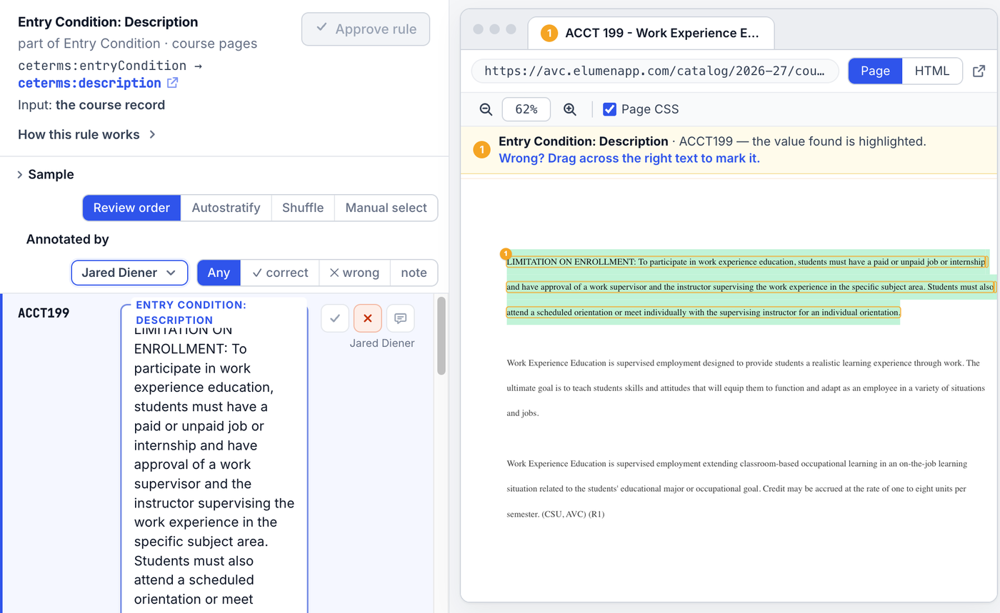
>
> Proposed:
>
> 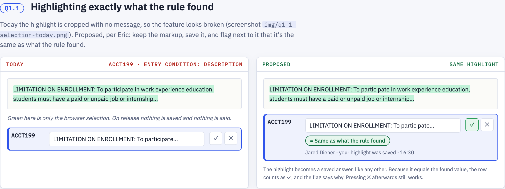
>
> **Pass 3 (Eric):** **reverses the premise.** Jared wasn't marking the right answer. He highlighted
> the LIMITATION ON ENROLLMENT block to say it should be **cut out**: it is not part of the right answer. So the row is
> correctly ✗. The Studio today assumes every highlight is "the right answer"; that has to change.
> - New design: highlight text, then a small popover (like Google Docs) offers **comment** (a speech bubble on that
>   block), and a two-way choice **part of the right answer / not part of the right answer**. Light, compact, few
>   elements, informative tooltips.
> - Structured outputs (the list of objects in item 10) may need a different highlighting experience.
>
> **Done (Claude), pass 4:** the "Same as found" proposal is withdrawn.
> - **Finding:** Jared has two ✗s on ACCT199. 15:40Z on **Description**, note: "The description should not include
>   the text that goes in the Entry Condition property, which in this case is indicated by 'Limitation on
>   Enrollment.'" That matches Eric's reading. 16:30Z on **Entry Condition: Description**, whose value *is* that
>   block, with a note identical to the value. Whether the second ✗ was meant is a question for Jared (Q1.5).
>
> 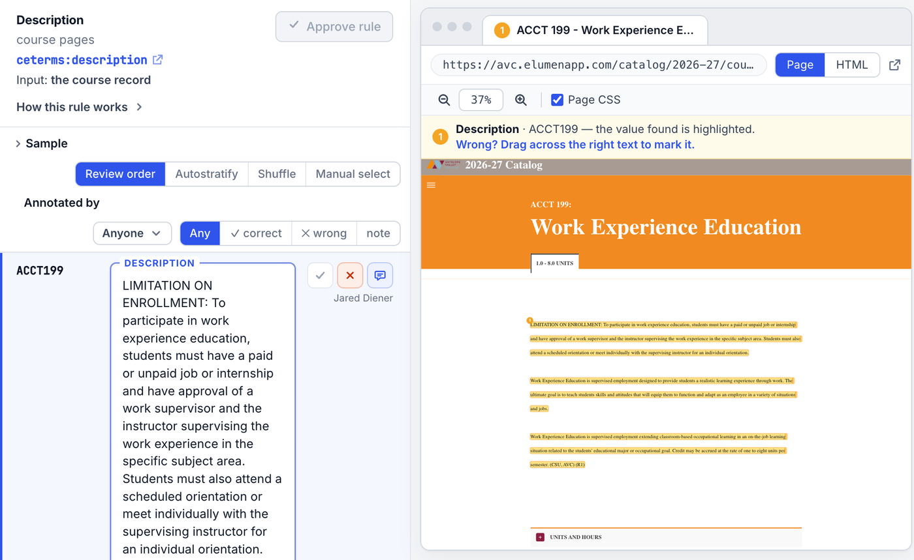
>
> 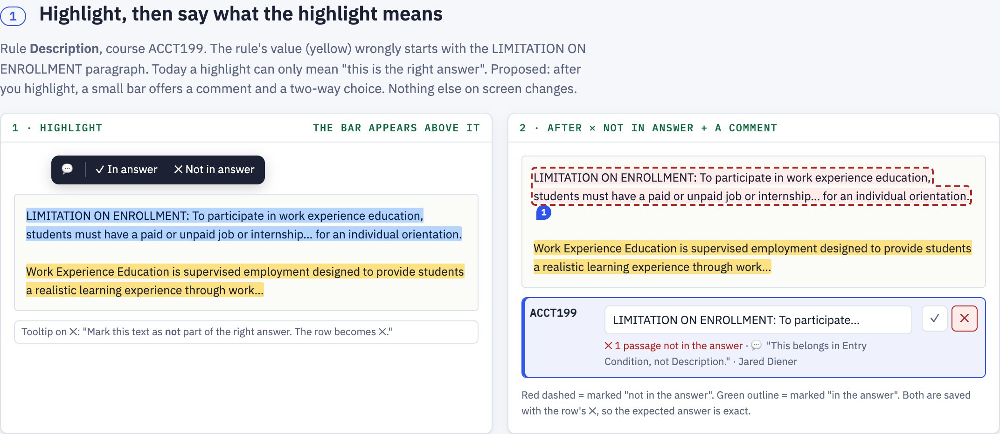
>
> **Q1.1b** After you highlight text on the page, show a small bar: 💬 comment · ✓ In answer · ✕ Not in answer
> (tooltips on each). ✕ marks the row wrong and records which text must go; ✓ records text that must be in the answer.
> It replaces today's single meaning ("a highlight is the right answer"). **Default:** yes, as drawn.
>
> **Q1.5 (for Jared)** On ACCT199, *Entry Condition: Description* holds exactly the LIMITATION ON ENROLLMENT
> paragraph, and Jared marked it ✗ at 16:30 with that same paragraph as his note. Was that ✗ intended (is something
> wrong with it), or meant as ✓? **Default:** ask Jared; leave the ✗ until he answers.

**Q1.2** Repair Jared's 16:30Z ✗ on ACCT199 with a superseding ✓, or leave it for him to redo?
**Default:** leave it, and tell Jared.

> **Answer (Eric):** Show me what this means first.
>
> **Note (Claude), the example:** on ACCT199, rule *Entry Condition: Description*, Jared's two clicks:
>
> | Time (Z) | Verdict | Expected | Note |
> |---|---|---|---|
> | 16:28:06 | ✓ correct | none | none |
> | 16:30:03 | ✗ wrong | none | "LIMITATION ON ENROLLMENT: To participate in work experience education, …" (identical to the extracted value) |
>
> - The later click wins. The row is red, the rule counts as failing on ACCT199, and this rule was one of the 5
>   "needs work" rules sent to Claude.
> - "Flipping" means adding a new ✓ that supersedes the ✗. Annotations are append-only, so the ✗ stays in history.
> - **Default now:** ask Jared to click ✓ again himself. That keeps the author honest.
>
> **Pass 2 (Eric):** undecided. Show what the row was before, what it is now, and what the decision is, as a screenshot.
>
> **Done (Claude), pass 3:** the row now (real), then before / now / the three choices (from the log,
> `research/annotations.md`). The ✗ is the rule's only open ✗, so it alone made the rule "needs work".
>
> 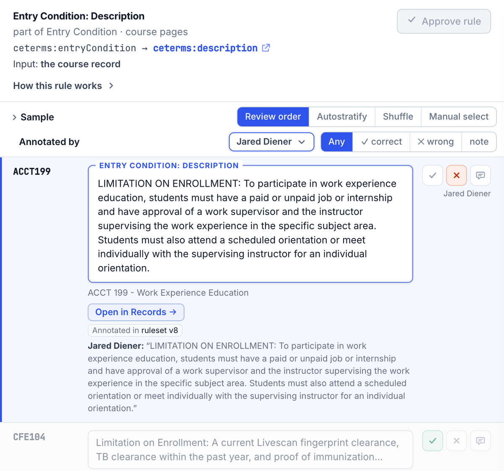
>
> 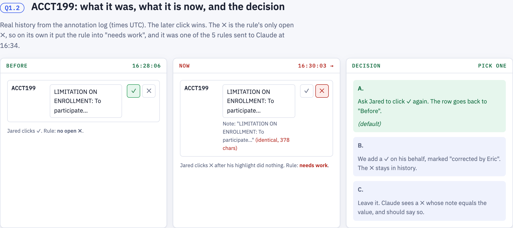
>
> **Pass 3 (Eric):** the ✗ is right, and putting the rule into "needs work" is how it should be.
> **Decided:** leave it (no repair).

**Q1.3** The text-selection color becomes blue, and every silently ignored selection gets a one-line hint saying why.
OK? **Default:** yes.

> **Pass 2 (Eric):** needs a mockup to understand the proposal.
>
> **Done (Claude), pass 3:**
>
> 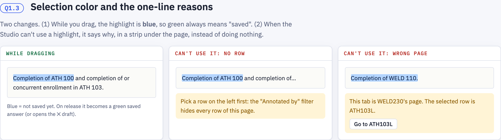
>
> **Pass 3 (Eric):** didn't understand the question (it relied on earlier context) and couldn't tell
> whether it adds new UI. Any new UI must be strongly justified.
>
> **Done (Claude), pass 4: withdrawn.** It proposed changing the browser's selection color from green to blue and
> adding a message whenever a highlight is ignored. The highlight bar (Q1.1b) makes both unnecessary: every highlight
> gets a visible response.

**Q1.4 (gap found on the way)** On a property with no extracted value, a ✗ with an expected value is saved but never
reaches the golden dataset (`golden.py:142-160`). Is that in scope here? **Default:** no, it goes on the list for
later.

> **Pass 2 (Eric):** needs an example with a real screenshot.
>
> **Done (Claude), pass 3:** there is **no real case**. All 7 annotations with an expected value are on rows that had a
> value (`research/annotations.md` §2). The gap is in code only: `golden.py:156` skips rows that aren't `found` and
> never reads `expected`. Worse, on found rows a ✗ with an expected value still publishes the rule's value, not the
> expected one. **Proposed:** fold Q1.4 into item 12 and the spec (the golden dataset uses the reviewer's answer),
> rather than a separate fix.
>
> **Pass 3 (Eric):** didn't understand (it relied on earlier context).
>
> **Done (Claude), pass 4, restated:** when a reviewer marks a value ✕ and highlights the right text, that right text
> is saved in the annotation log but never copied into the golden dataset. The golden dataset only holds text a rule
> extracted. Real case: AVC Description, DA107A. Eric's answer includes the last line "# Enrollment in any
> combination of DA 107A, DA 107B or DA 107C is limited to 4 times."; the rule (v8) still drops it; the golden
> dataset publishes the rule's text.
>
> 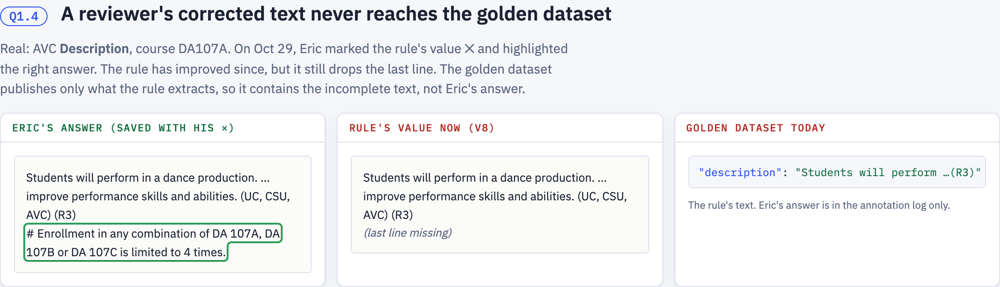
>
> **Q1.4b** Should the golden dataset publish the reviewer's answer when a row is ✕ with an answer? **Default:** yes,
> marked as human-approved; the rule's text is used only when nobody gave an answer.

## 2. Deep links to a sample and its comment

**What exists:**
- `?row=<occurrence key>` already opens a sample, even one deep in the list (`routes_review.py:362,402`).

**What's missing:**
- Clicking a row doesn't write `?row=` to the address bar.
- Comments have no URL parameter and no DOM id.
- There's no Copy link button anywhere.

**Q2.1** Should a link point at a comment only, or also at a verdict or annotation (e.g. Jared's ✗ and its note)?
**Default:** any annotation id (`?c=an-…`), since comments and verdicts share one id space.

> **Pass 2 (Eric):** the link only needs to point at the row (the record). Nothing more granular.
>
> **Decided:** `?row=<occurrence key>` only. No comment ids in the URL.

**Q2.2** Should clicking a row update the address bar? **Default:** yes, with `replace`, so Back isn't flooded.

> **Pass 2 (Eric):** yes. Also update it when tabbing through rows. No Back-button history.
>
> **Decided:** yes, `replace`, on click and on keyboard moves.

**Q2.3** Where does Copy link go? **Default:** on the selected row's header and on each comment's meta line.

> **Pass 2 (Eric):** no Copy link or Share button. The address bar keeps up with the selected row; people share what's in it.
>
> **Decided:** no button.

## 3 + 8. "One course per course page" on pages that hold many courses

**What the screen shows:**
- The filled blue block is only the course for the row selected on the left (`gds-focus`, `render.py:64`).
- The outlined, numbered blocks were found too. No legend says so.

**Where the confusion comes from:**
- "One course per course page" is a fixed label written for AVC (`routes_review.py:33`, `RuleHead.tsx:13`).
- CCSF's locator actually repeats on `.course-summary-wrapper`.

**Related CCSF risks:**
- Duplicate-code and uncovered-code signals may fire falsely on department pages (`signals.py:210-245`).
- The definition view hides `repeat_filter.selector` (`RuleHead.tsx:29`).

**Q3.1** Your item 3 ends at "in the 'one course per page' locator rule." Is it point 8, or a different problem?
**Default:** the same as 8.

> **Answer (Eric):** Yes, item 3 is the same as point 8.

**Q8.1** Name the locator from its definition ("Course blocks · each `.course-summary-wrapper`" / "Whole page is one
course") instead of the fixed title? **Default:** yes. The rule id `locator-course-page` stays as it is.

> **Pass 2 (Eric):** didn't follow the question; use best judgment. The point: when the rule matches several courses on one page,
> "One course per course page" is very misleading.
>
> **Decided (Claude's judgment):** the title is derived from the rule. CCSF reads "Course blocks: every
> `.course-summary-wrapper` on the page"; AVC reads "Whole page is one course". The rule id doesn't change.

**Q8.2** Should every found course get the same fill, with the selected one ringed, plus a "This page: N courses"
strip of clickable chips? **Default:** yes, as in the mockup.

> **Pass 2 (Eric):** needs to see it in a mockup.
>
> **Done (Claude), pass 3:** the real page today (CCSF, Interior Design, 3 courses), then the proposal.
>
> 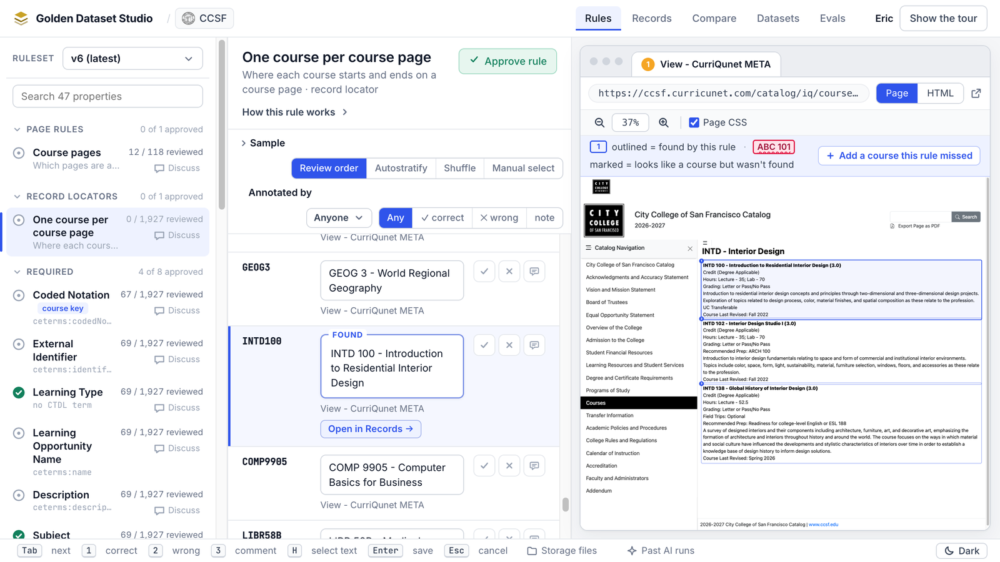
>
> 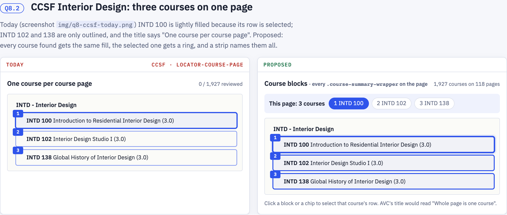
>
> **Pass 3 (Eric):** rename the rule; "one course per course page" implies one course per page,
> which is false. Same fix for the page rule's subtitle. The first-pass rule-generation prompt may be producing this
> same flawed rule shape for every catalog: consider fixing the prompt (a wider refactor).
> - Drop the chips if there's nested tabbing. Draw every found course as a **border with a transparent fill**; only
>   the course you've tabbed to is filled.

**Q8.3** One row per course (today), or one row per page with its courses nested? **Default:** one per course.

> **Pass 2 (Eric):** didn't understand the question; needs a visual.
>
> **Done (Claude), pass 3:** the question is how the left-hand table lists the 3 Interior Design courses. Today (A)
> they are 3 separate rows, scattered among other pages' rows. B would group them under their page.
>
> 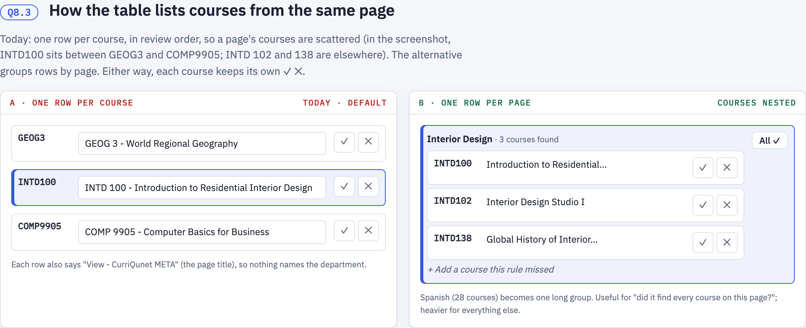
>
> **Pass 3 (Eric):** **B: one row per page, with its courses nested.** This rule's job is to find every
> course block on pages the upstream page rule already picked, so reviewers approve or reject course blocks.
> - Nested tabbing: Tab steps through a page's courses. A shortcut (maybe Shift+Tab) goes back up to the page level,
>   so the next Tab jumps to the next page. A page can hold 100+ courses; don't force tabbing through all of them.
> - Keep "Add a course this rule missed".
>
> **Done (Claude), pass 4:**
>
> 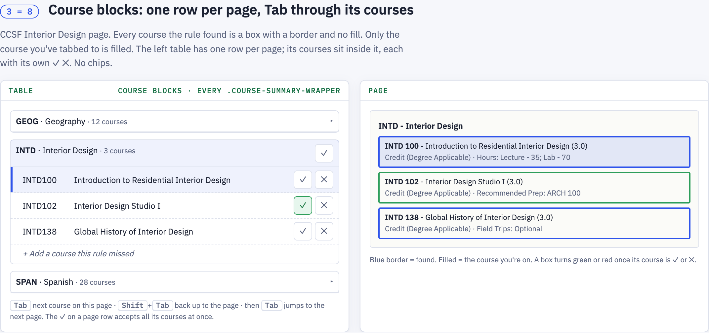
>
> **Q8.5** Keys: Tab = next course on the page; Shift+Tab = back up to the page; Tab at page level = next page; a ✓
> on the page row accepts all its courses. Note Shift+Tab usually means "previous"; the alternative is Esc to go up.
> **Default:** Esc goes up (Shift+Tab keeps meaning "previous").
>
> **Q8.6** Fix the first-pass rule-generation prompt so locators are named and described from what they do (one per
> page vs. many per page), in this work or later? **Default:** in this work, limited to names and descriptions.

**Q8.4** Should the false duplicate/uncovered-code signals on CCSF department pages be fixed here or researched
first? **Default:** research them in R, and fix them only if they show up on Jared's pages.

> **Pass 2 (Eric):** research first. Didn't understand what these signals are. Wants the research results, an example, and a
> screenshot.
>
> **Done (Claude), pass 3:** the worry was unfounded. **They don't fire falsely; they never fire on CCSF** (0 of each
> across 1,927 courses on 118 pages; `research/ccsf-courses.md`).
> - *Duplicate code*: the same course code in two blocks on one page.
> - *Uncovered code*: course-code text on the page outside every found block. In the CCSF screenshot above, it's
>   the legend "ABC 101 marked = looks like a course but wasn't found"; nothing is marked on that page.
> - Two blind spots hide problems (never invent them): block text is joined with no space, and CCSF's code pattern
>   misses 4-digit codes such as TICU 5000.
> - **Proposed:** drop Q8.4 from this work and record the blind spots for later. Also fix the page rule's subtitle
>   ("Which pages are a single course's own page"), which is just as wrong for CCSF.

## 4. "Improve these 5 rules" showed no output from Claude (health check)

**What happened to run `20261104T163408Z-f428` (AVC, started by Jared at 16:34:08Z):**

| Time (Z) | What happened |
|---|---|
| 16:34:08 | The Studio sent the run, and K2 resumed the golden-rules agent with the prompt. |
| 16:34:27 | Claude's first `golden-datasets` call failed with Azure `AuthenticationFailed` (the signature was rejected). The token's expiry, 2027-10-29, is not the problem. |
| 16:34:41 | Claude explained this in its own chat and stopped. It couldn't post a note, because notes go through the same storage. |
| 18:04 | The Studio will show "no update from Claude yet" until the run times out. |

The Studio's own token works: Jared's annotations save.

Diagnosis: the agent's container SAS was most likely invalidated (account key rotated, or the token revoked).

**Q4.1** Issue a new SAS for the agent and write it to its env file. That's an admin action on the agent host.
**Default:** wait for Eric to approve it or do it himself.

> **Answer (Eric):** Only issue a new token if one is needed.
>
> **Done (Claude), 2026-11-04 17:15Z:**
> - **Needed:** both storage account keys were regenerated on 2026-11-02 (key1 19:28Z, key2 19:37Z). The Studio's
>   token was renewed on 2026-11-03; the agent's wasn't.
> - **Renewed:** the agent's four container tokens (same permissions, expiry 2027-10-29). All four checked: 200.
> - **Kept:** the old file, as `golden-datasets.env.rotated-20261102`.

**Q4.2** How should the Studio notice an agent that stopped without reporting?
- (a) Ask K2 whether the agent's session is idle, and show its last message. This needs a K2 read API: research
  whether v0.46.5 has one.
- (b) Warn when there's no first note within 5 minutes.
- (c) A periodic self-check that the agent can reach storage, which disables the button when it can't.

**Default:** (a) and (b), with (c) researched.

> **Pass 2 (Eric):** doesn't like any of them, because they generate more tokens. Is there a K2 API that says whether work is
> ongoing, what the last message was, or whether Claude failed? Research it. Leaning towards dropping the matter,
> except perhaps: if there's no note within 5 minutes, the UI marks the run "Not responding" (or failed), so people
> know not to sit and wait.
>
> **Done (Claude), pass 3** (`research/k2-status.md`): K2 has **no** endpoint the Studio's key can use for
> "busy / idle / failed" or the last message. A person's K2 login can see busy/idle, but "idle" would have looked
> the same as a finished run today. **New default:** (b) only, in the UI, no tokens: 5 minutes after the run is sent
> with no note from Claude, the bar says "Claude isn't responding". Plus a prompt rule: Claude's first action is a
> note.
>
> 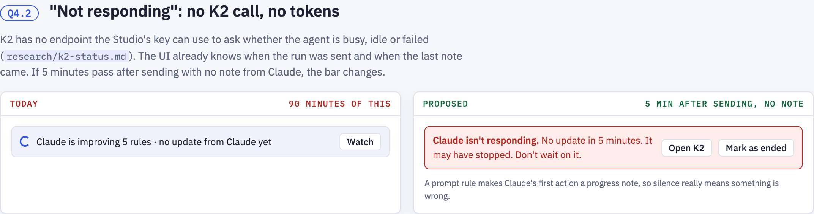
>
> **Pass 3 (Eric):** yes, both. But don't mention K2 in the UI: the button is just "Mark as ended". **Decided.**

**Q4.3** End the stuck run now, or let it time out at 18:04Z? **Default:** end it once the token is fixed, so Jared can
press the button again.

> **Answer (Eric):** Yes, end it.
>
> **Done (Claude):** run `20261104T163408Z-f428` ended as *failed*, with an outcome line and a report explaining the
> token problem. Ruleset is still v8. Jared can press Improve again.

## 5. Sample defaults to Autostratify · 6. Filter defaults to "Anyone"

**Where the defaults are set:**
- The sample's `review` default: `RulesTab.tsx:73`.
- "Annotated by" defaults to the top expert: `logic.ts:266-269`.

Neither is stored per user, so the change reaches everyone at once. Links that already carry `?by=` keep their filter.

**Q5.1** Should Compare also default to Autostratify? **Default:** no, Compare keeps Shuffle.

> **Pass 2 (Eric):** Compare keeps Shuffle. **Decided.**

**Q5.2** Should the Sample drawer open on its own with Autostratify? **Default:** no, the chip shows the mode.

> **Pass 2 (Eric):** no, the chip shows the mode. **Decided.**

**Q6.1** Should `?by=anyone` still be written to the URL now that it's the default? **Default:** no, Anyone becomes the
empty value, and a person's name is written only when one is picked.

> **Pass 2 (Eric):** the default. **Decided.**

## 10. Profile values: an array of objects, not text (Jared, ACCT199)

Jared's note asks for `ceterms:estimatedDuration` to be **a list of DurationProfiles**, each with a description and a
time. It should be annotated as structured fields, not as highlighted text. Pictures: `mockups.html#fix-10`.
Research done so far, which needed no input from you: [`research/profiles.md`](research/profiles.md).

**Findings (from the code, CTDL and the Registry):**
- **Every layer is flat today.**
  - A rule's value is one string (`model.py:77`).
  - Nothing links the Nth description to the Nth time. Child values flatten into one list, and their indexes shift
    when an item doesn't match (`engine.py:429-445`).
  - `expected.segments` holds pieces of *one* value, not named fields.
  - The golden JSON has one field per value.
  - xtra's scorer drops every profile object except `creditValue` (`score_extraction_match.py:116-129`).
- **This reverses a decision.** In property-rules, Seth's answer to A3.13 put pairing a profile's parts out of scope,
  to be done in transformation.
- **CTDL doesn't take a range in `timeRequired`.** Its range is `schema:Duration`, one ISO 8601 value such as `PT54H`.
  - "54.0 - 432.0" hours is `minimumDuration PT54H` + `maximumDuration PT432H`.
  - The Registry's California courses use exactly that shape (ART-16: `minimumDuration PT72H`,
    `maximumDuration PT81H`).
  - None of the ~200 Registry courses checked has more than one DurationProfile.
- **AVC has no course records in the Registry**, only an organization record. Jared's annotations are the only truth
  for ACCT199.
- **Building blocks that exist:** list rules with ✓/✕ per item, the missing-item flow, the parent→child `input.rule`
  chain, and xtra's one-to-one similarity pairing.

**Properties with a complex value, among those we have rules for:**

| Value shape | Properties (rule ids in `properties.csv`) | Fields in our rules | Notes |
|---|---|---|---|
| **List of profile objects** | `estimatedDuration` → DurationProfile | description, exact / min / max duration, timeRequired | Durations are ISO 8601. AVC prints several per course. |
| **List of profile objects** | `creditValue` → ValueProfile | min, max, creditUnitType | `multiple=false` in our sheet, but CTDL allows several (e.g. units *and* "Variable Lab Hours"). Registry uses `schema:value` for a single number. |
| **List of profile objects, with a list inside** | `corequisite`, `coPrerequisite`, `recommends`, `entryCondition` → ConditionProfile | description, targetLearningOpportunity[] | Each profile has a *list* of course references. That's two levels deep. |
| **Mismatch with CTDL** | `prerequisite` | description, targetLearningOpportunity[] | On a Course, CTDL's `prerequisite` takes only a Course reference. The Registry puts requisite text in `requires` → ConditionProfile. |
| **Single object** | `identifier` → IdentifierValue | value only | Needs identifierType / identifierTypeName too. |
| **List of vocabulary terms** | `deliveryType`, `learningMethodType`, `subject` (CAO), `creditUnitType`, `lifeCycleStatusType`, `inLanguage` | page words | Already lists. Mapping the words to concepts stays in transformation (A3.12). |
| **Language map** | name, description, contentDescription, … | text | `{"en-US": …}`, a mechanical wrapper. |

**Q10.1** Which of ACCT199's four lines are DurationProfiles? Jared's example has two (In-Class, Out-of-Class), but
the page also prints Lecture 0.0 and Lab 432.0, which look like a breakdown of In-Class.
**Default:** all four, as printed. The golden set records what the page states.

> **Answer (Eric):** All four.
>
> **Pass 2 (Eric):** do the field names `description` and `timeRequired` match Jared's notes? If so, keep them.
>
> **Note (Claude):** yes. Jared's notes use `ceterms:description` and `ceterms:timeRequired`. **Decided.**

**Q10.2** Reversing A3.13 needs an owner: you, or Seth? And does it cover all profile properties, or does it start
small? **Default:** start with `estimatedDuration` and `creditValue` (flat fields, one level). ConditionProfiles,
with their nested course lists, come second.

> **Answer (Eric):** Inclined to agree with the default, but needs the context.
>
> **Note (Claude), the context:**
> - On 2026-11-02, in the property-rules Q&A, Seth answered that grouping a profile's parts (the Nth description
>   with the Nth time) is a transformation concern, out of scope.
> - So the Studio was built to keep `…>description` and `…>timeRequired` as two separate lists that know nothing about
>   each other. Item 10 undoes that for some properties.
> - The question is only whether Seth should hear about it before the spec. **Default:** you decide, and Seth reads
>   the spec.
> - Why start with Duration and Credit Value: their profiles are one level deep (text fields only). A
>   ConditionProfile (prerequisites, entry conditions) holds a *list of courses inside each profile*, two levels deep.
>   Example, ATH103L: one condition `{description: "Completion of ATH 100 and … ATH 103", targets: [ATH 100,
>   ATH 103]}`.

> **Pass 2 (Eric):** "agree with Seth", and explain why prerequisite, corequisite, coPrerequisite and so on take a
> profile. Fine if CTDL has no `description` under `prerequisite`: the sheet keeps the raw text as `description` so
> it can be labelled more finely later, so that one stays fairly unstructured. If a profile would force us to be more
> explicit, show why with JSON objects and page snippets.
>
> **Note (Claude):** two things to clear up.
> - Those properties take a **ConditionProfile**, not a ValueProfile (that's `creditValue`). Shown with JSON and page
>   snippets in `research/conditions.md`.
> - "Agree with Seth" is open: does it mean ConditionProfiles stay unstructured (the raw text) and only Duration and
>   Credit Value become profiles? That's the working default until confirmed (Q10.2b).
>
> **Done (Claude), pass 3, the data behind it** (`research/conditions.md`): across AVC, CCSF and Marshall, **no course
> has more than one** prerequisite, corequisite, co-prerequisite or entry-condition statement, and Credit Value is
> always exactly one. Only Estimated Duration has several per course (all 1,062 AVC courses; 383 at CCSF). So the
> **new default** (Q10.2b):
> - **Estimated Duration:** a list of objects (the new rule type).
> - **Credit Value:** one object with its fields grouped. No list, no pairing.
> - **Conditions:** stay flat, raw text in `description`, as Seth said.
>
> **Pass 3 (Eric):** yes: a list of objects for Estimated Duration only. **Decided.**
> - Annotation: the rule tries to grab every object. Jared must accept or reject **each element**; rejecting one makes
>   the rule wrong for that record. He must also be able to add missing elements and fill their fields by labeling
>   pieces of the page. (Maybe a container rule plus field rules; the UI isn't built for that yet.)
>
> **Done (Claude), pass 4:**
>
> 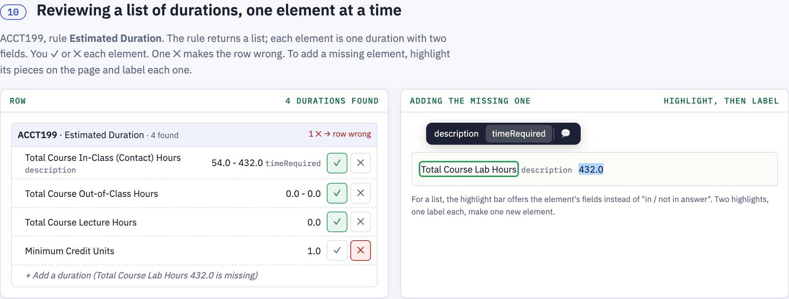
>
> **Q10.8** Review a list one element at a time (✓/✕ each, one ✕ makes the row wrong), and add a missing element by
> highlighting its pieces and labeling each with a field name? **Default:** yes, as drawn.

**Q10.3** What should the golden value hold?
- (a) The page's words per field ("54.0 - 432.0")
- (b) The CTDL shape (`minimumDuration: PT54H`, `maximumDuration: PT432H`)
- (c) Both

> **Answer (Eric):** Page words, put into the right object.
> - Don't parse "54.0 - 432.0" into min and max now. Downstream will do that.
> - Grab the block of text from the page and store it under the right field of the right profile, in the
>   multi-object answer.
>
> **Note (Claude):** each profile is stored as `{description: "Total Course In-Class (Contact) Hours",
> timeRequired: "54.0 - 432.0"}`, with field names as in Jared's example. CTDL parsing (ISO 8601, min/max) is
> transformation.

**Default:** (c). The SME confirms the page words, and the Studio shows the parsed CTDL beside them for a ✓.
Unparseable text stays words only.

> **Superseded:** Eric's pass-1 answer is (a), the page's words only. This default no longer applies.

**Q10.4** Should extra extracted profiles count against the score (precision), or only missed ones (as xtra does
today)? **Default:** report both. Profiles are paired by description, then each field is scored, as in the mockup.

> **Answer (Eric):** Needs a concrete example.
>
> **Note (Claude), the example:** Jared's golden ACCT199 has 4 profiles. AVC's "Units and Hours" card also prints
> `Minimum Credit Units 1.0`. That's a credit value, not a duration.
>
> | | Rule A (sloppy) | Rule B (exact) |
> |---|---|---|
> | Extracts | the 4 profiles + "Minimum Credit Units 1.0" as a 5th | the 4 profiles |
> | Score today (missed-only, xtra's rule) | 4/4 = **100%** | 4/4 = **100%** |
> | Score with extras counted | 4/4 found, 4/5 right = **89% (F1)** | **100%** |
>
> - **The question:** should rule B beat rule A?
> - **Default:** yes, report found (recall) and right (precision) separately, so Claude can't improve a rule by
>   grabbing more.
>
> **Pass 2 (Eric):** didn't see the difference between the scores; needs a visual, with JSON objects and page
> snippets. If the "Minimum Credit Units" line itself is unclear (how it should be recorded), put it on the list
> for Jared, Seth and Sneha.
>
> **Note (Claude):** the line is clear: it's a credit value (`creditValue`), not a duration. The example is about a
> rule that grabs it by mistake. It still goes on the follow-up list, to confirm.
>
> **Correction (Claude), pass 3:** ACCT199 prints **Minimum Credit Units 1.0**, not 3.0 (Maximum 8.0). The example
> above and the mockup are fixed.
>
> **Done (Claude), pass 3:** the ACCT199 data as JSON (today's two loose lists vs one list of objects), then three
> rules scored both ways. Scored as loose values (xtra today), all three get 100%.
>
> 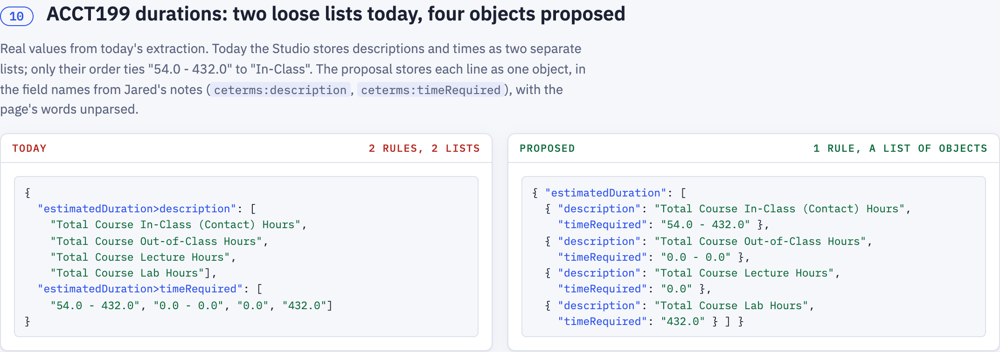
>
> 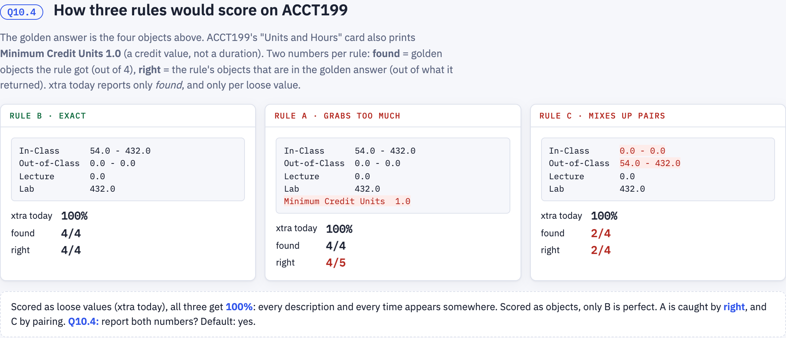
>
> **Pass 3 (Eric):** yes. An exact match means exactly the golden pairs. The score is penalized for
> extra pairs, for missing pairs, and for pairs whose text isn't exactly right. The golden dataset stores this format,
> **xtra's scorer must expect it, and xtra-cli must predict in it.** **Decided.**
>
> **Pass 4 (Eric)** (`answers-pass4.md`): "found" and "right" look like precision and recall under other names; is
> that right? How is a score for the whole catalog calculated, and how can the wrong values be segmented, so that
> wrong records can be grouped by similar reasons and explored?
>
> **Done (Claude), pass 4:** yes: found = recall, right = precision.
> - **Unit:** one pair (one duration object). Golden and extracted pairs are matched one to one; each pair gets one
>   outcome: exact, wrong field (paired, text differs), missed (golden, no partner), extra (extracted, no partner).
> - **Catalog score:** counts summed over every course (a course with 4 durations counts 4). found = exact ÷ golden
>   pairs; right = exact ÷ extracted pairs; courses exact = courses whose whole list is exact ÷ courses.
> - **Today** the Evals tab scores only the golden side (match / partial / wrong / missing per column; 61% exact for
>   AVC), so extras are invisible. Proposed: an "extra" segment on each column's bar, and found / right / courses
>   numbers.
> - **Segmenting:** every non-exact pair is a row (the Evals values table already has one row per scored value) with
>   its outcome, field, word diff, and the strata the Studio already computes for samples (value shape, word count,
>   course subject, page template), plus the description label. "Where it's wrong" groups those rows by reason,
>   biggest group first; clicking a group opens those courses in the Rules tab. Each group is one likely cause.
>
> 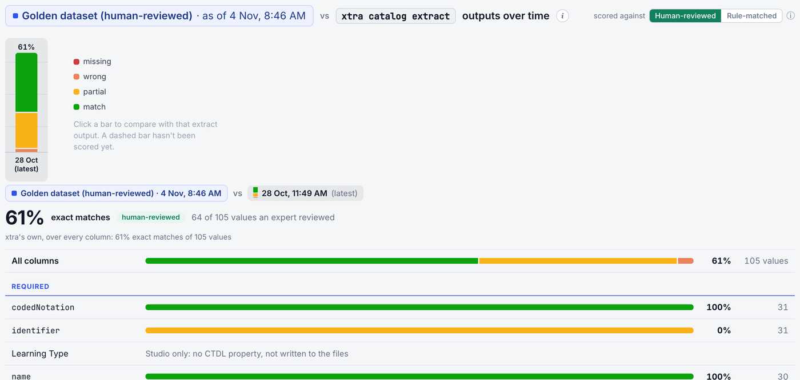
>
> 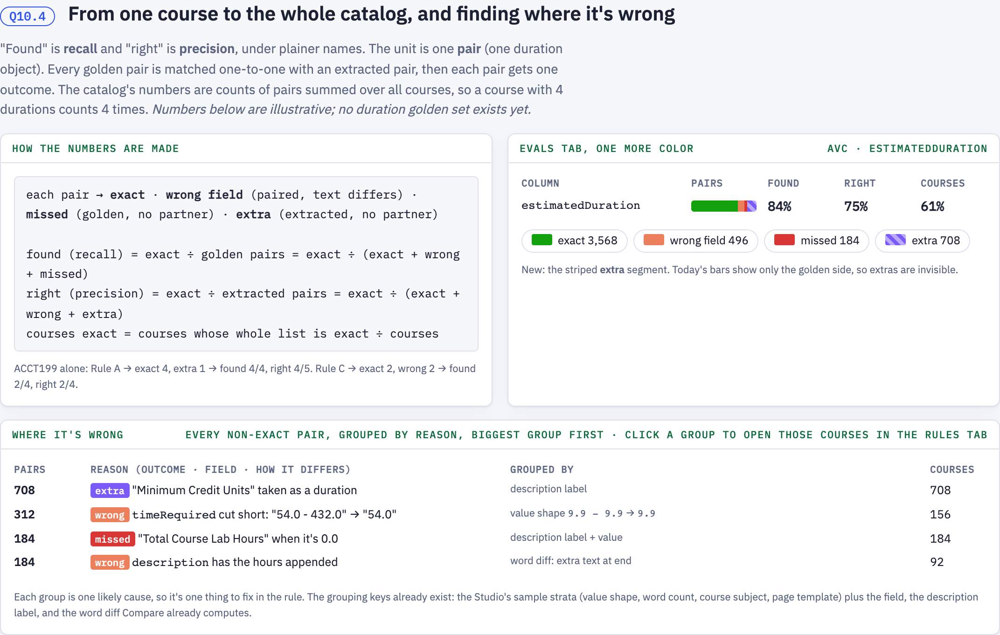
>
> **Q10.9** Label them "found (recall)" and "right (precision)" in the UI, or just "recall" and "precision"?
> **Default:** "found" and "right", with the statistical name in the tooltip.
>
> **Q10.10** Add the "extra" outcome and the "Where it's wrong" grouping to every column in Evals, not only
> Estimated Duration? **Default:** yes; extras matter for every property.

**Q10.5** What happens to the five existing child rules (`course-estimated-duration-*`) and their annotations?
**Default:** they're replaced by one profile-list rule per parent. Existing child annotations are shown as hints, not
migrated.

> **Pass 2 (Eric):** are there any annotations on those rules? Say yes or no. Doesn't know what these rules are or how much they've
> been used, so can't judge the impact.
>
> **Done (Claude), pass 3: no.** Nobody has annotated any `course-estimated-duration*` rule, in any catalog. The
> Credit Value children have 3 ✓ (Jared, ACCT199, today) and the parent has 1 ✗, Jared's, saying the parent should
> hold no flat value, only the Value Profile's fields:
>
> 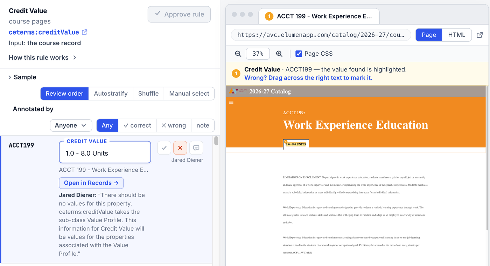
>
> So replacing the duration child rules loses nothing. The creditValue ✓s become hints.
>
> **Pass 3 (Eric):** didn't understand the question; restate it. Inclined to agree.
>
> **Done (Claude), pass 4, restated:** the Rules list has six Estimated Duration rules today: the whole block, its
> descriptions, its times, and Exact / Minimum / Maximum Duration (no rule yet). Proposed: one rule whose value is the
> list of {description, timeRequired} objects. The other five leave the list. Nobody annotated any of them.
>
> 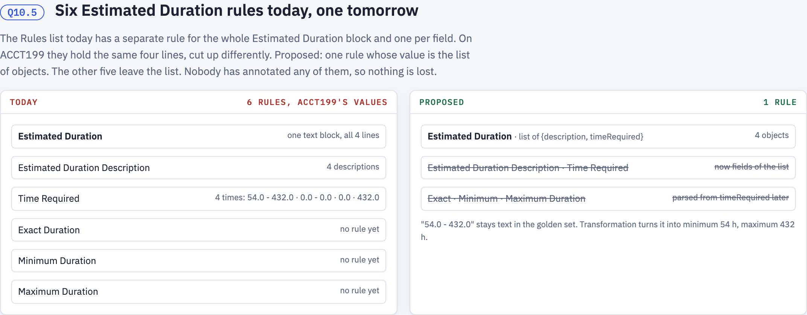
>
> **Q10.5b** Replace the six with one list rule, and leave Exact / Minimum / Maximum to transformation (parsed from
> the timeRequired text)? **Default:** yes.

**Q10.6** xtra-cli is out of scope (A3.16), but its scorer can't read profile values (wrong keys for ValueProfile,
and DurationProfile is dropped). Should the Studio get its own profile scorer for evals, with an xtra fix filed
separately? **Default:** yes.

> **Answer (Eric):** No. Propose the change to xtra-cli's scorer too: the Studio should keep using xtra-cli's scoring
> function.
>
> **Note (Claude):** that's right. Studio evals already call xtra's `score_extraction_match` as a library
> (`scores.py:311-317`; evals spec). The spec therefore includes an xtra-cli scorer change for profile values: pair
> profiles, then score fields, and read the CTDL keys the Registry uses. This makes an exception to A3.16 for the
> scorer only.

**Q10.7** The prerequisite / `requires` mismatch with CTDL: raise it with Jared and Seth now, or leave it to
transformation? **Default:** raise it now. It decides whether prerequisites become profiles at all.

> **Answer (Eric):** Needs a specific example.
>
> **Note (Claude), the example:** ATH103L's page says *"Prerequisite: Completion of ATH 100 and completion of or
> concurrent enrollment in ATH 103."*
> - **Our sheet** stores it as `ceterms:prerequisite>ceterms:description` = that sentence, plus
>   `ceterms:prerequisite>ceterms:targetLearningOpportunity` = ATH 100.
> - **CTDL** says a Course's `prerequisite` holds only a *link to another course* (ATH 100's record). It has no room
>   for a description.
> - **The Registry** writes the sentence as `ceterms:requires: [{ConditionProfile, description: "…"}]` (e.g.
>   WORKEXP-697).
> - So when prerequisites become profile objects, they would be `requires` objects, not `prerequisite` objects.
> - **Default:** keep the sheet's names for now (it's Jared's sheet), and bring this up when ConditionProfiles get the
>   profile treatment (phase 2 of item 10).

> **Pass 2 (Eric):** doesn't know what "mismatch" means here. Needs the same evidence: JSON objects and page snippets.
>
> **Done (Claude), pass 3** (`research/conditions.md`):
> - The page says "Prerequisite: Completion of ATH 100 and completion of or concurrent enrollment in ATH 103." Our
>   rules split it into `prerequisite>description` = "Completion of ATH 100" and `coPrerequisite>description` =
>   "completion of or concurrent enrollment in ATH 103."
> - **The mismatch:** in CTDL, a course's `prerequisite` can only be a link to another course. It has no
>   `description`. Jared's sheet treats it as a ConditionProfile (`properties.csv:65`). `corequisite`,
>   `coPrerequisite` and `entryCondition` really are ConditionProfiles, so they're fine.
> - It matters only at transformation (the sentence goes to `requires: [ConditionProfile]`). **Recommendation:** no
>   Studio change; keep the sheet's name and add it to the follow-up list.
>
> 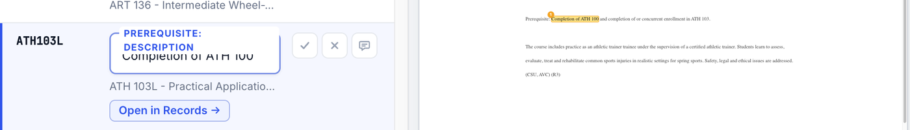
>
> **Pass 3 (Eric):** yes, no Studio change; it goes on the follow-up list. **And a correction** (written
> comment): `prerequisite>description` must hold the **full** text block, "Completion of ATH 100 and completion of or
> concurrent enrollment in ATH 103.", even though `coPrerequisite>description` repeats part of it. A wrong split at
> extraction would lose words like "and", which transformation needs to split correctly. Bias toward preserving full
> blocks of text. **Decided.**

## 11. Watching Claude, then finding its report

**What happens today** (`web/src/agent/RunBar.tsx:89-140`, `RunsPanel.tsx:63-100`):
- Watch opens a panel with live progress notes. When the run ends, that panel's title changes to "Finished" and shows
  the one-line outcome.
- The **full report** (`summary.md`: what went wrong, what changed, per rule) is only under *Past AI runs* → pick the
  run → report. The bar's *Details* button goes there too, but only after you close Watch.
- So someone who followed along has to close the panel and dig to find the report.

**Q11.1** When a watched run ends, should the Watch panel turn into the report in place (the report on top, a
Compare vN → vN+1 button, and the notes folded below)? **Default:** yes. See `mockups.html#fix-11`.

> **Pass 2 (Eric):** sure; show a mockup.
>
> **Done (Claude), pass 3:**
>
> 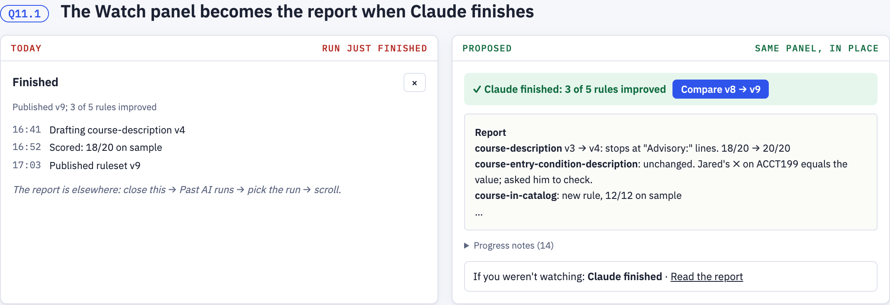

**Q11.2** If you aren't watching when the run ends, should the bar say "Claude finished · Read the report" with one
click to the same view? **Default:** yes, replacing *Details*.

> **Pass 2 (Eric):** yes. **Decided.**

## Bonus: an intermittent 500 in the new rule cache

- **Symptom:** `GET /annotators` fails with `KeyError: 'course-keyword'` at `review.py:75`. It shows up as an empty
  "Annotated by" list.
- **Cause:** `_Recent`, the per-rule LRU from #353, is used by request threads without a lock.

**Q9.1** Fold the fix (a lock) into this work? **Default:** yes.

> **Pass 2 (Eric):** explain it visually with a concrete example; no idea what this is about.
>
> **Done (Claude), pass 3:** it happened once in the available log (1 of 131 requests, 16:26:36Z).
>
> 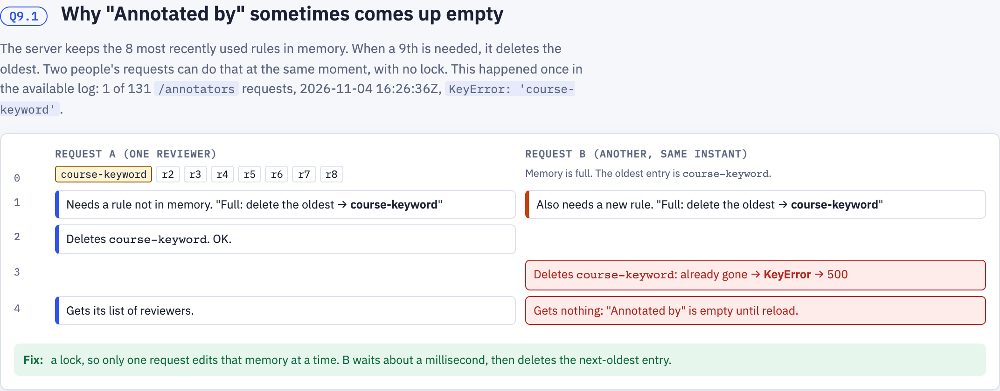

## 12. "Not on the page" as a positive claim (new, Eric, pass 2)

> **Pass 2 (Eric), an important new development:** sometimes a property simply isn't on a record's page. The rule
> tries to match it and finds nothing. Approving that row means the rule was **right that it isn't there**. So rules
> should make the positive claim "not on the page" instead of only "not found". Reviewers need a clear way to mark
> "not on the page for this record" in both cases:
> - the rule says "not found" (then a ✓ confirms the claim), and
> - the rule found something, but the property isn't on the page (then the rule is **over-eager**).

What this touches (to research in R):
- How the Studio shows a no-value row today, and how many annotations sit on such rows (`research/annotations.md`).
- Q1.4: a ✗ with an expected value on a no-value row (the opposite case: it *is* on the page, the rule missed it).
- Scoring: a golden "not on the page" plus an extracted value is a false positive; plus no value is a correct answer.

**Real today** (pass 3): Marshall WS483 has no description on its page. The rule says "nothing found", and Seth's ✓
is the only way to say "right, there's none". The log holds 17 annotations on no-value rows (15 imported ✓, 2 ✗), and
no note anywhere says "not on the page" about a found value (`research/annotations.md` §4).

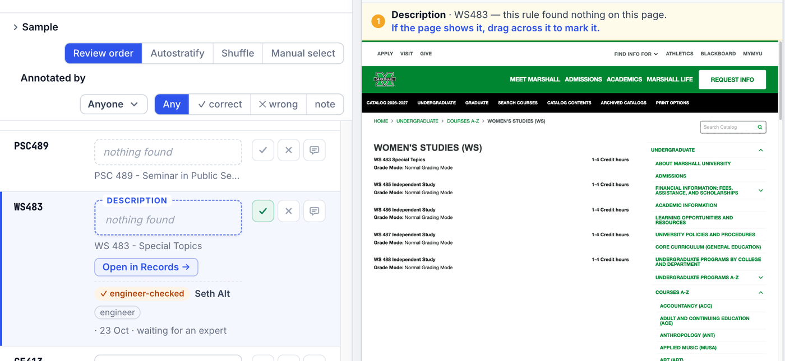

Proposed (case 2 is illustrative; no real case is in the log yet):

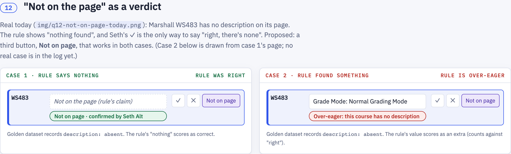

> **Pass 5 (Eric)** (`answers-pass5.md`): good direction, with changes.
> - No "Not on page" button. When the rule claims "not on the page", the reviewer just clicks ✓ to agree.
> - When the rule found a value that isn't on the page: ✕, which then reveals a flag saying why it's wrong; "Not on
>   the page" is one such reason.
> - Make the two rule outcomes explicit in the value's text: "not found" makes no claim (it may be on the page); "not
>   on the page" is a positive claim. Keep "Not on the page (rule's claim)"; show what "not found" would say. Is
>   "not found" a case to worry about? Eric: yes.
>
> **Done (Claude), pass 5:**
> - A rule ends one of three ways on a course: **a value**; **"Not on the page (rule's claim)"**, when it found the
>   place the property would be (e.g. the course block), checked it, and the property isn't there; or **"Nothing
>   found · the rule made no claim; check the page"**, when its selector matched nothing (today's `no_match`).
> - Today the engine has only `found`, `empty`, `no_match` and `none` (`engine.py:257, 426`); none of them is a claim.
>   A claim needs an explicit check in the rule definition.
>
> 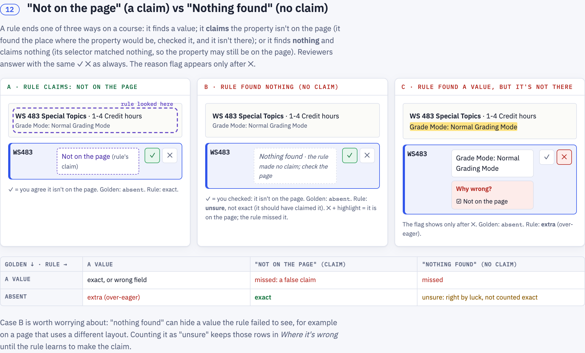

**Q12.1** Reviewers use only ✓ ✕. ✓ on a "Not on the page" row agrees with the claim. ✕ reveals a small "Why wrong?"
flag set; for now it has one flag, **Not on the page**, with a tooltip. **Default:** yes, as drawn.

**Q12.2** A rule claims absence only through an explicit check Claude writes into the rule (for example: "the course
block was found and has no description paragraph"). Anything else that matches nothing reads "Nothing found (no
claim)". **Default:** yes.

**Q12.3** Scoring, golden vs rule: absent + claim = exact; absent + value = extra (over-eager); absent + nothing found
= **unsure** (not counted as exact, listed in "Where it's wrong"); value + claim = missed (a false claim). The golden
dataset records absent properties explicitly. **Default:** yes, as in the table in the picture.

## Follow-up questions for Jared, Seth and Sneha

Things Eric wants to raise with the SMEs and engineers, collected as they come up.

1. **ACCT199's "Minimum Credit Units 1.0"** (from Q10.4): it sits in the "Units and Hours" card with the duration
   lines. Claude reads it as a credit value (`creditValue`), not a DurationProfile. Confirm.
2. **Item 10 vs Seth's 2026-11-02 decision (A3.13):** profile objects for Duration and Credit Value move pairing out of
   transformation and into extraction. Seth to confirm, or say what should stay deferred.
3. **Item 12:** is "not on the page" a separate verdict for SMEs, and should the golden dataset record absent
   properties explicitly?
4. **`prerequisite > description`** (from Q10.7): CTDL's `prerequisite` on a Course is a link to another course only.
   The sentence will have to be published as `requires: [ConditionProfile]` at transformation. Jared to confirm the
   sheet's name stays; Seth to note it for transformation.
5. **Jared, ACCT199 Entry Condition: Description** (Q1.5): the value is exactly the LIMITATION ON ENROLLMENT paragraph,
   and the 16:30 ✗ has that same paragraph as its note. Intended, or meant as ✓?
6. **Seth and Jared, full text blocks** (from Q10.7, pass 3): extracted values keep whole blocks of page text even when
   that repeats text (ATH103L's full prerequisite sentence). Splitting happens at transformation.
