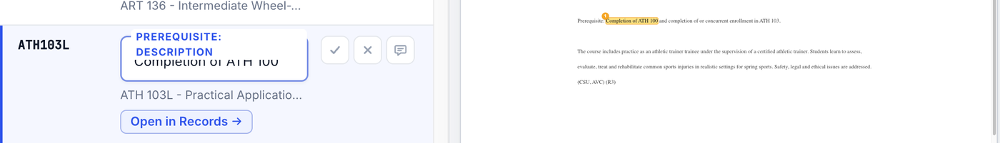

# Research: prerequisites, conditions and which properties need a list of objects (Q10.2, Q10.7)

Done on 2026-11-04 for Eric's pass-2 questions. Values come from the live extraction (ruleset v8 for AVC, v6 for CCSF and
Marshall). CTDL comes from the Credential Engine Schema-Development repo (2026-10-05). Nothing was changed.

## Only Estimated Duration needs a list of objects today

Count of courses whose rule found **two or more** values, per property (all rows, not a sample):

| Property (rule) | AVC (1,062 courses) | CCSF (1,927) | Marshall (6,692) |
|---|---|---|---|
| Estimated Duration: Description | **1,062** (all 4 lines) | **383** (e.g. OH53A: Lecture, Lab) | 0 (none found) |
| Prerequisite: Description | 0 of 349 found | 0 of 570 | 0 of 2,142 |
| Corequisite: Description | 0 of 50 | 0 of 83 | 0 of 191 |
| Co-Prerequisite: Description | 0 of 58 | 0 of 94 | 0 of 173 |
| Entry Condition: Description | 0 of 201 | none found | none found |
| Credit Value | 0 of 1,062 (always one) | 0 of 1,927 | 0 of 6,692 |

So:
- **Estimated Duration** is the one property where a course has several objects, and the description and time must
  stay paired. This is what Jared hit on ACCT199.
- **Credit Value** is always **one** object (min, max, unit). It needs grouping (Jared's ✗ on the parent says the parent
  should hold no flat value, only the ValueProfile's fields), but never pairing across several objects.
- **Conditions** (prerequisite, corequisite, co-prerequisite, entry condition) are one statement per course on every
  catalog we have. A flat `description` plus a flat list of target courses loses nothing. This matches Seth's
  2026-11-02 view (A3.13) and Eric's pass-2 "agree with Seth": keep them unstructured, the raw text in `description`.

## Q10.7: what "the prerequisite mismatch" means, with ATH103L

**The page** (AVC, ATH103L, Practical Applications of Athletic Training II Lab):

> Prerequisite: Completion of ATH 100 and completion of or concurrent enrollment in ATH 103.



**What our rules extract today** (flat values):

```json
{
  "ceterms:prerequisite>ceterms:description":   "Completion of ATH 100",
  "ceterms:coPrerequisite>ceterms:description": "completion of or concurrent enrollment in ATH 103.",
  "ceterms:prerequisite>ceterms:targetLearningOpportunity":   null,
  "ceterms:coPrerequisite>ceterms:targetLearningOpportunity": null
}
```

**What CTDL allows on a Course** (property → what it may point at):

| Property | CTDL range | Has a `description`? |
|---|---|---|
| `ceterms:prerequisite` | **Course only** (a link to another course record) | **No** |
| `ceterms:corequisite` | ConditionProfile | Yes |
| `ceterms:coPrerequisite` | ConditionProfile | Yes |
| `ceterms:entryCondition` | ConditionProfile | Yes |
| `ceterms:requires`, `ceterms:recommends` | ConditionProfile, Course, credentials, competencies, … | Yes, through ConditionProfile |

**The mismatch:** Jared's sheet treats `prerequisite` like the others, as a ConditionProfile with a `description`
(`properties.csv:65`, profile class column = `ceterms:ConditionProfile`). In CTDL, `prerequisite` can only be a list of
course links, so this is not valid CTDL:

```json
{ "ceterms:prerequisite": [ { "@type": "ceterms:ConditionProfile",
                              "ceterms:description": "Completion of ATH 100" } ] }
```

Two valid ways to publish the same sentence:

```json
{ "ceterms:prerequisite": [ "https://credentialengineregistry.org/resources/ce-…ATH100" ] }
```
(keeps the link, loses the sentence)

```json
{ "ceterms:requires": [ { "@type": "ceterms:ConditionProfile",
                          "ceterms:description": "Completion of ATH 100",
                          "ceterms:targetLearningOpportunity": [ "https://…/ce-…ATH100" ] } ] }
```
(keeps both; this is what published courses in the Registry do, e.g. WORKEXP-697)

The co-prerequisite half is already valid as extracted, once it's wrapped in its ConditionProfile:

```json
{ "ceterms:coPrerequisite": [ { "@type": "ceterms:ConditionProfile",
                                "ceterms:description": "completion of or concurrent enrollment in ATH 103." } ] }
```

**Why it matters (or doesn't) for the Studio:** it doesn't change what reviewers mark. The golden set keeps the page's
words under the sheet's name `prerequisite > description`, as Eric said. It only matters at transformation, where
`prerequisite > description` has to become `requires: [ConditionProfile]` (or course links). Recommendation: no
Studio change. Add it to the transformation notes and the list for Jared and Seth.
