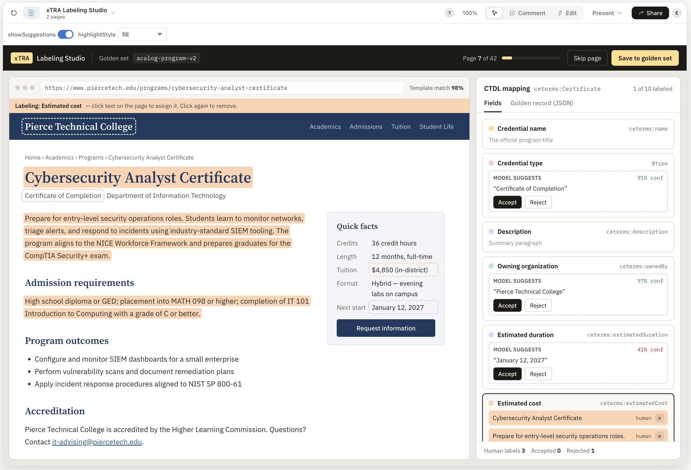
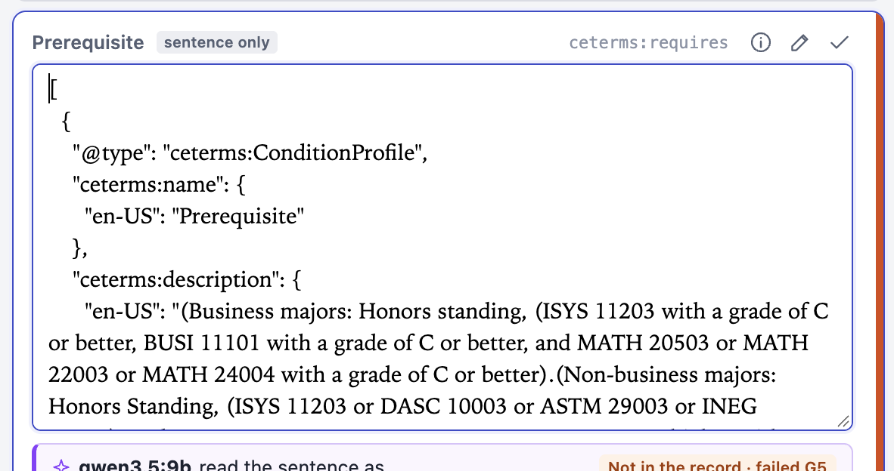
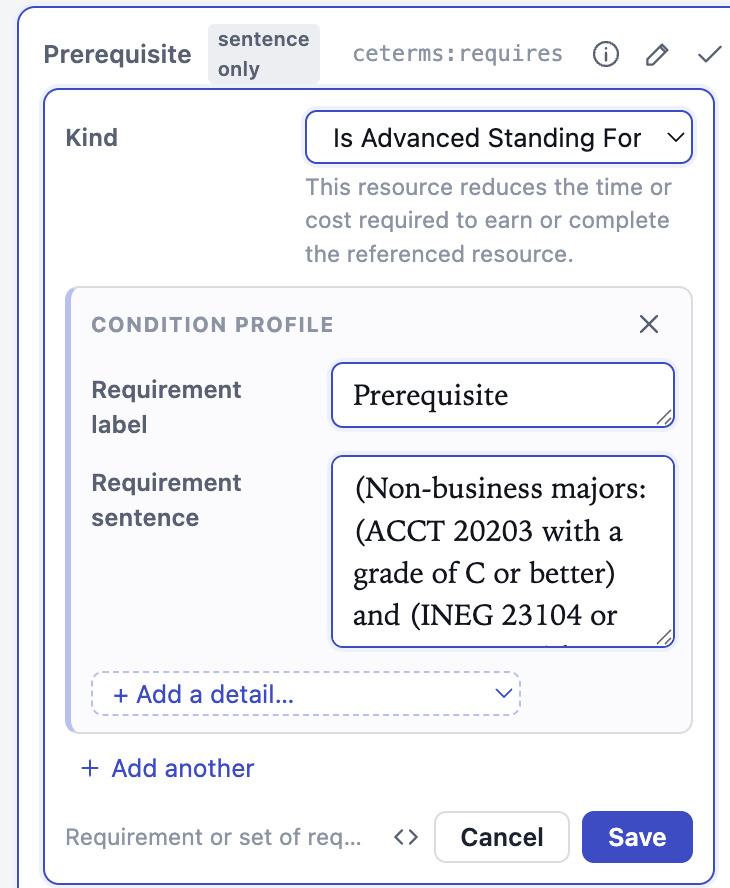

# Every input, verbatim

Eric's messages to Claude Code while making the xTRA mockup, in order, exactly as sent (most were dictated by voice, so expect transcription errors such as "CDTL" for CTDL and "crispy" for QRSPI). Generated from the session transcripts; automated messages and Claude's replies are left out. Times are US Central.


## Session 1: questions and research

### Wed Oct 7, 3:14 PM

```text
<https://catalog.uark.edu/undergraduatecatalog/coursesofinstruction/>

Please start from this page and extract into valid CTDL (credential transparency definition language) objects the courses. 

You'll need to involve a web scraper for phase one. That's fine.

Then you'll need to, based on sections of the doc, e.g. based on predictable patterns and locations such as is matchable by regex, locate key fields and extract them.

Some fields may be ambiguous and not discoverable by a rule. For those, use a local ollama-served model or other probabalistic means.

But a KEY THING is for any extracted piece of data, I want you to remember the exact regions of the page (highlighted bars) where that piece of data came from. I want you to build a mini web app that shows the "source documents/pages" on the left, and the "extracted json ld" on the right. If I click on any of the fields in the JSON object, 

1. it should scroll me to the location in the source document with highlighted region where that piece of data was taken from

2. AND it should provide the reasoning, e.g. a description of the deterministic rule that matched the location for extraction or a snippet of AI reasoning, citing the CTDL definition and making an argument / providing rationale as to why this snippet of text (or multiple snippets of text) from the source documents satisfies this requirement.

Follow Q.R.S.P.I. for this. Begin by generating a list of questions to expose presuppositions, clarify, and discover facts about the world.
```

### Wed Oct 7, 3:27 PM

```text
[pasted text follows]

Alright, I'm gonna go through your questions one by one. Number one, what does valid CTL mean here? Um It's the it is well formed JSON LD using the real C T DL terms and you can probably find example JSON LD objects. In fact, you should do you should find a concrete example of a JSON LD object uh from credential engine for this. And you also said meeting the credential registry's publishing requirements for a course. I I like your default. I like what you're saying about targeting the required and recommended properties and validating against a published CTDL schema without publishing. that's exactly right. Is each catalog entry a CE terms course? The alternative is more generic. Um I'm not sure. I think it's a course, but you tell me. Um I'd like you to make a case for that. Okay, number three. What about required fields? The page does not contain these are the CTID owning organization, language, lifecycle status. Um do your best to actually discover those Yourself. So do not just assume them. Try to actually look them up. Okay, number four. How much do I scrape? Default. All one hundred and sixty-eight subjects from the deterministic stage cache to disk at about one request per second. The LLM stage runs three to five subjects first because a nine B local model over thousands of courses could take hours. Um Um I want you to have two separate steps. Like the first step is gonna be a crawling step, which uh can run on some number of pages, and we should keep some sort of lookup information so that we idempotently so that we don't re fetch pages and documents like PDFs and images more than once because we don't need to put unnecessary load. And the the any extraction operations, like rules or model calls, should be made against data from the cached set of files. For now, do not well create this such that we could run it over all 168 subjects, but for now, let's just pick a a small subset of those. I like what you're saying. Three to five subjects first. Five. How structured should prerequisites be? The example is nested, Walton majors, A, B, and C or D. Non-business majors, default, capture the verbatim text, post the link to I don't know enough about CDTL to know what the trade offs are either way. I need you to tell me. Okay, number six. Can the source pane be a local snapshot? I can't inject highlights into the live page inside an iframe. Default render the scraped HTML from disk restyled minimally with highlights anchored by character offsets and link out to the live URL. That sounds great. Just make sure that you come up with a way to do that reliably, because different sites may have JavaScript or something. Some sites may be auth protected as well, so I like this idea of just showing it a similar version. It would be good if we could preserve style and formatting to the best of our ability though. And yes, link to the original as deeply as possible in the different sections, at least for the highlighted regions that we extract, so that uh to to maximize how traceable and verifiable this all is. Also, I'm gonna comment I'm gonna call this out because it just occurred to me. Uh save the questions and my answers to these questions in a markdown file in a folder called QRSPI. And do all this work in a repo in the repos folder called mock X T R A actually call it X T R A mock up Okay. Um Seven. Yeah, go ahead and use the Quen three point five nine B model because structured JSON output. Um and yes, verify that it's verbatim quotes are real substrings of the source. Um Uh and I'm saying yes to the this particular model just because I already have it installed, not necessarily because it's good. Um okay, eight. What stack? Default. A Python pipeline run with UV, yes, emitting static JSON. Yes. And a small VT plus React viewer with no back end. Yes, that's great. Nine, should the viewer support review? That would mean accepting, rejecting, or correcting a field. Default read-only for V1. Yes, for V1 we'll do read only. And I'll capture this here that in the future th this is exactly right, I do want um I do want them to be able to accept reject or correct in a later version. And I also want them to have the ability to annotate why they're doing the correction that they did. Like where they think we went wrong. Okay Okay, for 10. Oh, and then sorry, another note on nine is I want them to be able to have a streamlined and structured experience for this, like maybe tabbing through field by field by field. And uh so so that they can easily annotate and move on. Okay, 10. Is this a one-off or a U of A? Is this a one-off or U of A? If it should generalize other course leaf catalogs, I'll keep the rules as declarative in the registry rather than inline code. Um Well, I think having a declarative registry is nice. Eventually we will generalize this, but don't think about generalization for now. Right now I just want you to think about this one site. Um but having rules as a declarative registry, I think is a good call, even though we're doing this as a one-off. I think that will help for readability. Okay. Now moving on to questions I'll answer in research. 


 


[pasted text follows]

Okay, CDTL, the exact domain, range, and definition text for each candidate property pulled from the live schema so that the reasoning panel quotes real definitions. Good. The registry is minimum required set for a course. Good. Whether credit value should carry semester hour units. And which concept schemes cover offer frequency and delivery type. Good. Whether Act S equivalency equals ACT 2003. I don't know what that means. That's fine. How co-requisites cross listing same as yeah, I don't know what that means either. Yeah, honestly. This is making me realize that I'm an I'm a novice to CDTL. I mean, I understand that it's a data model through representing credentials and learning programs, but there's but I that's that's the ex that's the extent of my knowledge. So anytime that the definitions can provide an example of what the different values might be. Uh and maybe links to all your options. That would be a good thing. To help the human understand what they're doing here. Because we essentially want the humans to be like this this exercise is allowing the humans to correct and it's also teaching the humans and helping them become even more expert themselves. And that's a theme that I want to capture. Um for let's see, how many source data? How many title line variants exist across 168 pages. Yeah, I don't know what that means. Which labeled sentences occur in description, prerequisite, co-requisite, pre-corequisite. I don't know what that means either. Which fields are truly rule resistant and need the LLM? That's a great question whether the course codes encode level or credits the last digit 20103 looks like credit hours okay good good good good 


 go and do all this research and capture your findings in a research markdown document in the crispy folder that I told you to create.
```

### Wed Oct 7, 3:40 PM

```text
Save my original prompt for all this in crispy as well in a thing called prompt and rename the folder so that it's lowercase.
```

### Wed Oct 7, 4:36 PM

```text
[pasted text follows]

Okay, I'm reading through the research now. Um all right. Research findings. Phase two. Okay. Headlines. Each catalog entry is a CE terms course. The class definition fits. The catalog zone wording fits And forty-eight thousand courses are already published in the registry under that type. Okay, I'm interested to see how you know that. Because I'm a little bit skeptical since you didn't cite a finding there. All right. Um okay, the university number two, the university of Arkansas is already in the credential registry. Uh f fantastic. Okay. It has published 298 credentials, degrees, and certificates, and zero courses, so no CTIDs exist to refuse. Okay. That's good. And we to reiterate, we definitely don't want to publish what we're about to do because we don't know how valid it is. Okay, number three, six properties are required to publish a course. The page supplies two directly. Name and description are on the page. Six properties are required to publish, of course. Name and description are on the page. Okay. Language, life cycle, status, and owner can be evidenced from the pages and the registry. Um, yeah, I'm okay referencing the registry. yeah, I'm okay referencing the registry. Okay. The C T ID has to be minted section six. that's fine. Four almost everything on the page is extractable by rule all five hundred and forty-six title lines in the five sampled subjects. Sorry, going back to when you said the CTID has to be minted. Try to f try to follow to some degree domain driven design and keep that CTID minting th process as pure as you can, or referencing the bare minimum number of objects as you can. The way that services, I believe, are intended to work in domain-driven design. And how how rules are implemented there. Don't go too overkill with the abstractions in domain driven design. I'm just saying I want it to I want thought to have gone into the organization there. Okay, four. Almost everything on the page is extractable by rule. Okay. All five hundred and forty six title lines have the f have in the five sampled subjects fit one pattern with three variants, offering term, co-requisites, repeat rules, cross-listing and equivalent Okay, great. Five. the one hard field is pre re prerequisite logic. Real publishers do not attempt it. In a sample of one thousand published courses, every prerequisite was plain text. Section nine lays out the options. Okay. Yeah, because I don't want to give up on prerequisite logic. I want to make sure we do that Reasons unreliably Okay. About two point four seconds each, but it mislabeled and As or and invented course codes. Substring checks catch fabricated text but not wrong logic. That's great to know. Great to know. Number seven, credential engine has a public repository, a CDTL extra for this same job. I listed the files but did not study it. I would like you to study it actually. Okay. Number two, where the facts came from. Ct D L source schema, all classes, properties, concepts, schemas. Okay. But this was also all available on official CDTL web pages as well. I worry that Credreg might be out of date. Minimum data policy internet archive copy of Credreg.net Okay, CTDL handbook, Internet Archive Copy, Captured twenty twenty-six. Okay, credential registry records live from credential engine registry. Great, okay. Catalog pages. Um live from catalog.university of Arkansas.edu. That's great. That's great. Local model. Excellent. Okay. Not verified. I could not load cred or credentialfinder.org live. So this Okay, I can get you something. Oh, actually I'm sorry, Credreg actually is the is the correct site. So good job. Um I have a page called terms. But you're you're probably fine with the one that you downloaded. Just make sure you call that out visibly in in a final report somewhere that we had this concern. Okay, CDTL in five minutes, CDTL uh credential transparency description language is a vocabulary for describing credentials courses organizations and how they relate. It is written as JSON L D, which is ordinary JSON with a view reserved key Term class a kind of thing it goes in at type Property a fact about a thing, a JSON key. Domain and range, which classes may carry a property, which value it takes, credit value is allowed on a course and its value must be C term's value profile. Okay. Concept scheme a fixed list of allowed values. Credit union scheme contains credit union semester credit unit semester hour, credit unit quarter hour and thirteen others. Okay. All right. C T I D. All right. Language map. Text values are wrapped by language. Oh, interesting. Okay. Interesting. Profile A small nested object that groups related facts. The wrapper used to pick a value from a concept scheme. Wow, that does not make sense to me. There's a lot of abstractions here. But I can appreciate that it probably reduces the total number of tables. So we'll look at that more later. Okay, number four: the case for CE terms course. The definition fits. Single structured sequence of one or more educational activities that aims to develop a prescription The catalog says the same thing in its own words. The index page states the word course refers to a unit of academic instruction. While the word class refers to a course that has been scheduled during a semester or summer session. Nice. Excellent. Okay. So a catalog entry is the durable unit of instruction, not a scheduled section. That is the CTL CDTL course. Okay. Okay. Excellent. Number five. Discovering the fields the page doesn't state. You asked me to look these up, not assume them. Results. The University of Arkansas has a registry record. Excellent. Beware near misses in the registry. There are separate records for University of Arkansas, Little Rock, Fort Smith, Pine Bluff, Monticello, Grant them. Grant them. Good to know. Okay, core C T I D is not exist. I fetched all two hundred ninety-eight resources the university owns their degrees and certificates. So the C T IDs must be minted. The handbook defines a CTID as a UUID V4 prefix with C E. Um. Because UUID V4 is random, the only way to be idempotent is to mint once and remember a ledger file keyed by organization and course code. Rerunning extraction must never produce a new CTID for the same course. Agreed. The schema note on CE terms. CTID adds a wrinkle. Different versions of the of a resource are considered distinct expressions and each must be assigned its own C T I D Whether a new catalog year is a new version is a policy question for the publisher, not something the page answers. Interesting. Add a follow-up question to that. What does credential engine recommend as far as when a publisher should consider it a new course or not. Because surely they have an opinion on on what to recommend for that policy and the opinion must be based in actual trade offs. Like what do you get if you do it, or what do you lose if you don't? Okay, language evidenced not stated. Every page declares laying English, the course text is in English, the schema's own usage note covers edge cases. A course offered in English to teach Spanish would have an in-language of English. So that must be instruction language. So Arabic, Chinese, or French courses in this catalog are still EN. great. Oh, in it's not it's not instruction language. Well I guess it is, but that's just a coincidence that instruction starts with IN. It's just the course is taught in the language of English. Okay, published courses use CE terms in language E N. All right, life cycle status, evidence to not stated. Okay. Um pages are labeled twenty twenty six twenty-seven edition. The current catalog. The index says the listing is of all courses approved for the offering. All right. Okay. Course title lines say three hours without saying what kind. Successful completion of a class usually earns a specified number of semester hours of credit towards a degree that justifies the credit credit unit sister hour. That's great. Yeah. This is a great insight that the evidence for one field can sit on a different page from the course itself. that's definitely going to be true. And so that probably means we have to display multiple previews. What the registry requires for a course from the minimum data policy, note that every course row is now marked pending policy. The course specific rules are published. Okay, I'm looking at the property. Yeah, I'm going through this one by one. So required, we've got name, description, CTID, in language, life cycle status type, owned by and offered by. So great. And I'm curious to know more about owned by and offered by recommended and present in this catalog coded notation course code in the title line, credit value, three hours in the title line. Great. Subject web page, the subject page URL in catalog the catalog URL prerequisite co prerequisite audience level type Derivable from course number Learning Method type. Okay Okay. Lecture three hours a week, lab or some entries. Okay, good. Good to know. Good to know. Date effective, not on the page. Also recommended, but absent from this catalog delivery type, cost, duration, financial financial assistance, occupation and industry types, assessment methods, competencies taught, accreditation accreditation. All right, a real published course. This is a live registry record from Brookdale Community College, unedited. It is the closest analog I could find to these ACCT courses. Saved, all right. So we've got ID. Great. C E I see that now. Resources, okay. Type CE terms course context Credreg.net all right C E terms Awesome. C terms owned by Credential Engine Registry dot org. Okay, requires Prerequisites Math O one two, Math O one five, or satisfactory completion of colleges foundational studies requirement in computation. This is interesting. So this is a ground truth example. The reason I'm confused is this requires element is describing Multiple things and there's options between them. I would have expected one entry in the C E terms requires list per course. So what's that about? Could this be expressed more granularly in uh in uh C T D L should it be and can it be? Okay, C E terms in language EN Great. The class is taught in English. C E terms, credit value. Actually going back, I'm I f I find it interesting that that's a array. So there could be multiple multiple languages in there. Would that mean that one course alternates between two languages being taught, or does it mean you can select whether you want the English version or the Spanish version and so on? 


 


[pasted text follows]

"Okay, credit value value profile schema value three CE terms credit unit type the type is credential alignment object Okay. Framework, credit unit, target node semester hour framework name credit unit target node name semester hour target node description credit that is issued or accepted at a semester level. Okay. Description An introduction to basic concepts and principles. Of recording and posting financial information. Coded notation. Okay, nineteen ninety-nine oh one oh two. Wow, what does data effective mean? Okay. Um nice, so that's their course ID. Great. One thing I'm noticing is for example the schema value is expressed sorry, the the credit value is expressed as a list you got an array and one of your objects in the array is value profile and I have a couple questions as a non-expert to C T DL, which is why is there only one entry in this list? Why not multiple? What would it mean if there were multiple? What does it mean that there's only one? Why is it why is this one object a value profile specifically? Um Um these are all questions about the schema and about edge cases. And I think that a tool should whenever one of these choices is made, I think we also need to have the rationale of why each of these values was used instead of alternatives. And that's just to help us learn the schema. Okay, um C terms description All right, an introduction to basic concepts and principles of recording and posting financial information. great. All right, moving down. Life cycle status type. It's active raise target and description. Resources active current. Okay, great, great, great. All right, things to notice. The prerequisite is text only inside a condition profile. Yeah, yep, did notice that. Okay. I find that odd and unjustified. Um next thing. Variable credit uses schema min value and schema max value in in place of schema value seen in other records. I didn't notice a variable credit Oh, I see. The way you said that here didn't make sense, but I think with some more clearer wording, this would actually be a good note to have on to teach people about the schema in line. Okay. Catalog years carried in CE terms, version identifier. The concept scheme values repeat their own label and definition in line. That's handy for teaching for the teaching UI. Um Um yeah, that's that's good. Okay, what publishers actually populate? Property usage across a thousand published courses, caveat. The sample is the first one thousand Of which owns six hundred and ninety-one records, treated as indicative. Okay, cool. So Oh wow, they don't list the prerequisites, co-requisites, co-prerequisites, or offer frequency type at all. That is shocking to be, honest. I find that kind of irresponsible. Okay, what is on the page? Scale and shape. The index links 168 subject pages. The five samples hold five hundred and forty six courses. My earlier figure of one thirty eight for ACCT was wrong. I'd counted markup occurrences. Okay. Title lines, yeah you got the subject number, the name, optional transfer tag. Great little diagram. I love this diagram. Okay. And there's these variants. Terrific. I'm gonna skip reading the rest of this. I don't care that much All right, labeled sentences and descriptions. Lots of different shapes. Okay, yeah, locating it, yes, understanding it. Okay, uh I'm fine with that. Corequisite, half of them, forty-two are a single course code, the rest include pros, lab component, related course component, drill section. Great. Yeah, I love that you've thought of these rules. Okay. Pre or corequisites mostly typ tookicallyly offered yes fully. Course codes and side descriptions are hyperlinks, nine twenty one of them across Prerequisite sentences split three ways. One ninety two contain the word or Okay. Which fields truly need a model? Only two prerequisite logic andor grade population structure Nice. Okay, I'm a fan of that. Choosing a concept scheme value when the page's wording doesn't match the schemes. For example, mapping. Typically offered fall even years to a schedule frequency concept. Even this is a 12 row lookup table for this site, so a rule may serve better than a model. Um I'm open to attempting a rules-based thing. We just need a way to evaluate it. Also, by the way, when you said model, you confused me because model can mean a couple different things. I see you meant machine learning model. All right. Nine. Prerequisites, the options and their trade-offs. What's the CTDL offers requires Okay. Um, this is all fine. It's all fine. Prerequisites, the options in their trade offs. Um, great. I'm gonna skip down to the provenance and source pane. Anchoring means recording where on the page the value came from robustly enough to find it again. Yes. The W3C web annotation standard defines two selectors that are normally stored together position and quote storing both lets one verify the other if the text at the stored offsets no longer equals the stored quote. The anchor is stale and that is detectable. Yeah, sounds great. Um they need a fixed definition of the page's text because the crawl stores raw bytes for each page. Yep, sounds great. And I think computing a digest of the pages would also make sense. Okay, evidence shapes the data model must handle. The word shape was confusing here. Found in this research each with a real example. One span. Of course name from the title line. Several spans on a page prerequisite sentence plus hyperlinks inside it. A span on a different page semester hours markup not visible I would be careful not to call it a span unless you actually need an HTML span. Otherwise it would be confusing. If you need an HTML span, go for it. Otherwise, maybe call it a segment. Or even better, a text segment. Okay, markup not visible text Yeah, that's a good point. It's not visible. Oh, that's a great point. Yeah, you'll we'll definitely need to think of a way to to make that visible. Um Maybe we should have a way to toggle between an HTML DOM tree view and a rendered view. I think that would be really good. Okay, an external record, the registry record for the owning organization. Derived from another value. Level from the first digit of the course number, no source at all, the minted CTID. Okay. Derive from another value. Yeah, that's great. An external record also great. We're gonna want ways to to surface all of those. So this is such a good list. This is the best. This is so valuable. Amazing Okay, for reproducing the page faithfully. For this site, saving the RA HTML is enough. Content does not depend on JavaScript. Okay, good. Style but but do make a note that that could be an issue in the future. So in the past, when I've said make notes, uh let's define where that should go. Uh make us make a document called risks and future considerations. Okay. Uh the page loads eight scripts. They should be stripped from the rendered copy. Yes. Okay. Don't mind that at all. I don't mind stripping the eight scripts. Um for JavaScript heavy or login protected sites, not this one, the usual technique is to capture the page after rendering in a real browser and inline its styles into a single file. Not needed now. Awesome. Linking back to the original courses have no anchors, so two mechanisms are available"


 


[pasted text follows]

"Okay, linking back to the original. Courses have no anchors, so two mechanisms are available. Number one is text fragments, a URL, ending in this. Makes current browsers scroll to and highlight the text on the live page. That's amazing. If that works, do that. This gives a deep link per highlighted region with no cooperation from the site. Yes. That's amazing. Per course page. Shows a single course. Find for a human to click. The crawler must not fetch it. Uh I don't know what you mean by that. Local model probe. Task turn a prerequisite sentence into alternatives and requirements, giving an exact supporting quote for each. Fifteen real sentences, ten of them long. Falla Jason, fifteen, quotes the match, thirty one, median time percentage, great sentences Awesome sentences with something invented or misplaced in the code field. Yeah, I I love all these measurements here Yeah, these are really these are fantastic metrics. Okay. I read for outputs closely to had the logic wrong. Yeah, that's I mean that's good to see. Um don't really know what to do about this just yet. And we don't necessarily need to worry about how good the model is right now. We'll just plug in any model and we can ev further evaluate it and improve it later. Okay, verbatim quoting is reliable enough to build on a substring check is necessary but not sufficient. Okay. A cheap deterministic cheap deterministic guards catch a lot. Every course in the output must appear in the input. Great. At 2.4 seconds each they di all take they would take about 15 minutes. Sample size is 15, and I checked the logic by hand on only four. This is a signal not a measurement. Fine. Terms that came up. Acts, the Arkansas course transfer system, the state's list of courses guaranteed to transfer between Arkansas Public Institutions. Next equivalency. Says this course is the university's version of statewide course ACT two oh three, okay. Fascinating. C D T L has Transfer value profile for describing transfer credit formally as a separate heavier record that the state would own. And I have no I and I found no ACTS records of that kind in the registry. Okay. Corequisite a course that must be taken in the same term. Okay. Pre or co-requisite may be taken before or alongside. Okay. Cross listed as one course offered under two subject codes. Okay. In this catalog, it mostly pairs a course with its honors twin, same options as cross listing. Okay. Maybe repeated for up to n hours. Okay. CDTL has no property for that. It stays in the description. Worth servicing. Yeah, fascinating. Okay. Typically offered the terms, a course runs. Sure, course level, that's fine Schema freshness fine. Pending policy fine. Unresolvable links. What to do with references to courses outside the scraped subjects. Fine. Catalog gear and CTIDs, whether a new edition means new CTIDs is the publisher's call Description boundaries. Fine. Name format. Yeah, all very interesting. Glad that we're not addressing that I'm glad that we're saying that those are out of scope for right now. Okay. Files saved alongside this document. Great. Okay. This has been it's been great to read this report. Um think of a way that I could efficiently uh because what I've done here is I've read a lot of this markdown document out loud. If this were a Google Doc or a Notion page, I would have wanted comments to be created on this doc. So based on the part that I read, I'd want you to inject comments. Um think of a way to represent something similar to that, still using markdown, where the markdowns would render successfully in the GitHub viewer and the VS Code viewer as well. Because I want to capture all those things that I said and any areas where I had follow-up questions. Um Um beneath like imagine that you're doing a follow-up comment, so you're respond you're replying to my comment, and I want you to answer any comments that I made that should be responded to as a reply."
```


## Session 2: specification

### Wed Oct 7, 4:45 PM

```text
We're doing QRSPI from the prompt. We're moving on to the specification. Please draft the specification. Including a mock up of different areas um and rep reference parts of the mock-up as screenshots or SVGs directly in the markdown doc so that the whole thing is readable from the markdown dock
```

### Wed Oct 7, 5:12 PM

```text
[pasted text follows]

Okay. This looks really exciting. I will say the whole mock-up looks a bit busy. Is there a way we could better utilize progressive disclosure to make it so that the user isn't so overwhelmed by things to look at when they first get on here. Maybe what you're showing for this first screenshot is after the user's clicked on a bunch of things. If that's the case, then great. But I would want it to look a lot more bare before they click on things. Maybe instead of a c button you could do a little copy icon in the top right or something. And I think you could just find ways in general to reduce the busyness Okay, I'll go through the decisions made in this phase. The research choice is left open, each is settled here so the plan can proceed. Decision one, each catalog entry is a course, yes. Name is the bare name, the code has its own property. That's fine. Okay, decision three description is the whole description, paragraph, word for word, including the labeled sentences confirm. Um you know for a lot of these I'm just yeah, I'm I'm not gonna answer that just yet. Um Your example shows fixed minted placeholder rule and lm. I suppose that's fine. Okay, I'm looking more and more at things. I think this just needs more progressive progressive disclosure. There's so much information you're throwing at us. All at once. Maximally verbose version, like I would love to have that option, but beginning with that is way too much. And I think there's an in-between. I think uh a toggle Instantiation of a class it would be nice to have um I imagine a a linear experience where um verifiers go through an outer loop verifying each course and other um resource one at a time. And for each of those, the inner loop is they tab through each of the values and resource type choices that were made. With the option to focus on judgment-based ones like the ones that came out of a language model. But of course, our rules might be wrong too. But our rules are likely less likely to be wrong. And sometimes it's the value of the field that we're verifying, and sometimes it's the choice of field. Like we're we're trying to defend why we used that field over alternative other fields there. I want you to react to each of these and regenerate the images and regenerate the text here in the spec. By the way, I I also want you to make a way to unfold all fields in the JSON LD. The acceptance criteria looks great. Make these updates. Oh hey, also make it more clear and also not visually busy to show all the documents that were involved in the resource.
```


## Session 3: building and refining the viewer

### Wed Oct 7, 6:10 PM

```text
k, build the mockup app from the specification.
```

### Wed Oct 7, 6:25 PM



```text
Make the lefthand side look more like a browser. Kinda like how this take on the problem looks. [Image #7] Have the right hand side default to a view that doesn't look like json, but can be shown as json. The non-json view would look more like what the screenshot shows. It would have "accept", a confidence score of low, medium, high; and a field to edit the value, and when you click the region, you can select portions of the page (drag and drop highlight) to attribute to the region of you don't likw the one the system/model suggested; and in the name of progressive disclosure, clicking on the score should reveal all the reasoning about why we said what we said.
```

### Wed Oct 7, 8:27 PM

```text
K, this is great. Some enhancements:

1. have a show/hide-able left-hand sidebar that shows all the courses and other CTDL resources under review

2. put the CTDL record just right of [1]

3. Put the browser view on the far right.

4. in the "Fields" view, make the value a bit more visually distinct. Maybe put it in a bubble that looks like a text box and give it a distinctive font. Do this while simultaneously avoiding useless visual clutter.

5. move the copy button down into the JSON view. It's not relevant to the Fields view.

6. For both the JSON and fields view, ANY value string that I click: if it came directly from the source document, it should take me there.

7. I feel that the rule and the violation of the rule should be a bit more visually distinct. It feels like a 5 paragraph essay instead of a structured response.

8. it's not obvious what the red circles mean.

9. The "low", "medium", "high" are kind of visual clutter. Consider a right border instead with color coding.

10. Instead of "Fields" call it "Pretty". Instead of JSON, call it "Raw".
```

### Wed Oct 7, 8:37 PM

```text
the show hide is too clunky. Make the transition (expand/collapse) have a smooth animation.
```

### Wed Oct 7, 8:44 PM

```text
the lefthand sidebar should show some indication of progress. Maybe a check or shade on the line items if they're done. And a faint, progress-bar like highlight over the course categories, e.g. ACCT. 


[pasted text follows]

✗
Check failed
G1
The discarded proposal failed this
Rule
Every quote is word for word in the sentence.
Found
The proposal has an empty group.


^^^ this is better but not there yet. If it's missing specific entries, say it. We need more specifics. 

Make it more obvious what the output of the language model is.
```

### Wed Oct 7, 8:48 PM

```text
default the html to fully expanded
```

### Wed Oct 7, 9:56 PM



```text
[Image #9] this is not a good editing experience. Non technical users should be able to use this and they don't know json. And this isn't good for array-based responses. And it doesn't let you select the CDTL type which is possibly important. And there are some multi-select items in CDTL that would be good to respect. I believe CDTL has a tool to manually enter courses, see if you can go explore that and gain some ideas from it.
```

### Thu Oct 8, 8:08 AM



```text
[Image #10] wait, should the prerequisite label be a different field from the kind dropdown? Would these ever be different?
```

### Thu Oct 8, 8:09 AM

```text
okay, make it easier, for a specific field in the json or pretty view to switch to that field in the other view.
```

### Thu Oct 8, 8:14 AM

```text
if i hover over a field name, in either view, please have the browser show an "info tab" with the definition of the field from CTDL
```

### Thu Oct 8, 8:21 AM

```text
oh sorry, not hover, on click. But it should have a hover state that is underlined. 


[pasted text follows]

Method
A rule read it.


 also this says "A rule read it". Can you go deeper? What was the rule? Each rule should have a plaintext description and if possible some more visual way of showing how it works. Also if possible, just show the code of the rule, e.g. regex. At the very least, rules should have identifiers. The JSON view should default to "Full" disclosure. Hovering over a regex should show on the page what it matches.
```

### Thu Oct 8, 8:32 AM

```text
be sure to navigate away from the info tab if i click on a vlaue and need to see where it's comign from
```

### Thu Oct 8, 8:34 AM

```text
make the info pages richer. Like, if it "Holds: Value Profile", isn't there a way we can have that hyperlink to ceterms:valueProfile?
```


## Side session: single-file build

### Thu Oct 8, 8:36 AM

```text
please write a script that I can run which builds this entire website, assets and all, into a single HTML file, including CSS, JS, etc. And does not require any kind of backend whatsoever, such that I can share the one HTML file with my non-technical team members and they can run it on their machines. Verify your work by running it until your verified that it is high-fidelity
```


## Session 3: building and refining the viewer

### Thu Oct 8, 8:38 AM

```text
clicking the links doesn't take me to their pages.
```

### Thu Oct 8, 8:40 AM

```text
"ceterms:Course" at the top by "CTDL RECORD" doesn't link me there. Also stylize that term so that it appears clickable.
```

### Thu Oct 8, 9:02 AM

```text
I've asked for many things and we've improved the UI a lot. PLease update the original spec to ask for the things I've asked for. And add better screenshots.
```

### Thu Oct 8, 9:30 AM

```text
There's much more information that should be shown on the info page: 


[pasted text follows]

ceterms:approximateStartDate
URI:    https://purl.org/ctdl/terms/approximateStartDate
Shorthand URI:    ceterms:approximateStartDate
Label:    
en-US: Approximate Start Date
Definition:    
en-US: Approximate date the validity or usefulness of the information in this resource begins.
Comment:    
en-US: The value should be in ISO 8601 date format; specifically YYYY or YYY-MM.
Usage Note:    
en-US: Values may be just a year (e.g. 2026) or a year and a month (e.g. (2026-05). If the full date, i.e. year, month and day, are known use ceterms:startDate.
Type of Term:    rdf:Property
Status:    vs:unstable
Domain Includes:    
ceterms:AccreditAction ceterms:AdvancedStandingAction ceterms:ApproveAction ceterms:CollectionMember ceterms:CostManifest ceterms:CostProfile ceterms:CredentialingAction ceterms:OfferAction ceterms:RecognizeAction ceterms:RegistrationAction ceterms:RegulateAction ceterms:RenewAction ceterms:RevokeAction ceterms:RightsAction ceterms:TransferValueProfile ceterms:WorkforceDemandAction qdata:DataSetTimeFrame
Range Includes:    
schema:Date
Serialization:    JSON Encoding Turtle Encoding JSON Context
History:    View History View History (JSON) View History (Turtle)
```

### Thu Oct 8, 9:42 AM

```text
it seems like all the ceterms:... fields now just say "No definition was found for this name"
```

### Thu Oct 8, 9:44 AM

```text
the "valid" checkmark at the top by the ctdl record is semantically confusing. Due to it's placement it's seemingly communicating that all the fields are confident.
```

### Thu Oct 8, 9:49 AM

```text
wonderful! I'm noticing, this "Has Concept" field says the enum, but it's not obvious what the definition of each of these states is just from the name. Are there descriptions/examples we can pull down for elements like this? 


[pasted text follows]

Has Concept
lifeCycle:Active
lifeCycle:Ceased
lifeCycle:Ceasing
lifeCycle:Developing
lifeCycle:Suspended
lifeCycle:TeachOut


If I'm a reviewer, I need to know this kind of thing to be able to assess xTRA's judgement in whether it assigned the right one
```

### Thu Oct 8, 10:04 AM

```text
in the "fields" view, don't send me to the json when I click "ceterms:...", just open teh description page. If I want to see the code, I'll click that icon.

Also, the fields view isn't a great experience when i want to click on the term because it jumps around. 

Please put the buttons that appear beneath it. On hover of the whole item, the list item will grow a little bit horizontally to accomodate those buttons, but that's okay. 

Make the icon order: check, edit, info, code, info.
```

### Thu Oct 8, 10:22 AM

```text
put the buttons on the bottom-right.
```

### Thu Oct 8, 10:26 AM

```text
you're using names like "URI", "Label", "Range Includes", etc. I believe credential engine defines those terms in the spec. DO they? If so, make them clickable and take you to a terms glossary. And make https:// urls clickable.
```

### Thu Oct 8, 10:30 AM

```text
all the little icons on the right of the json viewer don't seem to do anything other than link back to the fields view. If that's true, reduce them.
```

### Thu Oct 8, 10:46 AM

```text
add an "R" shortcut for reject. And upon reject, place their cursor into a popup that explains why.

Also, add an onboarding flow. The first time you open the page, have it walk me through the user flow

1. these are the proposed CTDL resources after running xTRA

2. field by field, accept or reject xTRA's proposed value

3. clicking on a field shows you which elements of various pages informed xTRA's proposed value. Sometimes it's a element of a page. Sometimes it's not visible on the page but IS visible in the raw HTML. Sometimes it's informed by the URL.

---

Also, add a note that we need an algorithm to stably come up with the CTID for a resource and check the registry to see if that CTID already exists. So the reviewer would be verifying whether the course already exists or not. Implement that note as a stubbed out section of the UI for now.
```

### Thu Oct 8, 10:47 AM (sent while Claude was working)

```text
Ah, in the onboarding flow, indicate that the red, yellow, green things indicate xTRA's own confidence in it's recommendation
```

### Thu Oct 8, 10:53 AM

```text
Step 3 should show two things. One is when you click on a value, it shows where that value came from. "un-gray-out" aka "highlight" an example field so it's clear to the viewer which demo value is being shown. Step 3 (or maybe 3 part 2) should show that if you click on a ceterm:* then it shows you what that field is meant to contain.
```

### Thu Oct 8, 11:02 AM

```text
add one more step, showing xTRA's reasoning for setting this value the way it does.
```

### Thu Oct 8, 11:21 AM

```text
add a smooth animation when i click the info button so i can see the box expand
```

### Thu Oct 8, 11:24 AM

```text
change the heading from "xTRA mockup" to "xTRA Review" and remove the "CTDL format 8/8" dropdown altogether" and remove the "Not published" icon. And remove the hamburger button in the top-right and purge the dead links that that menu used to point to. Actually replace it with a button called "Show the tour"
```

### Thu Oct 8, 11:29 AM

```text
The course resource type has more properties than the ones we showed here. Represent values that xTRA didn't have a proposal for as blanks somehow-- with a gray right-hand border and use a small, faint red asterisk next to required properties.
```

### Thu Oct 8, 11:32 AM (sent while Claude was working)

```text
update the tour for the new grey ones
```

### Thu Oct 8, 11:39 AM

```text
add a step 6 that explains the "Already in the registry?" thing. And another that shows the un-proposed properties
```

### Thu Oct 8, 11:39 AM (sent while Claude was working)

```text
Update teh step that shows the sidebar with a screenshot or HTML element that shows what the sidebar looks like as you start to review/accept these
```

### Thu Oct 8, 11:40 AM (sent while Claude was working)

```text
update the styling of the list items in the sidebar to be progress bars (in their background highlighting) based on how many of the fields within then are accepted so far.
```

### Thu Oct 8, 11:42 AM (sent while Claude was working)

```text
in the tour, add an edit step that shows one of the dropdowns or multiple choice options.
```

### Thu Oct 8, 11:50 AM

```text
in the tour show an example of explaining the reasoning for rejecting. Also, mention the shortcuts with the same pretty icons as you describe them.
```

### Thu Oct 8, 11:52 AM (sent while Claude was working)

```text
In the "Not built yet" thing, explain that the approach we'll probably take is: depending on the class (resource type), e.g. course, we can look at the course ID and see if it's already in the CTDL credential finder database.
```

### Thu Oct 8, 11:54 AM

```text
add a "C" shortcut for comment. Rejection always comes with a comment. But you can also just leave a comment and move on. That counts as acknowledging it.
```

### Thu Oct 8, 11:58 AM

```text
k, reflect the recent additions to the spec
```

### Thu Oct 8, 12:03 PM

```text
Change "Already in the registry" to a simple field  for "CTID" and remove the existing CTID field, and just make it have a special callout (not built yet) and if you click on the info it'll go into
  detial or same if you click on the callout. reflect this in the tour
```

### Thu Oct 8, 12:05 PM (sent while Claude was working)

```text
when you hover over a button for a second, display the shortcut icon and label
```

### Thu Oct 8, 1:14 PM

```text
I worry the demo won't show to people. Since this is a mockup, just ALWAYS show the demo on page load. Don't try to be fancy about how you determine if someone has already seen the demo.

Once you've done that, commit/push to the appropriate repos and redeploy to the homelab.
```

