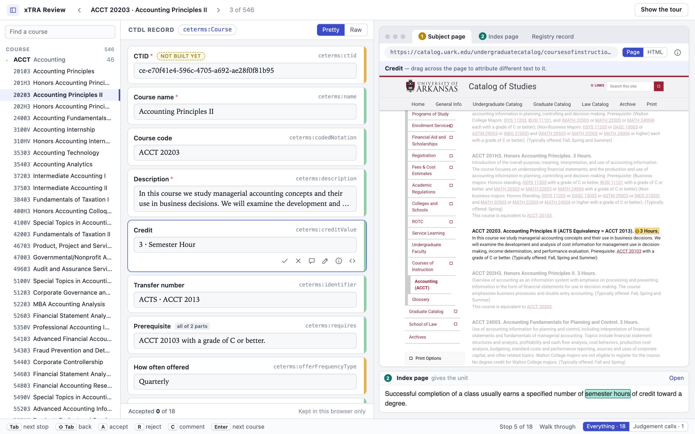
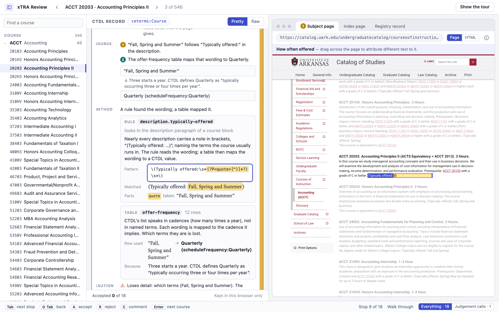

# The human inputs behind the xTRA reviewer mockup

The xTRA reviewer mockup ([flexion/xtra-reviewer-mockup](https://github.com/flexion/xtra-reviewer-mockup), local
copy at `~/repos/xtra-mockup`) was built by Claude Code on 7–8 October 2026, but most of its design came from
Eric: one opening prompt and then about 50 more messages, most of them dictated by voice. This folder
collects those inputs so they can be read without the transcripts.

| File | What it is |
|---|---|
| [01-original-prompt.md](01-original-prompt.md) | The opening prompt, verbatim |
| [02-inputs-cleaned.md](02-inputs-cleaned.md) | Every input, in order, tidied for reading and grouped by phase |
| [03-inputs-verbatim.md](03-inputs-verbatim.md) | Every input exactly as sent, with timestamps |
| [images/](images/) | The three screenshots Eric pasted, and three screenshots of the final result |

## The short answer: the prompt

> Please start from [the University of Arkansas course catalog] and extract into valid CTDL objects the
> courses. … Based on predictable patterns and locations, such as is matchable by regex, locate key fields
> and extract them. Some fields may be ambiguous … for those, use a local ollama-served model.
>
> But a KEY THING is for any extracted piece of data, I want you to remember the exact regions of the page
> (highlighted bars) where that piece of data came from. … If I click on any of the fields in the JSON
> object, (1) it should scroll me to the location in the source document … and (2) it should provide the
> reasoning … citing the CTDL definition and making an argument as to why this snippet of text satisfies
> this requirement.
>
> Follow Q.R.S.P.I. for this. Begin by generating a list of questions …

Full text: [01-original-prompt.md](01-original-prompt.md). The prompt asked for a read-only, side-by-side
viewer. Almost everything that makes the mockup a review tool came from the back-and-forth afterwards.

## How it went

| When | Phase | What Eric did |
|---|---|---|
| Wed 7 Oct, 3:14 PM | Questions | Gave the prompt; answered Claude's 10 clarifying questions aloud |
| 4:36 PM | Research | Read the research document aloud and reacted line by line (~3,800 words of dictation) |
| 4:45–5:12 PM | Specification | Asked for a spec with embedded mockups; reviewed it (13 comments, C1–C13) |
| 6:10 PM – Thu 8 Oct, 1:14 PM | Implementation | Asked for the build, then gave ~40 rounds of feedback on the running viewer (C14–C60) |
| Thu 8 Oct | Sharing | Single-file HTML build for non-technical teammates; push and deploy |

## The human insights, distilled

These are the ideas that came from Eric rather than from the prompt or from Claude. Each one is traced to the
moment it came up in [02-inputs-cleaned.md](02-inputs-cleaned.md).

### 1. The tool teaches as well as corrects
Eric found himself a CTDL novice while answering questions, and assumed reviewers would be too:

> "This exercise is allowing the humans to correct, and it's also teaching the humans and helping them become
> more expert themselves. That's a theme I want to capture."

This led to: definitions with example values and links to every option; the **rationale for choosing each
value over the alternatives**; a CTDL definition page for every field name, one click away; concept lists
with each option's meaning ("If I'm a reviewer, I need to know this … to assess xTRA's judgement"); a glossary
for the definition page's own headings.

### 2. Review is a two-level walk, and a reviewer judges both the value and the choice of field
> "An outer loop verifying each course and other resource one at a time. For each of those, the inner loop is
> they tab through each of the values and resource-type choices that were made — with the option to focus on
> judgement-based ones."

> "Sometimes it's the value of the field that we're verifying, and sometimes it's the choice of field."

This led to the keyboard walk (`Tab` between fields, `Enter` between courses), the "judgement calls only"
filter, and explanations that answer "why this value" and "why this field" separately.

### 3. Every value must trace to its source, and every source type must be visible
Beyond the prompt's "highlighted regions": evidence often sits on a *different page* (so the browser frame
has a tab per document), in *markup that isn't visible* (so there's an HTML tree view next to the rendered
page), in the *URL*, or in an *external record*. Clicking **any** value in either view goes to its source.
Reviewers can drag across the page to re-attribute a value. Deep links to the live site use text fragments.

### 4. Explanations name the mechanism, in structured form
"A rule read it" was rejected. Every rule gets an identifier, a plain description, its regex, and a picture
of what it matched; hovering the regex lights up the match on the page. Failed checks are shown as
**Rule / Found** rows, not prose, and name exactly what's missing ("If it's missing specific entries, say
it"). Language-model output is visibly marked as such.

### 5. Start bare; reveal on request
The first mockup was "a bit busy … way too much to begin with." Hence: three detail levels (Brief, Standard,
Full); confidence as a coloured right edge, not words; icons instead of labelled buttons; a copy icon only in
Raw; reasoning opens only when the confidence edge is clicked; a tour on every page load.

### 6. Reviewers aren't technical
> "Non-technical users should be able to use this and they don't know JSON."

Editing is a form built from the CTDL schema: pick-lists for CTDL's fixed lists (single and multi-select),
add/remove rows for lists, a course finder, a type choice where CTDL allows more than one, and a "Kind" choice
to move a requirement (e.g. prerequisite → corequisite). This was informed by Credential Engine's own
Publisher tool. The views are named **Pretty** and **Raw**, not Fields and JSON.

### 7. Reviews are cheap to give but always explained
`A` accepts, `R` rejects (and a reason is required), and `C` comments. "You can also just leave a comment and
move on. That counts as acknowledging it." The sidebar rows fill like progress bars. The fields CTDL allows but
xTRA didn't propose are shown as blanks that can be filled in.

### 8. Does this course already exist?
> "We need an algorithm to stably come up with the CTID for a resource and check the Registry to see if that
> CTID already exists. So the reviewer would be verifying whether the course already exists or not."

This is stubbed as the first field of every record. The probable approach is a lookup by course ID in
Credential Finder. Earlier, Eric asked that CTID minting be idempotent (a ledger) and kept as a pure
domain-driven-design service, and asked what Credential Engine recommends on whether a new catalog year means
a new CTID.

### 9. Rules first, language models only where needed, and measure both
"I don't want to give up on prerequisite logic." He was open to a rule-based lookup table for offer
frequency, "we just need a way to evaluate it." Model quality wasn't a concern yet: "We'll just plug in any
model and evaluate and improve it later." Language-model quotes must be checked as real substrings, and
deterministic guards catch invented course codes.

### 10. Be honest about provenance and limits
Nothing is published to the Registry. Concerns are written down, not dropped: a stale schema copy is "called
out visibly in a final report," and "make a note" means adding to `risks-and-future-considerations.md`. Claims
need citations ("I'm a little bit skeptical, since you didn't cite a finding"). The spec was rewritten to
include everything asked for during the build, so it describes what was built.

## The reference Eric pointed to

On the first build, Eric pasted an "xTRA Labeling Studio" design and said to make the source side "kinda like
how this take on the problem looks": a browser-framed page on the left and field cards with
accept/reject/confidence on the right. The mockup adopted that frame and card idea. It then moved away from
the design's percentage confidence, labelled buttons and always-visible suggestions, following insights 4
and 5 above.

## The result

| Arrival | A value selected | A rule at work |
|---|---|---|
|  |  |  |

## Where else to look

In the mockup repo, `qrspi/`:

- `01-questions.md`: the ten questions, with Eric's answers tidied.
- `02-research.md`: the research, with Eric's read-aloud remarks as inline comment threads and Claude's
  replies.
- `03-specification.md`: the spec. Its "Review comments" table lists all 60 requests (C1–C60), each mapped to
  the requirement it became.
- `risks-and-future-considerations.md`: the notes Eric asked to be kept.

## How this was gathered

This folder was put together on 15 October 2026 from the Claude Code session transcripts on Eric's machine
(`~/.claude/projects/-Users-eric--superset-worktrees-scratch-scientific-opera-5d809d14/`, sessions
`3a83583e`, `5afc0cbe`, `045fe358` and `67e76a1c`) and from the mockup repo. The inputs are Eric's own
messages, including those sent while Claude was mid-task. Claude's replies and automated messages are left
out. The verbatim file was generated by script. The cleaned file and this summary were written by Claude and
checked against the verbatim file.
