# S — Specification

Phase 3 of Q.R.S.P.I. First draft 2026-10-07; revised the same day after Eric's first review; **revised
2026-10-08 after his second review, of the built viewer**. Status: **draft, decisions D3 to D14 not yet
reviewed**.

> **Note, 2026-10-08.** Version 1 was built from the first revision of this document. Eric then reviewed the
> running viewer and asked for a long list of changes (comments C14 to C60 below). This revision writes those
> requests into the specification, so that it again says what the viewer should do. The viewer sections
> (9 and the viewer part of 10) were rewritten; sections 1, 2, 5.2, 5.4, 8.1, 11 and 12 were amended; the
> other pipeline sections are unchanged. The figures are screenshots of the built viewer.
>
> **What the second review added, in brief.** A sidebar that tracks progress. A card for every field, with
> xTRA's confidence as a coloured edge, and blank cards for the fields xTRA proposed nothing for. Three ways
> to deal with a field: accept, reject with a reason, or comment. Editing by form. Reasoning that shows the
> rule itself. CTDL's definition of every term, inside the tool. A tour on every page load. A CTID field that holds
> the place for checking whether a course is already in the Registry. And a plainer top bar: no menu, no notices.

This document says **what** version 1 does and what it looks like. It does not say how the code is organised or
in what order to build it; that is the plan, the next phase. It builds on `prompt.md`, `01-questions.md`,
`02-research.md` and `risks-and-future-considerations.md`. In this document `RC` numbers refer to review comments
in the research document, `R` numbers to risks, and `C` numbers to the review comments just below.

## Review comments

Eric reviewed the first draft aloud on 2026-10-07. His remarks are recorded here and, where they concern one
passage, inline next to it. Search for `💬` to jump between them.

| # | Comment | Outcome |
|---|---|---|
| C1 | The mockup is busy; use progressive disclosure; the first screen should be bare | Redesigned. Figures 1 and 2; section 9.2 |
| C2 | A small copy icon in place of the Copy button | Done; later moved into Raw (C17). JP5 |
| C3 | D1, each entry is a course: yes | Confirmed |
| C4 | D2, the bare name: fine | Confirmed |
| C5 | D3, the description: not answering yet | Left open; the default stands until you decide |
| C6 | The labels in the margin (fixed, minted, placeholder, rule, LM): "I suppose that's fine" | Reduced anyway, as part of C1. Later replaced by icons and a coloured edge (C20, C21). JP6 |
| C7 | Too much at once. A maximally verbose option is welcome, but not as the start; there is an in-between | Three levels of detail: Brief, Standard, Full. PD2 |
| C8 | "A toggle… instantiation of a class… would be nice to have" (the recording is unclear here) | Interpreted two ways and both built in; please confirm. Question 1 in section 12 |
| C9 | A linear experience: an outer loop over courses and other resources, an inner loop tabbing through each value and each choice, with the option to focus on judgement-based ones | New: the walk. Section 9.6 |
| C10 | Sometimes the value is being verified, sometimes the choice of field | Every explanation answers both, in separate labelled rows. Section 9.9; D17 |
| C11 | A way to unfold all fields in the JSON-LD | Done. JP4 |
| C12 | The acceptance criteria look great | Kept; viewer items reworded to match the new design |
| C13 | Show all the documents involved in a resource more clearly, without visual busyness | Every document is a tab in the browser frame. Section 9.11 |

**Second review, of the built viewer, 2026-10-07 and 2026-10-08.** Eric's requests, in the order he made
them, close to his words. The first four were made while the viewer was being built.

| # | Request | Where it is now specified |
|---|---|---|
| C14 | Frame the source as a browser. Make a per-field view the default, with accept, edit and re-attribute, and a confidence mark | 9.4, 9.7, 9.11; D19, D20, D21 |
| C15 | A show-and-hide sidebar on the left listing all the courses and other CTDL resources under review. The record just right of it. The browser view on the far right | LY1; 9.3 |
| C16 | Make the value more visually distinct: a bubble that looks like a text box, in a distinctive font, without useless clutter | PV2 |
| C17 | Move the copy button down into the JSON view; it is not relevant to the other view | JP5 |
| C18 | In both views, any value string I click that came directly from the source document should take me there | PV3, JP1 |
| C19 | The rule and the violation of the rule should be visually distinct. "It feels like a 5 paragraph essay instead of a structured response" | 9.9; FC1 |
| C20 | It is not obvious what the red circles mean | PD6, PV7, JP6 |
| C21 | "Low", "medium", "high" are visual clutter. Consider a right border with colour coding | PV4, JP6 |
| C22 | Call "Fields" **Pretty** and "JSON" **Raw** | LY4 |
| C23 | Showing and hiding the sidebar is clunky; make it a smooth animation | LY2 |
| C24 | The sidebar should show progress: a check or shade on line items that are done, and a faint progress-bar highlight over the course categories, such as ACCT | SB4, SB5 |
| C25 | A failed check is "better but not there yet. If it's missing specific entries, say it. We need more specifics" | FC2 |
| C26 | Make it more obvious what the output of the language model is | 9.10 |
| C27 | Default the HTML view to fully expanded | HV2 |
| C28 | Editing raw JSON "is not a good editing experience. Non technical users should be able to use this and they don't know JSON." It is poor for lists, does not let you select the CTDL type, and ignores CTDL's multi-select items. Look at Credential Engine's own entry tool for ideas | 9.7, ED1 to ED10; D22 |
| C29 | Should the requirement's label be a different field from the kind? Would they ever differ? | ED8 |
| C30 | Make it easier, for a specific field in one view, to switch to that field in the other | SW1 to SW3 |
| C31 | Show the CTDL definition of a field as an "info tab" in the browser. On **click**, not hover; hovering should underline | DF1, DF2 |
| C32 | "A rule read it" is not enough. What was the rule? Each rule should have a plain description, a more visual way of showing how it works, and if possible its code, such as the regex. At the very least rules should have identifiers. Hovering a regex should show on the page what it matches | RL1 to RL7; D23 |
| C33 | The Raw view should default to Full disclosure | PD2, JP10 |
| C34 | Navigate away from the info tab when I click a value and need to see where it comes from | PV3, DF3 |
| C35 | Make the info pages richer: "Holds: Value Profile" should link to Value Profile. Later: "There's much more information that should be shown on the info page", with CTDL's own term page as the example (URI, Shorthand URI, Label, Definition, Comment, Usage Note, Type of Term, Status, Domain Includes, Range Includes, History) | DF4 to DF7a; D24 |
| C36 | `ceterms:Course` at the top should link to its page, and be styled so it looks clickable | LY5, DF1 |
| C37 | The "valid" checkmark by the record's heading is semantically confusing: by its placement it seems to say all the fields are confident | Reworded as a neutral count of format checks; then removed altogether (C48). JP8 |
| C38 | A list of enum codes such as `lifeCycle:Active`, `lifeCycle:Ceased` is not enough: "If I'm a reviewer, I need to know this kind of thing to be able to assess xTRA's judgement in whether it assigned the right one" | DF7b |
| C39 | In Pretty, clicking `ceterms:…` should open the description page, not Raw: "If I want to see the code, I'll click that icon." The card "jumps around" when I go to click the term. Put the buttons beneath; the card may grow on hover. Icon order: check, edit, info, code | PV5, SW1, DF1 |
| C40 | The page uses names like "URI", "Label", "Range Includes". If Credential Engine defines those, make them clickable and take me to a glossary. And make `https://` addresses clickable | DF7c, DF7d. They are not CTDL's own terms; the glossary says whose they are |
| C41 | The little icons down the right of the Raw view all just link back to the other view; reduce them | SW2 |
| C42 | Add an `R` shortcut for reject. On reject, put the cursor in a popup that asks why | RV6 to RV9 |
| C43 | Add an onboarding flow, shown the first time the page is opened, that walks through: these are the proposed CTDL resources after running xTRA; field by field, accept or reject xTRA's proposed value; clicking a field shows which elements of which pages informed it (an element of a page, something only in the raw HTML, or the URL). Also say that red, yellow and green are xTRA's own confidence in its recommendation | Section 9.13, OB1 to OB7 |
| C44 | We need an algorithm to come up with the CTID for a resource stably, and a check of the Registry for whether that CTID already exists, so that the reviewer verifies whether the course already exists. Stub it in the UI for now | Section 5.4; RG1 to RG3; R16 |
| C45 | The tour's third step should show two things: clicking a value shows where it came from, with an example field un-greyed so it is clear which value is being demonstrated; and (as a further step) clicking a `ceterms:` name shows what that field is meant to contain | OB6, OB6a; steps 3 and 4 |
| C46 | Add one more step, showing xTRA's reasoning for setting the value the way it does | Step 4; OB6 |
| C47 | Add a smooth animation when I click the info button, so I can see the box expand | PV4 |
| C48 | Rename the heading to "xTRA Review". Remove the "CTDL format 8/8" dropdown altogether. Remove the "Not published" notice. Remove the menu in the top right and everything only it reached; put a button called "Show the tour" in its place | LY6, LY7, JP8, JP9, SP8, RV3, OB2; section 9.12 withdrawn |
| C49 | The Course type has more properties than the ones shown. Represent the ones xTRA had no proposal for as blanks, with a grey right-hand border, and put a small, faint red asterisk next to required properties | PV9 to PV12 |
| C50 | Update the tour for the new grey ones | Section 9.13, step 2 |
| C51 | Add a step 6 that explains "Already in the Registry?", and another that shows the un-proposed properties | Steps 6 and 7; OB6c |
| C52 | Update the sidebar step with a screenshot or HTML element showing what the sidebar looks like as you start to review and accept | Step 1 |
| C53 | Make the list items in the sidebar progress bars, in their background, by how many of their fields are accepted so far | SB4 |
| C54 | In the tour, add an edit step that shows one of the dropdowns or multiple-choice options | Step 6; OB6c |
| C55 | In the tour, show an example of explaining the reasoning for rejecting. And mention the shortcuts with the same icons as you describe them | Steps 2 and 3; OB8 |
| C56 | In the "not built yet" box, explain the approach we will probably take: depending on the class (for example a course), look at the course ID and see whether it is already in the Credential Finder database | Section 5.4; RG2; R16 |
| C57 | Add a `C` shortcut for comment. Rejection always comes with a comment. But you can also just leave a comment and move on; that counts as acknowledging it | RV7, RV10, RV11, RV9 |
| C58 | Change "Already in the Registry" to a simple field for "CTID" and remove the existing CTID field. Give it a special callout (not built yet); clicking the info, or the callout, goes into the detail. Reflect this in the tour | RG1 to RG3; PV6; tour step 8 |
| C59 | When you hover over a button for a second, display the shortcut icon and label | PD5 |
| C60 | Since this is a mockup, always show the tour on page load. Do not try to work out whether someone has already seen it | Section 9.13, OB1, D28 |

*The replies below were written for the first revision. Figure and section numbers inside them refer to that
revision, and some of what they describe was changed again by C14 to C60.*

> 💬 **C1 · Eric:** This looks really exciting. I will say the whole mockup looks a bit busy. Is there a way we could
> better use progressive disclosure, so that the user isn't overwhelmed by things to look at when they first get
> on here? Maybe what you're showing in the first screenshot is after the user has clicked on a bunch of things.
> If so, great. But I would want it to look a lot more bare before they click on things.
>
> ↳ **Reply:** The first screenshot was after one click, and it was still too much. The screen now has three
> states of increasing detail, and each needs a deliberate act to reach. On arrival (figure 2): the page, the
> record at one line per field, and nothing else. After one click or one press of Tab (figure 3): one highlight
> and two short sentences. Everything further is opened by the reader. What went away from the first screen:
> the labels in the margin, the document addresses and digests, the count of checks, the legend, the flags, and
> four of the five explanation sections.

> 💬 **C7 · Eric:** I think this just needs more progressive disclosure. There's so much information you're throwing
> at us all at once. The maximally verbose version, I would love to have that option, but beginning with that is
> way too much. And I think there's an in-between.
>
> ↳ **Reply:** Three levels, chosen with one switch and remembered: **Brief** (the default), **Standard** (the
> in-between) and **Full** (everything that is stored). Figure 4 shows the same field at all three. Any one
> section can also be opened by itself without changing level.

> 💬 **C8 · Eric:** A toggle… instantiation of a class… it would be nice to have. *(Transcription unclear.)*
>
> ↳ **Reply:** I could not tell which of two things you meant, so the design does both. First, each object in
> the record that is an instance of a CTDL class (a ValueProfile, a ConditionProfile, an alignment object) can be
> folded and unfolded by itself, as well as all at once. Second, the choice of class is a stop in the walk in its
> own right, defended like any other choice (figure 9, first card). If you meant something else, say so.

> 💬 **C9 · Eric:** I imagine a linear experience where verifiers go through an outer loop, verifying each course
> and other resource one at a time. For each of those, the inner loop is that they tab through each of the values
> and resource-type choices that were made, with the option to focus on judgement-based ones, like the ones that
> came out of a language model. Of course, our rules might be wrong too. But our rules are less likely to be wrong.
>
> ↳ **Reply:** This is now the main way of moving through the tool; section 9.2 specifies it. Tab is the inner
> loop, Enter is the outer loop. The walk can be set to "Everything" or "Judgement calls". Everything stays the
> default, because rules can be wrong too. One thing I have **not** changed: version 1 still records no verdicts.
> You decided in the questions phase that it is read-only. The walk is built so that accepting or rejecting a
> stop later is one more key at a place the reader is already standing.

> 💬 **C10 · Eric:** Sometimes it's the value of the field that we're verifying, and sometimes it's the choice of
> field. We're trying to defend why we used that field over the alternatives.
>
> ↳ **Reply:** That distinction now organises the explanation. Every stop has two short answers, always in the
> same two places: **Value** (are these the right words from the page?) and **Choice** (is this the right CTDL
> field or class for them?). Some stops have only one of the two, and say so.

## Contents

1. [What version 1 is](#1-what-version-1-is)
2. [Decisions made in this phase](#2-decisions-made-in-this-phase)
3. [The three steps](#3-the-three-steps)
4. [Step 1: crawl](#4-step-1-crawl)
5. [Step 2: extract](#5-step-2-extract)
6. [The record: which fields, from where](#6-the-record-which-fields-from-where)
7. [Prerequisites](#7-prerequisites)
8. [Provenance: what is remembered about every value](#8-provenance-what-is-remembered-about-every-value)
9. [Step 3: the viewer](#9-step-3-the-viewer)
10. [Acceptance criteria](#10-acceptance-criteria)
11. [Not in version 1](#11-not-in-version-1)
12. [Questions for Eric](#12-questions-for-eric)

**About the pictures.** Figure 3 is a drawing. Every other figure is a screenshot of the built viewer showing
real output of the extract step over the stored ACCT page; nothing in them was typed by hand.
`screens/capture.mjs` regenerates them from the running viewer. The hand-written mockup the first revision
was illustrated with is still in [`mockups/`](mockups/mockup.html) for comparison, and no longer describes the
design.

---

## 1. What version 1 is

A person opens a web page. On the left is a list of the courses under review. In the middle is one course,
written as a CTDL record: one card per field, each showing a plain name and a value. On the right, in a browser
frame, is the catalog page from the University of Arkansas that the course was read from, looking much as it
does on the live site.

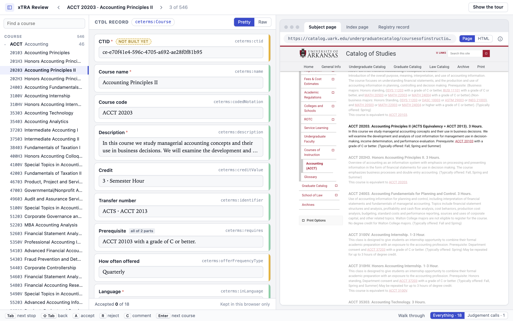

*Figure 1. On arrival.*

On every page load, a short tour walks them through the screen (section 9.13).

They click a value, or press Tab. The page scrolls to the words that value came from and highlights them. One
more click opens the reasoning: where the value came from, the rule that read it, and what CTDL says the field
is for. Then they deal with the field, in one of three ways: accept it; reject it, saying why; or leave a
comment and move on. If the value is wrong and they know the right one, they correct it in a form. The
sidebar fills in as they go.

Below the fields xTRA proposed are all the other fields CTDL allows on a course, blank, for the reader to
fill in if they can.

*Figure 2. After one click. Everything more than this is opened by the reader.*

**In scope**

- Five subjects: ACCT, CHEM, CSCE, ENGL, NURS (546 courses), built so that all 168 could be run.
- A crawl step and an extract step that are fully separate.
- One CTDL `ceterms:Course` record per course, checked against the CTDL schema.
- Evidence and reasoning for every value and every choice in every record.
- A viewer made of static files, organised as a walk through those values and choices, in which a person can
  accept, reject, comment on, edit and re-attribute each one, and fill in fields that were left blank. What
  they do is kept in their browser; no file on disk is changed.

**Out of scope** (section 11 has the full list): publishing, writing verdicts or corrections back to the
records or taking them out of the browser, checking the Registry for existing courses, other sites, measuring
the language model's quality.

**Two purposes, equally weighted** (from `01-questions.md`): the tool lets a person check the machine, and it
teaches that person CTDL as they go.

---

## 2. Decisions made in this phase

The research left choices open. Each is settled here so the plan can proceed. Those marked **confirm** are the
ones I am least sure you would make the same way; they are repeated as questions in section 12.

| # | Decision | Why | Alternative not taken |
|---|---|---|---|
| D1 ✓ | Each catalog entry is a `ceterms:Course`. *Confirmed (C3).* | Research section 4. | LearningOpportunityProfile, LearningProgram, CourseComponent. |
| D2 ✓ | `ceterms:name` is the bare name: "Accounting Principles". *Confirmed (C4).* | The code has its own property, `codedNotation`. The transfer tag has its own, `identifier`. | "ACCT 20103 - Accounting Principles", as some publishers write. |
| D3 | `ceterms:description` is the **whole** description paragraph, word for word, including its labelled sentences. **confirm** *(deferred, C5)* | Nothing on the page is lost, even things CTDL has no property for ("May be repeated…"). It matches the published example. It is one text segment, so its provenance is simple. | Prose only, with the labelled tail cut off. Cleaner, but drops information that has no other home. |
| D4 | Credit is one `ValueProfile`: a single number, or a minimum and maximum for a range. The unit is Semester Hour. | Research section 7 and RC15. | A bare number; two entries for a range. |
| D5 | Emit both `ceterms:ownedBy` and `ceterms:offeredBy`, pointing at the university's existing Registry record. **confirm** | Both are true and both are evidenced: the index page says "approved for offering by the University of Arkansas". | `ownedBy` alone, which is what 999 of 1,000 sampled records do (RC11). |
| D6 | A CTID is minted once per organisation and course code, and remembered in a ledger. The catalog edition does **not** change it. The edition goes in `ceterms:versionIdentifier`. **confirm** | It is what the Brookdale example does, and it keeps links between courses stable (RC8). | A new CTID per edition. Open as R9. |
| D7 | Prerequisites: always keep the sentence word for word; always attempt the full structure; add direct `ceterms:prerequisite` links only when a rule can prove the sentence is a plain list. | RC4, RC12, research section 9. | Text only. |
| D8 | A course that is named in a prerequisite but lies outside the crawled subjects still gets a CTID from the ledger. It is marked "referenced, no record yet". **confirm** | A CTID depends only on organisation and course code, and the reference supplies both. If that subject is crawled later, the same CTID is found. Without this, the structure for most prerequisites would be mostly text (R10). | Keep such references as text until their subject is crawled. |
| D9 | "Typically offered" maps to `ceterms:offerFrequencyType` through a hand-reviewed table. The viewer says plainly that detail is lost. Wordings with no fitting value are left out. | 12 distinct wordings; a table can be checked completely (RC17). | The language model; or leaving the property out. |
| D10 | "Cross-listed with" and "equivalent to" both map to `ceterms:isSimilarTo`. | It is the weakest claim that is still true ("another functionally similar entity"). | `ceterms:sameAs`, which claims more than the page says. |
| D11 | Course level (`audienceLevelType`) is **not** emitted. | The catalog's numbering policy has not been found, so it would be a guess. "Omit, never invent." | Deriving it from the first digit. |
| D12 | The "Why this, and not something else" text is written by hand, once per property, and stored with the rule. It is not generated per course. | It is teaching material. It should be reviewed and correct, and it is the same for every course. | Asking the language model to write it each time. |
| D13 | The source pane loads the live site's stylesheets, with a small bundled stylesheet as a fallback. | A browser loading a stylesheet is ordinary browsing, which `robots.txt` does not restrict (R6). The fallback keeps the page readable offline. | Imitation stylesheet only. |
| D14 | Record identifiers (`@id`) use the Registry's address form, and every screen that shows one labels it a placeholder. **confirm** | It is the form a real record would have, which is what "valid CTDL" was defined as. | An address that is obviously fake, which cannot be mistaken for a published record. |
| D15 | The viewer starts bare and reveals detail in three levels: Brief, Standard, Full. Brief is the default in Pretty; Full is the default in Raw. *Amended (C33).* | C1, C7, C33. | One fixed, complete view. |
| D16 | The main way through the tool is a linear walk: courses in order, and within a course its stops in order. | C9. | Free clicking only. Still possible, but no longer the only way. |
| D17 | Every explanation is a fixed set of labelled rows: Confidence, Source, Method, Language model, Structure, Caution, CTDL. Source and Method answer for the **value**; CTDL answers for the **choice**. *Amended (C19).* | C10, C19. | Two prose paragraphs, Value and Choice, which read as an essay. |
| D18 | ~~Version 1 records no verdicts.~~ *Superseded by D21.* | | |
| D19 ✓ | The record has two views. **Pretty**, one card per field in plain words, is the default. **Raw** is the JSON-LD. *Asked for (C14, C22).* | Most reviewers do not read JSON. | JSON only. |
| D20 ✓ | Every value carries a confidence of low, medium or high, set by stated rules, shown as a colour on the right edge. *Asked for (C14, C21).* | It tells the reader where to look first. | No confidence; or the words on every card. |
| D21 ✓ | A reader can accept, reject, comment on, edit and re-attribute a field. All of it is kept in the reader's browser. The record on disk is never changed. *Asked for (C14, C42, C57).* | It makes the walk a review, without adding a backend or any way to alter the evidence. | Read-only (the former D18); or writing back to the records. |
| D22 ✓ | Editing is by form, built from the CTDL schema copy. JSON is a fallback behind an icon. *Asked for (C28).* | Reviewers do not know JSON; lists, fixed lists and the choice of class each need their own control. | A JSON text box. |
| D23 ✓ | Every rule and table has an identifier, and the viewer shows the rule itself: description, pattern, and what it matched here. *Asked for (C32).* | "A rule read it" asks for trust; showing the rule lets the reader check it. | Naming the method only. |
| D24 ✓ | CTDL definitions open inside the tool, in the browser frame, and link to one another. *Asked for (C31, C35).* | The tool's second purpose is to teach CTDL; the reader should not have to leave it to follow a term. | Tooltips; or links out to credreg.net only. |
| D25 ✓ | Layout: sidebar, record, source, left to right. *Asked for (C15).* | | Source on the left, as first specified. |
| D26 ✓ | A field is **dealt with** when it is accepted, rejected or commented on. A rejection must carry a reason; a comment by itself counts as acknowledging the field. Progress counts fields dealt with. *Asked for (C57).* | A reviewer who has something to say but no verdict should not have to pick one to make progress; a rejection without a reason is no use to the next reader. | Accept and reject only; reasons optional. |
| D27 ✓ | The record shows every field its CTDL class allows. Fields xTRA proposed nothing for are shown blank with a grey edge and can be filled in. Required fields carry a faint red asterisk. *Asked for (C49).* | The reviewer sees what could be said about a course, not only what was. | Showing proposed fields only. |
| D28 ✓ | Every page load opens with a tour that performs each action on a real field. It is the one exception to "start bare". *Asked for (C43 and after).* | A new reviewer needs to know what the colours mean and what they are there to do before the bare screen means anything. | A help page; or nothing; or showing it on the first visit only, which was built first and dropped (C60) so that nobody shown the mockup can miss it. |
| D29 ✓ | The top bar carries the name, the course, and one button to replay the tour. No menu, no "Not published" notice, no summary of format checks. *Asked for (C48).* | Less on screen. | The menu and notices of the first build. |
| D30 ✓ | Whether a course is already in the Registry will be checked by looking its course ID up in the Credential Finder, by class of resource. Not built; the CTID field holds the place for it, marked "not built yet". *Asked for (C44, C56).* | A reviewer must be able to tell a new course from an existing one before anything is proposed. | Relying on a derived CTID alone. |

---

## 3. The three steps

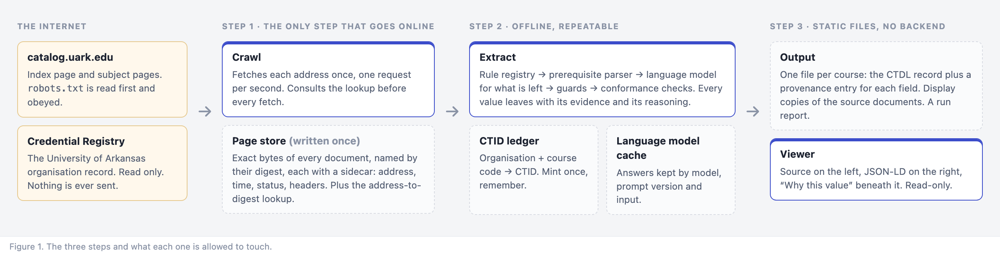

*Figure 3. The three steps and what each one is allowed to touch.*

| Step | Reads | Writes | May use the internet? |
|---|---|---|---|
| **Crawl** | The catalog site; one Registry record | The page store | Yes. It is the only step that may. |
| **Extract** | The page store; the CTDL schema copy; the CTID ledger | Course files, display copies of documents, a run report; new ledger entries | No. It may call the language model on this machine. |
| **Viewer** | The extract step's output | Nothing | Only the reader's browser, for stylesheets and for links the reader clicks. |

There is no publish step, and no code that can send anything to the Registry (RC2, R2).

---

## 4. Step 1: crawl

**What it is given.** The index page address, and a list of subject codes. The default list is the five sampled
subjects. Giving it "all" makes it take every subject page the index links to.

**What it must do**

| # | Requirement |
|---|---|
| CR1 | Fetch `robots.txt` first, store it like any other document, and never request an address it disallows. In particular it never requests `/search/`, `/css/`, `/js/`, `/images/`, `/fonts/` or `/pdf/` (RC22). |
| CR2 | Find subject pages from the links on the index page, not from a hard-coded list of addresses. |
| CR3 | Before every request, consult a lookup of addresses already fetched. If the address is there, do not fetch it. A second run with the same inputs makes **zero** requests. |
| CR4 | Wait at least one second between requests, and identify itself honestly in the request. |
| CR5 | Store the **exact bytes** of each response, named by the SHA-256 digest of those bytes (RC18). Two addresses that return identical bytes share one stored file. |
| CR6 | Beside each stored file, write a sidecar recording: the address requested, the final address after any redirect, the time, the status, the content type, the size, and the digest. |
| CR7 | Treat any content type the same way. A PDF or an image is stored as bytes with a sidecar, even though version 1 extracts nothing from them. |
| CR8 | Fetch the university's Registry record (`…/resources/ce-57603921-78ce-455c-88b5-00506fb33701`) and store it the same way, so that extraction can use it without going online. |
| CR9 | Refetching is possible only by an explicit request to do so. It never overwrites: the new bytes get a new digest, and the old file stays. |
| CR10 | A failed request is recorded with its status and is not retried silently. The crawl reports what it could not get. |

**What "fetch a page" hides.** Getting the bytes for an address is one replaceable part. Today it is a plain
request. For a site that needs a real browser or a login (R5), only that part changes; the store, the lookup and
everything after stay the same.

---

## 5. Step 2: extract

### 5.1 Behaviour

| # | Requirement |
|---|---|
| EX1 | Extraction reads only the page store. Run with the internet switched off, it produces the same output. |
| EX2 | Run twice on the same store, it produces the same output, byte for byte, apart from a timestamp in the run report. Language model answers are cached to make this true. |
| EX3 | Every value in every record has a provenance entry (section 8). A value without one is a defect, and the run fails. |
| EX4 | "Omit, never invent." If the evidence for a property is missing, the property is left out and the reason is recorded. Nothing is filled in by assumption. |
| EX5 | Every rule counts what it matched and lists what it did not. So does every lookup table. The totals go in the run report (R4). |
| EX6 | A run over five subjects that makes no language model calls (all cached) finishes in under a minute. A first run is bounded by the language model, roughly 15 minutes on the research figures. |

### 5.2 The rule registry

Rules are data, not code: one entry per rule, in a file a non-programmer can read (Q10). Each entry states:

| Part | Meaning | Example |
|---|---|---|
| Name | A stable identifier, shown in the viewer | `title-line.credit` |
| Property | The CTDL property it feeds | `ceterms:creditValue` |
| Where to look | Which part of which document | The title line of a course block |
| Pattern | What to match | `(?P<min>\d+)(?:-(?P<max>\d+))?\s+Hours?\.\s*$` |
| Plain description | One or two sentences a novice can follow, shown word for word in the viewer | "The title line of every course block ends with a credit statement…" |
| Teaching notes | Why this property, why this structure, what the alternatives were (D12, RC15) | Section 9.9 |
| Checks | Cross-checks to run on the result | "Last character of the course number equals the credit" |

Lookup tables (D9) live in the same registry, one row per wording, each row marked as reviewed by a person or not.

The name, where it looks, the plain description and the pattern are all shown to the reader, word for word
(section 9.9, RL1 to RL3). So they are written for that reader. A pattern names each part it captures
(`quote`, `min`, `max`), because the viewer colours and lists the parts by those names (RL4).

### 5.3 The language model

- It is used for **one job in version 1**: proposing the structure of a prerequisite, corequisite or
  pre-or-corequisite sentence that the parser could not read in full (section 7).
- It sits behind a replaceable boundary (RC23). The rest of the system gives it a task, a sentence and the
  relevant CTDL definitions, and receives a proposal. Which language model answers, and whether it is local, is
  configuration. The default is `qwen3.5:9b` served by ollama.
- A proposal has a fixed form: the structure, an exact quote from the sentence for each part of it, and a short
  argument that cites the CTDL definition (the prompt's requirement).
- **Nothing it says is trusted until the guards in section 7.3 pass.** If they fail, its proposal is discarded,
  kept in the provenance for inspection, and the record falls back to the sentence as text.
- Answers are cached by language model name, prompt version and input, so extraction is repeatable (EX2) and
  swapping the language model re-asks only what is needed.
- Every value that came from it is labelled as such everywhere it appears.

### 5.4 The CTID service

A small, pure piece of the domain (RC3).

- **It knows two things:** an organisation's CTID and a course code.
- **It has one collaborator:** the ledger, a file that remembers what was minted.
- **It knows nothing about** pages, rules, extraction or CTDL.
- **Its one operation:** "give me the CTID for this organisation and this course code." If the ledger has one,
  that is returned. If not, a new one is made (`ce-` plus a random UUID), written to the ledger with the date,
  and returned.
- Course codes are normalised before lookup (the page's non-breaking space becomes an ordinary space), so
  `ACCT 20103` always finds the same entry.
- The ledger is append-only. Extraction never changes or removes an entry.

**Not built, and needed before anything could be proposed to the Registry** (C44, R16):

1. **A stable CTID.** Today a CTID is random the first time a course is seen, and stable only because this
   machine's ledger remembers it. Another machine, or a lost ledger, would mint a different one for the same
   course. What is needed is an algorithm that arrives at the same CTID for the same resource every time, for
   anyone, from what the resource is. What "the same resource" means is the open question in D6 and R9.
2. **A check of the Registry.** With a stable CTID, ask the Registry whether a record with it already exists,
   so that a reviewer can verify whether the course is new or already there. A course the university has
   already published under a CTID of its own choosing would not be found by this alone; finding those needs
   a search by owner and course code as well.

**The approach we will probably take** (Eric, C56). It depends on the class of the resource. For a course:
take the course's own ID from the catalog (its code, `ACCT 20203`) together with the organization that owns
it, and look in Credential Engine's Credential Finder database for a course with that ID. If one is there,
show it to the reviewer beside xTRA's proposal, and the reviewer says whether it is the same course. Other
classes would be matched on whatever identifies them. This looks a course up by what it is, so it finds
courses published under any CTID, which a derived CTID alone would not (point 2 above). If the course is
found, its existing CTID is the one to use; a stable way to make a CTID is then needed only for courses that
are new.

The viewer's CTID field holds the place for the reviewer's side of this (section 9.7, RG1 to RG3). Nothing is implemented:
no algorithm, no look-up, and no request to the Registry.

### 5.5 Conformance checks

"Valid CTDL" (Q1) means the record passes every check below. The schema copy in `reference/ctdl/` is a list of
terms, not a ready-made validator, so these checks are ours, written against that copy.

| # | Check |
|---|---|
| V1 | The record is well-formed JSON-LD with the CTDL context. |
| V2 | Every key is a real CTDL property, and the schema allows it on the class it appears on. |
| V3 | Every value is of a kind the schema allows for that property (text, number, address, or a named class). |
| V4 | Every value chosen from a fixed list is a member of that list. |
| V5 | The six properties required by the Minimum Data Policy are present (research section 6). |
| V6 | Text values are wrapped by language. |
| V7 | Every CTID has the form `ce-` plus a UUID. |
| V8 | Every link to another course points at a CTID the ledger knows. |

A record that fails a check is still written and still viewable, with the failure shown. The run report lists
every failure. Properties the schema marks unstable (`coPrerequisite`, `offerFrequencyType`, `inCatalog`) are
flagged, not rejected.

---

## 6. The record: which fields, from where

One row per property that version 1 can emit. "Kind of evidence" uses the list in section 8.2.

| Property | Value for ACCT 20103 | How it is produced | Kind of evidence |
|---|---|---|---|
| `@type` | `ceterms:Course` | Fixed by design (D1) | None; a decision, with its rationale |
| `@id`, `ceterms:ctid` | `ce-…` | Minted (section 5.4) | No source |
| `ceterms:name` | "Accounting Principles" | Rule on the title line | Text segment |
| `ceterms:codedNotation` | "ACCT 20103" | Rule on the title line | Text segment |
| `ceterms:description` | The whole paragraph (D3) | Rule | Text segment |
| `ceterms:creditValue` → number | 3 | Rule on the title line; cross-checked against the course number | Text segment |
| `ceterms:creditValue` → unit | Semester Hour | Rule on the index page | Text segment on a different page |
| `ceterms:identifier` | ACTS course index number, "ACCT 2003" | Rule on the title line's transfer tag (three spellings) | Text segment |
| `ceterms:requires` | See section 7 | Rule, then parser, then language model | Several text segments |
| `ceterms:prerequisite` | (not for this course) | Only when a rule proves a plain list | Several text segments |
| `ceterms:corequisite` | (not for this course) | As `requires` | Several text segments |
| `ceterms:coPrerequisite` | (not for this course) | As `requires`; four spellings of the label | Several text segments |
| `ceterms:offerFrequencyType` | Quarterly | Rule finds the wording; a table maps it (D9) | Worked out from another value |
| `ceterms:isSimilarTo` | (not for this course) | Rule on "cross-listed with" / "equivalent to" (D10) | Text segment and its link |
| `ceterms:inLanguage` | `["en"]` | Rule on the page's `lang` attribute | Markup |
| `ceterms:lifeCycleStatusType` | Active | Rule: the edition label plus the index page's wording | Text segments on two pages |
| `ceterms:ownedBy`, `ceterms:offeredBy` | The university's Registry address (D5) | Looked up | Outside record, supported by text and markup |
| `ceterms:subjectWebpage` | The subject page's address | From the page store's sidecar | The document's own address |
| `ceterms:inCatalog` | The catalog's address | From the crawl's starting point | The document's own address |
| `ceterms:versionIdentifier` | Catalog edition, "2026-27" | Rule on the edition label (D6) | Text segment |

**On the page but not in the record.** Version 1 also recognises these and reports them, per course and in
total, with the reason they were left out:

| What the page says | Why it is not in the record |
|---|---|
| "May be repeated for [up to N hours of] degree credit." | CTDL has no property for it. It remains inside the description. |
| "Graduate degree credit will not be given for both X and Y." | No CTDL property found. It remains inside the description. |
| "Lecture N hours, laboratory N hours per week." | A candidate for `learningMethodType`; left for later. |
| Course level, suggested by the first digit of the number | Unverified (D11). |

---

## 7. Prerequisites

This is the one hard field (research section 9), and the one you asked not to give up on (RC4).

### 7.1 Three layers, each safer than the next

| Layer | What it holds | How it is produced | Can it be wrong? |
|---|---|---|---|
| **The sentence** | The prerequisite sentence, word for word | Rule: found by its label, "Prerequisite:" | No. It is a copy. |
| **The links** | Every course named in it | Rule: the page marks each course code up as a link | No, short of a mistake on the page. |
| **The structure** | How the courses and conditions combine | Parser, or failing that the language model | Yes. This is why the other two layers are always kept. |

### 7.2 The structure

The structure is a small tree, kept in full with the provenance and shown in the viewer. It has four kinds of node:

| Node | Meaning | Example from the catalog |
|---|---|---|
| **All of** | Every item beneath it is required | "ACCT 37203 **and** department consent" |
| **Any one of** | One item beneath it is enough | "MATH 20503 **or** MATH 22003 **or** MATH 24004" |
| **Course** | A specific course, with its CTID | "ISYS 11203" |
| **Text condition** | Something that is not a course, kept as its exact words | "with a grade of C or better", "Honors standing", "Walton College Majors" |

Every node records the text segment of the sentence it was read from.

**Who builds it**

1. **The parser**, a deterministic reader for sentences made only of course codes, "and", "or", commas, brackets
   and a short list of known phrases (such as "with a grade of C or better"). It either reads the whole sentence
   or declines. It never guesses.
2. **The language model**, for sentences the parser declines. Where the sentence has bracketed groups of course
   codes, the parser's reading of those groups is kept as a cross-check.
3. **Nobody**, if the guards fail. The record then carries the sentence and the links only.

### 7.3 Guards

Applied to every structure, whoever built it:

| # | Guard | Catches |
|---|---|---|
| G1 | The proposal is in the agreed form, and every quote is word for word in the sentence. | Invented wording |
| G2 | Every course in the structure is a link in the sentence. | Invented courses (the probe produced five) |
| G3 | Every link in the sentence appears in the structure. | Dropped courses |
| G4 | Where the parser read a bracketed group on its own, the structure agrees with it. | "and" mislabelled as "or" inside a group (the probe did this) |
| G5 | Flattened back to text, the structure's parts appear in the sentence's order and do not overlap. | Rearrangement |

**What the guards do not prove:** that "and" and "or" were read correctly outside bracketed groups. The viewer
says so on every structure the language model built (R3). Proving it needs the review workflow planned for later.

### 7.4 From the tree to CTDL

A fixed, pure mapping, the same for every sentence:

- One `ConditionProfile` per sentence under `ceterms:requires` (or `corequisite`, or `coPrerequisite`). Its
  `ceterms:description` is the sentence word for word. This is the floor that is always present.
- Courses directly under an "all of" go in that profile's `ceterms:targetLearningOpportunity`.
- Text conditions go in its `ceterms:condition`.
- An "any one of" becomes `ceterms:alternativeCondition`: one nested profile per choice.
- In addition, `ceterms:prerequisite` (a plain list of course links) is emitted only when the whole structure is
  a single "all of" containing nothing but courses.

**A limit worth knowing about.** As I read the handbook, one profile can hold only one set of choices. A group
that needs two ("one of these four, **and** one of these three") cannot be written exactly without repeating
branches. Version 1 does not repeat branches. It writes the structure as far as CTDL carries it exactly, leaves
the remainder as text in `ceterms:condition`, and marks the field **partly structured**. The complete tree is
still kept and shown. This reading is mine and is not confirmed by a Credential Engine example; see section 12.

Figures 16 and 17, in sections 9.9 and 9.10, show both outcomes on real courses: a reading by the language
model that the guards refused (the first course on the ACCT page, one of the harder sentences in the sample),
and one they let through.

A guard that fails says exactly what it found (FC2): which course links were left out, which bracketed group
was joined with the wrong word, which quote is not in the sentence. Several findings under one guard are all
reported, not only the first.

---

## 8. Provenance: what is remembered about every value

### 8.1 One file per course

Each course is written as one file with three parts:

| Part | Contents |
|---|---|
| **The record** | The CTDL JSON-LD, exactly as it would be handed to anyone else. Nothing of ours is mixed into it. |
| **The provenance** | One entry per value in the record, addressed by the value's path, for example `/ceterms:creditValue/0/schema:value`. |
| **Left out** | What was recognised on the page but not put in the record, and why (section 6). |

A provenance entry holds:

| Field | Meaning | Example |
|---|---|---|
| Method | How the value was produced. One of: rule, table, language model, lookup, minted, fixed. | `rule` |
| Produced by | The rule name; or the language model, prompt version and its argument | `title-line.credit` |
| Evidence | A list of pieces of evidence, numbered, each with a short note on its role | ① "3 Hours." gives the number |
| Matched | With each piece of evidence a rule produced: the rule's name, everything its pattern matched, and the position of each named part (RL7) | `title-line.credit` matched "3 Hours."; `min` is "3" |
| Confidence | Low, medium or high, with one sentence saying why (D20, section 9.4) | High: "Read by a rule from one place on the page, and every check passed." |
| Checks | Each check run on this value, whether it passed, and, if it did not, exactly what was found (FC2) | "Course number ends in 3" ✓ |
| Flags | Anything a reader should be warned of | `partly structured`, `loses detail`, `placeholder` |

The teaching content (CTDL definition, example values, links to all options, why this and not something else)
is stored once per property, not per course, and joined in the viewer.

Clicking a value with no entry of its own selects the nearest enclosing value that has one. So every click lands
somewhere.

### 8.2 Kinds of evidence

Seven came out of the research (RC19). An eighth, the document's own address, turned up while writing section 6.
Each has its own record and its own presentation.

| Kind | What is recorded | How the viewer shows it |
|---|---|---|
| **Text segment** | Document digest; start and end position in the document's text; the exact quote, with a little text before and after | Highlight on the rendered page (figure 2) |
| **Several text segments** | A list of the above, each numbered and given a role | Numbered highlights in different colours (figure 17) |
| **Text segment on another page** | As a text segment, with a different document digest | A short excerpt beneath the main preview, which can be opened in full (DC4) |
| **Markup** | Document digest; the element and attribute; its position in the stored source | The HTML view, scrolled to that element (figure 18) |
| **Outside record** | Its address, its digest, when it was read, and which of its fields were used | A plain statement naming the record, with the stored record one tab away |
| **Worked out from another value** | Which value it started from, and the step taken (a table row, a calculation) | A chain: source, step, result (figure 15) |
| **The document's own address** | Document digest; the address from the sidecar | The address bar above the preview, highlighted |
| **No source** | Who made the value and from what inputs | A plain statement that there is no source |

### 8.3 Anchoring text segments

- Positions are counted against one fixed text for each document: the text of the stored page after scripts are
  removed, in reading order. The extract step writes this "display copy" once, and both the positions and the
  viewer use it, so they cannot disagree.
- Both the position and the quote are stored (research section 10). The viewer checks that the text at the
  position equals the quote before highlighting.
  - If it does: highlight.
  - If it does not, but the quote is found elsewhere: highlight there and warn that the anchor was re-found.
  - If the quote is not found: show the quote and say plainly that the anchor is stale. Never highlight a guess.
- Every piece of evidence carries its document's digest. Evidence tied to a digest that is no longer the current
  one for its address is marked as needing re-checking (RC18).
- Text is stored as it appears. The catalog writes course codes with a non-breaking space; the quote keeps it,
  and the record's value normalises it. The provenance notes the change.

### 8.4 Links back to the live site

Per highlighted region, where the browser supports it (RC21):

- **At this text:** the page's address plus a text fragment (`#:~:text=…`), which makes the browser scroll to
  and highlight the phrase on the live page. Long segments use the start-and-end form.
- **Single-course page:** `https://catalog.uark.edu/search/?P=ACCT%2020103`. A link for a person to click. The
  crawler never requests it (CR1).

Both are conveniences. The stored copy is the evidence (R7). The viewer says so next to the links.

---

## 9. Step 3: the viewer

Static files, no backend (Q8). Nothing the reader does changes a file on disk: what they accept, reject,
comment on, edit or re-attribute is kept in their browser (section 9.7).

This section was rewritten on 2026-10-08 to state what Eric asked for in his second round of review (C14 to
C59). Requirement numbers from the first version are kept where the requirement survives; those that changed
say so.

### 9.1 Layout

Figure 1, in section 1, shows it: left to right, the sidebar, the record, the source page in a browser frame.

| # | Requirement |
|---|---|
| LY1 | Three areas, left to right: a **sidebar** of everything under review, the **CTDL record**, and the **source** in a browser frame on the far right (C14, C15). |
| LY2 | The sidebar can be shown and hidden with one icon. It slides open and shut; it does not jump (C23). People who ask their system for reduced motion get no animation. The choice is remembered. |
| LY3 | The divider between the record and the source can be dragged, and its place is remembered. |
| LY4 | The record has two views, named **Pretty** and **Raw** (C22). Pretty is the default. The choice is remembered. |
| LY5 | The record's class (`ceterms:Course`) is shown beside the heading as a link that looks like one, and opens that class's definition (C36, section 9.8). |
| LY6 | **Withdrawn (C48).** The "Not published" notice is removed from the screen. Nothing is published all the same: there is no publish step and no code that can send anything to the Registry (section 3, R2), and identifiers are still labelled as placeholders where they are explained. |
| LY7 | The top bar holds, left to right: the sidebar switch, the name **xTRA Review**, the course with its previous and next arrows and its place in the run, and one button, **Show the tour**. There is no menu (C48). |

### 9.2 Start bare, reveal on request

The rule that governs every part of the viewer (C1, C7) is unchanged:

> Nothing appears until the reader has asked for it, and each request reveals one step more, not everything.

| State | How the reader gets there | What is on screen |
|---|---|---|
| **Page load** | Opening or reloading the viewer | The tour (section 9.13), every time. It is the one exception to the rule above. |
| **Arrival** | Opening a course | The sidebar; one card per field, each showing only its name and value; the page. Figure 1. |
| **One value** | Clicking a value, or pressing Tab | Plus: the highlight for that value on the page, and the card's actions. Figure 2. |
| **Reasoning** | Clicking the card's coloured edge or its ⓘ | Plus: where the value came from, how, and what CTDL says, at the current level of detail. Figure 15. |
| **Standard, Full** | The level switch, or opening one section | Plus: alternatives, evidence in full, every check. |

| # | Requirement |
|---|---|
| PD1 | On arrival nothing is highlighted, nothing is selected and no explanation is shown. |
| PD2 | The level of detail is one switch with three positions: Brief, Standard, Full. **Changed:** each view remembers its own. Pretty starts at Brief. Raw starts at **Full**, because Raw is the view for a reader who wants everything (C33). |
| PD3 | Any single section can be opened or closed by itself, whatever the level. |
| PD4 | **Changed.** A document's address is always shown, in the browser frame's address bar. The rest of what describes a document (when it was fetched, its digest, links to the live site) stays behind one ⓘ. |
| PD5 | Actions are icons, not labelled buttons (C2). **Resting the pointer on an icon for a second shows what it does**: the same icon, its name in words, and its key where it has one, as in "✗ Reject, and say why `R`" (C59). The hint goes as soon as the pointer leaves, and does not appear on a quick pass. |
| PD6 | Meaning is carried by colour, position and recognisable icons before words. A mark nobody can read without a legend is a defect: the first build's unlabelled red dots were one (C20). |

### 9.3 The sidebar

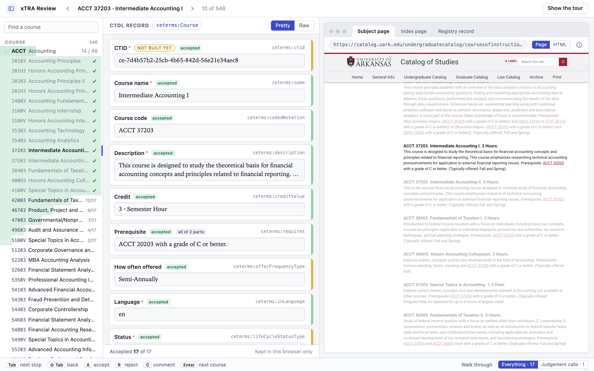

*Figure 4. Fourteen courses dealt with in full, five in part. Each course row fills as its fields are dealt with, and the subject row fills with them.*

| # | Requirement |
|---|---|
| SB1 | Lists every resource under review, grouped by CTDL class. In version 1 that is courses, grouped by subject, and the one organisation the courses refer to (C14). |
| SB2 | A resource that is only referred to, not under review, is listed apart and says so. The organisation links to its Registry record. |
| SB3 | A find box filters courses by code or name. |
| SB4 | **Each course row is a progress bar** (C53): its background fills green from the left in proportion to how many of its fields have been decided, so a half-reviewed course is half filled and a finished one is filled across. A finished course also carries a ✓; one in progress shows the count, as "12/17"; one with rejections shows how many (C24). |
| SB5 | Each subject row carries the same kind of fill, in proportion to the share of all its courses' fields dealt with, and a count of courses done (C24). |
| SB6 | The current course is marked, and its subject is opened and scrolled into view. |

### 9.4 The record, Pretty

One card per field of the record. This is the default view and the one a non-technical reader is expected to
stay in.

| # | Requirement |
|---|---|
| PV1 | Each card shows the field's plain name, its CTDL term, and its value. Nothing else until the card is pointed at or selected. |
| PV2 | The value sits in a box that looks like a text box, in a serif typeface used nowhere else on the screen, so that values are recognisable at a glance without adding any mark (C16). Long values are cut to two lines. |
| PV3 | **Clicking any value that was read from a stored document goes to that place in the source** (C18). This holds even when the value is already selected or another document is showing. If a definition page is open in the browser frame (section 9.8), it closes first (C34). |
| PV4 | Confidence is a colour on the card's right edge: green for high, amber for medium, red for low. The words low, medium and high do not appear on the card (C21). Clicking the edge opens the reasoning, which states the level in words and why. The reasoning grows open and shrinks shut over about a quarter of a second, so the reader sees which card it belongs to (C47); no animation for readers who ask for reduced motion. |
| PV5 | A card's actions appear when it is pointed at or selected, as a row of icons **beneath the value, at the card's bottom right**, in this order: accept, reject, comment, edit, why this value, show in Raw, and undo once something has been changed. The card grows to make room. Nothing in the card's heading moves when the pointer arrives, so the name and the term can be clicked without chasing them (C39). |
| PV6 | The CTID comes first (RG1). The other values not read from the page (`@context`, `@id`, `@type`) come last, under their own heading. |
| PV7 | A card whose value the language model built carries a star. A card with a warning carries a triangle. No other marks (C20). |
| PV9 | **The record shows every field its class allows, not only the ones xTRA filled** (C49). Beneath the proposed fields, under the heading "No proposal from xTRA · 87 more fields CTDL allows", there is one card for every other property CTDL allows on the record's class (for a Course, about a hundred in all), read from the schema copy. Required ones come first, the rest in alphabetical order. The group can be folded, and stays as it was left. |
| PV10 | A blank card has the same form as a proposed one: the field's name, its CTDL term, and a value box. The box is empty, dashed, and says "No proposal". Where a proposed card carries its confidence, a blank card's right edge is **grey**: there is no proposal to be confident about. |
| PV11 | A blank card can be filled in with the same form editor as any other field (section 9.7). A card the reader filled says "added by you", takes the accent colour on its edge, and can be cleared. Its name and term open the field's definition like any other. Blank cards are not stops in the walk and do not count toward a course being done. |
| PV12 | **A small, faint red asterisk follows the name of every field Credential Engine requires on a course**, on proposed and blank cards alike. Pointing at it says why, in words: "Required", or "Required, unless the other is given: Owned By or Offered By". |
| PV8 | A selected card whose value involved the language model, a failed check or a warning shows those without being asked, beneath the value (sections 9.9, 9.10). |

**Confidence** is a rule of thumb about how a value was produced, set by stated rules in the extract step. It
is not a measurement.

| Level | When |
|---|---|
| **High** | Read by a rule from the page with every check passed; or fixed by a design decision |
| **Medium** | Mapped through a table; looked up in an outside record; minted; loses detail; or a requirement kept as its sentence only |
| **Low** | A check failed; the language model proposed it; or only part of a sentence could be written as structure |

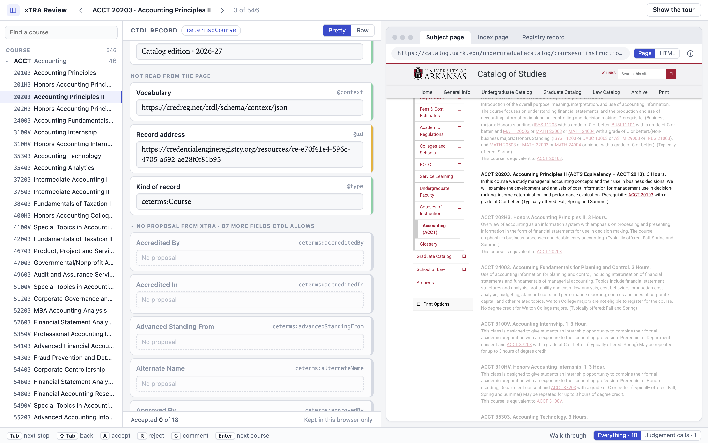

*Figure 5. Below the proposed fields: every other field CTDL allows on a course, blank, with a grey edge.*

### 9.5 The record, Raw

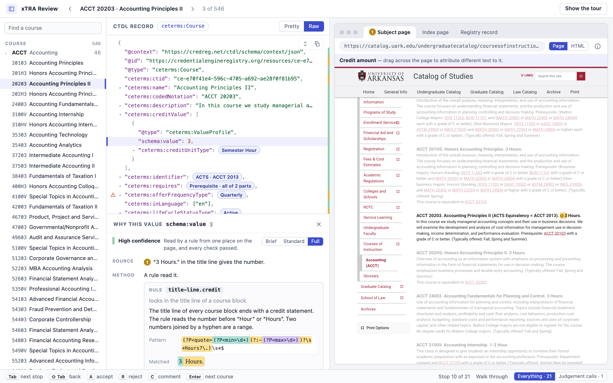

*Figure 6. Raw. One value inside the credit object is selected; its reasoning opens beneath at Full.*

| # | Requirement |
|---|---|
| JP1 | Shows the course's record as JSON-LD. Every value is clickable, and clicking one that was read from a document goes to that place in the source, exactly as in Pretty (C18). |
| JP2 | **Folded** is the default: one line per field. An object is shown as a single labelled chip, for example "3 · Semester Hour" (RC7). Text wrapped by language is shown as the text. |
| JP3 | Clicking a chip unfolds that one object in place. Each object that is an instance of a class folds and unfolds by itself (C8). |
| JP4 | **Unfold all** (⇕) shows the record exactly as written to disk. Pressing it again folds everything (C11). |
| JP5 | **Copy** (⧉) copies the record exactly as written to disk, whatever is folded. It lives inside the Raw view, because it has no meaning in Pretty (C17). |
| JP6 | **Changed.** The margin carries at most one mark per line: a star where the language model built the value, a warning triangle where there is a caution. Each line carries its confidence as a colour on its right edge, as cards do (C20, C21). |
| JP7 | How a value was produced is stated in the reasoning, not as a label on every line (C6). |
| JP8 | **Withdrawn (C37, C48).** The header first showed "✓ valid", which beside the record's heading read as a verdict on the values; it became a neutral count ("CTDL format 8/8"), and was then removed. The viewer shows no summary of the conformance checks. They still run in the extract step (section 5.5), and a failed check still shows on the field it concerns. |
| JP9 | **Withdrawn (C48).** Things on the page with no place in the record (section 6) are still recorded in each course file and in the run report file, but the viewer no longer lists them. |
| JP10 | The reasoning for the selected value opens in a panel beneath the record, at Full by default (PD2). |

**Moving between the two views** (C30)

| # | Requirement |
|---|---|
| SW1 | From a Pretty card, the code icon opens Raw with that field selected, unfolded and in view. Clicking the CTDL term does not: it opens the definition (DF1, C39). |
| SW2 | From Raw, one icon on the line that names a field opens Pretty at that field's card. Lines nested inside a field carry no icon of their own, since they would all lead to the same card (C41); `V` still works from any of them. |
| SW3 | The `V` key does the same from either view, keeping the selected field. |

### 9.6 The walk

The reader's main way through the tool (C9). Unchanged in substance.

| Loop | What it steps through | Keys |
|---|---|---|
| **Outer** | The resources in a run, in order | `Enter` next course · `Shift`+`Enter` previous |
| **Inner** | The **stops** in one resource, in the order shown | `Tab` next stop · `Shift`+`Tab` previous |

A **stop** is one thing a person could agree or disagree with: a value read from a document, or a choice of
class or structure where nothing was read (C10).

| # | Requirement |
|---|---|
| WK1 | Pressing Tab on arrival selects the first stop. Each further press moves to the next and scrolls the source to its evidence. |
| WK2 | The foot of the screen shows where the reader is ("Stop 3 of 18") and the keys. |
| WK3 | The walk can be set to **Everything** or **Judgement calls**. Everything is the default, because rules can be wrong too. |
| WK4 | A **judgement call** is any stop where the language model proposed the value, or a guard or check failed, or the value is flagged as partly structured or losing detail. The set is computed, and the count is shown beside the setting. |
| WK5 | In Pretty each card is one stop. In Raw each folded line is one stop, and unfolding an object adds the stops inside it, including the choice of its class (C8). |
| WK6 | After the last stop of a course, Tab does not wrap around silently. The foot says the course is finished and offers Enter. |
| WK7 | In the judgement-calls setting, Enter goes to the next course that has at least one. |
| WK8 | Clicking remains possible everywhere. Clicking a stop moves the walk to it. |
| WK9 | The address in the browser reflects the course, the stop, the view and the level of detail, so a screen can be bookmarked or sent to someone. |
| WK10 | **Changed.** `A` accepts the stop the reader is standing on, `R` rejects it and `C` comments on it (section 9.7). `Esc` clears the selection and closes whatever is open. Keys do nothing while the reader is typing in a form. |

### 9.7 Accepting, editing, re-attributing

Version 1 was specified as read-only (D18). Eric asked for these during the build and in his second review, so
they are now in scope, with one limit that keeps the original promise: **the record on disk is never changed.**

A reader deals with a field in one of three ways (D26): **accept** it (`A`), **reject** it with a reason
(`R`), or **comment** on it and move on (`C`). Separately, they can **edit** its value, **re-attribute** it
to other words on the page, or **fill in** a field xTRA left blank.

| # | Requirement |
|---|---|
| RV1 | Every field can be **accepted** with one click or the `A` key, and un-accepted the same way. Accepted cards say so. The foot of the record counts "Accepted 12 of 17", and beside it how many were rejected and commented on. |
| RV6 | Every field can be **rejected** with the `R` key or the ✗ icon, in either view (C42). Accepting and rejecting are the two verdicts on a field; giving one withdraws the other. |
| RV7 | **A rejection always comes with a comment** (C57). `R` opens a box headed with the field's name, with the cursor already in it. The field is rejected when a reason is saved, and not before: Enter with the box empty does nothing, and Esc cancels, leaving the field as it was. Shift+Enter starts a new line. The Enter that saves does nothing else: it does not move to the next course. |
| RV8 | A rejected card says "rejected", strikes its value through, and shows the reason beneath the value. Clicking the reason reopens the box; it can be reworded but not emptied. `R` again, or "Undo rejection", withdraws the rejection and its reason. |
| RV10 | **A comment can be left without a verdict** (C57). `C`, or the speech-bubble icon, opens the same box for the selected field, in either view. A saved comment shows beneath the value, and the card says "commented". `C` again reopens it; saving it empty removes it. A comment may also sit on a field that has been accepted. |
| RV11 | **Leaving a comment counts as acknowledging the field.** A field is dealt with when it is accepted, rejected, or commented on, and that is what progress counts everywhere. |
| RV9 | Progress counts fields dealt with, not approvals. A course is done in the sidebar when every field is accepted, rejected or commented on; a course with rejections shows how many (✗1). The foot of the record counts "Rejected 1" and "Commented 1". |
| RV2 | Dragging across text on the source page attributes that text to the selected field, as additional evidence. |
| RV3 | Everything accepted, rejected, edited or re-attributed is kept in the reader's browser only. The screen says "Kept in this browser only". **Changed (C48):** the download went with the menu, so there is at present no way to take a review out of the browser (section 12, question 16). |
| RV4 | An edited card says "edited", shows the new value, and offers undo, which puts the suggested value back. |
| RV5 | Values the system made (`@context`, `@id`, `ceterms:ctid`) cannot be edited, and the edit icon says why. |

**The editor** (C28, C29)

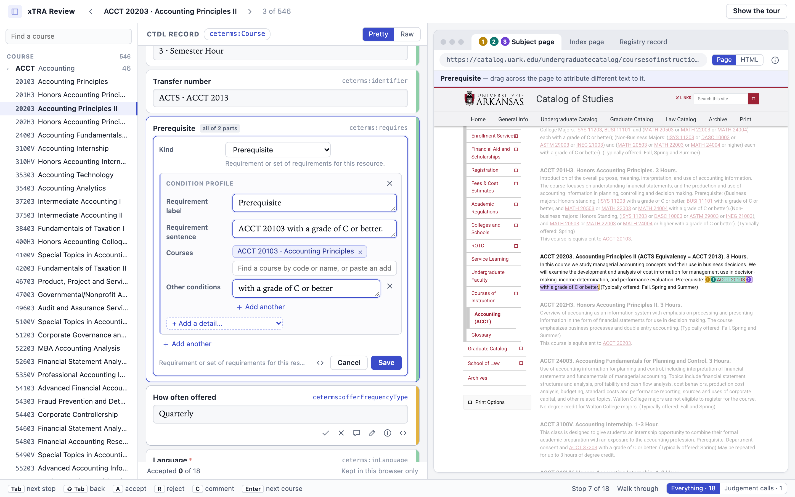

*Figure 7. Editing a prerequisite. No JSON: a kind, a requirement with its sentence, its courses as chips, its
other conditions as rows, and a list of every further detail CTDL allows.*

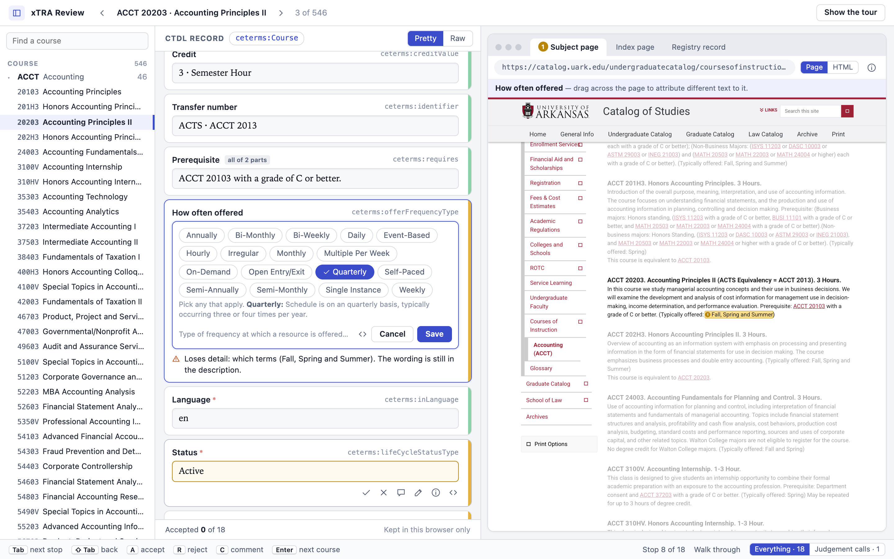

*Figure 8. A field that picks from a fixed CTDL list shows every entry. The chosen entry's definition is
beneath.*

| # | Requirement |
|---|---|
| ED1 | **A person who does not know JSON can make any edit the record allows.** The editor is a form. Raw JSON is available behind one small icon for those who want it, and is never the default. |
| ED2 | The form is built from the CTDL schema copy, not written by hand per field. Each property gets the control its kind of value calls for: text, a number, a date, yes or no, a language, an address, a pick-list, a link to another record, or a nested form for a class written in place. |
| ED3 | **Lists are rows.** A property that can hold several values shows one row per value, each removable, with "Add another" beneath. |
| ED4 | **Fixed lists are respected.** A property whose value comes from a CTDL list shows every entry of that list to pick from. Where CTDL allows several, several can be picked; where it allows one, picking another replaces it. The chosen entry's CTDL definition is shown. |
| ED5 | **The CTDL type can be chosen.** Three places: the record's own class (Course, Learning Opportunity Profile, Learning Program); the kind of a requirement (Requires, Corequisite, Co-Prerequisite, Recommends and the others that hold the same class), which moves the value to that property; and the class of any nested item where CTDL allows more than one. |
| ED6 | Links to other courses are chips. One is added by typing a code or a name and picking from the courses in the run, or by pasting an address. |
| ED7 | Every nested form offers "Add a detail", listing every property CTDL allows there, the commonly used ones first. |
| ED8 | A label that only repeats the kind follows the kind when the kind is changed. A label worded differently is left alone (C29). |
| ED9 | Empty entries are dropped on save. A field CTDL requires on every course cannot be saved empty, and the form says so in words, not by colour alone. |
| ED10 | A card whose value was moved to another property is headed with the new property and says where it came from: "edited · was Prerequisite". |

Patterns taken from Credential Engine's own entry tool, the Publisher (login only; read from its public
guides): a list of kinds to choose the type of condition, pick-lists for fixed lists, "add another" rows for
lists, search-and-pick for linked records with a pasted address as the fallback, and the schema's definition as
help text. Two of its patterns were not copied: saving each panel separately, and having to save a parent
before adding to it.

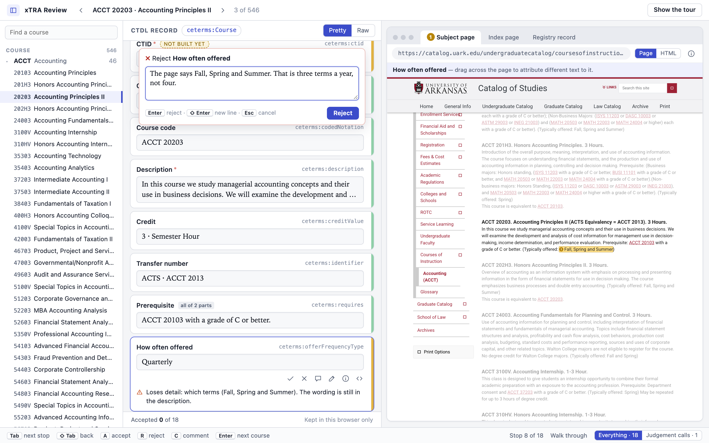

*Figure 9. `R` on "How often offered". The box is open and the cursor is in it. Nothing is rejected until a reason is saved.*

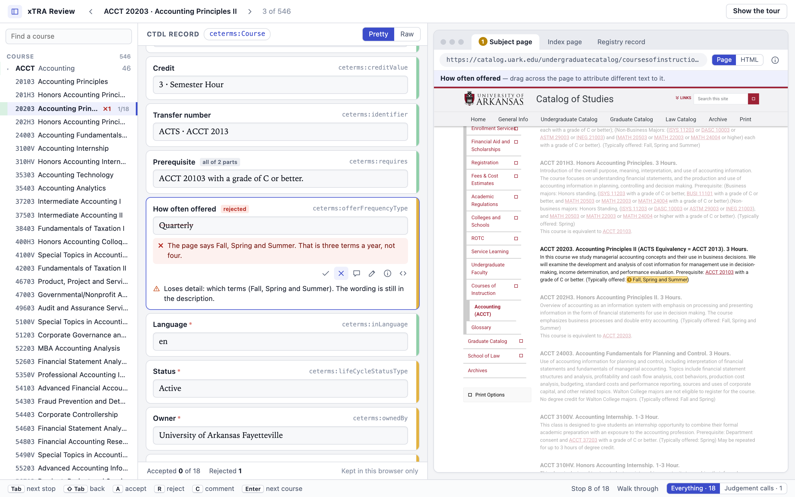

*Figure 10. After Enter. The card, the foot of the record and the sidebar all show the rejection.*

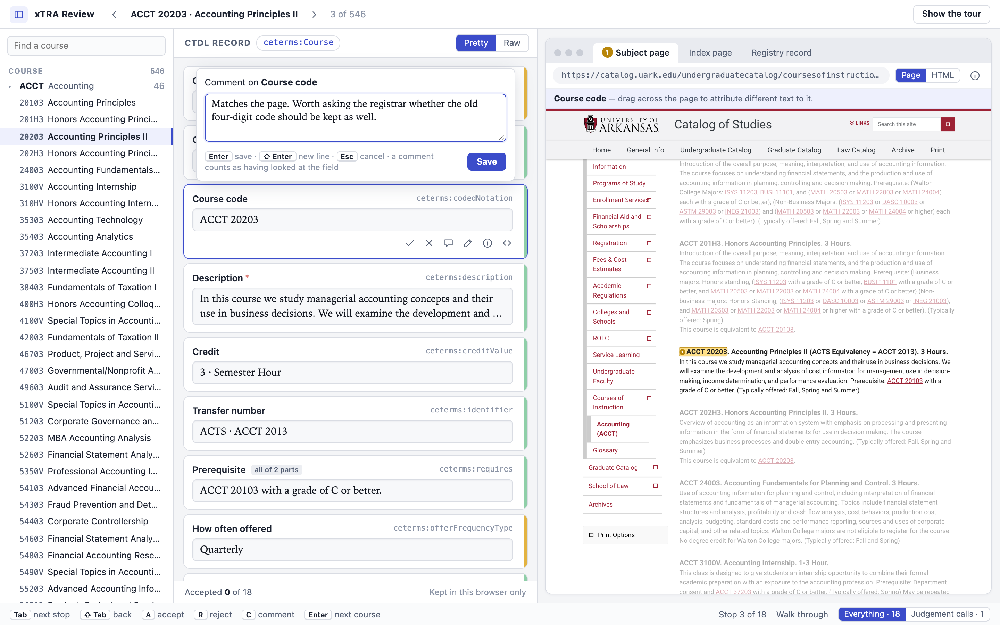

*Figure 11. `C` on "Course code": a comment without a verdict.*

**The CTID field: a place held for a check that is not built** (C44, C58)

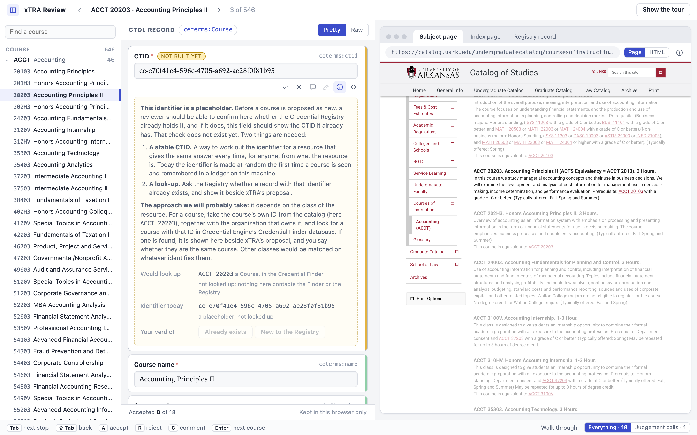

*Figure 12. The CTID field with its detail opened. The two verdict buttons are disabled.*

| # | Requirement |
|---|---|
| RG1 | **The CTID is the first field of the record**, an ordinary card named "CTID" showing the identifier (C58). It replaces both the separate "Already in the Registry?" box of the first build and the identifier card that used to sit last among the fields not read from the page. It carries a yellow callout, **not built yet**, beside its name. |
| RG2 | Clicking the callout, or the card's ⓘ, opens the detail inside the card. It says the identifier is a placeholder; states what is needed (a stable CTID and a look-up; section 5.4); describes the approach we will probably take (by class: for a course, look its course ID up in the Credential Finder database; C56) and names what it would look up for this record; and shows where the reviewer's verdict will go ("Already exists" / "New to the Registry"), disabled. Clicking again closes it. |
| RG3 | It contacts nothing. No request is made to the Registry or the Finder from the viewer or from any step on this field's account. In every other way the card behaves like any field: it can be accepted, rejected or commented on, and it is the first stop of the walk. |

### 9.8 Definitions: every CTDL name is a link

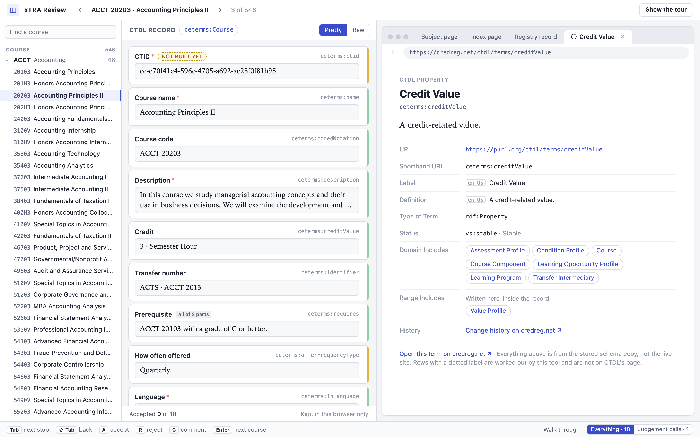

*Figure 13. Clicking a field's name opens its CTDL definition as a tab in the browser frame.*

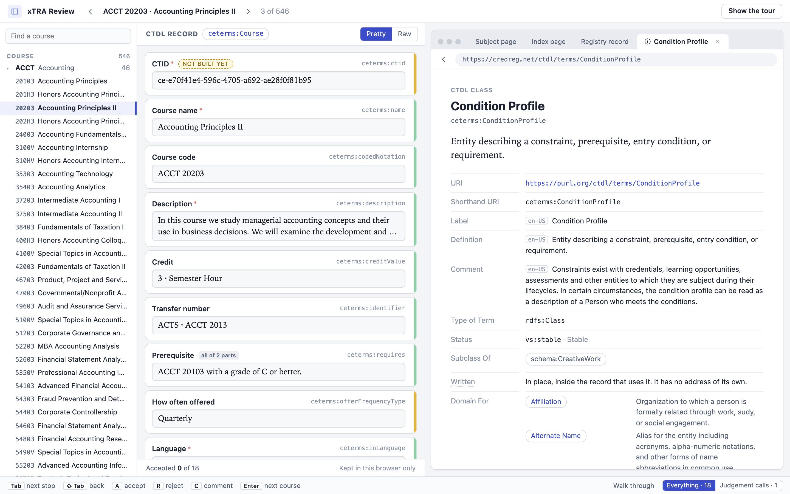

*Figure 14. Following "Condition Profile" from the Prerequisite page. Back returns.*

| # | Requirement |
|---|---|
| DF1 | **Clicking** a field's name opens what CTDL says about it, as a tab in the browser frame. This holds for the plain name and the CTDL term on a Pretty card, any key in Raw, and the record's class in the heading (C31, C36, C39). |
| DF2 | Hovering only underlines the name, to show it can be clicked. Nothing opens on hover (C31). |
| DF3 | The tab stays until the reader closes it: by its ×, by `Esc`, by clicking the name again, by choosing another tab, or by clicking a value to see where it came from (C34). The source page keeps its place underneath. |
| DF4 | **Every CTDL name on a definition page is a link to that name's own page** (C35). Following one adds to a trail; a Back arrow returns. The address bar shows the term's address on credreg.net. |
| DF5 | **A page shows everything the schema copy states about the term**, under the same headings as the term's page on credreg.net: URI, Shorthand URI, Label, Definition, Comment, Usage Note, Type of Term, Status, Domain Includes, Range Includes, and, where the term has them, Subclass Of, Subproperty Of, Equivalent To, Inverse Of, Target Scheme, In Scheme, Broader, Narrower and a link to its change history (C35, second request). Nothing the copy states is left out to save room; long lists show their first entries and the rest on request. |
| DF6 | This holds for **every term in the schema copy**, not only those a course uses: all properties, classes, concept schemes and concepts. So no link on a page leads nowhere. A name from another vocabulary (`schema:Date`) is shown and marked as not a CTDL term. |
| DF7 | Lists of terms carry their definitions where that helps: a class lists the properties it is the domain for, each with its definition, required ones first on Course; a concept scheme lists its concepts with theirs. A term named inside a comment or usage note ("use `ceterms:startDate`") is a link too. |
| DF7b | **A fixed list shows what each entry means, not only its name** (C38). Wherever a list's entries appear (on the list's own page, and on the page of a property that picks from it), each entry is shown with its label, its code, its CTDL definition, and its comment, usage note and broader entry where the copy has them. The entry the current record uses is marked "used in this record". A reviewer can then judge the pick against the alternatives without leaving the page. |
| DF7a | A few rows are worked out by the tool and are marked as not being on CTDL's page: whether a class is written in place or is a record of its own; which properties can hold a class or list; whether Credential Engine requires the property on a course. Range Includes separates classes written inside the record from those pointed to by address. |
| DF7c | **Every heading on a term page is a link to a glossary** that says what the heading means (C40). The headings (URI, Label, Range Includes and the rest) are not CTDL terms: each stands for a property Credential Engine took from another vocabulary (RDF Schema, SKOS, OWL, Dublin Core, VANN, schema.org) or made for managing its own schema (`meta:`). So the glossary is written for this tool and says so. For each heading it gives a plain explanation, the property it stands for and whose it is, that property's address, and the CTDL handbook's own words where the handbook says anything. Back returns to the term. |
| DF7d | Every address on a definition page is a link that opens in a new tab: the term's URI, the address bar, and any address inside a comment or usage note (C40). |
| DF8 | Keys that are JSON-LD and not CTDL (`@context`, `@id`, `@type`, language tags) get a page that says so plainly, so that our words are never mistaken for a CTDL definition. |
| DF9 | Every definition is quoted from the stored schema copy, and the page says so. A link opens the live term page for anyone who wants it (R1). |

### 9.9 "Why this value"

The reasoning behind one value. In Pretty it opens inside the card. In Raw it is the panel beneath the record.

**It is a structured answer, not an essay** (C19). The same labelled rows, in the same order, every time:

| Row | What it holds |
|---|---|
| **Confidence** | The level in words, and one sentence saying why |
| **Source** | Each piece of evidence, numbered to match its highlight. Clicking one goes to it. |
| **Method** | How the value was produced. For a rule or a table: its card (below). |
| **Language model** | Only where it was involved: what it answered (section 9.10) |
| **Structure** | For a requirement read by the parser: the tree |
| **Caution** | Failed checks and warnings. Never folded away. |
| **CTDL** | What CTDL says the field is for, quoted, and why this field was chosen |

Beneath the rows, sections that open at Standard (what CTDL says in full; the alternatives considered) and at
Full (evidence with exact positions and digests; every check).

**Rules are shown, not mentioned** (C32)

*Figure 15. "How often offered". The rule's card and the table's card. The pointer is on the pattern, and the
page shows everything the pattern matched.*

"A rule read it" is not an explanation. Wherever a rule or a table produced a value, the Method row shows:

| # | Requirement |
|---|---|
| RL1 | **An identifier.** Every rule and every table has a stable name, shown in the card: `title-line.credit`, `offer-frequency`. |
| RL2 | **A plain description** of what it does, in a sentence or two a novice can follow, and where it looks ("the title line of a course block"). |
| RL3 | **The code.** For a rule, its pattern, exactly as it is run. |
| RL4 | **A picture of it working.** Each named part of the pattern has a colour. The text the pattern matched on this page is shown with the same colours on the same parts, and each part is listed with what it captured. |
| RL5 | **Hovering the pattern lights up on the page everything it matched**; hovering a part lights up only that part. Clicking the pattern goes there. |
| RL6 | For a table: the row that was used, what it turned into, and the reason recorded for that row. |
| RL7 | To make RL4 and RL5 possible, the extract step records, with each piece of evidence a rule produced, the whole match and the position of every named part (section 8.1). |

**A failed check says exactly what was wrong** (C19, C25)

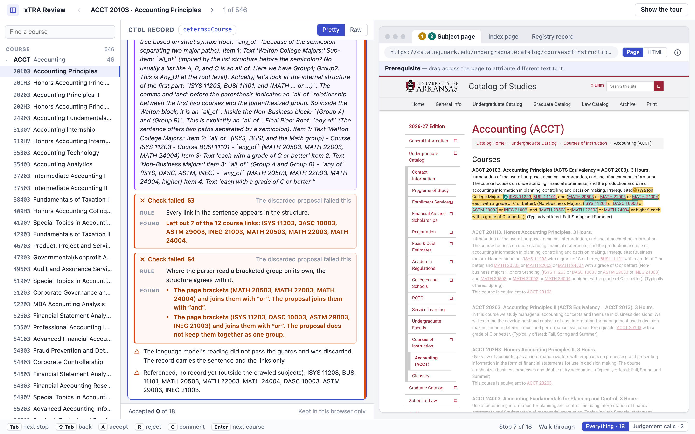

*Figure 16. Two guards failed. Each box gives the rule and what was found, down to the course codes.*

| # | Requirement |
|---|---|
| FC1 | A failed check is a box of its own with the check's identifier, and two labelled parts that cannot be confused: **Rule** (what should hold) and **Found** (what was there). |
| FC2 | **Found is specific.** If entries are missing, it names them: "Left out 7 of the 12 course links: ISYS 11203, DASC 10003, …". If a group was joined wrongly, it quotes the group and both joining words. If a quote is not in the sentence, it gives the quote. "The proposal failed" is never the whole message. |
| FC3 | Several findings under one check are a list, one per line. |

| # | Requirement (kept from the first version) |
|---|---|
| WH2 | Every CTDL definition is a quotation, never a paraphrase, and states the date of the schema copy where shown in full (R1). |
| WH3 | For a pick-from-a-list field, the chosen value's own definition is shown, and the other members are one click away. |
| WH5 | Warnings are never folded away. The closed "Checks" section shows its count, including what did not pass. |
| WH6 | Words a novice may not know link to a one-paragraph explanation with an example. |
| WH7 | For a prerequisite, pointing at any part of the structure lights up only its words in the source. |

### 9.10 What the language model said

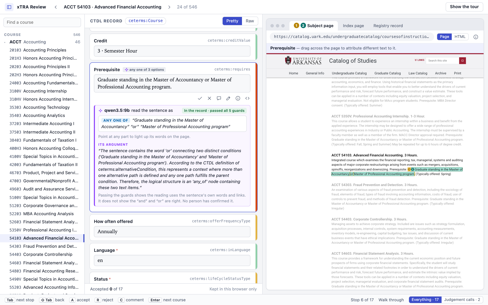

*Figure 17. A requirement the language model read, kept because it passed every guard.*

The output of the language model must be impossible to mistake for anything a rule produced (C26).

| # | Requirement |
|---|---|
| LM1 | Everything the language model answered sits in one box, in a colour used for nothing else, headed with the language model's name and a star. |
| LM2 | The box states the verdict first: "In the record · passed all 5 guards", or "Not in the record · failed G3, G4". |
| LM3 | It shows the reading itself as a tree, whether kept or refused. A refused reading is shown exactly as the language model wrote it. |
| LM4 | It shows the language model's own argument, as a quotation, labelled as its argument. |
| LM5 | A kept reading carries, at every level of detail: passing the guards shows the reading uses the sentence's own words and links; it does not show that "and" and "or" are right; no person has confirmed it (R3). *(Was WH4.)* |
| LM6 | A refused reading is followed by the failed checks (FC1 to FC3) and a plain statement that the record carries the sentence and the links only. |

### 9.11 The source

**The browser frame**

| # | Requirement |
|---|---|
| DC1 | **Changed.** The source is framed as a browser window. Every document that contributed to the course is a tab, by a short plain name: "Subject page", "Index page", "Registry record". The row is always complete. |
| DC2 | When a stop is selected, the tabs of the documents it draws on gain the numbers of their evidence. |
| DC3 | Clicking a tab shows that document, whether or not the current stop uses it. |
| DC4 | When a stop draws on a second document, a short excerpt of it appears beneath the frame, with its highlight. "Open" swaps it in. |
| DC5 | With three or more documents, excerpts stack up to two; the rest are reached from the tabs. |
| DC6 | The address bar shows the shown document's address. When the document's own address is the evidence, the bar is highlighted. |

**The page**

| # | Requirement |
|---|---|
| SP1 | Shows the stored copy of the document, not the live site. It works with the internet off, apart from styling (D13). |
| SP2 | Looks as close to the original as the stylesheets allow. All scripts are removed. The page's own styles cannot affect the rest of the viewer. |
| SP3 | When a stop is selected, scrolls so that its first piece of evidence is in view and highlights every piece, each with its number. The place asked for flashes once. The scroll is corrected if the page's layout settles late. |
| SP4 | Courses other than the current one are dimmed. |
| SP5 | Clicking a highlight selects the stop it belongs to. |
| SP6 | Colour is never the only signal. Highlights are numbered. |
| SP7 | A **Page / HTML** switch (RC19). |
| SP8 | **Withdrawn (C48).** The Coverage option went with the menu. |
| SP9 | A line above the page names the selected field and, on a rendered page, says that dragging across text attributes it (RV2). |

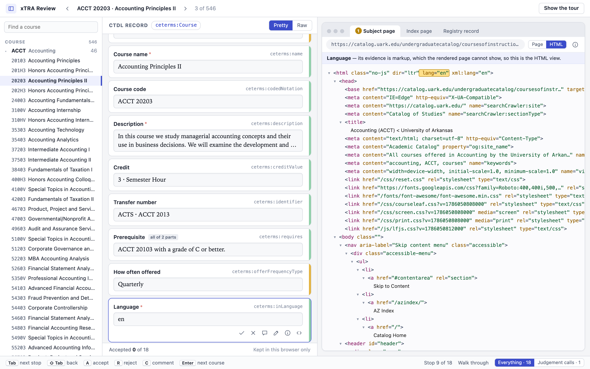

*Figure 18. `ceterms:inLanguage` is evidenced by an attribute, which the rendered page cannot show.*

| # | Requirement |
|---|---|
| HV1 | The HTML view shows the stored page as a tree of elements that can be folded. |
| HV2 | **Changed.** The tree opens **fully expanded** (C27), scrolled to the element holding the evidence, with the exact attribute or text highlighted. |
| HV3 | It works for every stop, not only markup evidence: a text segment is highlighted in the tree too. |
| HV4 | When a stop's only evidence is markup, the viewer switches to the HTML view by itself and says why in one line. |

### 9.12 Course list and run report

**Withdrawn (C48).** This screen was reached only from the menu and was removed with it. The sidebar
(section 9.3) is now the list of courses. The extract step still writes the run report as a file
(`data/out/run-report.json`: what each rule matched and missed, what was left out, unrecognised labels), so
the figures of requirements RR1 to RR5 still exist; the viewer does not show them.

### 9.13 On every page load: a nine-step tour

Every time the viewer is opened or reloaded, it walks the reader through what they are looking at and what they are
there to do (C43). It is the one exception to "start bare". It was first shown on the first visit only; it now opens
every time, so that nobody shown the mockup misses it (C60).

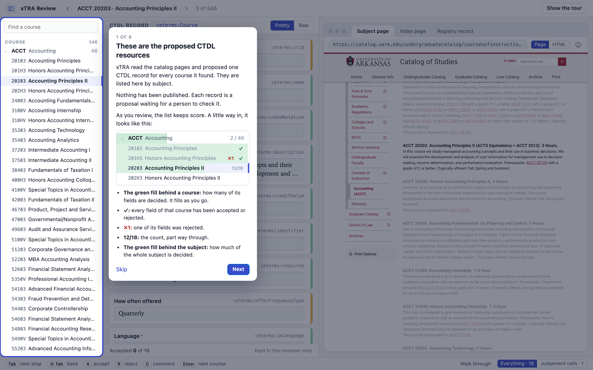

*Figure 19. Step 1. The sidebar is lit, with an example of it part way through a review.*

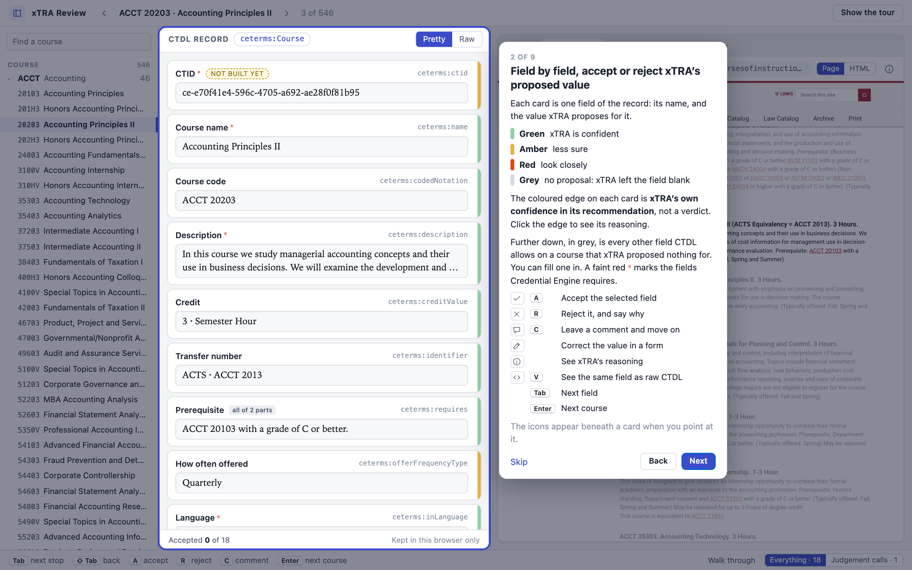

*Figure 20. Step 2. What the colours mean, and each action with its icon and its key.*

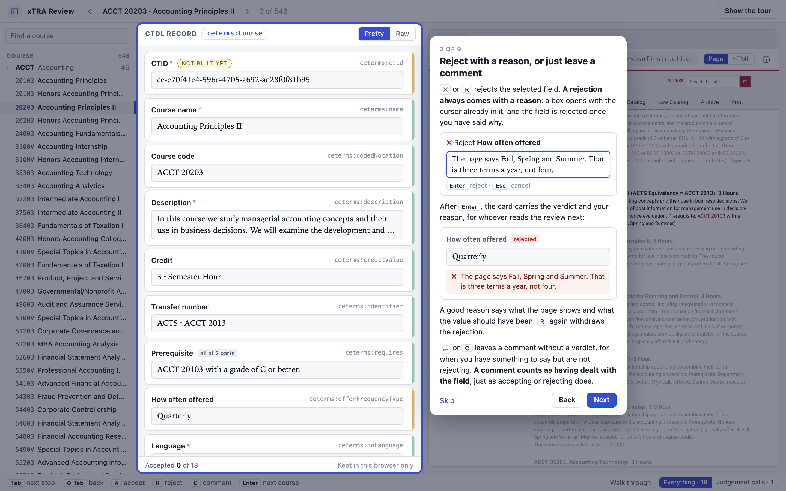

*Figure 21. Step 3. An example of rejecting a field and saying why.*

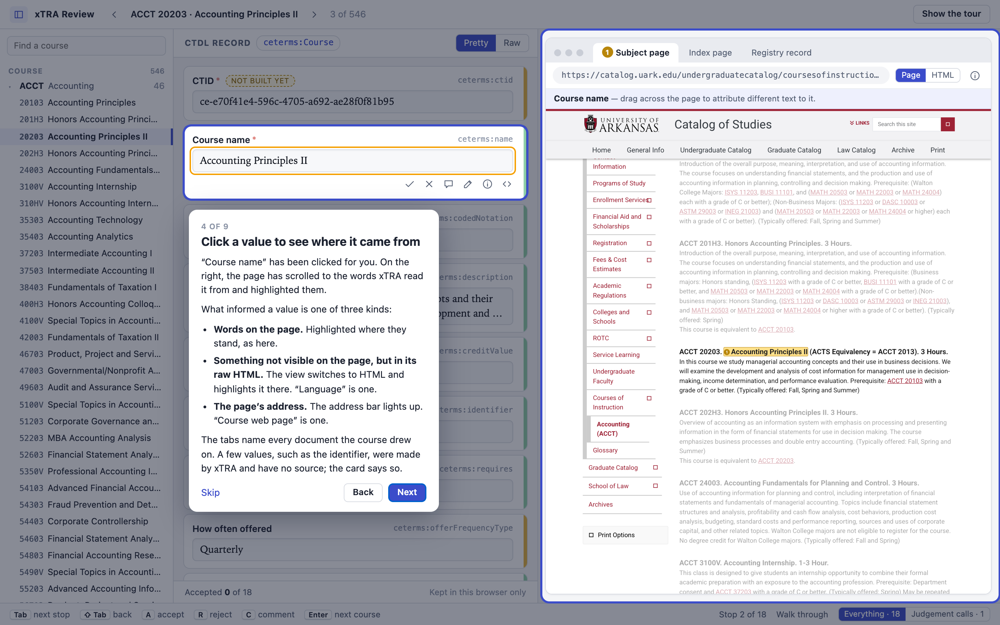

*Figure 22. Step 4. The example card and the source are both lit; the value that was clicked is ringed.*

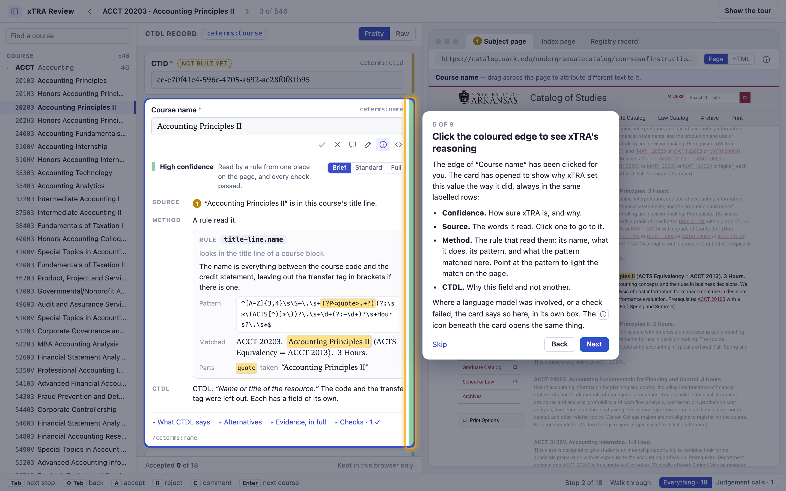

*Figure 23. Step 5. The card's coloured edge is ringed and the card has opened to show xTRA's reasoning.*

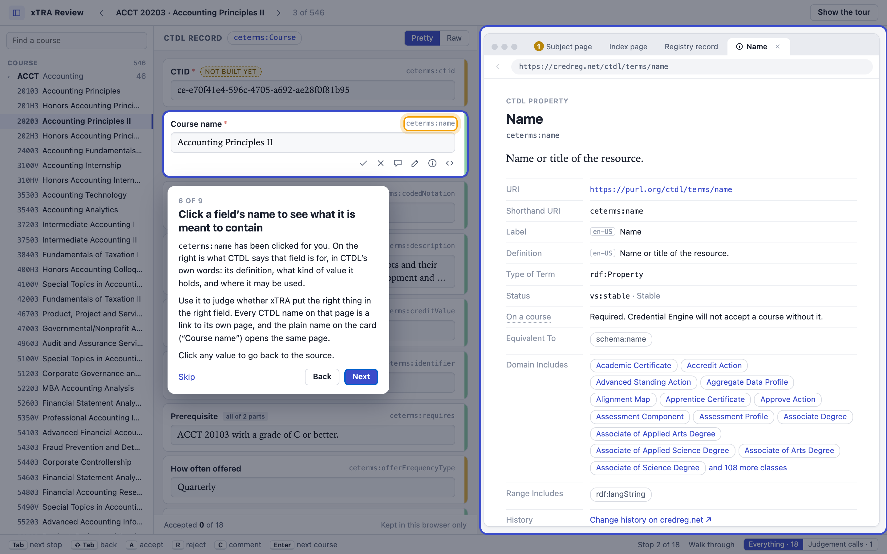

*Figure 24. Step 6. The field's CTDL name is ringed, and its definition is open on the right.*

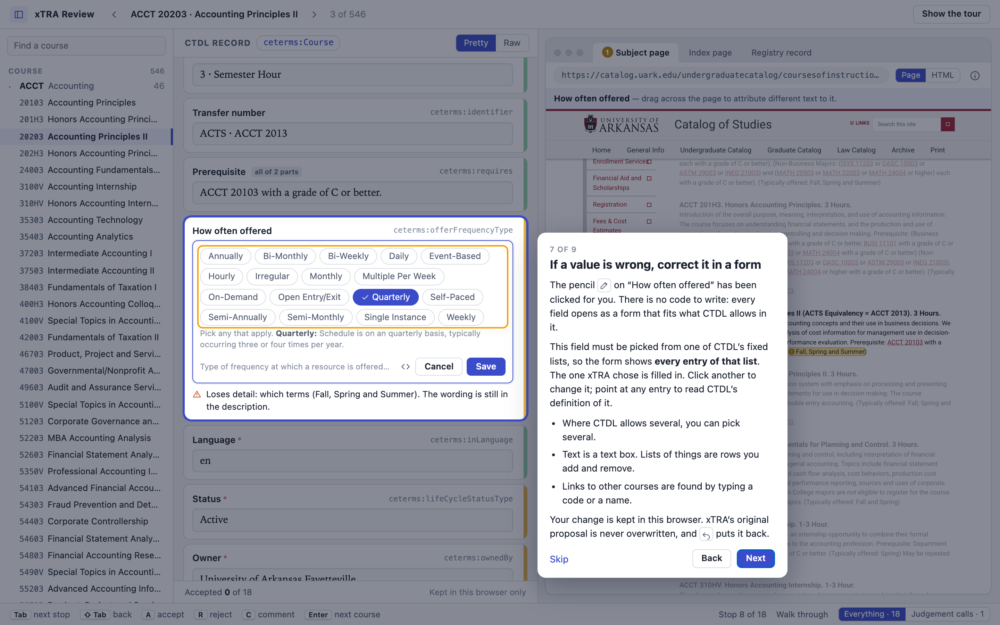

*Figure 25. Step 7. The form editor, opened on a field that picks from a fixed list.*

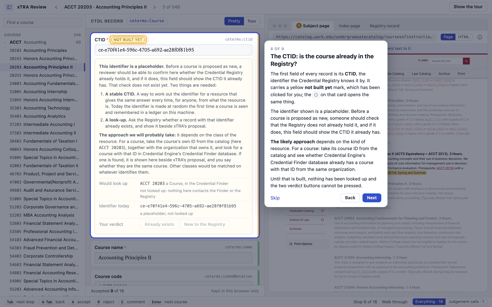

*Figure 26. Step 8. The CTID field, its callout ringed and its detail opened by the tour.*

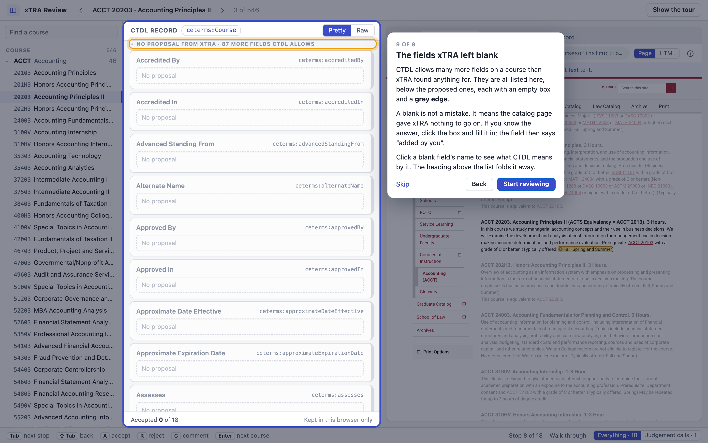

*Figure 27. Step 9. The record scrolled to the fields xTRA proposed nothing for.*

| Step | Lights up | Says |
|---|---|---|
| 1 | The sidebar | These are the proposed CTDL resources after running xTRA: one record per course found. Nothing is published; each is a proposal waiting to be checked. **It shows what the list will look like part way through a review** (C52): a small sidebar drawn with the real rows, with a finished course, one with a rejection, one part done and one untouched, the subject's progress fill, and a key to each mark. |
| 2 | The record | Field by field, accept or reject xTRA's proposed value. **Each action is shown with the same icon the card uses and its key** (C55): ✓ `A` accept, ✗ `R` reject, the speech bubble `C` comment, the pencil to edit, ⓘ for the reasoning, `<>` `V` for Raw, Tab and Enter to move on. **The green, amber and red edge on each card is xTRA's own confidence in its recommendation, not a verdict.** Grey is no proposal: the blank fields further down, which the reader may fill in. A faint red asterisk marks required fields. `A` accepts, `R` rejects and asks why, Tab and Enter move on. |
| 3 | The record | **Reject with a reason, or just leave a comment.** The ✗ icon or `R` rejects the selected field; a rejection always comes with a reason, so a box opens with the cursor in it. It also says that the speech-bubble icon or `C` leaves a comment without a verdict, and that a comment counts as having dealt with the field (C57). The step shows an example, drawn with the real box and the real card: a reason being typed ("The page says Fall, Spring and Summer. That is three terms a year, not four."), and the rejected card carrying that reason afterwards. It says what makes a good reason: what the page shows, and what the value should have been (C55). |
| 4 | One example card, and the source | **Click a value to see where it came from.** "Course name" has been clicked: the page has scrolled to the words it was read from. What informed a value is one of three kinds: words on the page, highlighted where they stand; something not visible on the page but present in its raw HTML, shown in the HTML view; or the page's address, shown in the address bar. |
| 5 | The same card, opened | **Click the coloured edge to see xTRA's reasoning.** The edge of "Course name" has been clicked: the card shows why xTRA set the value the way it did, in its labelled rows. Confidence: how sure, and why. Source: the words it read. Method: the rule, with its name, description, pattern and what it matched. CTDL: why this field. Where a language model was involved or a check failed, it says so there. |
| 6 | The same card, and the source | **Click a field's name to see what it is meant to contain.** `ceterms:name` has been clicked: the right side shows what CTDL says the field is for. Use it to judge whether xTRA put the right thing in the right field. |
| 7 | The "How often offered" card, with its editor open | **If a value is wrong, correct it in a form.** The pencil has been clicked: the field picks from one of CTDL's fixed lists, so the form shows every entry of that list with xTRA's choice filled in. No code to write. Where CTDL allows several, several can be picked; text is a text box; lists are rows; links to courses are found by typing. The change stays in the browser and xTRA's proposal can be put back with one click. |
| 8 | The CTID card, with its detail opened | **The CTID: is the course already in the Registry?** The first field of every record is its CTID, with a yellow "not built yet" mark. The tour clicks the mark; the card's ⓘ opens the same thing. The identifier is a placeholder. Before a course is proposed as new someone should check the Registry does not already hold it, and if it does, this field should show the CTID it already has. The likely approach: by kind of resource, and for a course, look its course ID up in the Credential Finder. Until then nothing has been looked up and the verdict buttons cannot be pressed (C58). |
| 9 | The record, scrolled to the blank fields | **The fields xTRA left blank.** Every other field CTDL allows on a course is listed below the proposed ones, with an empty box and a grey edge. A blank is not a mistake: the page gave xTRA nothing to go on. The reader can fill one in, or click its name to see what CTDL means by it. |

| # | Requirement |
|---|---|
| OB1 | The tour shows on every page load. Nothing records whether it was seen (C60). |
| OB2 | It can be shown again at any time with the **Show the tour** button in the top bar. |
| OB3 | Each step lights one area and dims the rest, with a card beside the area: a count ("2 of 3"), a heading, a few sentences, and Back, Next and Skip. The last step's button reads "Start reviewing". |
| OB4 | Enter or → goes on, ← goes back, Esc skips. While the tour is open no other key does anything. |
| OB5 | Step 1 shows the sidebar even if it had been hidden. |
| OB6 | Steps 4, 5 and 6 are demonstrations, not descriptions. The tour performs the click itself on one example field ("Course name"), so the real result is on screen: the highlight on the page in step 4, the opened reasoning in step 5, the definition page in step 6. |
| OB6a | In those steps the example card is lit along with the source, so it is plain which field is being demonstrated, and the exact thing that was clicked (the value, then the coloured edge, then the CTDL name) carries a pulsing ring (C45, C46). The tour's card sits beneath the example card, covering neither. |
| OB6c | Steps 7 to 9 set the screen up as well: step 7 opens the editor on a field that picks from a fixed list and rings the choices (C54), step 8 opens the CTID field's detail, step 9 unfolds the blank fields if they were folded and scrolls to them. Moving on puts back what the tour changed (C51). |
| OB6b | Leaving the tour closes the reasoning and the definition page and leaves the reader on the record. |
| OB8 | Wherever the tour names an action it shows the icon the reader will find on the card, beside its key if it has one, so the tour and the screen use one vocabulary. Illustrations inside the tour (the sidebar in step 1, the reject box and rejected card in step 3) are drawn with the viewer's own components, not pictures of them (C52, C55). |
| OB7 | The tour states what the colours mean in the same words wherever they are explained: confidence is xTRA's, and is not a verdict on the value. |

---

## 10. Acceptance criteria

Version 1 is done when all of these hold.

**Crawl**

- [ ] A first run over the five subjects stores the index page, five subject pages, `robots.txt` and the
      Registry record, each with a sidecar.
- [ ] A second run makes no requests at all.
- [ ] No request is ever made to an address `robots.txt` disallows.

**Extract**

- [ ] Run with the internet off, it completes.
- [ ] It writes 546 course records: ACCT 46, CHEM 86, CSCE 98, ENGL 171, NURS 145.
- [ ] Every record passes checks V1 to V8, or the failure is listed in the run report.
- [ ] Every value in every record has a provenance entry.
- [ ] For every text segment, the text at the stored position equals the stored quote.
- [ ] All 546 title lines match; any that do not are listed by name.
- [ ] Every prerequisite, corequisite and pre-or-corequisite sentence is kept word for word, whatever happened
      to its structure.
- [ ] No structure in the output names a course that is not a link in its sentence, or omits one that is.
- [ ] Running it again changes no CTID.
- [ ] Replacing the language model with a stand-in that returns nonsense yields the same records, except that
      the structures it would have built fall back to text. Nothing else changes and nothing crashes.

**Viewer**

*Layout and first screen*

- [ ] Opening ACCT 20203 shows the sidebar, one card per field, and the page, with nothing highlighted and no
      explanation.
- [ ] The sidebar hides and shows with a slide, and stays as it was left after a reload.
- [ ] The record's views are named Pretty and Raw. The copy icon appears only in Raw.
- [ ] The top bar reads "xTRA Review" and has one button, "Show the tour". There is no menu, no
      "Not published" notice and no count of format checks.

*Going to the source*

- [ ] In Pretty and in Raw, clicking any value that was read from a document scrolls the source to it and
      highlights it, including when it is on another document and when a definition tab is open.
- [ ] Selecting `ceterms:creditValue` numbers two tabs and shows an excerpt of the second document.
- [ ] Selecting `ceterms:inLanguage` shows the HTML view, fully expanded, with the attribute highlighted.
- [ ] Selecting `ceterms:ctid` says there is no source and that the identifier is a placeholder.
- [ ] Clicking a highlight in the source selects its stop.
- [ ] With the internet off, the viewer still works; only the catalog's styling degrades.
- [ ] "Open original at this text" opens the live page scrolled to the phrase, in current Chrome, Safari and
      Firefox. (Untested so far, R7.)

*The walk and review*

- [ ] Pressing Tab repeatedly visits every stop in order. Set to judgement calls, Tab visits only those, and
      Enter skips courses that have none.
- [ ] `A` accepts the selected field, and the course's row in the sidebar fills a little further. When every
      field of a course is accepted, rejected or commented on, its row is filled across and ticked, and its
      subject's row has filled in proportion.
- [ ] After a reload, everything accepted or edited is still there. No file under `data/` has changed.
- [ ] `R` on a selected field opens a box with the cursor in it. Enter with the box empty does not reject;
      Esc leaves the field as it was. Typing a reason and pressing Enter leaves the reader on the same
      course, with the card marked rejected and the reason beneath its value.
- [ ] `C` on a selected field opens the box; a saved comment shows beneath the value, the card says
      "commented", and the course's count in the sidebar goes up by one.
- [ ] In a browser that has never opened the viewer, the nine-step tour shows. Its first step shows a small example of the sidebar part way through a review. Its second step lists each action with its icon and key; its third shows
      an example reason for a rejection; its fourth shows a highlight on the page for "Course name"; its fifth
      opens that card's reasoning, with the rule `title-line.name`; its sixth shows the definition of
      `ceterms:name`; its seventh opens the form editor on "How often offered" with every entry of its list;
      its eighth opens the CTID field's detail; its ninth shows the blank fields. In steps four to six, the "Course name" card is lit, not dimmed.
      skipped, a reload does not show it again; the "Show the tour" button does.
- [ ] The tour's second step says the coloured edges are xTRA's own confidence.
- [ ] Resting the pointer on the ✗ icon of a card for a second shows "Reject, and say why" with the key `R`.
      Passing over it quickly shows nothing.
- [ ] The first card of every record is "CTID", with a "not built yet" callout. Clicking the callout, or the
      card's ⓘ, opens the detail; its two verdict buttons cannot be pressed. There is no other CTID card.

*Reasoning*

- [ ] Below the proposed fields of ACCT 20203 there are 87 blank cards, each with a grey right edge. Clicking
      "Alternate Name", typing a name and saving shows it as "added by you".
- [ ] Course name, Description, Language, Status, Owner, Offered by and the identifier carry a faint red asterisk.
- [ ] No card shows the words low, medium or high. Every card and every Raw line has a coloured right edge.
- [ ] The reasoning for `ceterms:creditValue` shows a card for the rule `title-line.credit` with its
      description, its pattern, the matched text "3 Hours." and its named parts. Pointing at the pattern
      highlights "3 Hours." on the page.
- [ ] The reasoning for `ceterms:offerFrequencyType` also shows the table `offer-frequency` and the row used.
- [ ] No value's Method consists only of the words "A rule read it".
- [ ] On ACCT 20103, the prerequisite shows the language model's refused reading in its own box, and the
      failed guard G3 names the course links that were left out.
- [ ] A reading by the language model that was kept says that no person has confirmed it, at Brief.
- [ ] Raw opens its reasoning at Full; Pretty at Brief. Each survives moving to another course and reloading.

*Editing*

- [ ] A prerequisite can be changed to a corequisite, given a second course and a second condition, and saved,
      without the reader seeing or typing any JSON. The card then reads "edited · was Prerequisite".
- [ ] Editing `ceterms:offerFrequencyType` shows every entry of the CTDL list.
- [ ] Emptying `ceterms:name` and saving is refused, with the reason in words.
- [ ] Undo puts the suggested value back.

*Definitions and moving about*

- [ ] Hovering a field name underlines it and opens nothing. Clicking it opens its CTDL definition as a tab.
- [ ] From the Credit page, clicking "Value Profile" opens that class's page; Back returns.
- [ ] The page for `ceterms:approximateStartDate` shows its URI, Comment, Usage Note, Type of Term, Status
      (`vs:unstable`), all 17 classes of Domain Includes and `schema:Date` as its range.
- [ ] Clicking `ceterms:Course` in the heading opens the Course page.
- [ ] From a Pretty card, one click opens Raw at the same field, unfolded; from a Raw line, one click opens
      Pretty at its card. `V` does both.

---

## 11. Not in version 1

| Left out | Where it is recorded |
|---|---|
| Publishing to the Registry, in any form | R2. Never, not merely later. |
| Writing a reader's verdicts and corrections anywhere but their own browser: no shared store, no sign-off by name, no change to the records on disk | D21. Section 9.7 has what is in. |
| A stable CTID and a check of whether a course is already in the Registry. The CTID field holds the place for it | Section 5.4; RG1 to RG3; R16 |
| Taking a review out of the browser: download, export, or sharing with another reviewer | RV3; section 12, question 16 |
| A screen for the run as a whole (the run report), the list of what was left out of a record, the coverage tint | Section 9.12; JP9; SP8. The data is still written by the extract step |
| Showing a reader's edits in the Raw view, which still shows the record on disk | Section 12, question 11 |
| A rule card for values that no pattern produced: the prerequisite parser, the guards, lookups and fixed values still explain themselves in a sentence | Section 12, question 12 |
| Highlighting a rule's match when it is in the page's markup, or on a document that is not showing | Section 9.9, RL5 |
| Showing which of Credential Engine's recommended fields a course lacks | Section 12, question 13 |
| Measuring how good the rules or the language model are against a hand-checked set | Risks document, "Evaluation" |
| The other 163 subjects | The crawl can do it; the run is not part of version 1 |
| Other catalog sites; sites needing a browser or login | R5 |
| Extracting from PDFs and images (they are stored, not read) | Risks document, "Beyond this site" |
| Course level, lecture and laboratory hours | Section 6 |
| A decision on new CTIDs per catalog edition | R9 |
| Refreshing the CTDL schema copy from the live site | R1 |

---

## 12. Questions for Eric

Nothing here blocks the plan; each has a default that the plan will follow unless you say otherwise.

**New, from the second review (2026-10-08)**

17. **Blank fields, open or folded (C49).** The 87 blank fields are open by default, which makes the record
    long. Should they start folded, or show a shorter recommended set first?
18. **What the sidebar bar counts (C53).** You asked for the bar to show fields accepted. It shows fields
    dealt with (accepted, rejected or commented on), to agree with when a course gets its tick. Say if it
    should be accepted only.
19. **The Credential Finder look-up (C56).** Is there an interface to the Finder we are permitted to query by
    owner and course code, and at what rate? Nothing has been asked of it so far.

16. **What went with the menu (C48).** Removing it also removed the only way to reach five things: the
    run report screen, the list of what was on the page but left out of the record, the coverage tint, the
    glossary panel, and the download of a review. The last matters most: a review now cannot leave the
    browser it was made in. Say if any of these should come back, and where.

10. **"Full" in C33.** I took it to mean the Brief / Standard / Full switch on the reasoning, and made Raw
    open at Full. If you meant that Raw should open with every object unfolded, that is the other switch (JP4).
11. **Edits in Raw.** An edited value shows in Pretty, but Raw still shows the record on disk. Should Raw
    show the edited record, the original, or offer both?
12. **Rules that are not patterns (C32).** The prerequisite parser, the five guards, the lookups and the
    fixed values have identifiers and plain descriptions, but no card with code and a picture, because they
    are not regular expressions. Do you want the same treatment for them, in whatever form fits each?
13. **Credential Engine's benchmark.** Their policy lists six required Course fields, which every record
    has, and a longer list of recommended ones. Should the viewer show which recommended fields a course lacks?
14. **The requirement label (C29).** It is kept as its own field and follows the kind unless reworded. The
    alternative is to hide it until someone wants to reword it.
15. **A reading that passed the guards but looks wrong.** For ACCT 51203 the language model's kept reading
    treats the word "or" as a condition of its own. The guards cannot catch that. It is the case R3 warns of;
    worth a look when you review the guards.

**From the first revision**

1. **What you meant in C8.** I built both readings: each class instance folds and unfolds by itself, and the
   choice of class is a stop in the walk. Was it one of those, or something else?
2. ~~**Verdicts (D18).**~~ Answered: accept, reject, comment, edit and re-attribute are in (D21, D26).
3. ~~**The margin (C6).**~~ Answered: icons and a coloured edge (C20, C21).

**Still open from the first draft** (you chose not to answer these yet)

4. **Description (D3).** Whole paragraph, or prose only? The whole paragraph loses nothing but repeats the
   prerequisite sentence, which also appears under `requires`.
5. **Owner (D5).** Both `ownedBy` and `offeredBy`, or `ownedBy` alone as nearly all publishers do?
6. **CTIDs and editions (D6).** One CTID per course across catalog years is the default. You wanted to ask
   Credential Engine (RC8); the ledger can be re-keyed later, but links minted in between would change.
7. **Courses outside the crawl (D8).** Is minting a placeholder CTID for a course we have only seen named
   acceptable, given that nothing is published?
8. **Identifier addresses (D14).** Registry-form addresses with a placeholder label, or addresses that are
   visibly not real?
9. **The limit in section 7.4.** My reading is that one ConditionProfile holds one set of choices. If Credential
   Engine has an example of two sets of choices in one requirement, the "partly structured" case may disappear.
   Worth adding to the questions for them alongside RC8. Recorded as R13.
